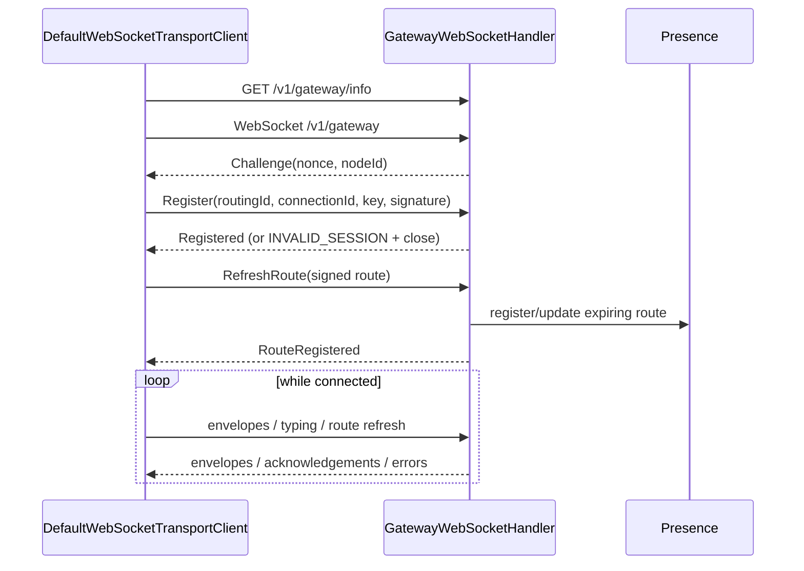

# WebSocket protocol overview

Clients connect to a selected verified Community Node at `/v1/gateway`.



## Session sign-in (challenge-response)

A routing ID is only accepted from the holder of its signing key:

1. Right after the WebSocket opens the gateway sends `challenge` with a fresh 32-byte `nonce` (`SecureRandom`, one per connection) and its own `nodeId`.
2. The client waits for it (10 s, `DefaultWebSocketTransportClient.awaitChallenge`; a timeout or any other first frame fails the attempt and the connection manager retries). It refuses a challenge whose `nodeId` is not the node it picked from the signed directory (`NodeEndpoint.nodeId`), then signs with its identity signing key (the same key that signs presence routes, `CreateGatewaySessionProofUseCase`).
3. The client sends `register` with `routingId`, `connectionId`, `clientSigningPublicKey` and `clientSignature`. All four are required; there is no unsigned registration.
4. The gateway (`GatewaySessionValidator`, `ProtocolSignatures.verifyGatewaySession`) requires a device (not bootstrap) routing ID, `ClientRoutingIds.matchesSigningPublicKey(routingId, key)` and a valid Ed25519 signature over this connection's nonce and its own node ID. The nonce is used up by the first `register`. On any failure it sends `error` with code `INVALID_SESSION` and closes the socket; the connection is never registered and no pending envelope is delivered.
5. Before sign-in only `register` is accepted. Any other frame (another message type, an undecodable frame such as a `register` without proof, a binary frame) gets `INVALID_SESSION` and the socket is closed. A socket that has not signed in within the sign-in deadline (`SIGN_IN_TIMEOUT_MILLISECONDS`, default 15 s after the challenge) is closed the same way ("Sign-in timed out"). The client therefore sends nothing but `register` until it has received `registered`; `DefaultWebSocketTransportClient` refuses other frames until then.

The signed bytes are length-prefixed, each field as a 4-byte big-endian length followed by its bytes:

```text
len | "sparrow-gateway-session-v1" | len | routingId (UTF-8) | len | connectionId (UTF-8)
    | len | nodeId (UTF-8) | len | nonce (32 bytes)
```

Both sides build it in one place (`gatewaySessionPayload` in `:feature:transport`, `ProtocolSignatures.gatewaySessionContent` in `:server:security`) and both test suites pin the same byte vector.

After sign-in every envelope must name the signed-in routing ID (or one of the bootstrap aliases the gateway accepted from a signed route refresh) as sender, otherwise the gateway answers `SENDER_MISMATCH`. Acknowledgements, route refreshes and blob-upload tickets are only handled for a signed-in session and only delete pending envelopes of that session's routing IDs.

## Route registration and phone verification

After sign-in, the signed route is published with a `RefreshRoute` frame; its routing ID and connection ID must match the signed-in session carrying a `ClientRouteRegistration` (`:server:protocol` / `:feature:transport`). The gateway forwards it to the Presence Directory (`PUT /v1/routes/{routingId}`). The registration has an optional `phoneVerificationToken`: the app sends the one-time token from sign-up phone verification only with its first registration that advertises a phone alias, and never again afterwards. The Presence Directory accepts a registration without a token; a present token must prove every advertised alias, otherwise the registration is rejected with `PHONE_VERIFICATION_FAILED`. See [Transport](../features/transport.md#phone-verification-token-at-sign-up).

## Blob upload tickets

The authenticated gateway WebSocket is also the control channel for attachment uploads. The client can request a blob-upload ticket containing the intended blob ID, maximum bytes and expiry. The gateway returns either an issued short-lived permit or a rejection such as an invalid size/expiry. The actual encrypted bytes are then uploaded over the HTTP `/v1/blobs/{blobId}` endpoint.

This keeps upload authorization tied to the authenticated gateway session while keeping large blob bytes out of WebSocket chat frames.

## Reliability boundary

A successful WebSocket send is not the same as the recipient having read a message. Application delivery state is updated by explicit callbacks/receipts through the Direct or Group delivery state machines.

## Route refresh errors

The gateway may reject invalid/expired route refreshes. The client constructs refresh time from a synchronized server-time baseline plus monotonic elapsed time so refresh timestamps continue to advance during a long-lived connection.
