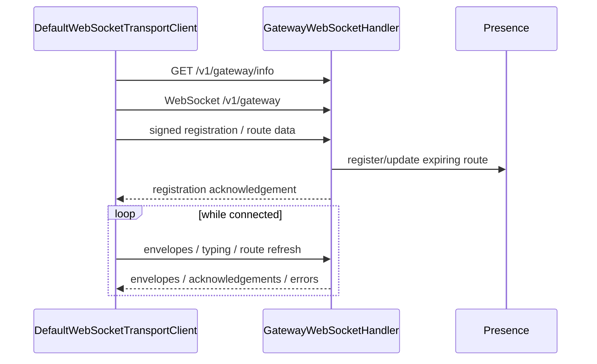

# WebSocket protocol overview

Clients connect to a selected verified Community Node at `/v1/gateway`.

## Route registration and phone verification

The signed route is published with a `RefreshRoute` frame carrying a `ClientRouteRegistration` (`:server:protocol` / `:feature:transport`). The gateway forwards it to the Presence Directory (`PUT /v1/routes/{routingId}`). The registration has an optional `phoneVerificationToken`: the app sends the one-time token from sign-up phone verification only with its first registration that advertises a phone alias, and never again afterwards. The Presence Directory accepts a registration without a token; a present token must prove every advertised alias, otherwise the registration is rejected with `PHONE_VERIFICATION_FAILED`. See [Transport](../features/transport.md#phone-verification-token-at-sign-up).

## Blob upload tickets

The authenticated gateway WebSocket is also the control channel for attachment uploads. The client can request a blob-upload ticket containing the intended blob ID, maximum bytes and expiry. The gateway returns either an issued short-lived permit or a rejection such as an invalid size/expiry. The actual encrypted bytes are then uploaded over the HTTP `/v1/blobs/{blobId}` endpoint.

This keeps upload authorization tied to the authenticated gateway session while keeping large blob bytes out of WebSocket chat frames.

## Reliability boundary

A successful WebSocket send is not the same as the recipient having read a message. Application delivery state is updated by explicit callbacks/receipts through the Direct or Group delivery state machines.

## Route refresh errors

The gateway may reject invalid/expired route refreshes. The client constructs refresh time from a synchronized server-time baseline plus monotonic elapsed time so refresh timestamps continue to advance during a long-lived connection.
