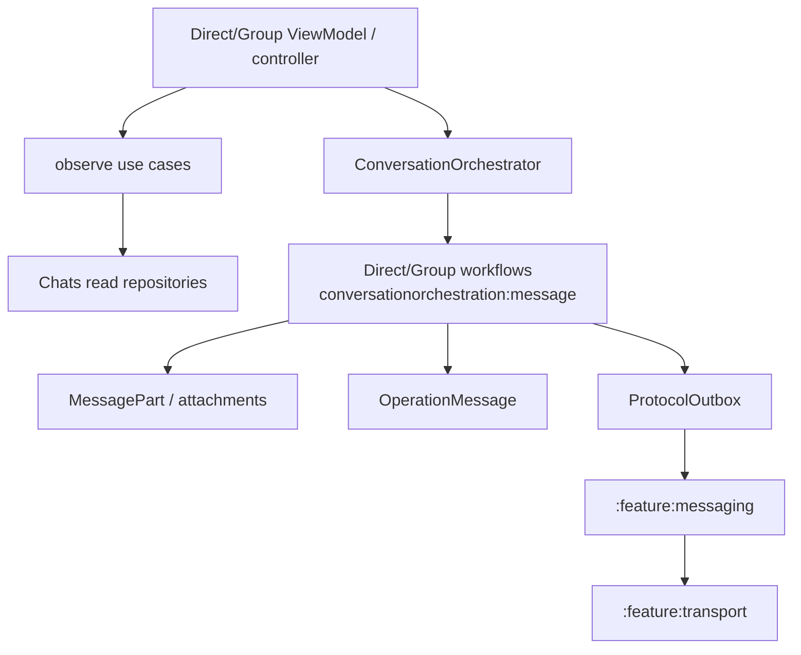

# Chats architecture

Direct and Group share primitives but intentionally keep separate business stacks.



`:feature:chats` is read-only: it observes/reads conversation data and submits every write as a `ConversationCommand` (`orchestrator.awaitResult(command)`). It depends only on `:feature:conversationorchestration:api`. See [Conversation orchestration](conversation-orchestration.md).

## Why Direct and Group stay separate

Direct authorization/identity state differs from Group membership/epoch/admin/per-recipient state. Shared abstractions are used only where semantics are actually identical: message parts, operation protocol, attachment storage and durable transport infrastructure.

## Message content boundary

The canonical content hierarchy is in `:core:base`:

```text
MessagePartDto -> MessagePart -> MessagePartUi
```

`GroupMessageContent` serializes `List<MessagePartDto>` and allows polls. `GroupMessageContentCodec` uses the `sparrow-group-message-v2:` prefix and can decode legacy plaintext into a synthetic text part.

`:feature:attachments` persists blob-backed parts and structured payloads; Chats presents conversations/messages rather than redefining content models.

## Operations

`OperationMessage`/`MessageOperation` is the protocol path for edit/delete/reaction/poll updates. Direct supports Edit/Delete/Reaction. Group supports those plus PollVote/PollClose.

Outgoing operations are workflows in `:feature:conversationorchestration:message` (for example `EditGroupMessageWorkflow`, `ToggleGroupReactionWorkflow`, `VoteGroupPollWorkflow`) that apply the local mutation and send the operation to current active recipients. Incoming operations run through `ApplyRemoteMessageOperationWorkflow`, which validates the sender/target/membership/admin conditions before mutating local state.

## Polls

Polls are ordinary group `MessagePart`s. `GroupPollController` observes finished polls from `:feature:polls`, sends them as `GroupMessageCommand.SendMessage`, and submits vote/close UI events as `GroupMessageCommand.VotePoll` / `GroupMessageCommand.ClosePoll`.

## Delivery

Direct delivery state is message-oriented. Group delivery/read state is aggregated from `MessageRecipientStateEntity` rows for each active recipient; `ApplyDeliveryEventWorkflow` updates both. Retrying a group message (`RetryGroupMessageWorkflow`) targets failed recipients rather than creating a new logical message.

## Pins

`PinGroupMessageWorkflow` snapshots encoded `GroupMessageContent` with sender identity metadata through the orchestration-side `GroupPinRepositoryImpl`; Chats reads the pin through `GroupPinReadRepositoryImpl`. Pin synchronization is separate from message-history pagination. Poll pins can load nested image parts and forward live poll actions.
