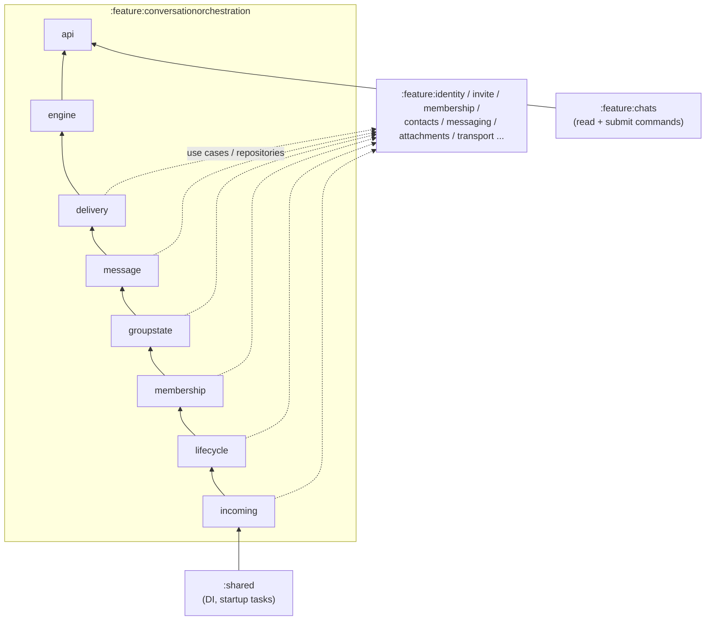
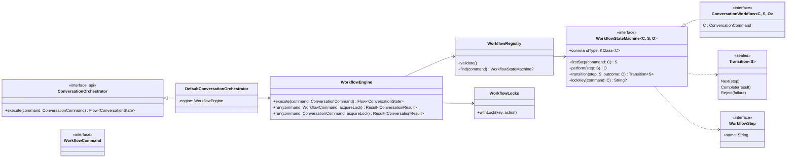
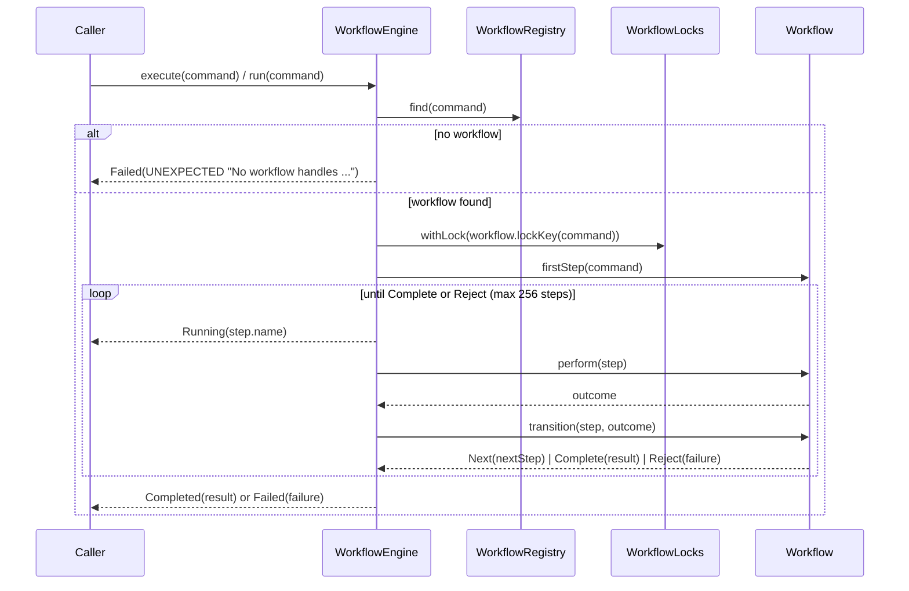
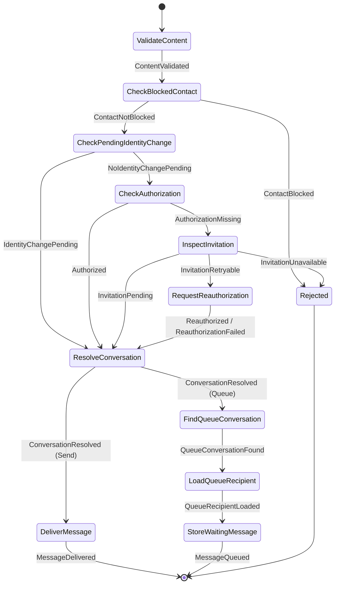
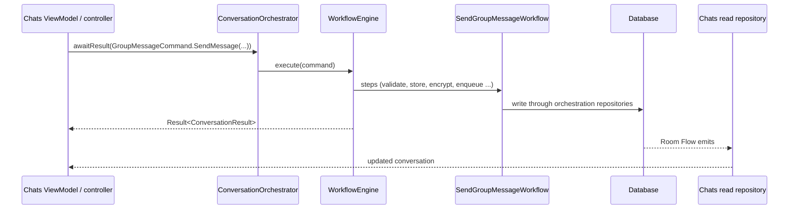
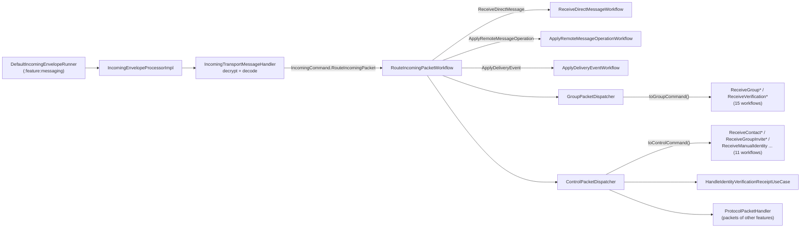

# Conversation orchestration

Every conversation **write** — sending, editing, reacting, pinning, group administration, invitations, recovery — and every **incoming packet** runs as a workflow state machine inside the `:feature:conversationorchestration:*` modules. `:feature:chats` only reads and observes data and submits commands.

This page explains the engine and how the modules fit together. The [workflow catalog](workflows/index.md) lists every command and every workflow with its step diagram; it is generated from the code by the `workflowCatalog` Gradle task, so it never has to be updated by hand.

## Rules

1. Chats depends only on `:feature:conversationorchestration:api` (plus read-only feature dependencies). It never writes conversation data itself.
2. Every write has exactly one entry: `ConversationOrchestrator.execute(command): Flow<ConversationState>`.
3. A workflow **owns the sequence, not the functionality**. Each step performs one operation by calling a feature use case or repository and reports an `Outcome`; the transition decides the next step.
4. `perform(step)` never decides what happens next; `transition(step, outcome)` never has side effects.
5. Nobody holds a workflow instance. Callers create a command and hand it to the engine, which finds the one workflow registered for that command type.
6. Modules form a strict line (below); a lower module never depends on a higher one.
7. The usual layering rules still apply inside the modules: mappers only in `mapper` packages, repositories never call use cases or other repositories, data sources never call repositories.

## Modules

| Module | Owns | Main classes |
|---|---|---|
| `api` | the public contract Chats depends on | `ConversationOrchestrator`, `awaitResult`, `ConversationCommand` (`DirectConversationCommand`, `GroupMessageCommand`, `GroupAdministrationCommand`, `ForwardMessage`), `ConversationState`, `ConversationResult`, `ConversationFailure`, `ConversationFailureReason`, `ConversationIndicatorObserver` |
| `engine` | the state-machine runtime | `WorkflowStateMachine`, `ConversationWorkflow`, `WorkflowCommand`, `WorkflowStep`, `Transition`, `WorkflowEngine`, `WorkflowRegistry`, `WorkflowLocks`, `ConversationFailureMapper`, `DefaultConversationOrchestrator` |
| `delivery` | outbox and transport progress, sending policy, mailbox and routing | [2 workflows](workflows/delivery.md), `DeliveryCommand`, `OutboxDeliveryStateRouter`, `OutgoingPacketSender`, `OutgoingRecipientRoutingResolver`, `GroupRoutingResolver`, `DefaultMailboxCoordinator`, `TransportConversationIndicatorObserver` |
| `message` | Direct and Group messages, operations, polls, forwarding | [22 workflows](workflows/message.md), `MessageCommand`, `DirectMessageRepository`, `GroupMessageRepository`, `OutgoingMessageContentPolicy`, `DirectReauthorizationPort`, `PendingAuthorizationCleanupRunner` |
| `groupstate` | state an admin sets for the whole group: title, description, avatar, pin, expense board | [12 workflows](workflows/groupstate.md), `GroupStateCommand`, `GroupPinRepository`, `GroupTitleRepository`, `GroupDescriptionRepository`, `GroupAvatarRepository`, `RequireGroupAdminContextUseCase`, `ClearGroupStateUseCase` |
| `membership` | group administration, joining a group, verification | [14 workflows](workflows/membership.md), `MembershipCommand`, `GroupConversationRepository`, `GroupVerificationRepository`, `MembershipResultObserver` |
| `lifecycle` | how a direct chat opens, gets authorized, loses and regains its authorization | [14 workflows](workflows/lifecycle.md) in `direct/`, `result/`, `recovery/`, `LifecycleCommand`, runtime observers, `WorkflowDirectReauthorization` |
| `incoming` | routing every decrypted packet to the workflow that applies it | [30 workflows](workflows/incoming.md), `IncomingCommand`, `IncomingEnvelopeProcessorImpl`, `IncomingTransportMessageHandler`, `GroupPacketDispatcher`, `ControlPacketDispatcher`, `IncomingPacketCommandMapper` |

All module paths are `:feature:conversationorchestration:<module>`.

## Layering



Each module depends on the one below through `api(...)`, so every layer sees `api`, `engine` and everything below it: `delivery → message → groupstate → membership → lifecycle → incoming`. Feature modules never depend on orchestration.

When a lower module needs behaviour of a higher one, it declares a **port** that the higher module implements. There is one: a Direct send without authorization must request a fresh invitation, so `message` declares `DirectReauthorizationPort` and `lifecycle` implements it with `WorkflowDirectReauthorization`, which submits `LifecycleCommand.RequestReauthorization`.

### Package layout

Every workflow module uses the same layout:

```text
<module>/src/commonMain/kotlin/.../conversationorchestration/<module>/
├── data/            datasource, mapper, model, packet (codec implementations), repository (implementations)
├── di/              <Module>Module.kt — Koin registrations
├── domain/
│   ├── command/     <Module>Command.kt — every internal command of the module (one sealed interface)
│   ├── model/       domain models
│   ├── packet/      packet codec interfaces
│   ├── policy/      pure rules
│   ├── repository/  repository interfaces
│   ├── usecase/     single operations used by workflow steps
│   └── workflow/    <topic>/<Name>Workflow.kt
└── runtime/         observers and long-running runners started by :shared
```

## The engine



| Class | Responsibility |
|---|---|
| `WorkflowStateMachine<C, S, O>` | One workflow: command type `C`, sealed `Step` type `S`, sealed `Outcome` type `O`. |
| `ConversationWorkflow<C, S, O>` | Marker for workflows whose command is a public `ConversationCommand`, i.e. that Chats may start. |
| `WorkflowCommand` | Marker for internal commands. Each module's sealed `<Module>Command` extends it. |
| `WorkflowStep` | A step; its `name` (the class name) is published as `ConversationState.Running(step)`. |
| `Transition` | `Next(step)`, `Complete(result = ConversationResult.Done)`, `Reject(failure)`; `Reject.because(error)` maps an exception. |
| `WorkflowRegistry` | Maps each command type to its workflow. Reads all Koin-registered `WorkflowStateMachine<*, *, *>` lazily on first use (workflows depend on the engine, the engine on the registry). `validate()` fails on duplicates. |
| `WorkflowEngine` | Runs a command's workflow step by step under its lock and publishes the states. |
| `WorkflowLocks` | One mutex per lock key; workflows without a key run unrestricted. Not reentrant. |
| `ConversationFailureMapper` | Turns an exception into a `ConversationFailure`. |
| `DefaultConversationOrchestrator` | The `api` implementation; hands Chats' commands to the engine. |

### The run loop



- `execute(...)` returns the `Flow<ConversationState>` (`Running`, then `Completed` or `Failed`). Chats uses the `awaitResult(...)` extension, which waits for the final state and returns `Result<ConversationResult>`.
- `run(...)` is for callers inside orchestration. It returns `Result<ConversationResult>` and keeps the **original exception** as the failure, so a calling workflow can react to a specific domain error.
- An exception thrown by `perform` ends the workflow with `Failed(ConversationFailureMapper.toFailure(error))`:

| Exception | `ConversationFailureReason` |
|---|---|
| `ConversationFailureException` | its own failure |
| `DirectChatAuthorizationRequiredException` | `AUTHORIZATION_REQUIRED` |
| `IllegalArgumentException` (`require`) | `INVALID_INPUT` |
| `IllegalStateException` (`check`, `error`) | `NOT_ALLOWED` |
| anything else | `UNEXPECTED` |

- A workflow that exceeds 256 steps fails; this guards against a transition loop.

## Anatomy of a workflow

`SendDirectMessageWorkflow` (module `message`, command `DirectConversationCommand.SendMessage`), shortened:

```kotlin
/**
 * ValidateContent -> CheckBlockedContact -> CheckPendingIdentityChange -> CheckAuthorization
 * -> [InspectInvitation -> RequestReauthorization] -> ResolveConversation
 * -> DeliverMessage | (FindQueueConversation -> LoadQueueRecipient -> StoreWaitingMessage).
 *
 * An authorized contact gets the message immediately. Without authorization the message waits in
 * WAITING_FOR_AUTHORIZATION, and the workflow starts a fresh invitation when none is pending.
 */
class SendDirectMessageWorkflow internal constructor(
    private val engine: WorkflowEngine,
    private val contactBlocklistRepository: ContactBlocklistRepository,
    ...
) : ConversationWorkflow<DirectConversationCommand.SendMessage, SendDirectMessageWorkflow.Step, SendDirectMessageWorkflow.Outcome> {

    override val commandType = DirectConversationCommand.SendMessage::class

    override fun firstStep(command: DirectConversationCommand.SendMessage): Step = Step.ValidateContent(command)

    // exactly one operation per step, reports what happened
    override suspend fun perform(step: Step): Outcome =
        when (step) {
            is Step.CheckBlockedContact ->
                if (contactBlocklistRepository.isBlocked(step.command.contactId)) Outcome.ContactBlocked
                else Outcome.ContactNotBlocked(step.content)
            is Step.DeliverMessage -> {
                engine.run(MessageCommand.DeliverDirectMessage(step.conversationId, step.content, ...)).getOrThrow()
                Outcome.MessageDelivered
            }
            ...
        }

    // pure: decides the next step from the outcome
    override fun transition(step: Step, outcome: Outcome): Transition<Step> =
        when (outcome) {
            Outcome.ContactBlocked -> Transition.Reject(ConversationFailure(AUTHORIZATION_REQUIRED, "..."))
            is Outcome.ContactNotBlocked -> Transition.Next(Step.CheckPendingIdentityChange(outcome.content, step.command))
            Outcome.MessageDelivered -> Transition.Complete(ConversationResult.DirectMessageSent)
            ...
        }

    sealed interface Step : WorkflowStep {
        val command: DirectConversationCommand.SendMessage
        data class ValidateContent(override val command: ...) : Step
        data class CheckBlockedContact(val content: OutgoingMessageContent, override val command: ...) : Step
        ...
    }

    sealed interface Outcome {
        data class ContentValidated(val content: OutgoingMessageContent) : Outcome
        data object ContactBlocked : Outcome
        ...
    }
}
```

- Every `Step` carries the command plus all data the step needs; every `Outcome` carries the data the next decision needs. There is no mutable workflow state.
- `firstStep` may branch on the command. `transition` may branch on the outcome's data (for example `DeliveryPlan.Send` vs `DeliveryPlan.Queue`).
- The KDoc lists the step chain. The generated diagram of the same workflow:



## Commands

### Public commands (Chats)

Defined in `:feature:conversationorchestration:api` as one sealed hierarchy under `ConversationCommand`:

| Family | Commands |
|---|---|
| `DirectConversationCommand` | `OpenConversation`, `ReconnectConversation`, `DeleteConversation`, `SendMessage`, `EditMessage`, `DeleteMessage`, `ToggleReaction`, `RetryMessage`, `MarkConversationRead`, `SendIndicator` |
| `GroupMessageCommand` | `SendMessage`, `EditMessage`, `DeleteMessage`, `ToggleReaction`, `VotePoll`, `ClosePoll`, `RetryMessage`, `MarkConversationRead`, `SendIndicator`, `PinMessage`, `UnpinMessage`, `ActivateExpenses`, `CloseExpenses`, `CreateExpense` |
| `GroupAdministrationCommand` | `CreateGroup`, `AddMembers`, `RemoveMember`, `PromoteMember`, `TransferAdminAndLeave`, `LeaveGroup`, `DeleteGroup`, `ChangeTitle`, `ChangeDescription`, `ChangeAvatar`, `RemoveAvatar`, `VerifyMember`, `SynchronizeVerification` |
| `ForwardMessage` | forwards message parts to `ForwardTarget.DirectConversation`, `GroupConversation` or `Contact` |

### Internal commands

Each module lists every internal job in one sealed interface in `domain/command/`. That file is the overview of what the module can be asked to do internally:

| Sealed interface | Module | Commands |
|---|---|---|
| `DeliveryCommand` | `delivery` | `ApplyDeliveryEvent`, `RecordPreparedTransport` |
| `MessageCommand` | `message` | `DeliverDirectMessage`, `ActivateAuthorizedConversation`, `DiscardWaitingDirectMessages`, `ReleaseWaitingDirectMessages`, `FlushQueuedGroupMessages` |
| `GroupStateCommand` | `groupstate` | `PublishGroupAvatar`, `SendCurrentGroupMetadata`, `SendCurrentGroupPin` |
| `MembershipCommand` | `membership` | `RefreshOwnedGroupVerification`, `HandleGroupInvitationResult`, `HandleMembershipResult`, `RecoverAcceptedGroupInvitation`, `ResumeApprovedGroupJoin` |
| `LifecycleCommand` | `lifecycle` | `RequestReauthorization`, `RevokePeerExchange`, `StartDirectInvitation`, `HandleContactBlocked`, `HandleDirectInvitationResult`, `HandleIdentityResult`, `RecordIncomingDirectInvitation`, `RecoverAcceptedDirectInvitation`, `RecoverAuthorizedConversation`, `AcceptApprovedIdentityChange`, `StartRecoveryInvitation` |
| `IncomingCommand` | `incoming` | `RouteIncomingPacket`, `ApplyRemoteMessageOperation`, `ApplyParkedMessageOperations`, `CompleteManualIdentity` and one `Receive*` command per packet type (27) |

### Starting a workflow

```kotlin
// Chats: public command
orchestrator.awaitResult(DirectConversationCommand.SendMessage(contactId, parts))

// runtime observer or another workflow: internal command
engine.run(LifecycleCommand.HandleContactBlocked(contactId))

// a workflow reusing a public workflow (forwarding sends a message)
engine.run(GroupMessageCommand.SendMessage(groupId, parts))

// nested inside a workflow that already holds the same lock
engine.run(MessageCommand.FlushQueuedGroupMessages(groupId), acquireLock = false)
```

## How Chats uses orchestration



Chats never gets data back from a command except the small `ConversationResult` (for example `ConversationOpened(conversationId)` or `GroupCreated(groupId)`). The UI updates because Chats observes the database through its own read repositories:

| Chats read repository | Reads | Written by (orchestration) |
|---|---|---|
| `DirectConversationReadRepository` | a direct chat, its contact and history | `message`, `lifecycle` (`DirectConversationRepository`, `DirectMessageRepository`) |
| `GroupConversationReadRepository` | a group chat, members, local membership timeline | `membership` (`GroupConversationRepository`), `message` |
| `GroupPinReadRepository` | the current pin and pinned attachments | `groupstate` (`GroupPinRepository`) |
| `GroupAvatarReadRepository` | the group avatar | `groupstate` (`GroupAvatarRepository`) |
| `GroupDescriptionReadRepository` | the group description | `groupstate` (`GroupDescriptionRepository`) |
| `GroupVerificationReadRepository` | verification rows | `membership` (`GroupVerificationRepository`) |
| `ConversationOverviewRepository`, `MessageHistoryRepository` | chat list, history paging | all writers |

The read side and the write side use different repositories over the same tables on purpose: Chats cannot write, and orchestration needs no UI models. Typing indicators are transient and never stored, so Chats observes them through `ConversationIndicatorObserver` (implemented by `TransportConversationIndicatorObserver` in `delivery`).

## Incoming packets



`RouteIncomingPacketWorkflow` decides the path:

```text
direct message:  CheckDirectAuthorization -> EnsureDirectConversation -> ReceiveDirectMessage | ApplyDirectOperation
group packet:    CheckGroupAccepted -> DispatchGroupPacket
receipt:         ApplyReceipt
anything else:   FindControlConversation -> DispatchControlPacket
```

### Operations that overtake their message

An edit, delete, reaction, poll vote or poll close can arrive before the message it refers to, for example
when a reconnect delivers the mailbox out of order. `ApplyRemoteMessageOperationWorkflow` then parks the
operation (`FindTarget -> Park`) in `parked_message_operations` and the envelope is acknowledged. Once
`ReceiveDirectMessageWorkflow` or `ReceiveGroupMessageWorkflow` has stored a message, its last step
`ApplyParkedOperations` runs `ApplyParkedMessageOperationsWorkflow`, which applies the waiting operations in
the order they were sent through the normal operation workflow (so the same sender and admin checks apply)
and removes each one. An operation that is not allowed is dropped as it would have been on arrival. Parked
operations whose message never arrives are deleted after 7 days. `ParkedMessageOperationsTest` covers these
cases.

Every packet type has its own command, for example `IncomingCommand.ReceiveGroupTitle(context: IncomingPacketContext, packet: GroupTitleUpdatedPacket)`. `IncomingPacketCommandMapper` (`toGroupCommand()`, `toControlCommand()`) maps a `ReceivedPacket` to that command; the dispatchers only submit it with `engine.run(command)`. Direct and Group packets never share a workflow.

## Runtime observers

Durable result streams of other features and of the outbox enter orchestration through runtime classes started by `:shared` startup tasks. Each observer only builds a command and submits it:

| Runtime class | Module | Listens to | Submits |
|---|---|---|---|
| `IdentityResultObserver` | `lifecycle` | identity results | `LifecycleCommand.HandleIdentityResult`, `RecoverAuthorizedConversation` (on start) |
| `InvitationResultObserver` | `lifecycle` | invitation results | `LifecycleCommand.HandleDirectInvitationResult`, `RecoverAcceptedDirectInvitation`, `MembershipCommand.HandleGroupInvitationResult`, `RecoverAcceptedGroupInvitation` |
| `ContactBlockObserver` | `lifecycle` | blocked contacts | `LifecycleCommand.HandleContactBlocked` |
| `ApprovedIdentityReconnectionObserver` | `lifecycle` | approved identity changes (retried by `ApprovedReconnectionRetryWorker`) | `LifecycleCommand.StartRecoveryInvitation` |
| `MessagingTransportResultObserver` | `lifecycle` | durable messaging failures | hands invitation packets to `InvitationTransportFailureHandler` |
| `MembershipResultObserver` | `membership` | membership results | `MembershipCommand.HandleMembershipResult` |
| `OutboxDeliveryStateRouter` | `delivery` | outbox state changes | `DeliveryCommand.RecordPreparedTransport`, `ApplyDeliveryEvent` |
| `PendingAuthorizationCleanupRunner` | `message` | direct messages waiting for authorization | discards expired ones (`DiscardDirectMessagesUseCase`) |

Startup order (`ApplicationStartupTasks`): `ValidateConversationWorkflowsStartupTask` runs right after the crypto runtime and calls `WorkflowRegistry.validate()`; the `Start*ObserverStartupTask`s then start the observers once the local identity is ready.

## Locking

`lockKey(command)` returns a key; `WorkflowLocks` keeps one mutex per key. Workflows sharing a key never run at the same time; workflows without a key run unrestricted.

| Key helper | Key | Serializes |
|---|---|---|
| `groupSendLockKey` | `group-send:<groupId>` | handing group messages to the outbox (send, flush), keeps their order |
| `groupAdministrationLockKey` | `group-administration:<groupId>` | membership changes of one group |
| `groupMetadataLockKey` | `group-metadata:<groupId>` | title, description and avatar changes |
| `groupPinLockKey` | `group-pin:<groupId>` | pin, unpin, close expense board |
| `groupVerificationLockKey` | `group-verification:<groupId>` | verification changes, also from incoming packets |
| `"direct-release:<contactId>"` | — | releasing or discarding queued Direct messages |
| `DELIVERY_LOCK_KEY` | `message-delivery` | all delivery-state updates |

Locks are not reentrant. A workflow that submits a nested command with the same key passes `acquireLock = false`. The full mapping of workflows to locks is in the [catalog](workflows/index.md#locks).

## Dependency injection

Every workflow is registered in its module's Koin module with the same line:

```kotlin
singleOf(::SendDirectMessageWorkflow) { bind<WorkflowStateMachine<*, *, *>>() }
```

`conversationEngineModule` provides `WorkflowLocks`, `WorkflowRegistry { getAll<WorkflowStateMachine<*, *, *>>() }`, `WorkflowEngine` and `DefaultConversationOrchestrator` (bound to `ConversationOrchestrator`). `ApplicationModules` loads `conversationEngineModule`, `conversationDeliveryModule`, `conversationMessageModule`, `conversationGroupStateModule`, `conversationMembershipModule`, `conversationLifecycleModule` and `conversationIncomingModule`.

## Adding a workflow

1. Pick the lowest module that owns the behaviour (`delivery`, `message`, `groupstate`, `membership`, `lifecycle`, `incoming`). If it needs a higher module, declare a port in the lower one.
2. Add the command:
   - user action → a new `data class` in the matching `ConversationCommand` family in `api`;
   - internal job → a new nested `data class` in the module's `<Module>Command`;
   - new packet type → a new `IncomingCommand.Receive*` plus a branch in `IncomingPacketCommandMapper`.
3. Write `<Name>Workflow` implementing `ConversationWorkflow` (public) or `WorkflowStateMachine` (internal) with nested sealed `Step` and `Outcome`. One operation per `perform` branch, pure `transition`, step chain in the KDoc.
4. Add a `lockKey` if it must not overlap with other workflows of the same group or contact.
5. Register it: `singleOf(::<Name>Workflow) { bind<WorkflowStateMachine<*, *, *>>() }`.
6. Test the transitions and the workflow end to end through `WorkflowEngine` (see `WorkflowEngineTest`).
7. Commit. The pre-commit hook runs `workflowCatalog` and stages `docs/architecture/workflows`; `qualityCheck` (pre-push and CI) runs `verifyWorkflowCatalog` and fails if the catalog is out of date.

## Workflow catalog

The catalog is generated by `./gradlew workflowCatalog` (build-logic: `GenerateWorkflowCatalogTask`, `WorkflowSourceParser`, `WorkflowCatalogRenderer`). It parses every `*Workflow.kt` of the workflow modules: the supertype gives the command and whether Chats may start it, `firstStep`/`perform`/`transition` give the diagram, the constructor gives the dependencies and the KDoc the step chain. It runs automatically:

| When | Task | Effect |
|---|---|---|
| `git commit` (pre-commit hook) | `ktlintFormat workflowCatalog` | regenerates and stages the catalog |
| `./gradlew qualityFix` / `quality` | `workflowCatalog` | regenerates the catalog |
| `git push` (pre-push hook), CI, `./gradlew check` / `qualityCheck` | `verifyWorkflowCatalog` | fails if the catalog does not match the code |
| `scipts/update-docs.bat` | `architectureReport workflowCatalog` | regenerates all generated docs |


- [Index: every command, workflow and lock](workflows/index.md)
- [Delivery](workflows/delivery.md)
- [Message](workflows/message.md)
- [Group state](workflows/groupstate.md)
- [Membership](workflows/membership.md)
- [Direct chat lifecycle](workflows/lifecycle.md)
- [Incoming packets](workflows/incoming.md)
