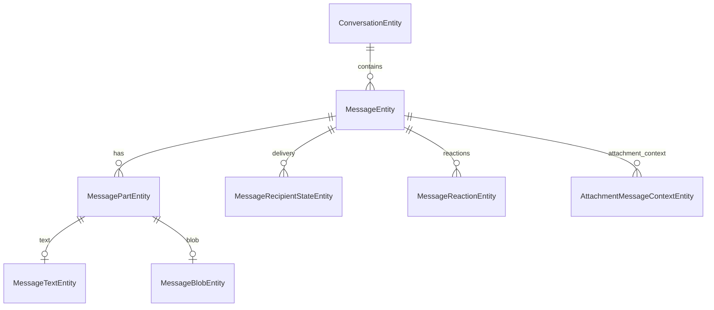

# Persistence

The Android client uses Room. The current `SparrowDatabase` schema version is **59**.

## Message storage

The current message schema separates message envelope/state, text, typed parts and blob metadata:



Key entities include `ConversationEntity`, `MessageEntity`, `MessagePartEntity`, `MessageTextEntity`, `MessageBlobEntity`, `MessageRecipientStateEntity`, `MessageReactionEntity`, `AttachmentMessageContextEntity`, `VoiceTranscriptEntity`, `GroupPinEntity`, membership/security tables, identity/recovery tables and the durable protocol outbox tables.

`MessagePartEntity` is the generic structural row:

```text
id
messageId
position
type
payload?
```

`MessageBlobEntity` owns blob-related fields such as MIME type, byte size, dimensions/duration, node/blob capabilities, AEAD key/nonce/hash, delete capability and `localFilePath`.

## Structured message-part payloads

Since schema 54, structured part JSON is stored directly in `MessagePartEntity.payload`. `MessagePartPayloadMigration53To54` copies legacy values from `message_structured.json` into that column and drops the legacy table.

`PollDto`, the expense parts (`ExpenseBoardDto`, `ExpenseDto`, `ExpenseBoardClosedDto`) and `PaymentTransferDto` use this mechanism. Poll nested images are persisted as separate image parts/blobs and are reattached by `MessagePartPersistenceMapper.withPersistedParts(...)`.

## Parked message operations

`ParkedMessageOperationEntity` (`parked_message_operations`, added in schema 56 by auto-migration) holds
incoming edits, deletes, reactions and poll operations whose message has not arrived yet: the target message
ID, conversation, sender, the operation as JSON and its sent and parked times. Rows are removed once the
message is stored and the operation was applied, and are purged after 7 days.

## Parked envelopes

`ParkedEnvelopeEntity` (`parked_envelopes`, added in schema 57 by auto-migration) holds incoming envelopes that
arrived too early and were acknowledged: a group packet before the welcome of its epoch, or a direct message or
operation of a contact whose invitation is still in flight. A row keeps the envelope as it arrived (envelope ID,
unique; sender routing ID; encoded transport payload), the key it waits for (`group-epoch:<groupId>:<epoch>` or
`contact-exchange:<contactId>`) and when it was parked. Parking the same envelope again only changes its key, so
it keeps its place in the arrival order. Rows are removed once the replayed envelope was handled, rejected or its
sender is unknown, and are purged after 7 days.

## Edit times

`MessageTextEntity.editedAtEpochMilliseconds` (schema 57) is the time of the last edit that replaced the text,
null for text that was never edited. A remote edit replaces the text only when its edit time is later than the
stored one (`ChatDao.replaceMessageTextIfNewer`), so edits that arrive out of order keep the newest text; a local
edit always replaces it and records the local time.

## Mailbox credentials

`LocalMailboxCredentialEntity` (`local_mailbox_credentials`) holds the one current mailbox per contact (primary key
`contactId`), `RemoteMailboxRouteEntity` (`remote_mailbox_routes`) the contact's route we deliver to.
`RetiringMailboxCredentialEntity` (`retiring_mailbox_credentials`, added in schema 58 by auto-migration) holds
mailboxes a renewal replaced, keyed by `routeId` with the same columns: they stay readable until they expire and
are revoked afterwards, so envelopes still in them are not lost (`MailboxRouteDao.retireLocal` moves the old
credential there and saves the replacement in one transaction). `revocationPending` marks a revocation of a blocked
contact or deleted chat that is still to be retried, as for current credentials. Rows cascade with their contact.

## Outbox

`ProtocolOutboxEntity` and `ProtocolOutboxFailureEventEntity` persist transport work independently of a screen. Feature code creates packets/operations; `:feature:messaging` runners process the durable outbox later. This is why outgoing work can survive temporary transport failure.

## Group state

Group persistence includes `GroupMembershipEntity`, `GroupSecurityStateEntity`, `GroupMemberKeyEntity`, `GroupVerificationPairEntity`, `GroupPinEntity` and `GroupMetadataEntity` (admin-owned title, description and avatar state with change timestamps). Since schema 59 (auto-migration, default `0`) `GroupMetadataEntity.titlePublishPending`, `descriptionPublishPending`, `avatarPublishPending` and `GroupPinEntity.publishPending` mark a local admin change that is saved and shown already but not yet queued for the members. The publish clears the mark only while the stored version is still the one it sent (`GroupMetadataDao.markTitlePublished` and the like, `GroupPinDao.markPublished`); a state received from another admin is stored without the mark, and clearing local state clears it too. `UnpublishedGroupStateRunner` publishes every marked state after a restart. `ContactProfilePictureEntity` records per contact whether a profile picture exists and when it changed. Delivery/read aggregation is per recipient through `MessageRecipientStateEntity`.

## Identity and recovery

Identity/reconnection state is durable through `IdentityExchangeEntity`, `PendingRemoteIdentityChangeEntity`, `ApprovedIdentityReconnectionEntity`, contact public identity/routing tables and invitation state. Recovery is therefore not an in-memory navigation event.

## Local search/safety

`MessageSearchEmbeddingEntity` stores local search embeddings and `MessageSafetyAssessmentEntity` stores local safety-analysis output. These are client-side feature data and are not sent as message content.

## Schema source of truth

Use `data/database/src/commonMain/kotlin/com/cbgm/sparrow/data/database/SparrowDatabase.kt` and exported Room schemas under `data/database/schemas/` as the authoritative schema. Historical entity files can remain for migration code even when they are no longer registered in the current database.
