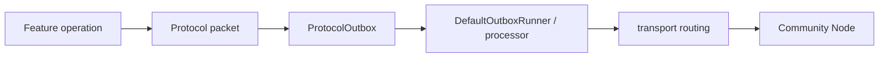

# Runtime flows

This page summarizes the current application-lifetime orchestration boundaries.

## Startup

Startup is driven by `ApplicationStartupRunner` and `StartupTask` instances. Only tasks marked `waitForCompletion` block navigation. After all waiting tasks finish and the identity result is resolved, `StartupViewModel` navigates to `AppRoute.Main` and calls `startPostNavigationRuntime()`.

See [Startup architecture](startup.md) for the exact task list and class flow.

## Foreground runtime

`ForegroundRuntimeCoordinator` starts after navigation rather than being hidden inside the startup screen. Transport/observer lifetimes therefore belong to application runtime, not Composable lifetime.

## Durable outgoing messaging

Direct and Group workflows in `:feature:conversationorchestration:message` own their business rules. `:feature:messaging` owns durable execution/retry; `:feature:transport` owns discovery/routing/WebSocket/mailbox/push transport.

## Message operations

Edits, deletes, reactions, poll votes and poll closes share `OperationMessage` / `MessageOperation`. `ApplyRemoteMessageOperationWorkflow` accepts edit/delete/reaction for Direct chats and rejects poll operations there. Group workflows additionally support `PollVote` and `PollClose`. An operation whose message has not arrived yet is parked locally and applied once the message is stored ([Conversation orchestration](conversation-orchestration.md#operations-that-overtake-their-message)).

## Poll composer handoff

`CreatePollViewModel` finishes a `Poll` into `PollComposerRepository`. `GroupPollController` observes it, submits it as an ordinary group `MessagePart` (`GroupMessageCommand.SendMessage`), cleans temporary poll media after success and clears the finished poll handoff.

## Conversation workflows and observers

Every conversation write and incoming packet runs as a workflow state machine through `WorkflowEngine`. Chats submits commands through `ConversationOrchestrator`; incoming envelopes enter through `IncomingTransportMessageHandler` → `RouteIncomingPacketWorkflow`; startup tasks start the runtime observers in `:feature:conversationorchestration:lifecycle` (`ContactBlockObserver`, `IdentityResultObserver`, `InvitationResultObserver`, `MembershipResultObserver`, `MessagingTransportResultObserver`, `ApprovedIdentityReconnectionObserver`), which run the matching workflows. See [Conversation orchestration](conversation-orchestration.md).

## Identity recovery

Approved reconnection retry is started by `StartApprovedIdentityReconnectionObserverStartupTask` after identity readiness. `ApprovedIdentityReconnectionObserver` and its worker persist/retry approved recovery independent of a particular chat screen.

## Attachment caching

Incoming messages can be persisted before their binary blobs finish downloading. `MessageAttachmentCacheCoordinator` / `MessageAttachmentDataSource` cache blob data and persist local paths. Room observations that render media must observe the relevant blob rows so the UI can move from loading to the real local file without reopening the app.
