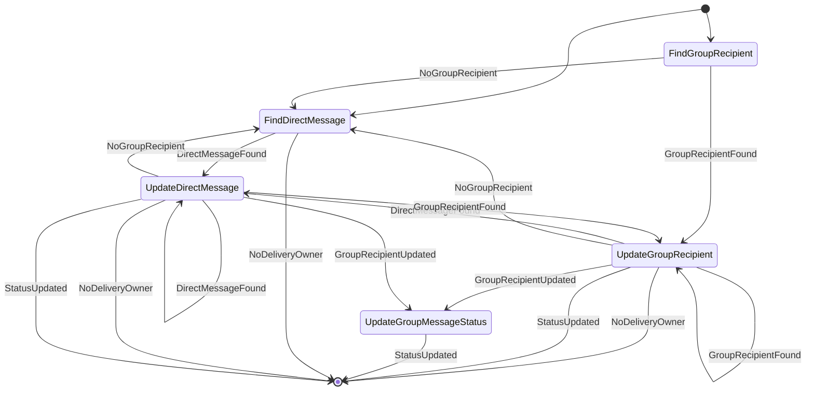
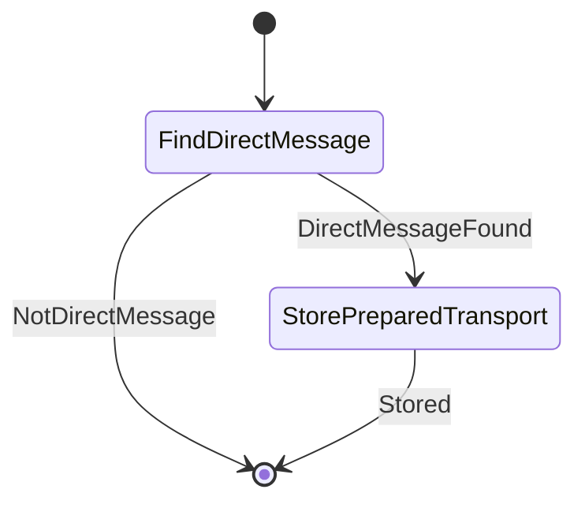

# Delivery workflows

_Generated by `./gradlew workflowCatalog` from `:feature:conversationorchestration:delivery`. Do not edit by hand._

Outbox and transport progress: which state a sent message or recipient is in.

Diagram legend: boxes are `Step`s, arrow labels are the `Outcome` a step reported, `[*]` is the start or a successful completion, `Rejected` ends the workflow with a `ConversationFailure`.

| Workflow | Started by | Command | Lock |
|---|---|---|---|
| [`ApplyDeliveryEventWorkflow`](#applydeliveryeventworkflow) | orchestration (`engine.run`) | `DeliveryCommand.ApplyDeliveryEvent` | `DELIVERY_LOCK_KEY` |
| [`RecordPreparedTransportWorkflow`](#recordpreparedtransportworkflow) | orchestration (`engine.run`) | `DeliveryCommand.RecordPreparedTransport` | — |

## `event`

### ApplyDeliveryEventWorkflow

- **Kind:** internal — started by an observer, dispatcher or another workflow `DeliveryCommand.ApplyDeliveryEvent`
- **Source:** `feature/conversationorchestration/delivery/src/commonMain/kotlin/com/cbgm/sparrow/feature/conversationorchestration/delivery/domain/workflow/event/ApplyDeliveryEventWorkflow.kt`
- **Lock:** `DELIVERY_LOCK_KEY`
- **Uses:** `DirectMessageDeliveryRepository`, `GroupRecipientDeliveryRepository`

```text
FindGroupRecipient -> (UpdateGroupRecipient -> UpdateGroupMessageStatus) | FindDirectMessage -> UpdateDirectMessage.

Group recipients are always checked first because one group packet belongs to exactly one recipient.
```



## `transport`

### RecordPreparedTransportWorkflow

- **Kind:** internal — started by an observer, dispatcher or another workflow `DeliveryCommand.RecordPreparedTransport`
- **Source:** `feature/conversationorchestration/delivery/src/commonMain/kotlin/com/cbgm/sparrow/feature/conversationorchestration/delivery/domain/workflow/transport/RecordPreparedTransportWorkflow.kt`
- **Lock:** none
- **Uses:** `DirectMessageDeliveryRepository`

```text
FindDirectMessage -> StorePreparedTransport. Group packets keep no prepared payload.
```


