# Group state workflows

_Generated by `./gradlew workflowCatalog` from `:feature:conversationorchestration:groupstate`. Do not edit by hand._

State an admin sets for the whole group and broadcasts to every member: title, description, avatar, pin and the expense board.

Diagram legend: boxes are `Step`s, arrow labels are the `Outcome` a step reported, `[*]` is the start or a successful completion, `Rejected` ends the workflow with a `ConversationFailure`.

| Workflow | Started by | Command | Lock |
|---|---|---|---|
| [`ActivateGroupExpensesWorkflow`](#activategroupexpensesworkflow) | Chats (`ConversationOrchestrator`) | `GroupMessageCommand.ActivateExpenses` | `"group-expense:${command.groupId}"` |
| [`CreateGroupExpenseWorkflow`](#creategroupexpenseworkflow) | Chats (`ConversationOrchestrator`) | `GroupMessageCommand.CreateExpense` | — |
| [`DeleteGroupExpenseWorkflow`](#deletegroupexpenseworkflow) | Chats (`ConversationOrchestrator`) | `GroupMessageCommand.DeleteExpense` | — |
| [`EditGroupExpenseWorkflow`](#editgroupexpenseworkflow) | Chats (`ConversationOrchestrator`) | `GroupMessageCommand.EditExpense` | — |
| [`SendCurrentGroupExpensesWorkflow`](#sendcurrentgroupexpensesworkflow) | orchestration (`engine.run`) | `GroupStateCommand.SendCurrentGroupExpenses` | — |
| [`ChangeGroupAvatarWorkflow`](#changegroupavatarworkflow) | Chats (`ConversationOrchestrator`) | `GroupAdministrationCommand.ChangeAvatar` | — |
| [`ChangeGroupDescriptionWorkflow`](#changegroupdescriptionworkflow) | Chats (`ConversationOrchestrator`) | `GroupAdministrationCommand.ChangeDescription` | — |
| [`ChangeGroupTitleWorkflow`](#changegrouptitleworkflow) | Chats (`ConversationOrchestrator`) | `GroupAdministrationCommand.ChangeTitle` | — |
| [`PublishGroupAvatarWorkflow`](#publishgroupavatarworkflow) | orchestration (`engine.run`) | `GroupStateCommand.PublishGroupAvatar` | `groupAdministrationLockKey(command.groupId)` |
| [`PublishGroupDescriptionWorkflow`](#publishgroupdescriptionworkflow) | orchestration (`engine.run`) | `GroupStateCommand.PublishGroupDescription` | `groupAdministrationLockKey(command.groupId)` |
| [`PublishGroupTitleWorkflow`](#publishgrouptitleworkflow) | orchestration (`engine.run`) | `GroupStateCommand.PublishGroupTitle` | `groupAdministrationLockKey(command.groupId)` |
| [`RemoveGroupAvatarWorkflow`](#removegroupavatarworkflow) | Chats (`ConversationOrchestrator`) | `GroupAdministrationCommand.RemoveAvatar` | — |
| [`SendCurrentGroupMetadataWorkflow`](#sendcurrentgroupmetadataworkflow) | orchestration (`engine.run`) | `GroupStateCommand.SendCurrentGroupMetadata` | `groupAdministrationLockKey(command.groupId)` |
| [`SendGroupPaymentWorkflow`](#sendgrouppaymentworkflow) | Chats (`ConversationOrchestrator`) | `GroupMessageCommand.SendPaymentTransfer` | `"payment:${command.groupId}"` |
| [`CloseGroupExpensesWorkflow`](#closegroupexpensesworkflow) | Chats (`ConversationOrchestrator`) | `GroupMessageCommand.CloseExpenses` | `groupAdministrationLockKey(command.groupId)` |
| [`PinGroupMessageWorkflow`](#pingroupmessageworkflow) | Chats (`ConversationOrchestrator`) | `GroupMessageCommand.PinMessage` | — |
| [`PublishGroupPinWorkflow`](#publishgrouppinworkflow) | orchestration (`engine.run`) | `GroupStateCommand.PublishGroupPin` | `groupAdministrationLockKey(command.groupId)` |
| [`SendCurrentGroupPinWorkflow`](#sendcurrentgrouppinworkflow) | orchestration (`engine.run`) | `GroupStateCommand.SendCurrentGroupPin` | — |
| [`UnpinGroupMessageWorkflow`](#unpingroupmessageworkflow) | Chats (`ConversationOrchestrator`) | `GroupMessageCommand.UnpinMessage` | — |

## `expense`

### ActivateGroupExpensesWorkflow

- **Kind:** public — Chats submits `GroupMessageCommand.ActivateExpenses`
- **Source:** `feature/conversationorchestration/groupstate/src/commonMain/kotlin/com/cbgm/sparrow/feature/conversationorchestration/groupstate/domain/workflow/expense/ActivateGroupExpensesWorkflow.kt`
- **Lock:** `"group-expense:${command.groupId}"`
- **Uses:** `WorkflowEngine`, `GroupPinRepository`, `RequireGroupAdminContextUseCase`, `CreateExpenseBoardUseCase`

```text
AuthorizeAdmin -> CheckNoActiveBoard -> CreateBoard -> SendBoard -> PinBoard.

An expense board is an ordinary group message part that occupies the group's pin slot. Activations of one group
run one after another under their own lock ([lockKey]), so a second tap sees the board the first one pinned in
CheckNoActiveBoard instead of sending a second board. The nested SendMessage (group send lock) and PinMessage
(whose publishing takes the group administration lock) never take this key, so the nesting cannot deadlock.
```

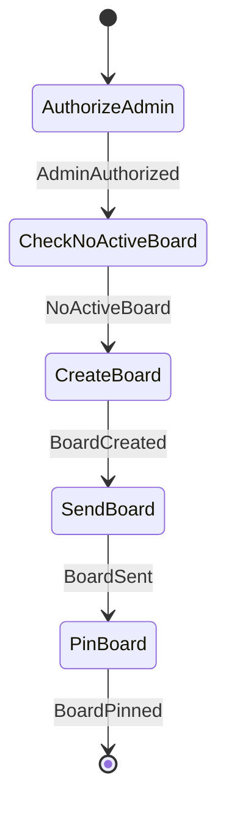

### CreateGroupExpenseWorkflow

- **Kind:** public — Chats submits `GroupMessageCommand.CreateExpense`
- **Source:** `feature/conversationorchestration/groupstate/src/commonMain/kotlin/com/cbgm/sparrow/feature/conversationorchestration/groupstate/domain/workflow/expense/CreateGroupExpenseWorkflow.kt`
- **Lock:** none
- **Uses:** `WorkflowEngine`, `PrepareGroupExpenseUseCase`

```text
PrepareExpense -> SendExpense.
```

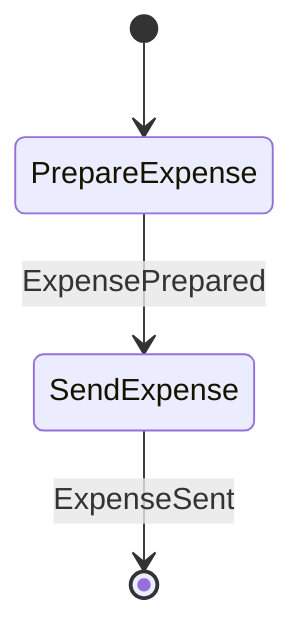

### DeleteGroupExpenseWorkflow

- **Kind:** public — Chats submits `GroupMessageCommand.DeleteExpense`
- **Source:** `feature/conversationorchestration/groupstate/src/commonMain/kotlin/com/cbgm/sparrow/feature/conversationorchestration/groupstate/domain/workflow/expense/DeleteGroupExpenseWorkflow.kt`
- **Lock:** none
- **Uses:** `WorkflowEngine`, `PrepareGroupExpenseDeletionUseCase`, `DeleteLocalExpenseReceiptsUseCase`

```text
PrepareDeletion -> SendExpense -> DeleteReceipts.
```

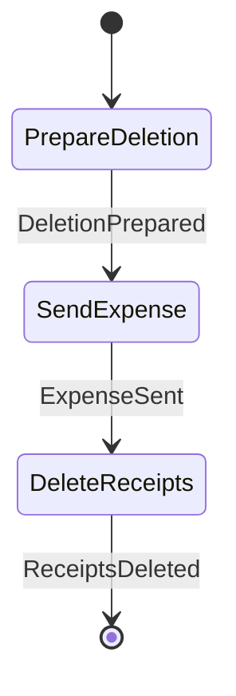

### EditGroupExpenseWorkflow

- **Kind:** public — Chats submits `GroupMessageCommand.EditExpense`
- **Source:** `feature/conversationorchestration/groupstate/src/commonMain/kotlin/com/cbgm/sparrow/feature/conversationorchestration/groupstate/domain/workflow/expense/EditGroupExpenseWorkflow.kt`
- **Lock:** none
- **Uses:** `WorkflowEngine`, `PrepareGroupExpenseRevisionUseCase`, `DeleteLocalExpenseReceiptsUseCase`

```text
PrepareRevision -> SendExpense -> DeleteReplacedReceipts.
```

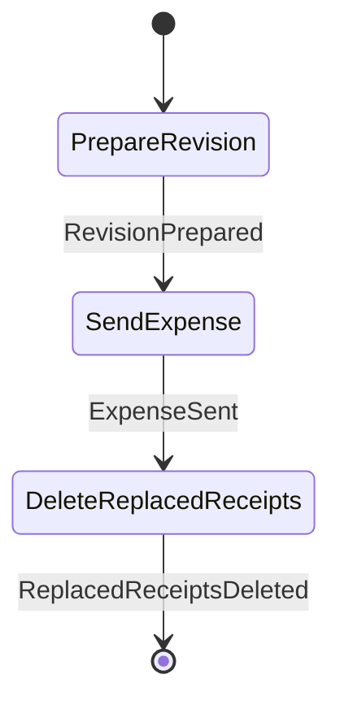

### SendCurrentGroupExpensesWorkflow

- **Kind:** internal — started by an observer, dispatcher or another workflow `GroupStateCommand.SendCurrentGroupExpenses`
- **Source:** `feature/conversationorchestration/groupstate/src/commonMain/kotlin/com/cbgm/sparrow/feature/conversationorchestration/groupstate/domain/workflow/expense/SendCurrentGroupExpensesWorkflow.kt`
- **Lock:** none
- **Uses:** `GroupPinRepository`, `RequireGroupAdminContextUseCase`, `LoadGroupExpenseMessagesUseCase`, `EncryptGroupMessageUseCase`, `EnqueueGroupPacketsUseCase`

```text
FindBoard -> AuthorizeRecipient -> LoadExpenseMessages -> EnqueueExpenseMessages.
```

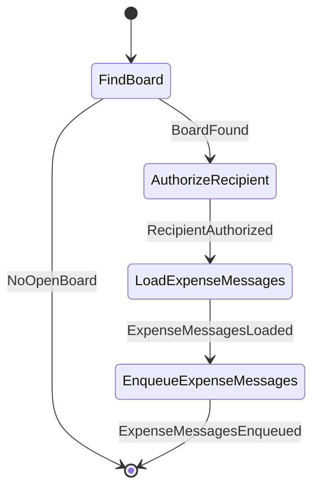

## `metadata`

### ChangeGroupAvatarWorkflow

- **Kind:** public — Chats submits `GroupAdministrationCommand.ChangeAvatar`
- **Source:** `feature/conversationorchestration/groupstate/src/commonMain/kotlin/com/cbgm/sparrow/feature/conversationorchestration/groupstate/domain/workflow/metadata/ChangeGroupAvatarWorkflow.kt`
- **Lock:** none
- **Uses:** `WorkflowEngine`, `RequireGroupAdminContextUseCase`, `PrepareGroupAvatarUseCase`, `SaveGroupAvatarUseCase`

```text
ValidateAvatar -> AuthorizeAdmin -> PrepareAvatar -> SaveAvatar -> PublishAvatar.

The new avatar is saved as unpublished right away, so the user sees it at once without waiting for a running
membership change. Only the publishing ([GroupStateCommand.PublishGroupAvatar]) waits for the group
administration lock. A failed or interrupted publish leaves the avatar unpublished: the same change again, or the
recovery after the next start, publishes it.
```

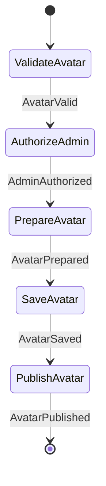

### ChangeGroupDescriptionWorkflow

- **Kind:** public — Chats submits `GroupAdministrationCommand.ChangeDescription`
- **Source:** `feature/conversationorchestration/groupstate/src/commonMain/kotlin/com/cbgm/sparrow/feature/conversationorchestration/groupstate/domain/workflow/metadata/ChangeGroupDescriptionWorkflow.kt`
- **Lock:** none
- **Uses:** `WorkflowEngine`, `RequireGroupAdminContextUseCase`, `PrepareGroupDescriptionUseCase`, `SaveGroupDescriptionUseCase`

```text
AuthorizeAdmin -> PrepareDescription -> SaveDescription -> PublishDescription.
An unchanged description that was published already stops after PrepareDescription.

The new description is saved as unpublished right away, so the user sees it at once without waiting for a running
membership change. Only the publishing ([GroupStateCommand.PublishGroupDescription]) waits for the group administration
lock. A failed or interrupted publish leaves the description unpublished: the same change again, or the recovery after
the next start, publishes it.
```

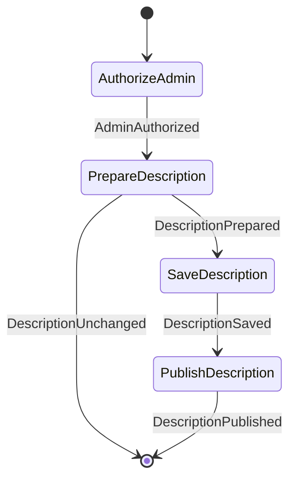

### ChangeGroupTitleWorkflow

- **Kind:** public — Chats submits `GroupAdministrationCommand.ChangeTitle`
- **Source:** `feature/conversationorchestration/groupstate/src/commonMain/kotlin/com/cbgm/sparrow/feature/conversationorchestration/groupstate/domain/workflow/metadata/ChangeGroupTitleWorkflow.kt`
- **Lock:** none
- **Uses:** `WorkflowEngine`, `RequireGroupAdminContextUseCase`, `PrepareGroupTitleUseCase`, `SaveGroupTitleUseCase`

```text
AuthorizeAdmin -> PrepareTitle -> SaveTitle -> PublishTitle.
An unchanged title that was published already stops after PrepareTitle.

The new title is saved as unpublished right away, so the user sees it at once without waiting for a running
membership change. Only the publishing ([GroupStateCommand.PublishGroupTitle]) waits for the group administration
lock. A failed or interrupted publish leaves the title unpublished: the same change again, or the recovery after
the next start, publishes it.
```

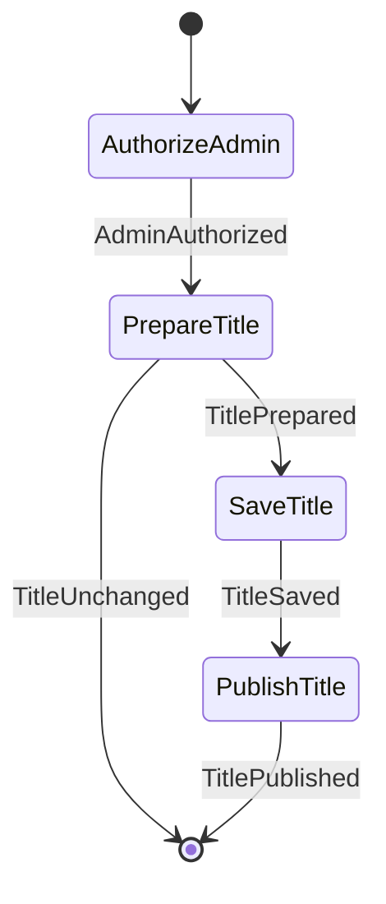

### PublishGroupAvatarWorkflow

- **Kind:** internal — started by an observer, dispatcher or another workflow `GroupStateCommand.PublishGroupAvatar`
- **Source:** `feature/conversationorchestration/groupstate/src/commonMain/kotlin/com/cbgm/sparrow/feature/conversationorchestration/groupstate/domain/workflow/metadata/PublishGroupAvatarWorkflow.kt`
- **Lock:** `groupAdministrationLockKey(command.groupId)`
- **Uses:** `GroupAvatarRepository`, `FindUnpublishedGroupStateUseCase`, `RequireGroupAdminContextUseCase`, `CreateGroupAvatarPacketsUseCase`, `EnqueueGroupPacketsUseCase`

```text
FindUnpublishedAvatar -> AuthorizeAdmin -> CreateAvatarPackets -> EnqueueAvatarPackets -> MarkAvatarPublished.
Without an unpublished avatar (published already, or replaced by a newer one from another admin) it stops
after FindUnpublishedAvatar.

The avatar or its removal was saved locally before; this workflow only sends it. It holds the group administration lock, so the
packets are signed for the epoch and recipients that are current when they are queued. The avatar is marked
published only while it is still the stored version; a failed send leaves it unpublished for the next attempt.
```

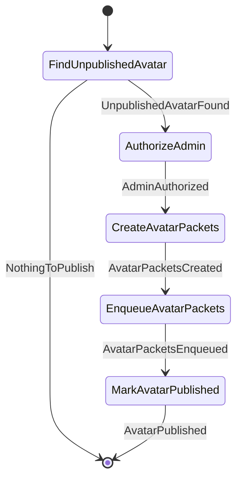

### PublishGroupDescriptionWorkflow

- **Kind:** internal — started by an observer, dispatcher or another workflow `GroupStateCommand.PublishGroupDescription`
- **Source:** `feature/conversationorchestration/groupstate/src/commonMain/kotlin/com/cbgm/sparrow/feature/conversationorchestration/groupstate/domain/workflow/metadata/PublishGroupDescriptionWorkflow.kt`
- **Lock:** `groupAdministrationLockKey(command.groupId)`
- **Uses:** `GroupDescriptionRepository`, `FindUnpublishedGroupStateUseCase`, `RequireGroupAdminContextUseCase`, `CreateGroupDescriptionPacketsUseCase`, `EnqueueGroupPacketsUseCase`

```text
FindUnpublishedDescription -> AuthorizeAdmin -> CreateDescriptionPackets -> EnqueueDescriptionPackets -> MarkDescriptionPublished.
Without an unpublished description (published already, or replaced by a newer one from another admin) it stops
after FindUnpublishedDescription.

The description was saved locally before; this workflow only sends it. It holds the group administration lock, so the
packets are signed for the epoch and recipients that are current when they are queued. The description is marked
published only while it is still the stored version; a failed send leaves it unpublished for the next attempt.
```

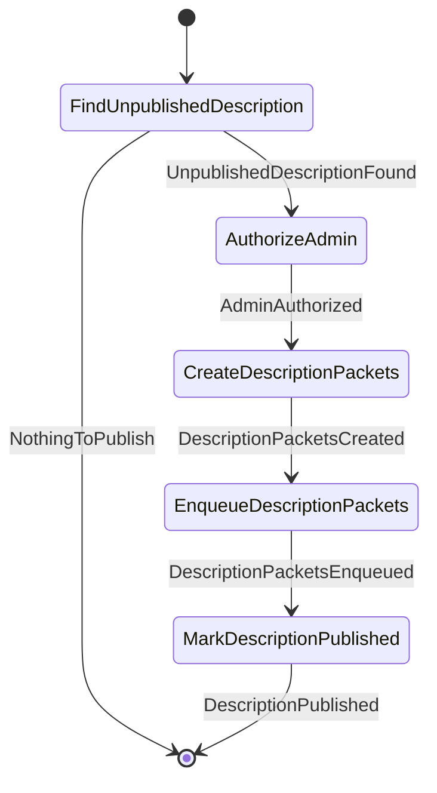

### PublishGroupTitleWorkflow

- **Kind:** internal — started by an observer, dispatcher or another workflow `GroupStateCommand.PublishGroupTitle`
- **Source:** `feature/conversationorchestration/groupstate/src/commonMain/kotlin/com/cbgm/sparrow/feature/conversationorchestration/groupstate/domain/workflow/metadata/PublishGroupTitleWorkflow.kt`
- **Lock:** `groupAdministrationLockKey(command.groupId)`
- **Uses:** `GroupTitleRepository`, `FindUnpublishedGroupStateUseCase`, `RequireGroupAdminContextUseCase`, `CreateGroupTitlePacketsUseCase`, `EnqueueGroupPacketsUseCase`

```text
FindUnpublishedTitle -> AuthorizeAdmin -> CreateTitlePackets -> EnqueueTitlePackets -> MarkTitlePublished.
Without an unpublished title (published already, or replaced by a newer one from another admin) it stops
after FindUnpublishedTitle.

The title was saved locally before; this workflow only sends it. It holds the group administration lock, so the
packets are signed for the epoch and recipients that are current when they are queued. The title is marked
published only while it is still the stored version; a failed send leaves it unpublished for the next attempt.
```

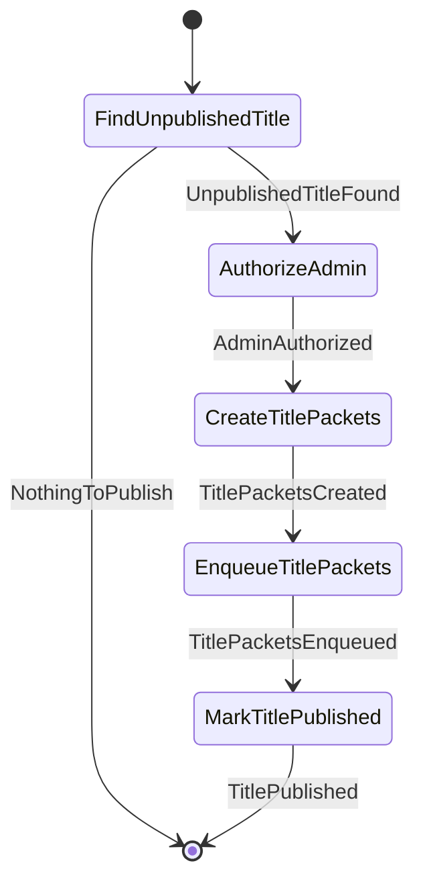

### RemoveGroupAvatarWorkflow

- **Kind:** public — Chats submits `GroupAdministrationCommand.RemoveAvatar`
- **Source:** `feature/conversationorchestration/groupstate/src/commonMain/kotlin/com/cbgm/sparrow/feature/conversationorchestration/groupstate/domain/workflow/metadata/RemoveGroupAvatarWorkflow.kt`
- **Lock:** none
- **Uses:** `WorkflowEngine`, `RequireGroupAdminContextUseCase`, `PrepareGroupAvatarUseCase`, `SaveGroupAvatarUseCase`

```text
AuthorizeAdmin -> PrepareAvatar -> SaveAvatar -> PublishAvatar. The removal is a new avatar version without an image.

The new avatar is saved as unpublished right away, so the user sees it at once without waiting for a running
membership change. Only the publishing ([GroupStateCommand.PublishGroupAvatar]) waits for the group
administration lock. A failed or interrupted publish leaves the avatar unpublished: the same change again, or the
recovery after the next start, publishes it.
```

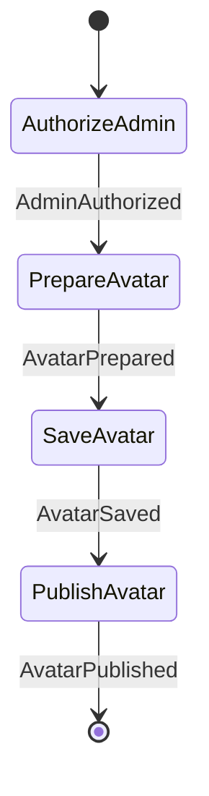

### SendCurrentGroupMetadataWorkflow

- **Kind:** internal — started by an observer, dispatcher or another workflow `GroupStateCommand.SendCurrentGroupMetadata`
- **Source:** `feature/conversationorchestration/groupstate/src/commonMain/kotlin/com/cbgm/sparrow/feature/conversationorchestration/groupstate/domain/workflow/metadata/SendCurrentGroupMetadataWorkflow.kt`
- **Lock:** `groupAdministrationLockKey(command.groupId)`
- **Uses:** `WorkflowEngine`, `SendCurrentGroupTitleUseCase`, `SendCurrentGroupDescriptionUseCase`, `SendCurrentGroupAvatarUseCase`

```text
SendTitle -> SendDescription -> SendAvatar -> SendPin -> SendExpenses.

Every item is replayed independently: a failed item is logged and the next one is still sent. The replay holds
the group administration lock, so no epoch rotation runs between authorizing the member and queueing an item;
the nested pin and expense replays take no lock of their own.
```

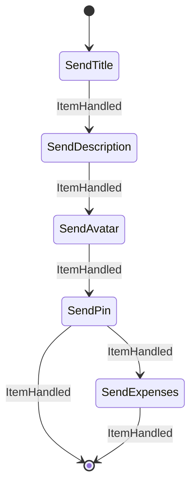

## `payment`

### SendGroupPaymentWorkflow

- **Kind:** public — Chats submits `GroupMessageCommand.SendPaymentTransfer`
- **Source:** `feature/conversationorchestration/groupstate/src/commonMain/kotlin/com/cbgm/sparrow/feature/conversationorchestration/groupstate/domain/workflow/payment/SendGroupPaymentWorkflow.kt`
- **Lock:** `"payment:${command.groupId}"`
- **Uses:** `WorkflowEngine`, `RequireGroupPaymentTransferUseCase`

```text
ValidatePayment -> SendPayment; bank details never enter messaging or the outbox.
```

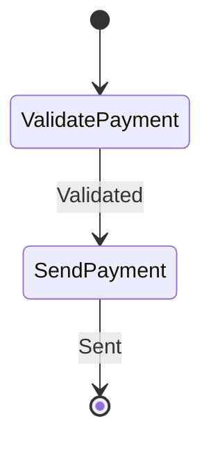

## `pin`

### CloseGroupExpensesWorkflow

- **Kind:** public — Chats submits `GroupMessageCommand.CloseExpenses`
- **Source:** `feature/conversationorchestration/groupstate/src/commonMain/kotlin/com/cbgm/sparrow/feature/conversationorchestration/groupstate/domain/workflow/pin/CloseGroupExpensesWorkflow.kt`
- **Lock:** `groupAdministrationLockKey(command.groupId)`
- **Uses:** `WorkflowEngine`, `GroupPinRepository`, `RequireGroupAdminContextUseCase`, `FindExpenseBoardClosureUseCase`, `CreateExpenseBoardUseCase`, `PrepareEmptyGroupPinUseCase`, `CreateGroupPinPacketsUseCase`, `EnqueueGroupPacketsUseCase`, `SaveGroupPinUseCase`, `DeleteLocalExpenseReceiptsUseCase`

```text
Closes the open expense board: announces the closing as an ordinary encrypted group message,
then clears the pin slot the board occupies.

AuthorizeAdmin -> FindPin -> FindBoardClosure -> [SendBoardClosedMessage] -> DeleteReceipts -> PrepareEmptyPin
  -> CreatePinPackets -> EnqueuePinPackets -> SaveEmptyPin.

The closing message is queued before the pin is released, so a failed send never closes the board. Every step
can run again: a retry after a failure finds the stored closing message and does not announce it twice, and the
pin stays until its packets are queued, so the retry still releases it for every member.
```

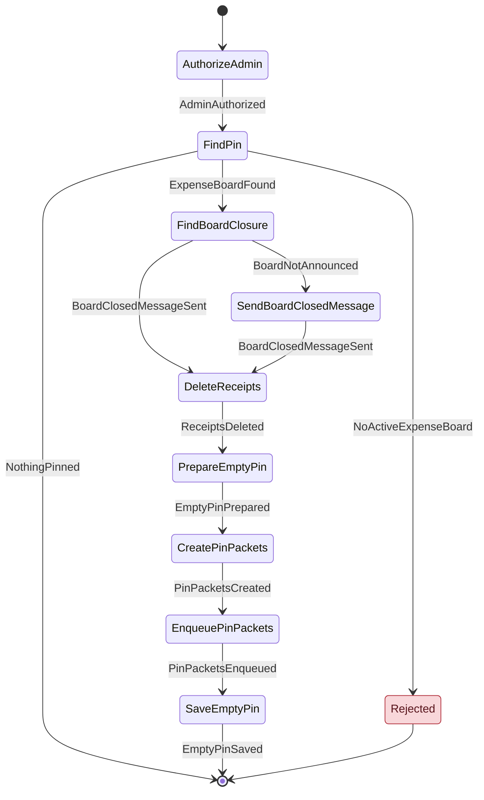

### PinGroupMessageWorkflow

- **Kind:** public — Chats submits `GroupMessageCommand.PinMessage`
- **Source:** `feature/conversationorchestration/groupstate/src/commonMain/kotlin/com/cbgm/sparrow/feature/conversationorchestration/groupstate/domain/workflow/pin/PinGroupMessageWorkflow.kt`
- **Lock:** none
- **Uses:** `WorkflowEngine`, `GroupPinRepository`, `FindPinnableGroupMessageUseCase`, `ResolveGroupPinSenderKeyUseCase`, `RequireGroupAdminContextUseCase`, `PrepareGroupPinUseCase`, `SaveGroupPinUseCase`

```text
FindPinTarget -> [ResolveSenderKey] -> AuthorizeAdmin -> PreparePin -> SavePin -> PublishPin.

The pin snapshot keeps the sender's signing key so every member can verify who wrote the message. The pin is
saved as unpublished right away, so the user sees it at once; only the publishing
([GroupStateCommand.PublishGroupPin]) waits for the group administration lock. A pin that was never published is
not skipped as "already pinned": pinning it again, or the recovery after the next start, publishes it.
```

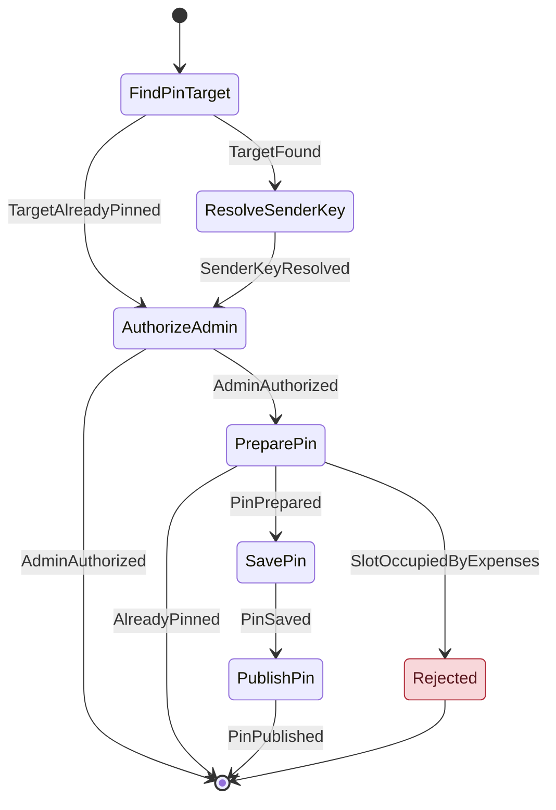

### PublishGroupPinWorkflow

- **Kind:** internal — started by an observer, dispatcher or another workflow `GroupStateCommand.PublishGroupPin`
- **Source:** `feature/conversationorchestration/groupstate/src/commonMain/kotlin/com/cbgm/sparrow/feature/conversationorchestration/groupstate/domain/workflow/pin/PublishGroupPinWorkflow.kt`
- **Lock:** `groupAdministrationLockKey(command.groupId)`
- **Uses:** `GroupPinRepository`, `FindUnpublishedGroupStateUseCase`, `RequireGroupAdminContextUseCase`, `CreateGroupPinPacketsUseCase`, `EnqueueGroupPacketsUseCase`

```text
FindUnpublishedPin -> AuthorizeAdmin -> CreatePinPackets -> EnqueuePinPackets -> MarkPinPublished.
Without an unpublished pin (published already, or replaced by a newer one from another admin) it stops
after FindUnpublishedPin.

The pin slot was saved locally before; this workflow only sends it. It holds the group administration lock, so the
packets are signed for the epoch and recipients that are current when they are queued. The pin is marked
published only while it is still the stored version; a failed send leaves it unpublished for the next attempt.
```

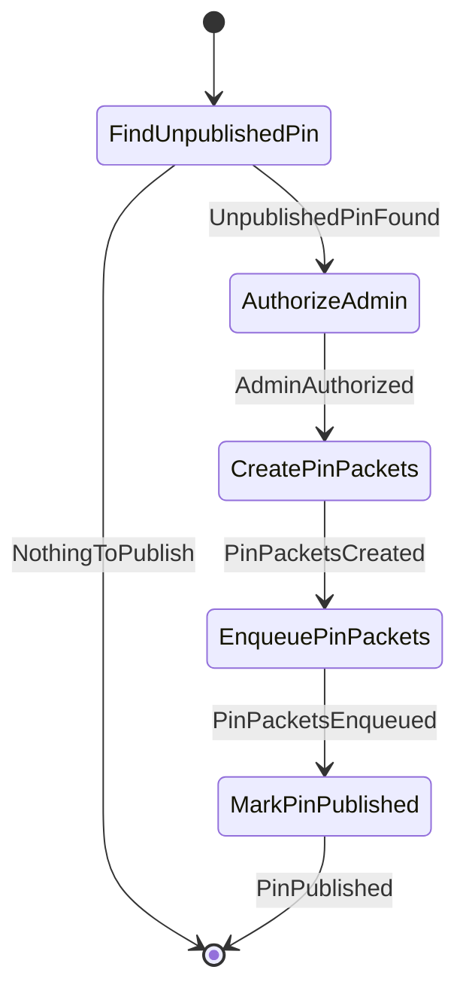

### SendCurrentGroupPinWorkflow

- **Kind:** internal — started by an observer, dispatcher or another workflow `GroupStateCommand.SendCurrentGroupPin`
- **Source:** `feature/conversationorchestration/groupstate/src/commonMain/kotlin/com/cbgm/sparrow/feature/conversationorchestration/groupstate/domain/workflow/pin/SendCurrentGroupPinWorkflow.kt`
- **Lock:** none
- **Uses:** `GroupPinRepository`, `RequireGroupAdminContextUseCase`, `CreateGroupPinPacketsUseCase`, `EnqueueGroupPacketsUseCase`

```text
FindPin -> CreatePinPacket -> EnqueuePinPacket.
```

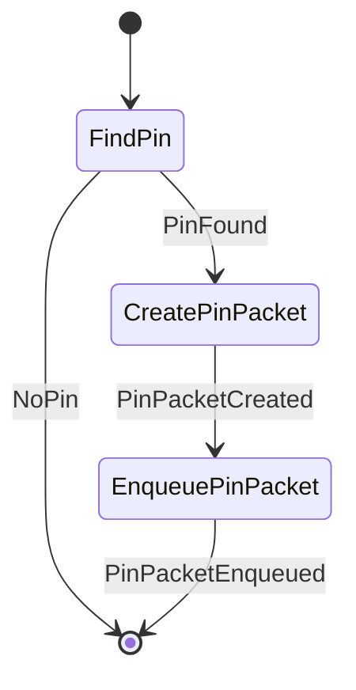

### UnpinGroupMessageWorkflow

- **Kind:** public — Chats submits `GroupMessageCommand.UnpinMessage`
- **Source:** `feature/conversationorchestration/groupstate/src/commonMain/kotlin/com/cbgm/sparrow/feature/conversationorchestration/groupstate/domain/workflow/pin/UnpinGroupMessageWorkflow.kt`
- **Lock:** none
- **Uses:** `WorkflowEngine`, `GroupPinRepository`, `RequireGroupAdminContextUseCase`, `PrepareEmptyGroupPinUseCase`, `SaveGroupPinUseCase`

```text
Removes a pinned message; an open expense board must be closed instead.

AuthorizeAdmin -> FindPin -> [PrepareEmptyPin -> SaveEmptyPin] -> PublishPin.

The slot is cleared locally right away as unpublished, so the user sees it at once; only the publishing
([GroupStateCommand.PublishGroupPin]) waits for the group administration lock. An empty slot that was never
published is published again instead of reported as "nothing pinned".
```

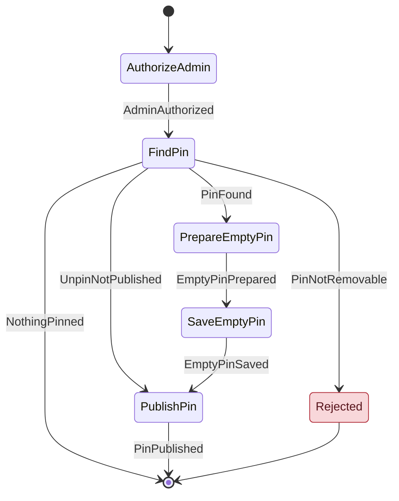
