# Group state workflows

_Generated by `./gradlew workflowCatalog` from `:feature:conversationorchestration:groupstate`. Do not edit by hand._

State an admin sets for the whole group and broadcasts to every member: title, description, avatar, pin and the expense board.

Diagram legend: boxes are `Step`s, arrow labels are the `Outcome` a step reported, `[*]` is the start or a successful completion, `Rejected` ends the workflow with a `ConversationFailure`.

| Workflow | Started by | Command | Lock |
|---|---|---|---|
| [`ActivateGroupExpensesWorkflow`](#activategroupexpensesworkflow) | Chats (`ConversationOrchestrator`) | `GroupMessageCommand.ActivateExpenses` | — |
| [`CreateGroupExpenseWorkflow`](#creategroupexpenseworkflow) | Chats (`ConversationOrchestrator`) | `GroupMessageCommand.CreateExpense` | — |
| [`DeleteGroupExpenseWorkflow`](#deletegroupexpenseworkflow) | Chats (`ConversationOrchestrator`) | `GroupMessageCommand.DeleteExpense` | — |
| [`EditGroupExpenseWorkflow`](#editgroupexpenseworkflow) | Chats (`ConversationOrchestrator`) | `GroupMessageCommand.EditExpense` | — |
| [`SendCurrentGroupExpensesWorkflow`](#sendcurrentgroupexpensesworkflow) | orchestration (`engine.run`) | `GroupStateCommand.SendCurrentGroupExpenses` | — |
| [`ChangeGroupAvatarWorkflow`](#changegroupavatarworkflow) | Chats (`ConversationOrchestrator`) | `GroupAdministrationCommand.ChangeAvatar` | — |
| [`ChangeGroupDescriptionWorkflow`](#changegroupdescriptionworkflow) | Chats (`ConversationOrchestrator`) | `GroupAdministrationCommand.ChangeDescription` | `groupMetadataLockKey(command.groupId)` |
| [`ChangeGroupTitleWorkflow`](#changegrouptitleworkflow) | Chats (`ConversationOrchestrator`) | `GroupAdministrationCommand.ChangeTitle` | `groupMetadataLockKey(command.groupId)` |
| [`PublishGroupAvatarWorkflow`](#publishgroupavatarworkflow) | orchestration (`engine.run`) | `GroupStateCommand.PublishGroupAvatar` | `groupMetadataLockKey(command.groupId)` |
| [`RemoveGroupAvatarWorkflow`](#removegroupavatarworkflow) | Chats (`ConversationOrchestrator`) | `GroupAdministrationCommand.RemoveAvatar` | — |
| [`SendCurrentGroupMetadataWorkflow`](#sendcurrentgroupmetadataworkflow) | orchestration (`engine.run`) | `GroupStateCommand.SendCurrentGroupMetadata` | — |
| [`CloseGroupExpensesWorkflow`](#closegroupexpensesworkflow) | Chats (`ConversationOrchestrator`) | `GroupMessageCommand.CloseExpenses` | `groupPinLockKey(command.groupId)` |
| [`PinGroupMessageWorkflow`](#pingroupmessageworkflow) | Chats (`ConversationOrchestrator`) | `GroupMessageCommand.PinMessage` | `groupPinLockKey(command.groupId)` |
| [`SendCurrentGroupPinWorkflow`](#sendcurrentgrouppinworkflow) | orchestration (`engine.run`) | `GroupStateCommand.SendCurrentGroupPin` | — |
| [`UnpinGroupMessageWorkflow`](#unpingroupmessageworkflow) | Chats (`ConversationOrchestrator`) | `GroupMessageCommand.UnpinMessage` | `groupPinLockKey(command.groupId)` |

## `expense`

### ActivateGroupExpensesWorkflow

- **Kind:** public — Chats submits `GroupMessageCommand.ActivateExpenses`
- **Source:** `feature/conversationorchestration/groupstate/src/commonMain/kotlin/com/cbgm/sparrow/feature/conversationorchestration/groupstate/domain/workflow/expense/ActivateGroupExpensesWorkflow.kt`
- **Lock:** none
- **Uses:** `WorkflowEngine`, `GroupPinRepository`, `RequireGroupAdminContextUseCase`

```text
AuthorizeAdmin -> CheckNoActiveBoard -> CreateBoard -> SendBoard -> PinBoard.

An expense board is an ordinary group message part that occupies the group's pin slot.
```

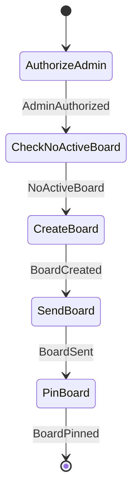

### CreateGroupExpenseWorkflow

- **Kind:** public — Chats submits `GroupMessageCommand.CreateExpense`
- **Source:** `feature/conversationorchestration/groupstate/src/commonMain/kotlin/com/cbgm/sparrow/feature/conversationorchestration/groupstate/domain/workflow/expense/CreateGroupExpenseWorkflow.kt`
- **Lock:** none
- **Uses:** `WorkflowEngine`, `FindGroupExpenseMembersUseCase`

```text
FindExpenseMembers -> CreateExpense -> SendExpense.
```

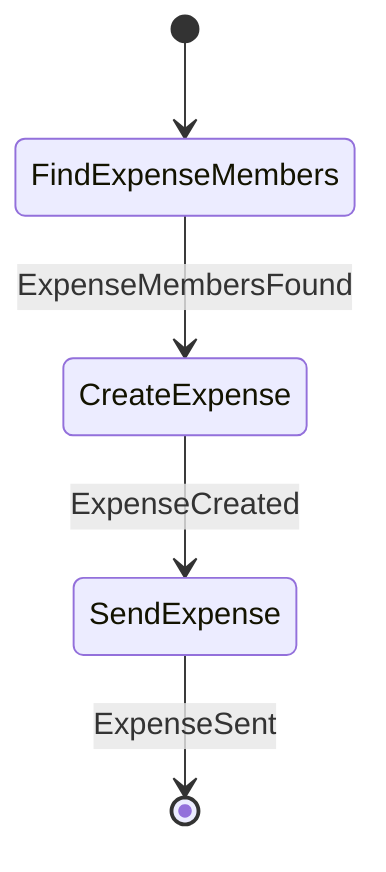

### DeleteGroupExpenseWorkflow

- **Kind:** public — Chats submits `GroupMessageCommand.DeleteExpense`
- **Source:** `feature/conversationorchestration/groupstate/src/commonMain/kotlin/com/cbgm/sparrow/feature/conversationorchestration/groupstate/domain/workflow/expense/DeleteGroupExpenseWorkflow.kt`
- **Lock:** none
- **Uses:** `WorkflowEngine`, `FindGroupExpenseMembersUseCase`, `DeleteLocalExpenseReceiptsUseCase`

```text
FindExpenseMembers -> MarkExpenseDeleted -> SendExpense -> DeleteReceipts.
```

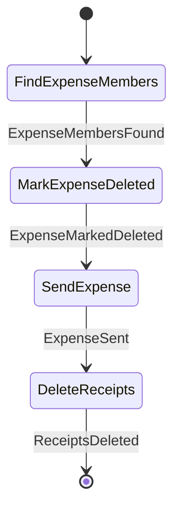

### EditGroupExpenseWorkflow

- **Kind:** public — Chats submits `GroupMessageCommand.EditExpense`
- **Source:** `feature/conversationorchestration/groupstate/src/commonMain/kotlin/com/cbgm/sparrow/feature/conversationorchestration/groupstate/domain/workflow/expense/EditGroupExpenseWorkflow.kt`
- **Lock:** none
- **Uses:** `WorkflowEngine`, `FindGroupExpenseMembersUseCase`, `MessageAttachmentOperationsRepository`, `MessageAttachmentRepository`, `DeleteLocalExpenseReceiptsUseCase`

```text
FindExpenseMembers -> ReviseExpense -> SendExpense -> DeleteReplacedReceipts.
```

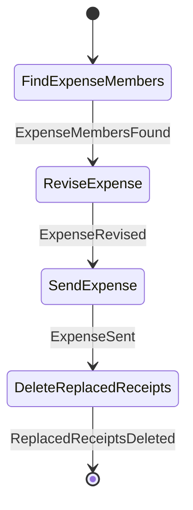

### SendCurrentGroupExpensesWorkflow

- **Kind:** internal — started by an observer, dispatcher or another workflow `GroupStateCommand.SendCurrentGroupExpenses`
- **Source:** `feature/conversationorchestration/groupstate/src/commonMain/kotlin/com/cbgm/sparrow/feature/conversationorchestration/groupstate/domain/workflow/expense/SendCurrentGroupExpensesWorkflow.kt`
- **Lock:** none
- **Uses:** `GroupPinRepository`, `RequireGroupAdminContextUseCase`, `MessageAttachmentOperationsRepository`, `GroupMessageRepository`, `EncryptGroupMessageUseCase`, `EnqueueGroupPacketsUseCase`

```text
FindBoard -> LoadExpenseMessages -> EnqueueExpenseMessages.
```

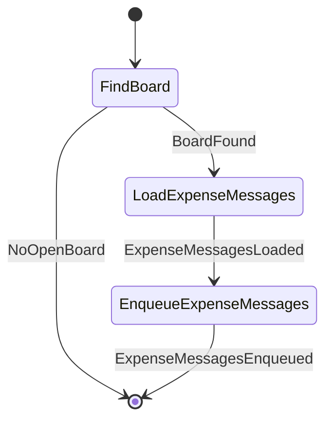

## `metadata`

### ChangeGroupAvatarWorkflow

- **Kind:** public — Chats submits `GroupAdministrationCommand.ChangeAvatar`
- **Source:** `feature/conversationorchestration/groupstate/src/commonMain/kotlin/com/cbgm/sparrow/feature/conversationorchestration/groupstate/domain/workflow/metadata/ChangeGroupAvatarWorkflow.kt`
- **Lock:** none
- **Uses:** `WorkflowEngine`

```text
ValidateAvatar -> PublishAvatar.
```

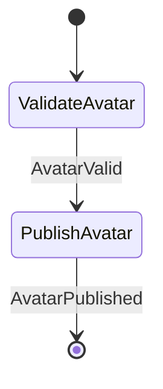

### ChangeGroupDescriptionWorkflow

- **Kind:** public — Chats submits `GroupAdministrationCommand.ChangeDescription`
- **Source:** `feature/conversationorchestration/groupstate/src/commonMain/kotlin/com/cbgm/sparrow/feature/conversationorchestration/groupstate/domain/workflow/metadata/ChangeGroupDescriptionWorkflow.kt`
- **Lock:** `groupMetadataLockKey(command.groupId)`
- **Uses:** `GroupDescriptionRepository`, `RequireGroupAdminContextUseCase`, `CreateGroupDescriptionPacketsUseCase`, `EnqueueGroupPacketsUseCase`

```text
AuthorizeAdmin -> LoadDescription -> SaveDescription -> CreateDescriptionPackets -> EnqueueDescriptionPackets. An unchanged description stops after LoadDescription.
```

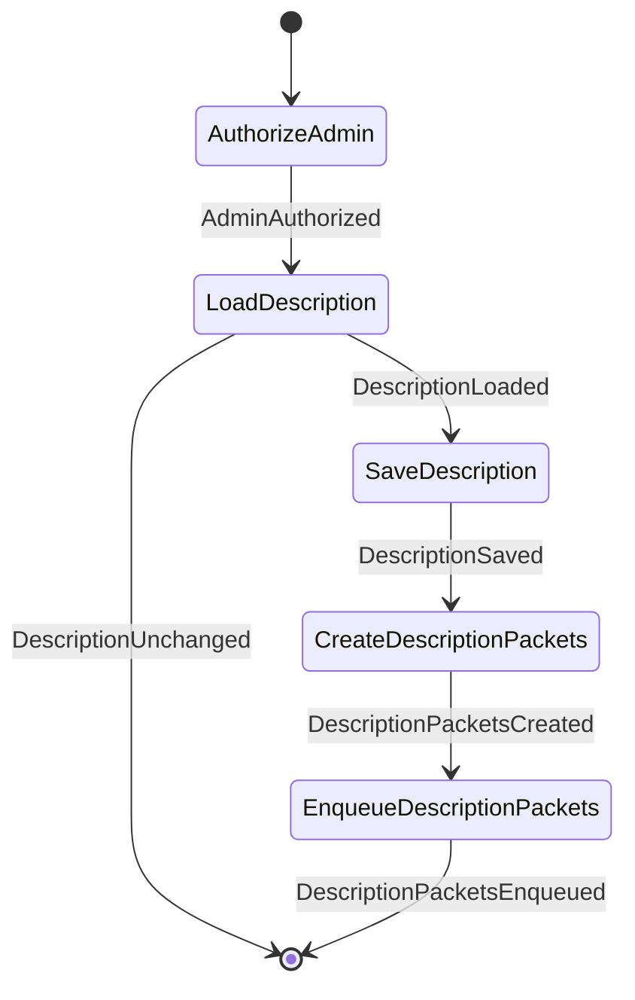

### ChangeGroupTitleWorkflow

- **Kind:** public — Chats submits `GroupAdministrationCommand.ChangeTitle`
- **Source:** `feature/conversationorchestration/groupstate/src/commonMain/kotlin/com/cbgm/sparrow/feature/conversationorchestration/groupstate/domain/workflow/metadata/ChangeGroupTitleWorkflow.kt`
- **Lock:** `groupMetadataLockKey(command.groupId)`
- **Uses:** `GroupTitleRepository`, `RequireGroupAdminContextUseCase`, `CreateGroupTitlePacketsUseCase`, `EnqueueGroupPacketsUseCase`

```text
AuthorizeAdmin -> LoadTitle -> SaveTitle -> CreateTitlePackets -> EnqueueTitlePackets. An unchanged title stops after LoadTitle.
```

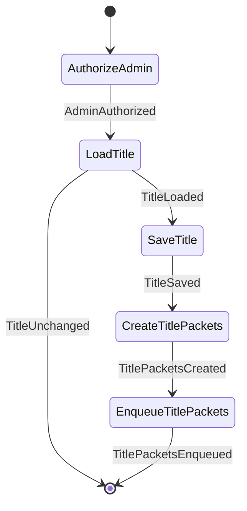

### PublishGroupAvatarWorkflow

- **Kind:** internal — started by an observer, dispatcher or another workflow `GroupStateCommand.PublishGroupAvatar`
- **Source:** `feature/conversationorchestration/groupstate/src/commonMain/kotlin/com/cbgm/sparrow/feature/conversationorchestration/groupstate/domain/workflow/metadata/PublishGroupAvatarWorkflow.kt`
- **Lock:** `groupMetadataLockKey(command.groupId)`
- **Uses:** `GroupAvatarRepository`, `RequireGroupAdminContextUseCase`, `CreateGroupAvatarPacketsUseCase`, `EnqueueGroupPacketsUseCase`

```text
AuthorizeAdmin -> LoadAvatar -> SaveAvatar -> CreateAvatarPackets -> EnqueueAvatarPackets.
```

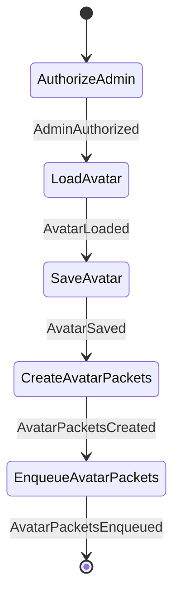

### RemoveGroupAvatarWorkflow

- **Kind:** public — Chats submits `GroupAdministrationCommand.RemoveAvatar`
- **Source:** `feature/conversationorchestration/groupstate/src/commonMain/kotlin/com/cbgm/sparrow/feature/conversationorchestration/groupstate/domain/workflow/metadata/RemoveGroupAvatarWorkflow.kt`
- **Lock:** none
- **Uses:** `WorkflowEngine`

```text
PublishRemoval: the removal is published like any other avatar change.
```

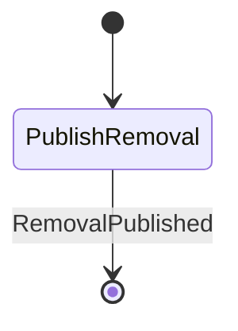

### SendCurrentGroupMetadataWorkflow

- **Kind:** internal — started by an observer, dispatcher or another workflow `GroupStateCommand.SendCurrentGroupMetadata`
- **Source:** `feature/conversationorchestration/groupstate/src/commonMain/kotlin/com/cbgm/sparrow/feature/conversationorchestration/groupstate/domain/workflow/metadata/SendCurrentGroupMetadataWorkflow.kt`
- **Lock:** none
- **Uses:** `WorkflowEngine`, `SendCurrentGroupTitleUseCase`, `SendCurrentGroupDescriptionUseCase`, `SendCurrentGroupAvatarUseCase`

```text
SendTitle -> SendDescription -> SendAvatar -> SendPin -> SendExpenses.

Every item is replayed independently: a failed item is logged and the next one is still sent.
```

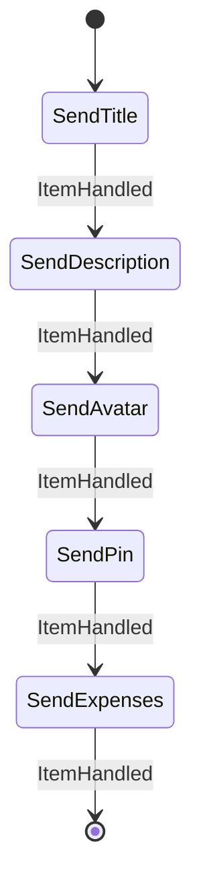

## `pin`

### CloseGroupExpensesWorkflow

- **Kind:** public — Chats submits `GroupMessageCommand.CloseExpenses`
- **Source:** `feature/conversationorchestration/groupstate/src/commonMain/kotlin/com/cbgm/sparrow/feature/conversationorchestration/groupstate/domain/workflow/pin/CloseGroupExpensesWorkflow.kt`
- **Lock:** `groupPinLockKey(command.groupId)`
- **Uses:** `WorkflowEngine`, `GroupPinRepository`, `RequireGroupAdminContextUseCase`, `CreateGroupPinPacketsUseCase`, `EnqueueGroupPacketsUseCase`, `DeleteLocalExpenseReceiptsUseCase`

```text
Closes the open expense board: announces the closing as an ordinary encrypted group message,
then clears the pin slot the board occupies.

AuthorizeAdmin -> FindPin -> SendBoardClosedMessage -> DeleteReceipts -> SaveEmptyPin -> CreatePinPackets
  -> EnqueuePinPackets.

The closing message is queued before the pin is released, so a failed send never closes the board.
```

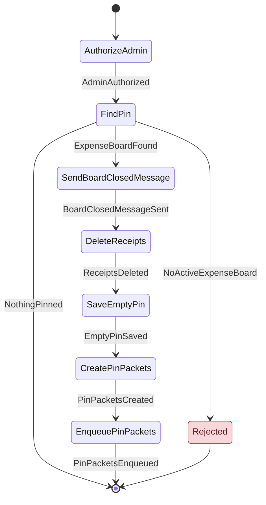

### PinGroupMessageWorkflow

- **Kind:** public — Chats submits `GroupMessageCommand.PinMessage`
- **Source:** `feature/conversationorchestration/groupstate/src/commonMain/kotlin/com/cbgm/sparrow/feature/conversationorchestration/groupstate/domain/workflow/pin/PinGroupMessageWorkflow.kt`
- **Lock:** `groupPinLockKey(command.groupId)`
- **Uses:** `GroupMessageRepository`, `GroupPinRepository`, `MessageAttachmentOperationsRepository`, `FindGroupMessageUseCase`, `GetGroupPinSenderSigningKeyUseCase`, `GetRemoteIdentityUseCase`, `RequireGroupAdminContextUseCase`, `CreateGroupPinPacketsUseCase`, `EnqueueGroupPacketsUseCase`

```text
FindPinTarget -> [ResolveSenderKey] -> AuthorizeAdmin -> CheckPinSlot -> SavePin -> CreatePinPackets
-> EnqueuePinPackets.

The pin snapshot keeps the sender's signing key so every member can verify who wrote the message.
```

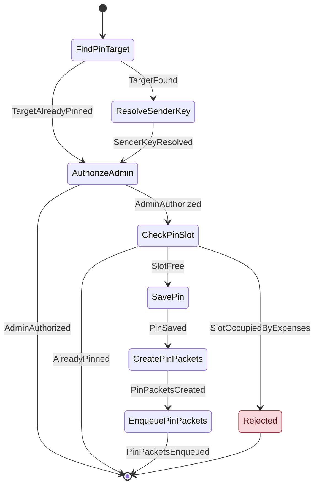

### SendCurrentGroupPinWorkflow

- **Kind:** internal — started by an observer, dispatcher or another workflow `GroupStateCommand.SendCurrentGroupPin`
- **Source:** `feature/conversationorchestration/groupstate/src/commonMain/kotlin/com/cbgm/sparrow/feature/conversationorchestration/groupstate/domain/workflow/pin/SendCurrentGroupPinWorkflow.kt`
- **Lock:** none
- **Uses:** `GroupPinRepository`, `RequireGroupAdminContextUseCase`, `CreateGroupPinPacketsUseCase`, `EnqueueGroupPacketsUseCase`

```text
FindPin -> CreatePinPacket -> EnqueuePinPacket.
```

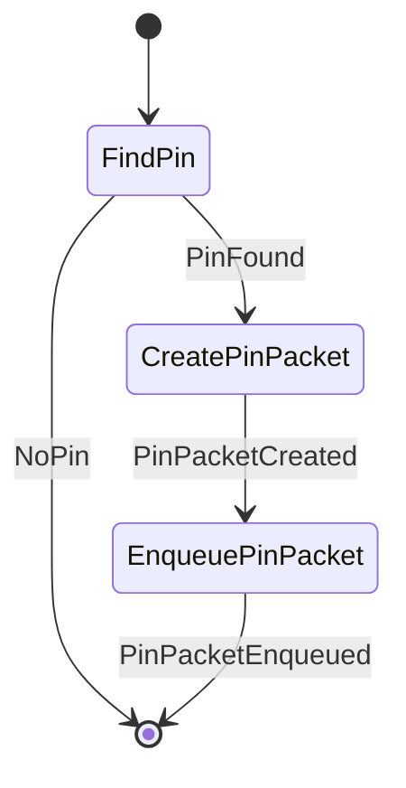

### UnpinGroupMessageWorkflow

- **Kind:** public — Chats submits `GroupMessageCommand.UnpinMessage`
- **Source:** `feature/conversationorchestration/groupstate/src/commonMain/kotlin/com/cbgm/sparrow/feature/conversationorchestration/groupstate/domain/workflow/pin/UnpinGroupMessageWorkflow.kt`
- **Lock:** `groupPinLockKey(command.groupId)`
- **Uses:** `GroupPinRepository`, `RequireGroupAdminContextUseCase`, `CreateGroupPinPacketsUseCase`, `EnqueueGroupPacketsUseCase`

```text
Removes a pinned message; an open expense board must be closed instead.

AuthorizeAdmin -> FindPin -> SaveEmptyPin -> CreatePinPackets -> EnqueuePinPackets.
```

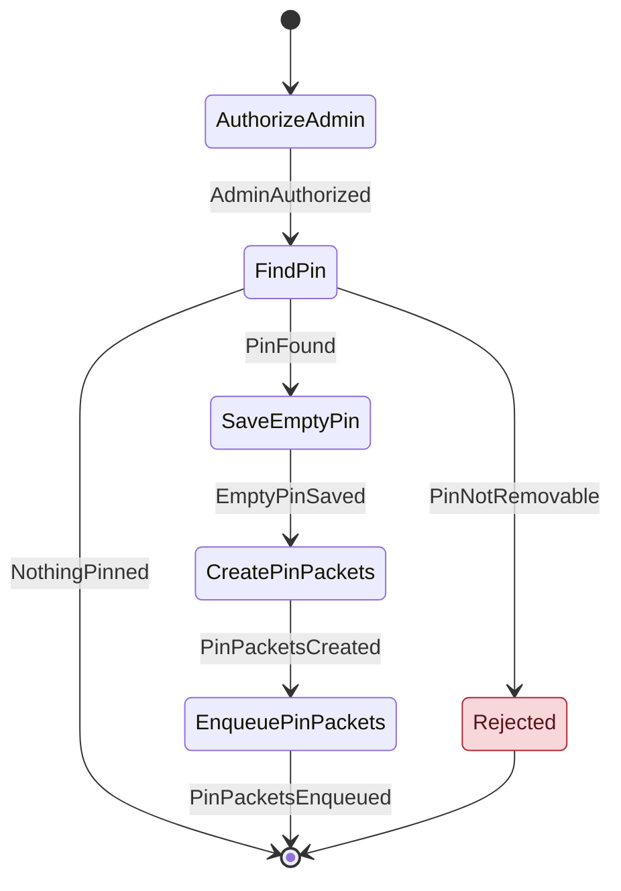
