# Incoming packet workflows

_Generated by `./gradlew workflowCatalog` from `:feature:conversationorchestration:incoming`. Do not edit by hand._

Routing every decrypted packet to the one workflow that applies it.

Diagram legend: boxes are `Step`s, arrow labels are the `Outcome` a step reported, `[*]` is the start or a successful completion, `Rejected` ends the workflow with a `ConversationFailure`.

| Workflow | Started by | Command | Lock |
|---|---|---|---|
| [`ReceiveDirectMessageWorkflow`](#receivedirectmessageworkflow) | orchestration (`engine.run`) | `IncomingCommand.ReceiveDirectMessage` | — |
| [`ReceiveGroupMessageWorkflow`](#receivegroupmessageworkflow) | orchestration (`engine.run`) | `IncomingCommand.ReceiveGroupMessage` | — |
| [`CompleteManualIdentityWorkflow`](#completemanualidentityworkflow) | orchestration (`engine.run`) | `IncomingCommand.CompleteManualIdentity` | — |
| [`ReceiveAuthorizationRevokedWorkflow`](#receiveauthorizationrevokedworkflow) | orchestration (`engine.run`) | `IncomingCommand.ReceiveAuthorizationRevoked` | — |
| [`ReceiveContactInviteAcceptedWorkflow`](#receivecontactinviteacceptedworkflow) | orchestration (`engine.run`) | `IncomingCommand.ReceiveContactInviteAccepted` | — |
| [`ReceiveContactInviteDeclinedWorkflow`](#receivecontactinvitedeclinedworkflow) | orchestration (`engine.run`) | `IncomingCommand.ReceiveContactInviteDeclined` | — |
| [`ReceiveContactInviteWorkflow`](#receivecontactinviteworkflow) | orchestration (`engine.run`) | `IncomingCommand.ReceiveContactInvite` | — |
| [`ReceiveContactReadyWorkflow`](#receivecontactreadyworkflow) | orchestration (`engine.run`) | `IncomingCommand.ReceiveContactReady` | — |
| [`ReceiveIdentityAcknowledgementWorkflow`](#receiveidentityacknowledgementworkflow) | orchestration (`engine.run`) | `IncomingCommand.ReceiveIdentityAcknowledgement` | — |
| [`ReceiveManualIdentityWorkflow`](#receivemanualidentityworkflow) | orchestration (`engine.run`) | `IncomingCommand.ReceiveManualIdentity` | — |
| [`ReceiveGroupActivationAcknowledgementWorkflow`](#receivegroupactivationacknowledgementworkflow) | orchestration (`engine.run`) | `IncomingCommand.ReceiveGroupActivationAcknowledgement` | — |
| [`ReceiveGroupDeletionWorkflow`](#receivegroupdeletionworkflow) | orchestration (`engine.run`) | `IncomingCommand.ReceiveGroupDeletion` | — |
| [`ReceiveGroupInviteDeclineWorkflow`](#receivegroupinvitedeclineworkflow) | orchestration (`engine.run`) | `IncomingCommand.ReceiveGroupInviteDecline` | — |
| [`ReceiveGroupInviteReceiptWorkflow`](#receivegroupinvitereceiptworkflow) | orchestration (`engine.run`) | `IncomingCommand.ReceiveGroupInviteReceipt` | — |
| [`ReceiveGroupInviteWorkflow`](#receivegroupinviteworkflow) | orchestration (`engine.run`) | `IncomingCommand.ReceiveGroupInvite` | — |
| [`ReceiveGroupJoinRequestWorkflow`](#receivegroupjoinrequestworkflow) | orchestration (`engine.run`) | `IncomingCommand.ReceiveGroupJoinRequest` | — |
| [`ReceiveGroupLeaveRequestWorkflow`](#receivegroupleaverequestworkflow) | orchestration (`engine.run`) | `IncomingCommand.ReceiveGroupLeaveRequest` | — |
| [`ReceiveGroupMemberActivationWorkflow`](#receivegroupmemberactivationworkflow) | orchestration (`engine.run`) | `IncomingCommand.ReceiveGroupMemberActivation` | — |
| [`ReceiveGroupMemberRemovalWorkflow`](#receivegroupmemberremovalworkflow) | orchestration (`engine.run`) | `IncomingCommand.ReceiveGroupMemberRemoval` | — |
| [`ReceiveGroupReadyAcknowledgementWorkflow`](#receivegroupreadyacknowledgementworkflow) | orchestration (`engine.run`) | `IncomingCommand.ReceiveGroupReadyAcknowledgement` | — |
| [`ReceiveGroupWelcomeWorkflow`](#receivegroupwelcomeworkflow) | orchestration (`engine.run`) | `IncomingCommand.ReceiveGroupWelcome` | — |
| [`ReceiveGroupAvatarWorkflow`](#receivegroupavatarworkflow) | orchestration (`engine.run`) | `IncomingCommand.ReceiveGroupAvatar` | — |
| [`ReceiveGroupDescriptionWorkflow`](#receivegroupdescriptionworkflow) | orchestration (`engine.run`) | `IncomingCommand.ReceiveGroupDescription` | — |
| [`ReceiveGroupPinWorkflow`](#receivegrouppinworkflow) | orchestration (`engine.run`) | `IncomingCommand.ReceiveGroupPin` | — |
| [`ReceiveGroupTitleWorkflow`](#receivegrouptitleworkflow) | orchestration (`engine.run`) | `IncomingCommand.ReceiveGroupTitle` | — |
| [`ApplyParkedMessageOperationsWorkflow`](#applyparkedmessageoperationsworkflow) | orchestration (`engine.run`) | `IncomingCommand.ApplyParkedMessageOperations` | — |
| [`ApplyRemoteMessageOperationWorkflow`](#applyremotemessageoperationworkflow) | orchestration (`engine.run`) | `IncomingCommand.ApplyRemoteMessageOperation` | — |
| [`RouteIncomingPacketWorkflow`](#routeincomingpacketworkflow) | orchestration (`engine.run`) | `IncomingCommand.RouteIncomingPacket` | — |
| [`ReceiveVerificationReceiptWorkflow`](#receiveverificationreceiptworkflow) | orchestration (`engine.run`) | `IncomingCommand.ReceiveVerificationReceipt` | `groupVerificationLockKey(command.packet.groupId)` |
| [`ReceiveVerificationSnapshotRequestWorkflow`](#receiveverificationsnapshotrequestworkflow) | orchestration (`engine.run`) | `IncomingCommand.ReceiveVerificationSnapshotRequest` | `groupVerificationLockKey(command.packet.groupId)` |
| [`ReceiveVerificationSnapshotWorkflow`](#receiveverificationsnapshotworkflow) | orchestration (`engine.run`) | `IncomingCommand.ReceiveVerificationSnapshot` | `groupVerificationLockKey(command.packet.groupId)` |

## `direct`

### ReceiveDirectMessageWorkflow

- **Kind:** internal — started by an observer, dispatcher or another workflow `IncomingCommand.ReceiveDirectMessage`
- **Source:** `feature/conversationorchestration/incoming/src/commonMain/kotlin/com/cbgm/sparrow/feature/conversationorchestration/incoming/domain/workflow/direct/ReceiveDirectMessageWorkflow.kt`
- **Lock:** none
- **Uses:** `WorkflowEngine`, `DirectMessagePacketReader`, `ApplyPeerProfilePictureUseCase`, `ContactRepository`, `DirectMessageRepository`, `MessageAttachmentOperationsRepository`, `ResolveSenderDisplayNameUseCase`, `SendDeliveryReceiptUseCase`, `ClaimAutoReplyForContactUseCase`, `ReleaseAutoReplyRecipientUseCase`

```text
ReadMessage -> UpdateSenderProfile -> StoreMessage -> StoreAttachments -> SendDeliveryReceipt -> ClaimAutoReply
-> [SendAutoReply -> [ReleaseAutoReplyClaim]] -> CacheAttachments -> ApplyParkedOperations

The router created the conversation and checked the authorization before this workflow starts.
```

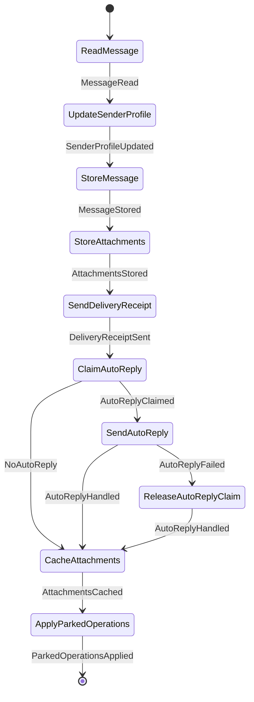

## `group`

### ReceiveGroupMessageWorkflow

- **Kind:** internal — started by an observer, dispatcher or another workflow `IncomingCommand.ReceiveGroupMessage`
- **Source:** `feature/conversationorchestration/incoming/src/commonMain/kotlin/com/cbgm/sparrow/feature/conversationorchestration/incoming/domain/workflow/group/ReceiveGroupMessageWorkflow.kt`
- **Lock:** none
- **Uses:** `WorkflowEngine`, `GroupMessageRepository`, `GroupSecurityRepository`, `GroupMessagePlaintextCodec`, `ApplyPeerProfilePictureUseCase`, `PrefetchLinkPreviewsUseCase`, `MessageAttachmentOperationsRepository`, `SendDeliveryReceiptUseCase`, `AuthorizeIncomingExpensesUseCase`, `DeleteReplacedExpenseReceiptsUseCase`

```text
FindConversation -> DecryptMessage -> ApplyOperation                                   (an operation)
FindConversation -> DecryptMessage -> FindExisting
  -> [AuthorizeExpenses -> DeleteReplacedReceipts -> ApplyProfilePicture -> StoreMessage]
  -> PrefetchLinkPreviews -> StoreAttachments -> SendDeliveryReceipt -> CacheAttachments
  -> ApplyParkedOperations                                                              (a message)

A redelivered message keeps its row; only attachments and the receipt are repeated.
```

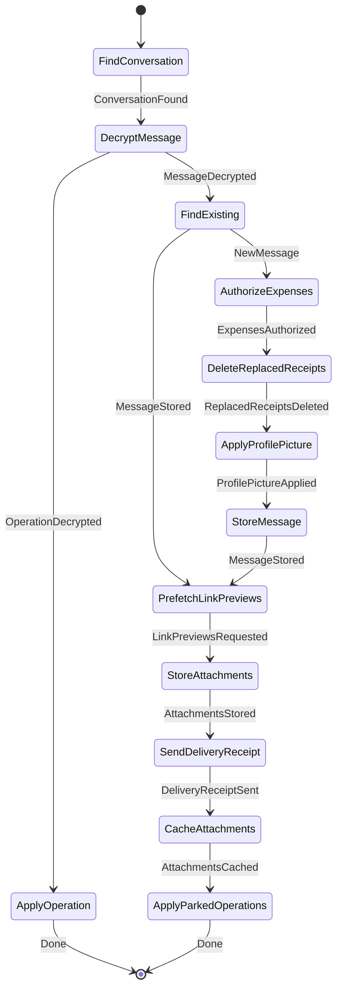

## `identity`

### CompleteManualIdentityWorkflow

- **Kind:** internal — started by an observer, dispatcher or another workflow `IncomingCommand.CompleteManualIdentity`
- **Source:** `feature/conversationorchestration/incoming/src/commonMain/kotlin/com/cbgm/sparrow/feature/conversationorchestration/incoming/domain/workflow/identity/CompleteManualIdentityWorkflow.kt`
- **Lock:** none
- **Uses:** `WorkflowEngine`, `GetIdentityPeerStateUseCase`, `SendIdentityVerificationReceiptUseCase`

```text
LoadAuthorization -> [ActivateConversation] -> SendVerificationReceipt

Manual setup may precede an invitation: only an accepted invitation creates the chat and releases its
queued messages.
```

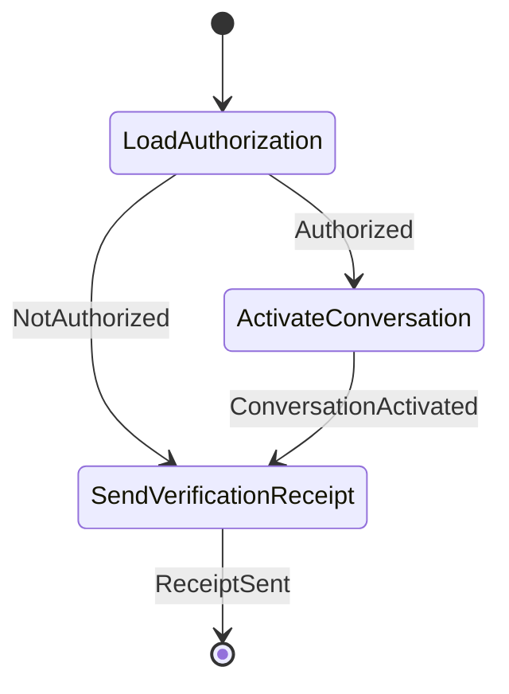

### ReceiveAuthorizationRevokedWorkflow

- **Kind:** internal — started by an observer, dispatcher or another workflow `IncomingCommand.ReceiveAuthorizationRevoked`
- **Source:** `feature/conversationorchestration/incoming/src/commonMain/kotlin/com/cbgm/sparrow/feature/conversationorchestration/incoming/domain/workflow/identity/ReceiveAuthorizationRevokedWorkflow.kt`
- **Lock:** none
- **Uses:** `GetIdentityExchangeBindingUseCase`, `DirectChatAuthorizationRevocationProtocol`, `InvalidateIdentityExchangeUseCase`

```text
FindExchange -> VerifySignature -> DecideRevocation -> InvalidateExchange

The signature is verified before the signer is compared with the invitation's identity: a self-signed
packet from a new identity never revokes the previous identity's chat. It is acknowledged and ignored.
```

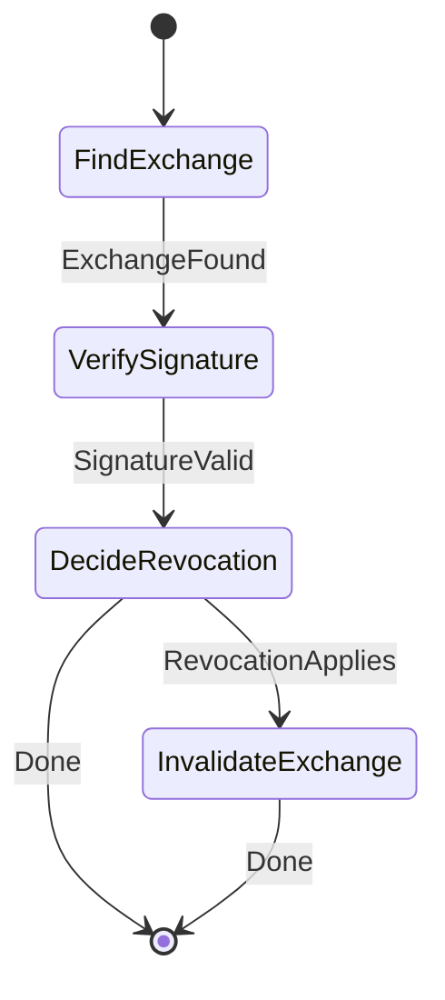

### ReceiveContactInviteAcceptedWorkflow

- **Kind:** internal — started by an observer, dispatcher or another workflow `IncomingCommand.ReceiveContactInviteAccepted`
- **Source:** `feature/conversationorchestration/incoming/src/commonMain/kotlin/com/cbgm/sparrow/feature/conversationorchestration/incoming/domain/workflow/identity/ReceiveContactInviteAcceptedWorkflow.kt`
- **Lock:** none
- **Uses:** `WorkflowEngine`, `ContactInvitationHandshakeProtocol`, `GetIdentityExchangeBindingUseCase`, `ReceiveIdentityExchangeAcceptedUseCase`, `ContactBlocklistRepository`, `StagePendingRemoteIdentityChangeUseCase`, `HandleInvitationResponseUseCase`, `ApplyPeerProfilePictureUseCase`

```text
VerifyAcceptance -> FindExchange -> ReceiveAcceptance -> ActivateConversation -> MarkInvitationAccepted
-> ApplyProfilePicture

An acceptance whose exchange was cancelled or replaced locally cannot establish a chat and is acknowledged
as handled instead of being retried forever. A verified acceptance signed with keys other than the original
contact's is no proof of that contact's identity: it becomes an identity review and never activates the chat.
```

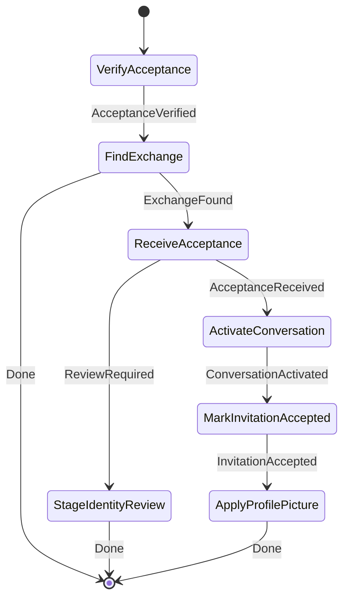

### ReceiveContactInviteDeclinedWorkflow

- **Kind:** internal — started by an observer, dispatcher or another workflow `IncomingCommand.ReceiveContactInviteDeclined`
- **Source:** `feature/conversationorchestration/incoming/src/commonMain/kotlin/com/cbgm/sparrow/feature/conversationorchestration/incoming/domain/workflow/identity/ReceiveContactInviteDeclinedWorkflow.kt`
- **Lock:** none
- **Uses:** `ContactInvitationDeclineProtocol`, `RecordRemoteIdentityDeclineUseCase`

```text
VerifyDecline -> RecordDecline.
```

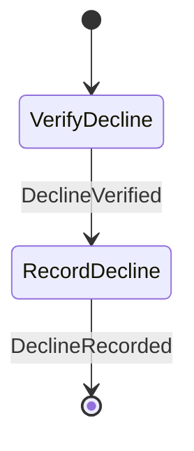

### ReceiveContactInviteWorkflow

- **Kind:** internal — started by an observer, dispatcher or another workflow `IncomingCommand.ReceiveContactInvite`
- **Source:** `feature/conversationorchestration/incoming/src/commonMain/kotlin/com/cbgm/sparrow/feature/conversationorchestration/incoming/domain/workflow/identity/ReceiveContactInviteWorkflow.kt`
- **Lock:** none
- **Uses:** `WorkflowEngine`, `ContactInvitationRequestProtocol`, `PhoneNumberNormalizer`, `ResolveIncomingIdentityPeerUseCase`, `ContactBlocklistRepository`, `StagePendingRemoteIdentityChangeUseCase`, `ReassignIdentityExchangePeerUseCase`, `ApplyIdentityPeerMergeUseCase`, `UpdateIncomingIdentityPeerMetadataUseCase`, `ReceiveIdentityExchangeUseCase`, `ApplyPeerProfilePictureUseCase`, `GetIdentityPeerDisplayNameUseCase`

```text
VerifyInvitation -> ResolvePeer -> MergePeers -> [UpdatePeerPhoneNumber] -> ReceiveExchange -> ApplyProfilePicture
-> ResolveDisplayName -> RecordInvitation

Signature and time bounds are verified BEFORE contacts are looked up or merged. Keys that differ from a
known contact's are proof of the proposed keys only: they become an identity review, never a merge.
The Identity result observer restores the inbox record after a restart; it alone declines rejected senders.
```

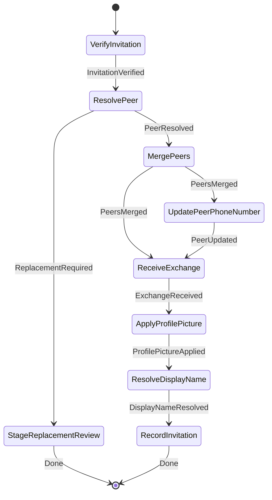

### ReceiveContactReadyWorkflow

- **Kind:** internal — started by an observer, dispatcher or another workflow `IncomingCommand.ReceiveContactReady`
- **Source:** `feature/conversationorchestration/incoming/src/commonMain/kotlin/com/cbgm/sparrow/feature/conversationorchestration/incoming/domain/workflow/identity/ReceiveContactReadyWorkflow.kt`
- **Lock:** none
- **Uses:** `GetIdentityExchangeBindingUseCase`, `ContactInvitationHandshakeProtocol`, `ReceiveIdentityReadyUseCase`

```text
FindExchange -> VerifyReady -> ReceiveReady. READY completes the inviter's side of the exchange.
```

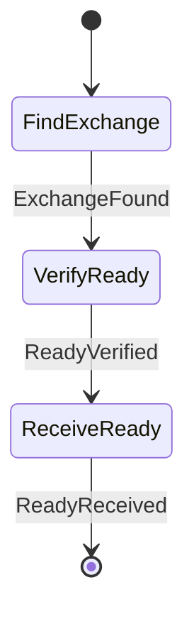

### ReceiveIdentityAcknowledgementWorkflow

- **Kind:** internal — started by an observer, dispatcher or another workflow `IncomingCommand.ReceiveIdentityAcknowledgement`
- **Source:** `feature/conversationorchestration/incoming/src/commonMain/kotlin/com/cbgm/sparrow/feature/conversationorchestration/incoming/domain/workflow/identity/ReceiveIdentityAcknowledgementWorkflow.kt`
- **Lock:** none
- **Uses:** `WorkflowEngine`, `ReceiveIdentityAcknowledgementUseCase`

```text
ReceiveAcknowledgement -> [CompleteIdentity]: the contact confirmed our manually shared identity.
```

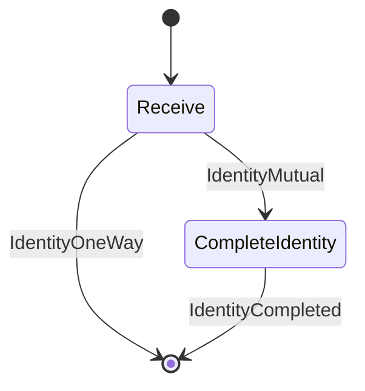

### ReceiveManualIdentityWorkflow

- **Kind:** internal — started by an observer, dispatcher or another workflow `IncomingCommand.ReceiveManualIdentity`
- **Source:** `feature/conversationorchestration/incoming/src/commonMain/kotlin/com/cbgm/sparrow/feature/conversationorchestration/incoming/domain/workflow/identity/ReceiveManualIdentityWorkflow.kt`
- **Lock:** none
- **Uses:** `WorkflowEngine`, `ReceiveManualIdentityUseCase`

```text
ReceiveIdentity -> [CompleteIdentity]: a manually shared identity arrived.
```


## `membership`

### ReceiveGroupActivationAcknowledgementWorkflow

- **Kind:** internal — started by an observer, dispatcher or another workflow `IncomingCommand.ReceiveGroupActivationAcknowledgement`
- **Source:** `feature/conversationorchestration/incoming/src/commonMain/kotlin/com/cbgm/sparrow/feature/conversationorchestration/incoming/domain/workflow/membership/ReceiveGroupActivationAcknowledgementWorkflow.kt`
- **Lock:** none
- **Uses:** `ReceiveGroupActivationAcknowledgementUseCase`

```text
ReceiveAcknowledgement: Membership advances the member's activation rounds.
```

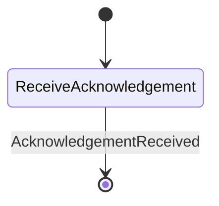

### ReceiveGroupDeletionWorkflow

- **Kind:** internal — started by an observer, dispatcher or another workflow `IncomingCommand.ReceiveGroupDeletion`
- **Source:** `feature/conversationorchestration/incoming/src/commonMain/kotlin/com/cbgm/sparrow/feature/conversationorchestration/incoming/domain/workflow/membership/ReceiveGroupDeletionWorkflow.kt`
- **Lock:** none
- **Uses:** `GetRemoteIdentityUseCase`, `AuthorizeIncomingGroupDeletionUseCase`, `MessageAttachmentRepository`, `GroupIncomingConversationRepository`, `CompleteIncomingGroupDeletionUseCase`

```text
LoadOwnerKey -> AuthorizeDeletion -> DeleteAttachments -> PrepareDeletion -> CompleteDeletion -> FinishDeletion.
```

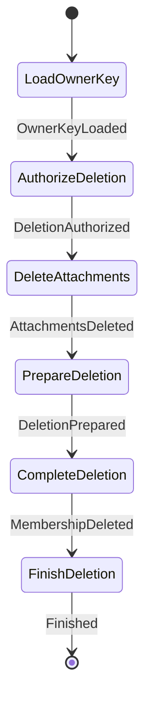

### ReceiveGroupInviteDeclineWorkflow

- **Kind:** internal — started by an observer, dispatcher or another workflow `IncomingCommand.ReceiveGroupInviteDecline`
- **Source:** `feature/conversationorchestration/incoming/src/commonMain/kotlin/com/cbgm/sparrow/feature/conversationorchestration/incoming/domain/workflow/membership/ReceiveGroupInviteDeclineWorkflow.kt`
- **Lock:** none
- **Uses:** `ReceiveGroupMembershipDeclineUseCase`, `ClearMembershipHandshakeUseCase`, `HandleInvitationResponseUseCase`, `EnsureRemoteSigningIdentityUseCase`, `MarkMembershipRemovedUseCase`

```text
pending invitation: ReceiveDecline -> ClearHandshake -> MarkInvitationDeclined
active member:      ReceiveDecline -> RequireSigningIdentity -> MarkMembershipRemoved

A pending decline is authenticated by its signed original challenge and never changes a pinned key;
removing an active member requires the accepted identity.
```

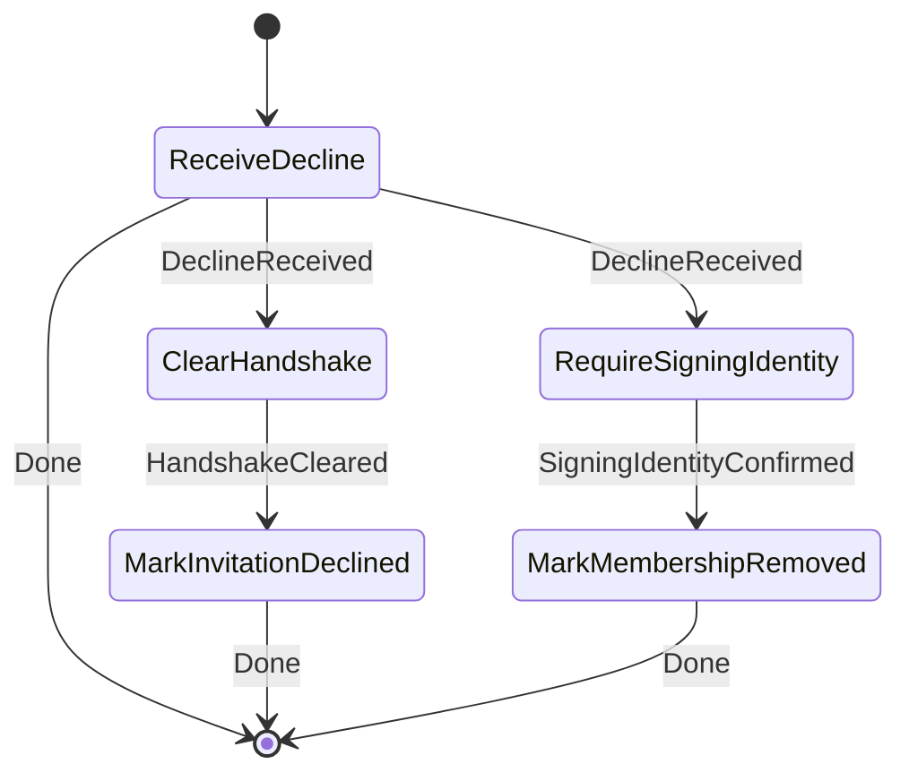

### ReceiveGroupInviteReceiptWorkflow

- **Kind:** internal — started by an observer, dispatcher or another workflow `IncomingCommand.ReceiveGroupInviteReceipt`
- **Source:** `feature/conversationorchestration/incoming/src/commonMain/kotlin/com/cbgm/sparrow/feature/conversationorchestration/incoming/domain/workflow/membership/ReceiveGroupInviteReceiptWorkflow.kt`
- **Lock:** none
- **Uses:** `ReceiveGroupMembershipReceiptUseCase`

```text
ReceiveReceipt: Membership verifies the delivery receipt of a group invitation.

The receipt never accepts the membership or authorizes a welcome, and a restored member may sign it with
new keys; the pinned identity therefore stays unchanged. The join request establishes authorization later.
```

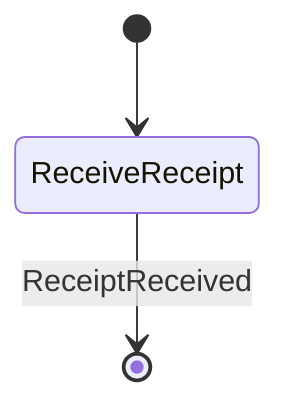

### ReceiveGroupInviteWorkflow

- **Kind:** internal — started by an observer, dispatcher or another workflow `IncomingCommand.ReceiveGroupInvite`
- **Source:** `feature/conversationorchestration/incoming/src/commonMain/kotlin/com/cbgm/sparrow/feature/conversationorchestration/incoming/domain/workflow/membership/ReceiveGroupInviteWorkflow.kt`
- **Lock:** none
- **Uses:** `InspectIncomingGroupMembershipUseCase`, `ContactBlocklistRepository`, `ShouldRecordPendingInvitationUseCase`, `ReceiveIncomingGroupMembershipUseCase`, `GetRemoteIdentityUseCase`, `GroupConversationRepository`, `StageRemoteIdentityUseCase`, `StagePendingRemoteIdentityChangeUseCase`, `RecordPendingInvitationUseCase`, `ApplyPeerProfilePictureUseCase`

```text
InspectOffer -> CheckRecordable -> StageConversation -> EvaluateOwnerIdentity -> [StageOwnerIdentity] -> StageOffer
-> [StageIdentityReview] -> RecordInvitation -> [ApplyProfilePicture]

Expired or blocked offers are dropped so they never enter the inbox or poison the retry queue. A replayed or
no longer stageable offer is still handed to Membership without staging. A signed group offer proves the
PROPOSED keys only: changed owner keys become a separate identity review and never touch trusted keys,
conversations or profile data.
```

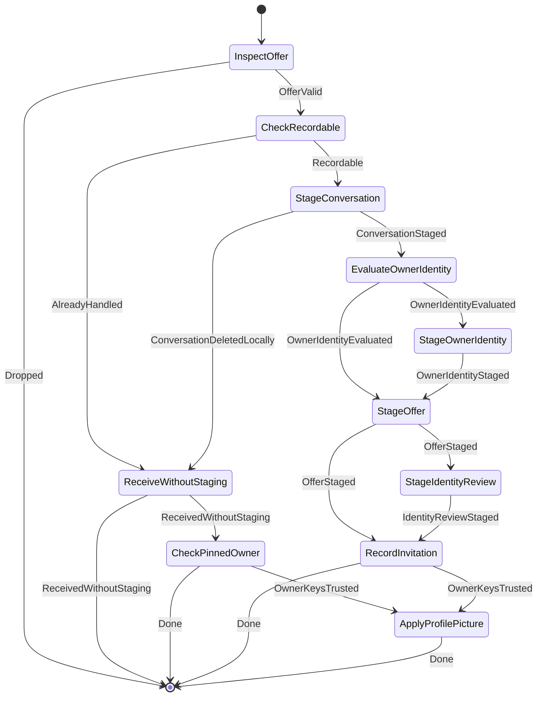

### ReceiveGroupJoinRequestWorkflow

- **Kind:** internal — started by an observer, dispatcher or another workflow `IncomingCommand.ReceiveGroupJoinRequest`
- **Source:** `feature/conversationorchestration/incoming/src/commonMain/kotlin/com/cbgm/sparrow/feature/conversationorchestration/incoming/domain/workflow/membership/ReceiveGroupJoinRequestWorkflow.kt`
- **Lock:** none
- **Uses:** `ReceiveGroupMembershipJoinRequestUseCase`, `GetRemoteIdentityUseCase`, `GetMembershipHandshakeUseCase`, `StagePendingRemoteIdentityChangeUseCase`, `StageRemoteIdentityUseCase`, `EstablishMutualIdentityUseCase`, `ConfirmGroupMemberIdentityUseCase`, `ApplyPeerProfilePictureUseCase`

```text
ReceiveJoin -> EvaluateMemberIdentity -> StageIdentityReview                          (changed keys)
ReceiveJoin -> EvaluateMemberIdentity -> StageIdentity -> EstablishMutualIdentity
  -> ConfirmMemberIdentity -> ApplyProfilePicture

Unlike the receipt, a JOIN binds both member keys. A different signing OR encryption key always waits
for the user's one-tap approval; the membership stays staged meanwhile. A duplicate JOIN after the
welcome has nothing left to authorize.
```

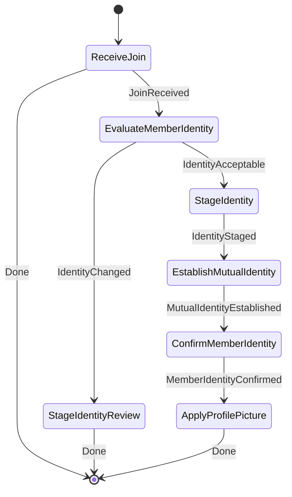

### ReceiveGroupLeaveRequestWorkflow

- **Kind:** internal — started by an observer, dispatcher or another workflow `IncomingCommand.ReceiveGroupLeaveRequest`
- **Source:** `feature/conversationorchestration/incoming/src/commonMain/kotlin/com/cbgm/sparrow/feature/conversationorchestration/incoming/domain/workflow/membership/ReceiveGroupLeaveRequestWorkflow.kt`
- **Lock:** none
- **Uses:** `WorkflowEngine`, `GroupConversationRepository`, `ReceiveGroupLeaveRequestUseCase`, `FindMemberDisplayNameUseCase`

```text
LoadContext -> ReceiveLeaveRequest -> ResolveMemberName -> RemoveParticipant -> RefreshVerification.
```

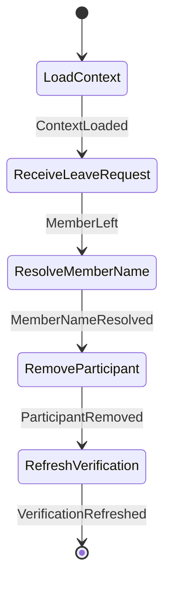

### ReceiveGroupMemberActivationWorkflow

- **Kind:** internal — started by an observer, dispatcher or another workflow `IncomingCommand.ReceiveGroupMemberActivation`
- **Source:** `feature/conversationorchestration/incoming/src/commonMain/kotlin/com/cbgm/sparrow/feature/conversationorchestration/incoming/domain/workflow/membership/ReceiveGroupMemberActivationWorkflow.kt`
- **Lock:** none
- **Uses:** `WorkflowEngine`, `GetRemoteIdentityUseCase`, `AuthorizeIncomingGroupActivationUseCase`, `ResolveSigningIdentityContactUseCase`, `ApplyIncomingGroupActivationUseCase`, `FindMemberDisplayNameUseCase`, `GroupConversationRepository`

```text
LoadOwner -> AuthorizeActivation -> [ResolveMemberContact] -> ApplyActivation, then
local member:     SynchronizeVerification
DISCOVERY round:  ResolveMemberName -> RecordMemberAdded           (history only, no routing yet)
FINAL round:      ResolveMemberName -> ActivateParticipant -> FlushQueuedMessages
```

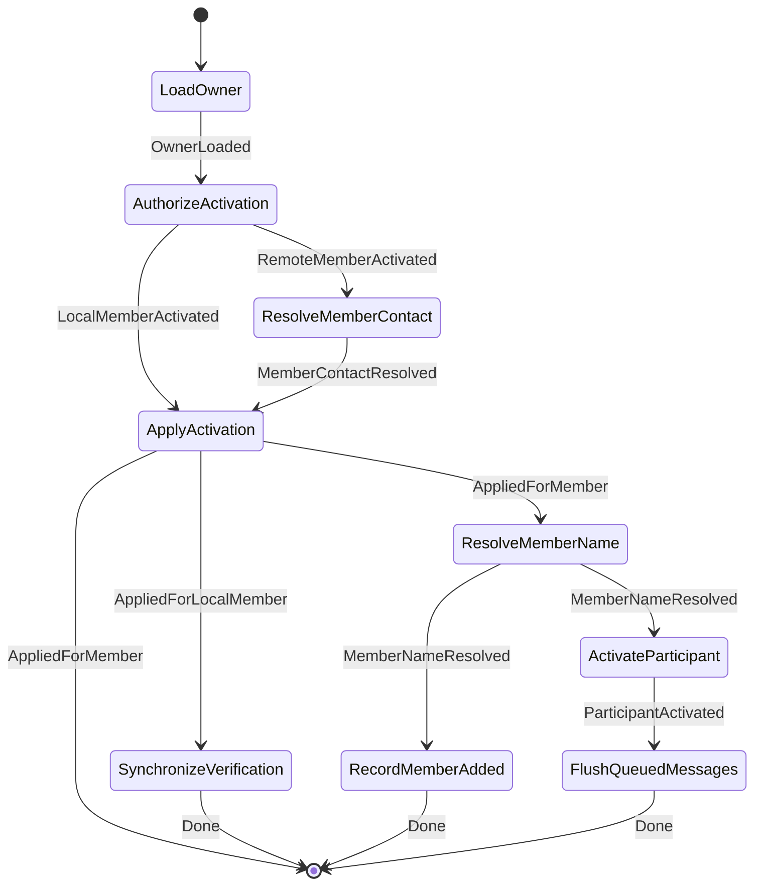

### ReceiveGroupMemberRemovalWorkflow

- **Kind:** internal — started by an observer, dispatcher or another workflow `IncomingCommand.ReceiveGroupMemberRemoval`
- **Source:** `feature/conversationorchestration/incoming/src/commonMain/kotlin/com/cbgm/sparrow/feature/conversationorchestration/incoming/domain/workflow/membership/ReceiveGroupMemberRemovalWorkflow.kt`
- **Lock:** none
- **Uses:** `AuthorizeIncomingGroupRemovalUseCase`, `ApplyIncomingGroupRemovalUseCase`, `CompleteIncomingGroupRemovalUseCase`

```text
AuthorizeRemoval -> ApplyRemoval -> CompleteRemoval; Membership resolves the trusted signing key.
```

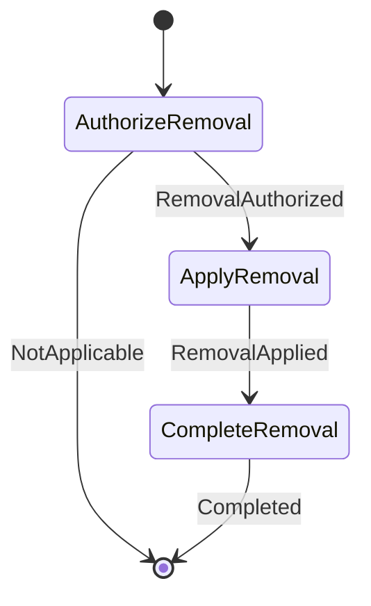

### ReceiveGroupReadyAcknowledgementWorkflow

- **Kind:** internal — started by an observer, dispatcher or another workflow `IncomingCommand.ReceiveGroupReadyAcknowledgement`
- **Source:** `feature/conversationorchestration/incoming/src/commonMain/kotlin/com/cbgm/sparrow/feature/conversationorchestration/incoming/domain/workflow/membership/ReceiveGroupReadyAcknowledgementWorkflow.kt`
- **Lock:** none
- **Uses:** `WorkflowEngine`, `GetGroupCurrentEpochUseCase`, `ReceiveGroupReadyAcknowledgementUseCase`, `GetMembershipHandshakeUseCase`, `FindMemberDisplayNameUseCase`, `GroupConversationRepository`

```text
CheckEpochCurrent -> ReceiveAcknowledgement -> CheckEpochStillCurrent -> FindActivatedMembership
-> [ResolveMemberName -> AddParticipant -> FlushQueuedMessages] -> RefreshVerification -> SendCurrentMetadata

The owner discards old epoch keys on rotation: a delayed acknowledgement of an older welcome is
obsolete and changes nothing. The participant is projected synchronously so group sends never wait
for an observer.
```

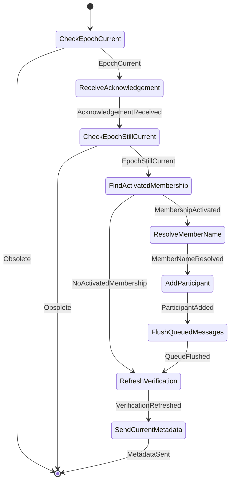

### ReceiveGroupWelcomeWorkflow

- **Kind:** internal — started by an observer, dispatcher or another workflow `IncomingCommand.ReceiveGroupWelcome`
- **Source:** `feature/conversationorchestration/incoming/src/commonMain/kotlin/com/cbgm/sparrow/feature/conversationorchestration/incoming/domain/workflow/membership/ReceiveGroupWelcomeWorkflow.kt`
- **Lock:** none
- **Uses:** `AuthorizeIncomingGroupWelcomeUseCase`, `GetRemoteIdentityUseCase`, `OpenIncomingGroupWelcomeUseCase`, `GroupIncomingConversationRepository`, `ResolveIncomingPeerContactsUseCase`, `PersistIncomingGroupWelcomeUseCase`, `FindMemberDisplayNameUseCase`, `EstablishMutualIdentityUseCase`, `SendGroupReadyAcknowledgementUseCase`, `CompleteIncomingGroupWelcomeUseCase`

```text
AuthorizeWelcome -> LoadAuthority -> OpenWelcome -> RecordRestart -> ResolveMemberContacts -> PersistWelcome
-> ResolveMemberNames -> InstallWelcome -> [EstablishMutualIdentity] -> SendReadyAcknowledgement -> CompleteWelcome

The first welcome must come from the accepted, pinned inviter identity; later welcomes are checked against
Membership's prior epoch. Contacts are resolved only after Membership verified and decrypted the welcome.
```

```mermaid
stateDiagram-v2
    [*] --> AuthorizeWelcome
    AuthorizeWelcome --> LoadAuthority : Advanced
    AuthorizeWelcome --> [*] : NotApplicable
    LoadAuthority --> OpenWelcome : Advanced
    OpenWelcome --> RecordRestart : Advanced
    RecordRestart --> ResolveMemberContacts : Advanced
    ResolveMemberContacts --> PersistWelcome : Advanced
    PersistWelcome --> ResolveMemberNames : Advanced
    ResolveMemberNames --> InstallWelcome : Advanced
    InstallWelcome --> EstablishMutualIdentity : Advanced
    InstallWelcome --> SendReadyAcknowledgement : Advanced
    EstablishMutualIdentity --> SendReadyAcknowledgement : Advanced
    SendReadyAcknowledgement --> CompleteWelcome : Advanced
    CompleteWelcome --> [*] : Completed
```

## `metadata`

### ReceiveGroupAvatarWorkflow

- **Kind:** internal — started by an observer, dispatcher or another workflow `IncomingCommand.ReceiveGroupAvatar`
- **Source:** `feature/conversationorchestration/incoming/src/commonMain/kotlin/com/cbgm/sparrow/feature/conversationorchestration/incoming/domain/workflow/metadata/ReceiveGroupAvatarWorkflow.kt`
- **Lock:** none
- **Uses:** `GroupAvatarPacketCodec`, `AuthorizeGroupMetadataUseCase`, `GroupAvatarRepository`

```text
VerifySignature -> AuthorizeAdmin -> LoadAvatar -> SaveAvatar. Older or unauthorized updates are dropped.
```

```mermaid
stateDiagram-v2
    [*] --> VerifySignature
    VerifySignature --> AuthorizeAdmin : SignatureValid
    AuthorizeAdmin --> LoadAvatar : AdminAuthorized
    AuthorizeAdmin --> [*] : Ignored
    LoadAvatar --> [*] : Ignored
    LoadAvatar --> SaveAvatar : UpdateIsNewer
    SaveAvatar --> [*] : Saved
```

### ReceiveGroupDescriptionWorkflow

- **Kind:** internal — started by an observer, dispatcher or another workflow `IncomingCommand.ReceiveGroupDescription`
- **Source:** `feature/conversationorchestration/incoming/src/commonMain/kotlin/com/cbgm/sparrow/feature/conversationorchestration/incoming/domain/workflow/metadata/ReceiveGroupDescriptionWorkflow.kt`
- **Lock:** none
- **Uses:** `GroupDescriptionPacketCodec`, `AuthorizeGroupMetadataUseCase`, `GroupDescriptionRepository`

```text
VerifySignature -> AuthorizeAdmin -> LoadDescription -> SaveDescription. Older or unauthorized updates are dropped.
```

```mermaid
stateDiagram-v2
    [*] --> VerifySignature
    VerifySignature --> AuthorizeAdmin : SignatureValid
    AuthorizeAdmin --> LoadDescription : AdminAuthorized
    AuthorizeAdmin --> [*] : Ignored
    LoadDescription --> [*] : Ignored
    LoadDescription --> SaveDescription : UpdateIsNewer
    SaveDescription --> [*] : Saved
```

### ReceiveGroupPinWorkflow

- **Kind:** internal — started by an observer, dispatcher or another workflow `IncomingCommand.ReceiveGroupPin`
- **Source:** `feature/conversationorchestration/incoming/src/commonMain/kotlin/com/cbgm/sparrow/feature/conversationorchestration/incoming/domain/workflow/metadata/ReceiveGroupPinWorkflow.kt`
- **Lock:** none
- **Uses:** `GroupPinPacketCodec`, `AuthorizeGroupMetadataUseCase`, `GroupPinRepository`, `FindRemoteIdentityPeerIdUseCase`

```text
VerifySignature -> AuthorizeAdmin -> CheckPinSlot -> [ResolveMessageSender] -> SavePin

Older updates are dropped, and an active expense board keeps the pin slot against other messages.
```

```mermaid
stateDiagram-v2
    [*] --> VerifySignature
    VerifySignature --> AuthorizeAdmin : SignatureValid
    AuthorizeAdmin --> CheckPinSlot : AdminAuthorized
    AuthorizeAdmin --> [*] : Ignored
    CheckPinSlot --> [*] : Ignored
    CheckPinSlot --> SavePin : SenderResolved
    CheckPinSlot --> ResolveMessageSender : SlotAvailable
    ResolveMessageSender --> SavePin : SenderResolved
    SavePin --> [*] : Saved
```

### ReceiveGroupTitleWorkflow

- **Kind:** internal — started by an observer, dispatcher or another workflow `IncomingCommand.ReceiveGroupTitle`
- **Source:** `feature/conversationorchestration/incoming/src/commonMain/kotlin/com/cbgm/sparrow/feature/conversationorchestration/incoming/domain/workflow/metadata/ReceiveGroupTitleWorkflow.kt`
- **Lock:** none
- **Uses:** `GroupTitlePacketCodec`, `AuthorizeGroupMetadataUseCase`, `GroupTitleRepository`

```text
VerifySignature -> AuthorizeAdmin -> LoadTitle -> SaveTitle. Older or unauthorized updates are dropped.
```

```mermaid
stateDiagram-v2
    [*] --> VerifySignature
    VerifySignature --> AuthorizeAdmin : SignatureValid
    AuthorizeAdmin --> LoadTitle : AdminAuthorized
    AuthorizeAdmin --> [*] : Ignored
    LoadTitle --> [*] : Ignored
    LoadTitle --> SaveTitle : UpdateIsNewer
    SaveTitle --> [*] : Saved
```

## `operation`

### ApplyParkedMessageOperationsWorkflow

- **Kind:** internal — started by an observer, dispatcher or another workflow `IncomingCommand.ApplyParkedMessageOperations`
- **Source:** `feature/conversationorchestration/incoming/src/commonMain/kotlin/com/cbgm/sparrow/feature/conversationorchestration/incoming/domain/workflow/operation/ApplyParkedMessageOperationsWorkflow.kt`
- **Lock:** none
- **Uses:** `WorkflowEngine`, `ParkedMessageOperationRepository`

```text
FindParked -> [Apply -> Apply -> ...]

Runs after a message was stored: the operations that arrived before it (an edit that overtook its message
after a reconnect, for example) are applied in the order they were sent. Each one is removed once it ran;
one that is not allowed, such as an edit by another sender, is dropped as it would have been on arrival.
```

```mermaid
stateDiagram-v2
    [*] --> FindParked
    FindParked --> Apply : Waiting
    FindParked --> [*] : Waiting
    Apply --> Apply : Waiting
    Apply --> [*] : Waiting
```

### ApplyRemoteMessageOperationWorkflow

- **Kind:** internal — started by an observer, dispatcher or another workflow `IncomingCommand.ApplyRemoteMessageOperation`
- **Source:** `feature/conversationorchestration/incoming/src/commonMain/kotlin/com/cbgm/sparrow/feature/conversationorchestration/incoming/domain/workflow/operation/ApplyRemoteMessageOperationWorkflow.kt`
- **Lock:** none
- **Uses:** `FindOperationTargetUseCase`, `DirectMessageRepository`, `GroupMessageRepository`, `MessageAttachmentOperationsRepository`, `MessageReactionRepository`, `DiscardDirectMessagesUseCase`, `DiscardGroupMessagesUseCase`, `FindGroupPollUseCase`, `GroupMembershipRepository`, `RequireMessageWithoutPaymentUseCase`, `ParkedMessageOperationRepository`

```text
FindTarget, then by operation:
Edit:      CheckEditable -> ReplaceText
Delete:    CheckSender -> DeleteMessage
Reaction:  SaveReaction | RemoveReaction
PollVote:  FindPoll -> SavePoll
PollClose: CheckPollCloser -> FindPoll -> SavePoll
No target: Park

Only the original sender edits or deletes; group operations only touch user messages. An operation whose
message has not arrived yet, for example an edit that overtook it after a reconnect, is parked and applied
once the message is stored ([ApplyParkedMessageOperationsWorkflow]).
```

```mermaid
stateDiagram-v2
    [*] --> FindTarget
    FindTarget --> CheckEditable : TargetFound
    FindTarget --> CheckPollCloser : TargetFound
    FindTarget --> CheckSender : TargetFound
    FindTarget --> FindPoll : TargetFound
    FindTarget --> RemoveReaction : TargetFound
    FindTarget --> SaveReaction : TargetFound
    FindTarget --> Park : TargetMissing
    CheckEditable --> ReplaceText : Editable
    ReplaceText --> [*] : Applied
    CheckSender --> DeleteMessage : SenderOwnsTarget
    DeleteMessage --> [*] : Applied
    SaveReaction --> [*] : Applied
    RemoveReaction --> [*] : Applied
    CheckPollCloser --> FindPoll : PollCloserAllowed
    FindPoll --> SavePoll : PollFound
    SavePoll --> [*] : Applied
    Park --> [*] : Parked
```

## `routing`

### RouteIncomingPacketWorkflow

- **Kind:** internal — started by an observer, dispatcher or another workflow `IncomingCommand.RouteIncomingPacket`
- **Source:** `feature/conversationorchestration/incoming/src/commonMain/kotlin/com/cbgm/sparrow/feature/conversationorchestration/incoming/domain/workflow/routing/RouteIncomingPacketWorkflow.kt`
- **Lock:** none
- **Uses:** `WorkflowEngine`, `GetIdentityPeerStateUseCase`, `DirectConversationRepository`, `CheckGroupPacketAcceptedUseCase`, `GroupPacketDispatcher`, `ControlPacketDispatcher`

```text
direct message:  CheckDirectAuthorization -> EnsureDirectConversation -> ReceiveDirectMessage | ApplyDirectOperation
group packet:    CheckGroupAccepted -> DispatchGroupPacket
receipt:         ApplyReceipt
anything else:   FindControlConversation -> DispatchControlPacket

Direct and group packets never share handlers. Messages of a contact whose invitation was not accepted
are dropped without a chat being created.
```

```mermaid
stateDiagram-v2
    [*] --> CheckDirectAuthorization
    [*] --> CheckGroupAccepted
    [*] --> ApplyReceipt
    [*] --> FindControlConversation
    CheckDirectAuthorization --> EnsureDirectConversation : DirectAuthorized
    CheckDirectAuthorization --> [*] : Dropped
    EnsureDirectConversation --> ApplyDirectOperation : DirectConversationResolved
    EnsureDirectConversation --> ReceiveDirectMessage : DirectConversationResolved
    EnsureDirectConversation --> Rejected : DirectConversationResolved
    ReceiveDirectMessage --> [*] : Handled
    ApplyDirectOperation --> [*] : Handled
    CheckGroupAccepted --> [*] : Dropped
    CheckGroupAccepted --> DispatchGroupPacket : GroupAccepted
    DispatchGroupPacket --> [*] : Handled
    ApplyReceipt --> [*] : Handled
    FindControlConversation --> DispatchControlPacket : ControlConversationResolved
    DispatchControlPacket --> [*] : Handled
    Rejected --> [*]
    classDef reject fill:#f8d7da,stroke:#b02a37,color:#58151c
    class Rejected reject
```

## `verification`

### ReceiveVerificationReceiptWorkflow

- **Kind:** internal — started by an observer, dispatcher or another workflow `IncomingCommand.ReceiveVerificationReceipt`
- **Source:** `feature/conversationorchestration/incoming/src/commonMain/kotlin/com/cbgm/sparrow/feature/conversationorchestration/incoming/domain/workflow/verification/ReceiveVerificationReceiptWorkflow.kt`
- **Lock:** `groupVerificationLockKey(command.packet.groupId)`
- **Uses:** `AcceptParticipantVerificationReceiptUseCase`, `BroadcastGroupVerificationSnapshotUseCase`

```text
AcceptReceipt -> BroadcastSnapshot: the admin records that a member verified it and tells everybody.
```

```mermaid
stateDiagram-v2
    [*] --> AcceptReceipt
    AcceptReceipt --> BroadcastSnapshot : ReceiptAccepted
    BroadcastSnapshot --> [*] : SnapshotBroadcast
```

### ReceiveVerificationSnapshotRequestWorkflow

- **Kind:** internal — started by an observer, dispatcher or another workflow `IncomingCommand.ReceiveVerificationSnapshotRequest`
- **Source:** `feature/conversationorchestration/incoming/src/commonMain/kotlin/com/cbgm/sparrow/feature/conversationorchestration/incoming/domain/workflow/verification/ReceiveVerificationSnapshotRequestWorkflow.kt`
- **Lock:** `groupVerificationLockKey(command.packet.groupId)`
- **Uses:** `AcceptVerificationSnapshotRequestUseCase`, `RefreshOwnedGroupVerificationUseCase`, `SendGroupVerificationSnapshotUseCase`

```text
AuthenticateRequest -> RefreshRows -> SendSnapshot: the admin answers a member with its current rows.
```

```mermaid
stateDiagram-v2
    [*] --> AuthenticateRequest
    AuthenticateRequest --> RefreshRows : RequestAuthenticated
    RefreshRows --> SendSnapshot : RowsRefreshed
    SendSnapshot --> [*] : SnapshotSent
```

### ReceiveVerificationSnapshotWorkflow

- **Kind:** internal — started by an observer, dispatcher or another workflow `IncomingCommand.ReceiveVerificationSnapshot`
- **Source:** `feature/conversationorchestration/incoming/src/commonMain/kotlin/com/cbgm/sparrow/feature/conversationorchestration/incoming/domain/workflow/verification/ReceiveVerificationSnapshotWorkflow.kt`
- **Lock:** `groupVerificationLockKey(command.packet.groupId)`
- **Uses:** `ApplyVerificationSnapshotUseCase`

```text
ApplySnapshot: a member stores the admin's newest verification rows.
```

```mermaid
stateDiagram-v2
    [*] --> ApplySnapshot
    ApplySnapshot --> [*] : SnapshotApplied
```
