# Direct chat lifecycle workflows

_Generated by `./gradlew workflowCatalog` from `:feature:conversationorchestration:lifecycle`. Do not edit by hand._

How a direct chat is opened, gets authorized, loses its authorization and recovers it.

Diagram legend: boxes are `Step`s, arrow labels are the `Outcome` a step reported, `[*]` is the start or a successful completion, `Rejected` ends the workflow with a `ConversationFailure`.

| Workflow | Started by | Command | Lock |
|---|---|---|---|
| [`DeleteDirectConversationWorkflow`](#deletedirectconversationworkflow) | Chats (`ConversationOrchestrator`) | `DirectConversationCommand.DeleteConversation` | — |
| [`OpenDirectConversationWorkflow`](#opendirectconversationworkflow) | Chats (`ConversationOrchestrator`) | `DirectConversationCommand.OpenConversation` | — |
| [`ReconnectDirectConversationWorkflow`](#reconnectdirectconversationworkflow) | Chats (`ConversationOrchestrator`) | `DirectConversationCommand.ReconnectConversation` | — |
| [`RequestReauthorizationWorkflow`](#requestreauthorizationworkflow) | orchestration (`engine.run`) | `LifecycleCommand.RequestReauthorization` | — |
| [`RevokePeerExchangeWorkflow`](#revokepeerexchangeworkflow) | orchestration (`engine.run`) | `LifecycleCommand.RevokePeerExchange` | — |
| [`StartDirectInvitationWorkflow`](#startdirectinvitationworkflow) | orchestration (`engine.run`) | `LifecycleCommand.StartDirectInvitation` | — |
| [`AcceptApprovedIdentityChangeWorkflow`](#acceptapprovedidentitychangeworkflow) | orchestration (`engine.run`) | `LifecycleCommand.AcceptApprovedIdentityChange` | — |
| [`RecoverAcceptedDirectInvitationWorkflow`](#recoveraccepteddirectinvitationworkflow) | orchestration (`engine.run`) | `LifecycleCommand.RecoverAcceptedDirectInvitation` | — |
| [`RecoverAuthorizedConversationWorkflow`](#recoverauthorizedconversationworkflow) | orchestration (`engine.run`) | `LifecycleCommand.RecoverAuthorizedConversation` | — |
| [`StartRecoveryInvitationWorkflow`](#startrecoveryinvitationworkflow) | orchestration (`engine.run`) | `LifecycleCommand.StartRecoveryInvitation` | — |
| [`HandleContactBlockedWorkflow`](#handlecontactblockedworkflow) | orchestration (`engine.run`) | `LifecycleCommand.HandleContactBlocked` | — |
| [`HandleDirectInvitationResultWorkflow`](#handledirectinvitationresultworkflow) | orchestration (`engine.run`) | `LifecycleCommand.HandleDirectInvitationResult` | — |
| [`HandleIdentityResultWorkflow`](#handleidentityresultworkflow) | orchestration (`engine.run`) | `LifecycleCommand.HandleIdentityResult` | — |
| [`RecordIncomingDirectInvitationWorkflow`](#recordincomingdirectinvitationworkflow) | orchestration (`engine.run`) | `LifecycleCommand.RecordIncomingDirectInvitation` | — |

## `direct`

### DeleteDirectConversationWorkflow

- **Kind:** public — Chats submits `DirectConversationCommand.DeleteConversation`
- **Source:** `feature/conversationorchestration/lifecycle/src/commonMain/kotlin/com/cbgm/sparrow/feature/conversationorchestration/lifecycle/domain/workflow/direct/DeleteDirectConversationWorkflow.kt`
- **Lock:** none
- **Uses:** `WorkflowEngine`, `DirectConversationRepository`, `MailboxCapabilityLifecycle`

```text
FindContact -> RevokeExchange -> RevokeMailbox -> DeleteConversation.
```

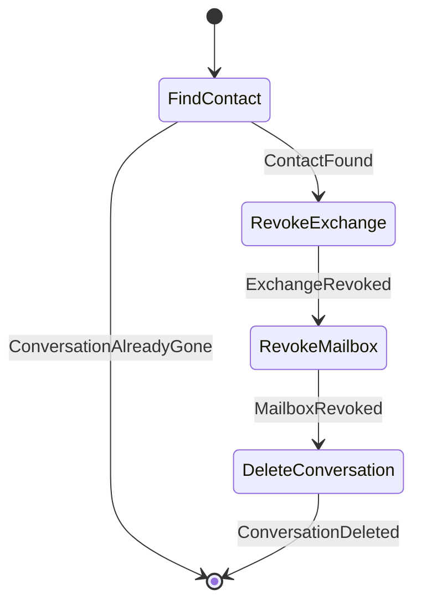

### OpenDirectConversationWorkflow

- **Kind:** public — Chats submits `DirectConversationCommand.OpenConversation`
- **Source:** `feature/conversationorchestration/lifecycle/src/commonMain/kotlin/com/cbgm/sparrow/feature/conversationorchestration/lifecycle/domain/workflow/direct/OpenDirectConversationWorkflow.kt`
- **Lock:** none
- **Uses:** `WorkflowEngine`, `DirectConversationRepository`, `RequireDirectChatAuthorizationUseCase`

```text
FindConversation -> CheckAuthorization                 (opens the authorized chat)
FindConversation -> [CheckAuthorization] -> StartInvitation

Authorization alone is no evidence that a locally deleted chat still exists: reopening a missing chat
goes through an invitation, otherwise the other device may still wait for authorization.
```

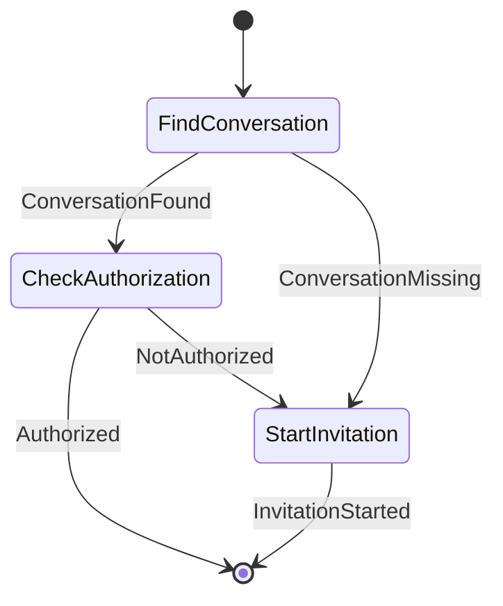

### ReconnectDirectConversationWorkflow

- **Kind:** public — Chats submits `DirectConversationCommand.ReconnectConversation`
- **Source:** `feature/conversationorchestration/lifecycle/src/commonMain/kotlin/com/cbgm/sparrow/feature/conversationorchestration/lifecycle/domain/workflow/direct/ReconnectDirectConversationWorkflow.kt`
- **Lock:** none
- **Uses:** `WorkflowEngine`, `ContactBlocklistRepository`, `DirectConversationRepository`, `GetIdentityExchangeClosureUseCase`, `ResolveContactInvitationRoutingIdUseCase`, `GetIdentityPeerStateUseCase`

```text
CheckReconnectable -> PreflightRouting -> LoadAuthorization -> [RevokeExchange] -> StartInvitation

The user explicitly reconnects an EXISTING chat: a prior authorization is closed before a fresh
invitation starts. The contact, keys and conversation history are never deleted. A contact without
a phone number can still reconnect when the other installation restored the original signing identity;
routing is checked before anything is revoked.
```

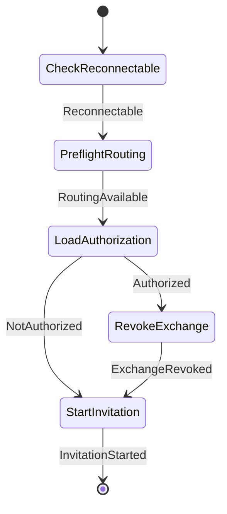

### RequestReauthorizationWorkflow

- **Kind:** internal — started by an observer, dispatcher or another workflow `LifecycleCommand.RequestReauthorization`
- **Source:** `feature/conversationorchestration/lifecycle/src/commonMain/kotlin/com/cbgm/sparrow/feature/conversationorchestration/lifecycle/domain/workflow/direct/RequestReauthorizationWorkflow.kt`
- **Lock:** none
- **Uses:** `WorkflowEngine`, `DirectConversationRepository`, `GetIdentityPeerStateUseCase`

```text
FindConversation -> LoadAuthorization -> Reconnect        (a retained chat with stale authorization)
FindConversation -> [LoadAuthorization] -> StartInvitation (no chat, or nothing to revoke)

Runs only after an actual authorization failure; a merely offline contact never reaches it.
Reconnecting is required because the plain invitation skips contacts with an authorized chat.
```

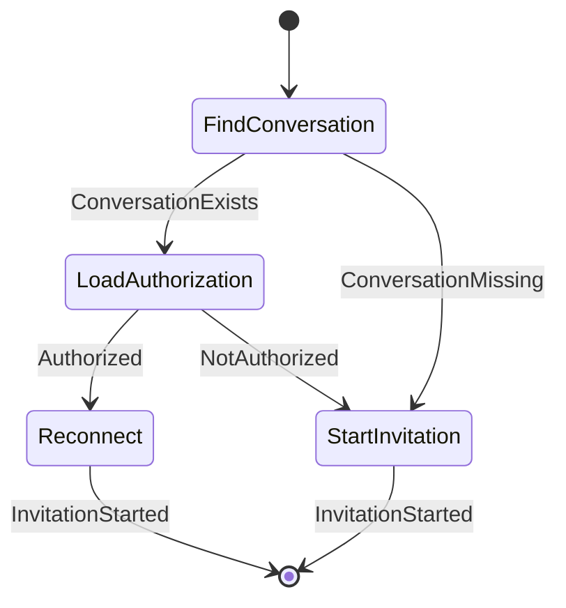

### RevokePeerExchangeWorkflow

- **Kind:** internal — started by an observer, dispatcher or another workflow `LifecycleCommand.RevokePeerExchange`
- **Source:** `feature/conversationorchestration/lifecycle/src/commonMain/kotlin/com/cbgm/sparrow/feature/conversationorchestration/lifecycle/domain/workflow/direct/RevokePeerExchangeWorkflow.kt`
- **Lock:** none
- **Uses:** `GetIdentityExchangeClosureUseCase`, `DeclineIdentityExchangeUseCase`, `DirectChatAuthorizationRevocationSender`, `CloseIdentityExchangeUseCase`

```text
FindExchange -> DeclineExchange -> CloseExchange   (an incoming invitation is still pending)
FindExchange -> SendRevocation -> CloseExchange    (the exchange is active)
FindExchange -> CloseExchange                      (the exchange is terminal)

Only orchestration decides whether to decline, revoke or just close the Identity-owned exchange.
```

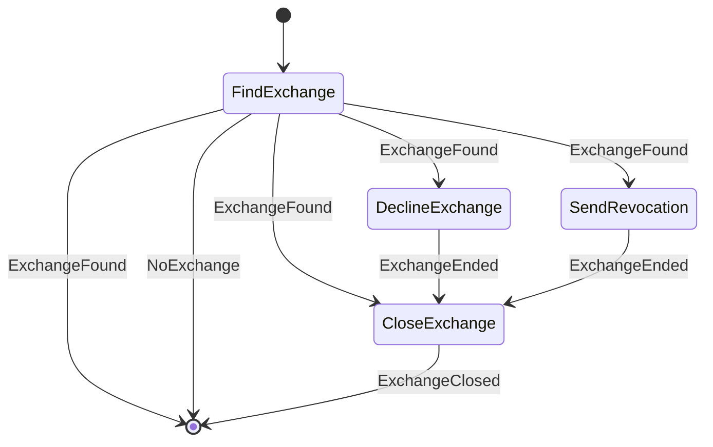

### StartDirectInvitationWorkflow

- **Kind:** internal — started by an observer, dispatcher or another workflow `LifecycleCommand.StartDirectInvitation`
- **Source:** `feature/conversationorchestration/lifecycle/src/commonMain/kotlin/com/cbgm/sparrow/feature/conversationorchestration/lifecycle/domain/workflow/direct/StartDirectInvitationWorkflow.kt`
- **Lock:** none
- **Uses:** `WorkflowEngine`, `ContactBlocklistRepository`, `GetIdentityPeerStateUseCase`, `DirectConversationRepository`, `ResolveContactInvitationRoutingIdUseCase`, `GetIdentityPeerDisplayNameUseCase`, `LocalPhoneNumberProvider`, `StartIdentityExchangeUseCase`, `RecordOutgoingDirectInvitationUseCase`

```text
CheckNotBlocked -> LoadAuthorization -> LoadLabels -> StartExchange -> RecordInvitation

An authorized contact without a chat (it was deleted locally while the peer kept its keys) first goes
through FindConversation -> PreflightRouting -> RevokeExchange. Only that old conversation authorization
is revoked; remote identity, trust records and the user's own keys are never reset. An authorized
contact with a chat needs no invitation.
```

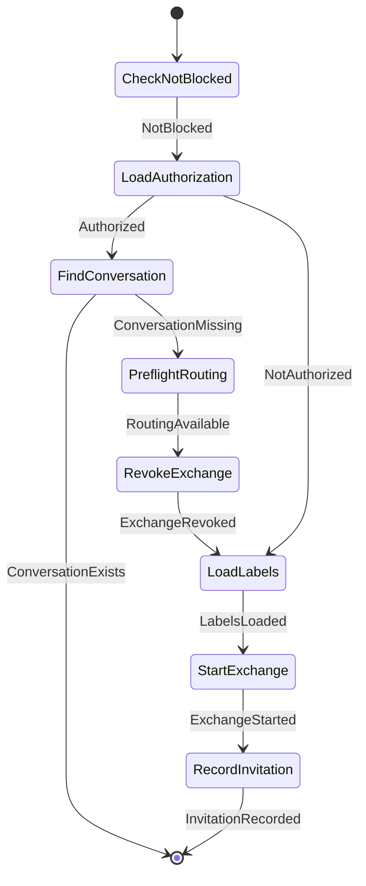

## `recovery`

### AcceptApprovedIdentityChangeWorkflow

- **Kind:** internal — started by an observer, dispatcher or another workflow `LifecycleCommand.AcceptApprovedIdentityChange`
- **Source:** `feature/conversationorchestration/lifecycle/src/commonMain/kotlin/com/cbgm/sparrow/feature/conversationorchestration/lifecycle/domain/workflow/recovery/AcceptApprovedIdentityChangeWorkflow.kt`
- **Lock:** none
- **Uses:** `GetRemoteIdentityUseCase`, `ReceiveIdentityExchangeUseCase`, `InvalidatePendingInvitationUseCase`

```text
ValidateApproval -> CheckPinnedIdentity -> AcceptOriginalInvitation -> InvalidateStaleInvitation

The approved path never publishes INCOMING_CHALLENGE_RECEIVED, so the Identity result observer cannot
turn it into a normal invitation again. READY still activates the existing conversation later.
```

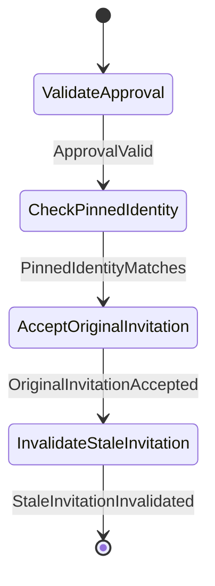

### RecoverAcceptedDirectInvitationWorkflow

- **Kind:** internal — started by an observer, dispatcher or another workflow `LifecycleCommand.RecoverAcceptedDirectInvitation`
- **Source:** `feature/conversationorchestration/lifecycle/src/commonMain/kotlin/com/cbgm/sparrow/feature/conversationorchestration/lifecycle/domain/workflow/recovery/RecoverAcceptedDirectInvitationWorkflow.kt`
- **Lock:** none
- **Uses:** `WorkflowEngine`, `GetIdentityExchangeClosureUseCase`

```text
CheckExchangeStillOpen -> HandleResult. A closed or revoked exchange is never replayed.
```

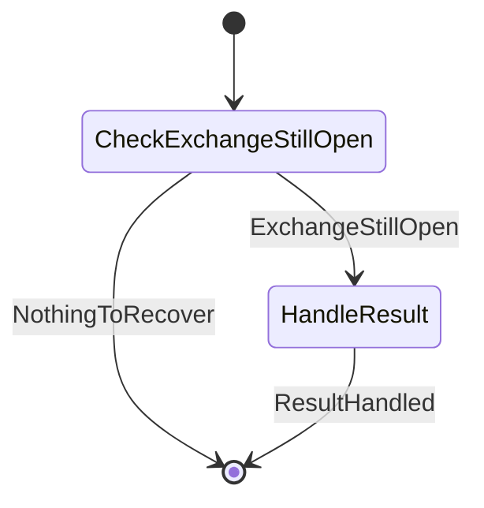

### RecoverAuthorizedConversationWorkflow

- **Kind:** internal — started by an observer, dispatcher or another workflow `LifecycleCommand.RecoverAuthorizedConversation`
- **Source:** `feature/conversationorchestration/lifecycle/src/commonMain/kotlin/com/cbgm/sparrow/feature/conversationorchestration/lifecycle/domain/workflow/recovery/RecoverAuthorizedConversationWorkflow.kt`
- **Lock:** none
- **Uses:** `WorkflowEngine`, `GetIdentityPeerStateUseCase`, `DirectConversationRepository`, `GetIdentityExchangeClosureUseCase`

```text
LoadAuthorization -> FindConversation -> ActivateConversation
LoadAuthorization -> FindConversation -> CheckExchangeStillActive -> ActivateConversation

An established exchange can be persisted right before a process death, without its chat. Only the
exact, still active exchange may create the missing chat; a deliberately deleted conversation is never
resurrected from history. An existing conversation keeps its ID and messages.
```

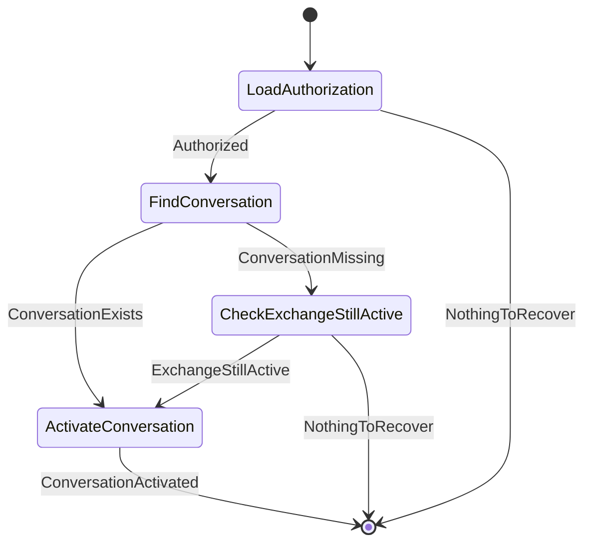

### StartRecoveryInvitationWorkflow

- **Kind:** internal — started by an observer, dispatcher or another workflow `LifecycleCommand.StartRecoveryInvitation`
- **Source:** `feature/conversationorchestration/lifecycle/src/commonMain/kotlin/com/cbgm/sparrow/feature/conversationorchestration/lifecycle/domain/workflow/recovery/StartRecoveryInvitationWorkflow.kt`
- **Lock:** none
- **Uses:** `WorkflowEngine`, `GetMembershipHandshakeUseCase`, `DirectConversationRepository`

```text
group, owner side:  FindGroupMembership -> ResumeGroupJoin
group, member side: FindGroupMembership                      (the offer waits in the inbox)
direct:             FindGroupMembership -> EnsureConversation -> AcceptOriginalInvitation | RequestReauthorization

A group approval never becomes a direct invitation, even when its membership was withdrawn before this
ran. A direct chat shell does not grant transport authorization or release queued messages.
```

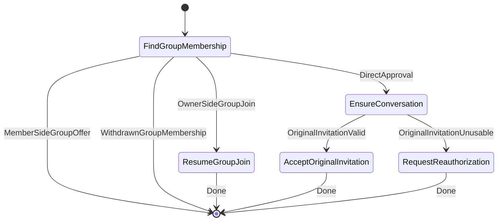

## `result`

### HandleContactBlockedWorkflow

- **Kind:** internal — started by an observer, dispatcher or another workflow `LifecycleCommand.HandleContactBlocked`
- **Source:** `feature/conversationorchestration/lifecycle/src/commonMain/kotlin/com/cbgm/sparrow/feature/conversationorchestration/lifecycle/domain/workflow/result/HandleContactBlockedWorkflow.kt`
- **Lock:** none
- **Uses:** `WorkflowEngine`, `ContactBlocklistRepository`

```text
CheckStillBlocked -> RevokeExchange. An unblocked contact keeps its authorization.
```

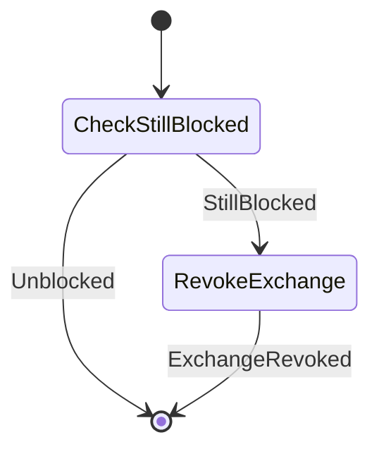

### HandleDirectInvitationResultWorkflow

- **Kind:** internal — started by an observer, dispatcher or another workflow `LifecycleCommand.HandleDirectInvitationResult`
- **Source:** `feature/conversationorchestration/lifecycle/src/commonMain/kotlin/com/cbgm/sparrow/feature/conversationorchestration/lifecycle/domain/workflow/result/HandleDirectInvitationResultWorkflow.kt`
- **Lock:** none
- **Uses:** `WorkflowEngine`, `AcceptIdentityExchangeUseCase`, `DeclineIdentityExchangeUseCase`, `BlockContactUseCase`

```text
incoming, accepted: AcceptExchange -> ActivateConversation
incoming, declined: DeclineExchange -> [BlockContact]
outgoing, declined: DiscardWaitingMessages

Both identity setup modes create the receiver's chat and release its queued messages on acceptance.
```

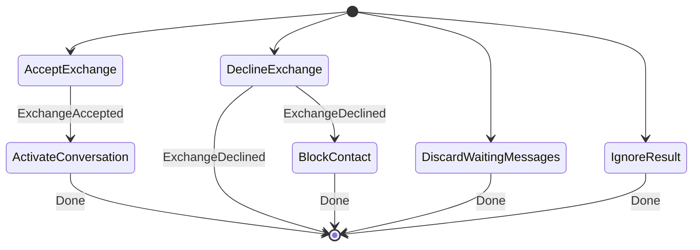

### HandleIdentityResultWorkflow

- **Kind:** internal — started by an observer, dispatcher or another workflow `LifecycleCommand.HandleIdentityResult`
- **Source:** `feature/conversationorchestration/lifecycle/src/commonMain/kotlin/com/cbgm/sparrow/feature/conversationorchestration/lifecycle/domain/workflow/result/HandleIdentityResultWorkflow.kt`
- **Lock:** none
- **Uses:** `WorkflowEngine`, `GetIdentityPeerDisplayNameUseCase`, `HandleInvitationResponseUseCase`, `DirectIdentitySetupModeRepository`, `SendIdentityVerificationReceiptUseCase`, `MarkInvitationTransportFailedUseCase`, `InvalidatePendingInvitationUseCase`

```text
INCOMING_EXCHANGE:    ResolveDisplayName -> RecordIncomingInvitation
ESTABLISHED: [MarkInvitationAccepted] -> ActivateConversation -> LoadSetupMode -> [SendVerificationReceipt]
REMOTE_DECLINED:      MarkInvitationDeclined -> DiscardWaitingMessages
FAILED:               MarkTransportFailed
EXCHANGE_INVALIDATED: InvalidateInvitation

Invitation acceptance, not the identity setup mode, authorizes the conversation: queued messages are
released in both modes.
```

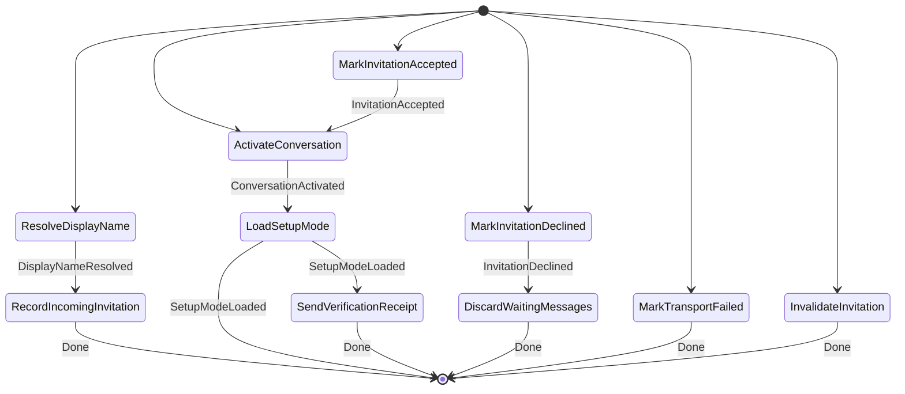

### RecordIncomingDirectInvitationWorkflow

- **Kind:** internal — started by an observer, dispatcher or another workflow `LifecycleCommand.RecordIncomingDirectInvitation`
- **Source:** `feature/conversationorchestration/lifecycle/src/commonMain/kotlin/com/cbgm/sparrow/feature/conversationorchestration/lifecycle/domain/workflow/result/RecordIncomingDirectInvitationWorkflow.kt`
- **Lock:** none
- **Uses:** `CheckIncomingInvitationAllowedUseCase`, `RecordIncomingDirectInvitationUseCase`, `DeclineIdentityExchangeUseCase`

```text
CheckAllowed -> RecordInvitation | CheckAllowed -> [DeclineExchange].
```

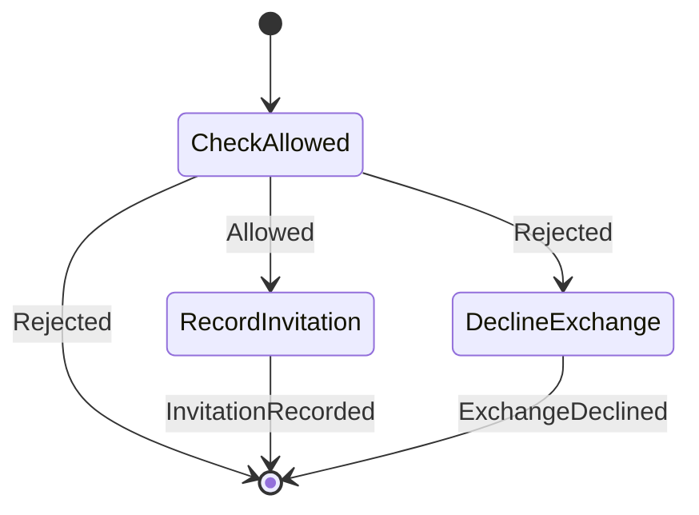
