# Membership workflows

_Generated by `./gradlew workflowCatalog` from `:feature:conversationorchestration:membership`. Do not edit by hand._

Creating and administrating groups, joining a group and group verification.

Diagram legend: boxes are `Step`s, arrow labels are the `Outcome` a step reported, `[*]` is the start or a successful completion, `Rejected` ends the workflow with a `ConversationFailure`.

| Workflow | Started by | Command | Lock |
|---|---|---|---|
| [`AddGroupMembersWorkflow`](#addgroupmembersworkflow) | Chats (`ConversationOrchestrator`) | `GroupAdministrationCommand.AddMembers` | `groupAdministrationLockKey(command.groupId)` |
| [`CreateGroupWorkflow`](#creategroupworkflow) | Chats (`ConversationOrchestrator`) | `GroupAdministrationCommand.CreateGroup` | — |
| [`DeleteGroupWorkflow`](#deletegroupworkflow) | Chats (`ConversationOrchestrator`) | `GroupAdministrationCommand.DeleteGroup` | `groupAdministrationLockKey(command.groupId)` |
| [`LeaveGroupWorkflow`](#leavegroupworkflow) | Chats (`ConversationOrchestrator`) | `GroupAdministrationCommand.LeaveGroup` | `groupAdministrationLockKey(command.groupId)` |
| [`PromoteGroupMemberWorkflow`](#promotegroupmemberworkflow) | Chats (`ConversationOrchestrator`) | `GroupAdministrationCommand.PromoteMember` | `groupAdministrationLockKey(command.groupId)` |
| [`RemoveGroupMemberWorkflow`](#removegroupmemberworkflow) | Chats (`ConversationOrchestrator`) | `GroupAdministrationCommand.RemoveMember` | `groupAdministrationLockKey(command.groupId)` |
| [`TransferGroupAdminAndLeaveWorkflow`](#transfergroupadminandleaveworkflow) | Chats (`ConversationOrchestrator`) | `GroupAdministrationCommand.TransferAdminAndLeave` | `groupAdministrationLockKey(command.groupId)` |
| [`HandleGroupInvitationResultWorkflow`](#handlegroupinvitationresultworkflow) | orchestration (`engine.run`) | `MembershipCommand.HandleGroupInvitationResult` | — |
| [`HandleMembershipResultWorkflow`](#handlemembershipresultworkflow) | orchestration (`engine.run`) | `MembershipCommand.HandleMembershipResult` | — |
| [`RecoverAcceptedGroupInvitationWorkflow`](#recoveracceptedgroupinvitationworkflow) | orchestration (`engine.run`) | `MembershipCommand.RecoverAcceptedGroupInvitation` | — |
| [`ResumeApprovedGroupJoinWorkflow`](#resumeapprovedgroupjoinworkflow) | orchestration (`engine.run`) | `MembershipCommand.ResumeApprovedGroupJoin` | — |
| [`RefreshOwnedGroupVerificationWorkflow`](#refreshownedgroupverificationworkflow) | orchestration (`engine.run`) | `MembershipCommand.RefreshOwnedGroupVerification` | `groupVerificationLockKey(command.groupId)` |
| [`SynchronizeGroupVerificationWorkflow`](#synchronizegroupverificationworkflow) | Chats (`ConversationOrchestrator`) | `GroupAdministrationCommand.SynchronizeVerification` | `groupVerificationLockKey(command.groupId)` |
| [`VerifyGroupMemberWorkflow`](#verifygroupmemberworkflow) | Chats (`ConversationOrchestrator`) | `GroupAdministrationCommand.VerifyMember` | `groupVerificationLockKey(command.groupId)` |

## `administration`

### AddGroupMembersWorkflow

- **Kind:** public — Chats submits `GroupAdministrationCommand.AddMembers`
- **Source:** `feature/conversationorchestration/membership/src/commonMain/kotlin/com/cbgm/sparrow/feature/conversationorchestration/membership/domain/workflow/administration/AddGroupMembersWorkflow.kt`
- **Lock:** `groupAdministrationLockKey(command.groupId)`
- **Uses:** `WorkflowEngine`, `GroupConversationRepository`, `StartGroupMembershipUseCase`, `RecordGroupInvitationUseCase`

```text
LoadTitle -> (StartMembership -> RecordInvitation -> RefreshVerification) for every contact.

The verification projection shows each invited member as pending right after its invitation.
```

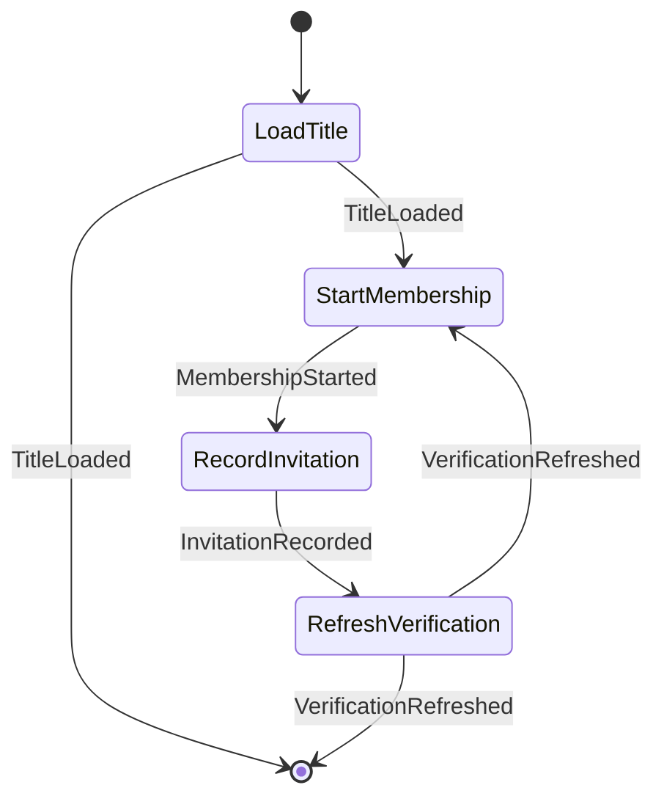

### CreateGroupWorkflow

- **Kind:** public — Chats submits `GroupAdministrationCommand.CreateGroup`
- **Source:** `feature/conversationorchestration/membership/src/commonMain/kotlin/com/cbgm/sparrow/feature/conversationorchestration/membership/domain/workflow/administration/CreateGroupWorkflow.kt`
- **Lock:** none
- **Uses:** `WorkflowEngine`, `GroupConversationRepository`, `GroupSecurityRepository`, `LocalSigningKeyPairProvider`, `RefreshOwnedGroupVerificationUseCase`

```text
CreateConversation -> InitializeSecurity -> InitializeVerification -> InviteMembers.

No invitation may be created before the owner's epoch and group key exist.
```

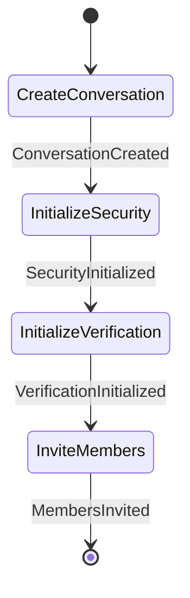

### DeleteGroupWorkflow

- **Kind:** public — Chats submits `GroupAdministrationCommand.DeleteGroup`
- **Source:** `feature/conversationorchestration/membership/src/commonMain/kotlin/com/cbgm/sparrow/feature/conversationorchestration/membership/domain/workflow/administration/DeleteGroupWorkflow.kt`
- **Lock:** `groupAdministrationLockKey(command.groupId)`
- **Uses:** `GroupConversationRepository`, `MessageAttachmentRepository`, `DeleteGroupMembershipUseCase`, `ClearGroupStateUseCase`

```text
LoadContext -> DeleteMembership -> DeleteAttachments -> DeleteLocalConversation -> ClearGroupState.

Membership goes first because it can refuse, e.g. a sole admin of a group with members; the attachments are
only deleted once the group is really gone.
```

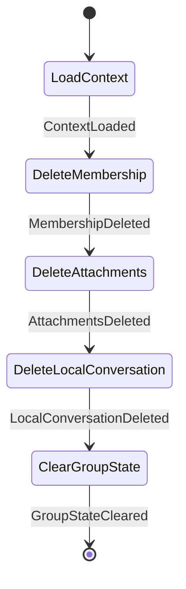

### LeaveGroupWorkflow

- **Kind:** public — Chats submits `GroupAdministrationCommand.LeaveGroup`
- **Source:** `feature/conversationorchestration/membership/src/commonMain/kotlin/com/cbgm/sparrow/feature/conversationorchestration/membership/domain/workflow/administration/LeaveGroupWorkflow.kt`
- **Lock:** `groupAdministrationLockKey(command.groupId)`
- **Uses:** `GroupConversationRepository`, `LeaveGroupUseCase`, `DeleteLocalExpenseReceiptsUseCase`

```text
LoadContext -> LeaveGroup -> EndLocalMembership -> DeleteExpenseReceipts.
```

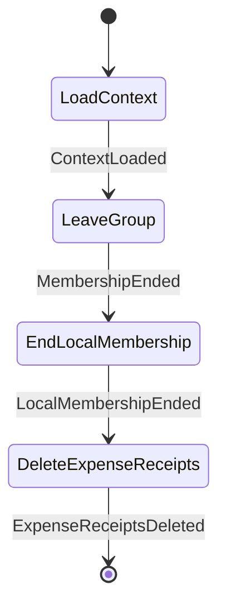

### PromoteGroupMemberWorkflow

- **Kind:** public — Chats submits `GroupAdministrationCommand.PromoteMember`
- **Source:** `feature/conversationorchestration/membership/src/commonMain/kotlin/com/cbgm/sparrow/feature/conversationorchestration/membership/domain/workflow/administration/PromoteGroupMemberWorkflow.kt`
- **Lock:** `groupAdministrationLockKey(command.groupId)`
- **Uses:** `WorkflowEngine`, `GroupConversationRepository`, `PromoteGroupMemberUseCase`

```text
LoadContext -> PromoteMember -> ProjectPromotion -> RefreshVerification.

A retry after a crash or a failed later step is safe: Membership returns the promotion of a member who is an
admin already without rotating again, so the projection and the verification refresh still run.
```

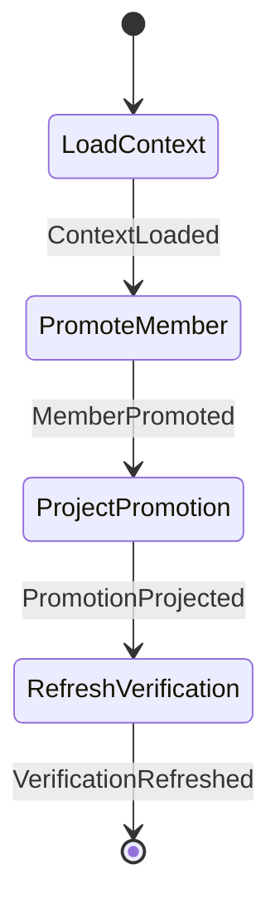

### RemoveGroupMemberWorkflow

- **Kind:** public — Chats submits `GroupAdministrationCommand.RemoveMember`
- **Source:** `feature/conversationorchestration/membership/src/commonMain/kotlin/com/cbgm/sparrow/feature/conversationorchestration/membership/domain/workflow/administration/RemoveGroupMemberWorkflow.kt`
- **Lock:** `groupAdministrationLockKey(command.groupId)`
- **Uses:** `WorkflowEngine`, `GroupConversationRepository`, `FindGroupMemberRemovalProgressUseCase`, `RemoveGroupMemberUseCase`, `FindMemberDisplayNameUseCase`

```text
LoadContext -> FindRemovalProgress -> [RemoveMember] -> ResolveMemberName -> ProjectRemoval -> RefreshVerification.

Membership commits the removal in one step; projection and verification follow. A retry after a crash or a
failed later step finds the committed removal and continues with the missing steps.
```

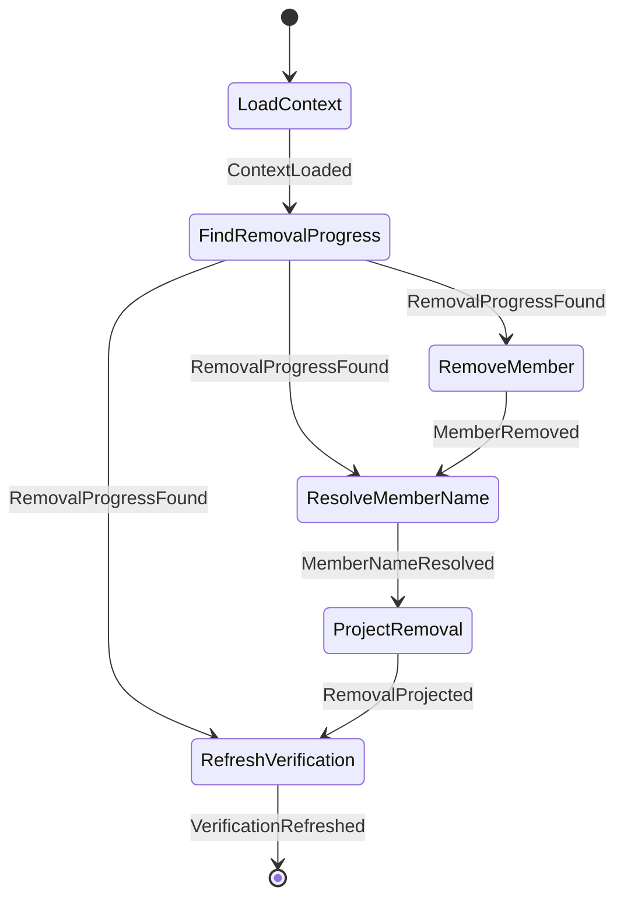

### TransferGroupAdminAndLeaveWorkflow

- **Kind:** public — Chats submits `GroupAdministrationCommand.TransferAdminAndLeave`
- **Source:** `feature/conversationorchestration/membership/src/commonMain/kotlin/com/cbgm/sparrow/feature/conversationorchestration/membership/domain/workflow/administration/TransferGroupAdminAndLeaveWorkflow.kt`
- **Lock:** `groupAdministrationLockKey(command.groupId)`
- **Uses:** `GroupConversationRepository`, `TransferGroupAdminAndLeaveUseCase`, `DeleteLocalExpenseReceiptsUseCase`

```text
LoadContext -> TransferAdminAndLeave -> EndLocalMembership -> DeleteExpenseReceipts.
```

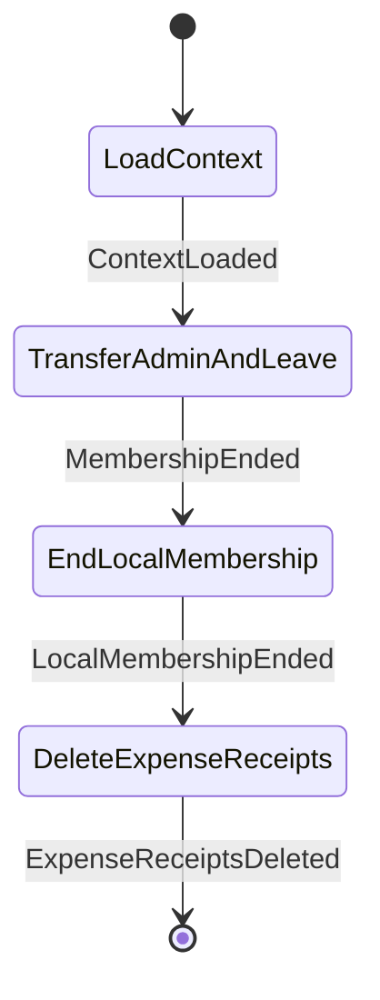

## `join`

### HandleGroupInvitationResultWorkflow

- **Kind:** internal — started by an observer, dispatcher or another workflow `MembershipCommand.HandleGroupInvitationResult`
- **Source:** `feature/conversationorchestration/membership/src/commonMain/kotlin/com/cbgm/sparrow/feature/conversationorchestration/membership/domain/workflow/join/HandleGroupInvitationResultWorkflow.kt`
- **Lock:** none
- **Uses:** `GetMembershipHandshakeUseCase`, `StageRemoteIdentityUseCase`, `AcceptRemoteIdentityHandshakeUseCase`, `AcceptGroupMembershipUseCase`, `DeclineGroupMembershipUseCase`, `GroupConversationRepository`, `DiscardDeclinedGroupConversationUseCase`

```text
accepted, staged:  FindHandshake -> StageOwnerIdentity -> AcceptOwnerIdentity -> AcceptMembership -> ShowConversation
accepted, joining: FindHandshake -> ShowConversation   (an accepted invitation is replayable after restart)
declined:          FindHandshake -> DeclineMembership -> DiscardConversation

The owner keys were verified when this exact offer was staged. A half-joined group is never shown:
the conversation appears only after identity and join preflight succeeded.
```

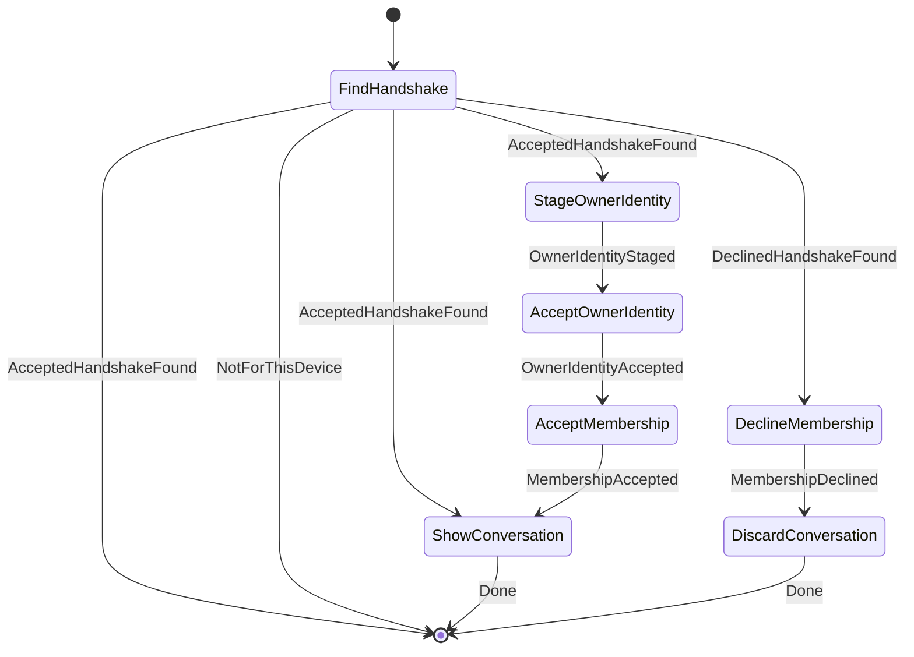

### HandleMembershipResultWorkflow

- **Kind:** internal — started by an observer, dispatcher or another workflow `MembershipCommand.HandleMembershipResult`
- **Source:** `feature/conversationorchestration/membership/src/commonMain/kotlin/com/cbgm/sparrow/feature/conversationorchestration/membership/domain/workflow/join/HandleMembershipResultWorkflow.kt`
- **Lock:** none
- **Uses:** `WorkflowEngine`, `HandleInvitationResponseUseCase`, `LoadMutualMemberIdentityUseCase`, `ConfirmGroupMemberIdentityUseCase`, `FindMemberDisplayNameUseCase`, `GetGroupCurrentEpochUseCase`, `GroupConversationRepository`

```text
IDENTITY_READY: MarkInvitationAccepted -> LoadMemberIdentity -> ConfirmMemberIdentity
WELCOME_SENT:   MarkInvitationAccepted
ACTIVE:         ResolveMemberName -> LoadEpoch -> AddParticipant -> FlushQueuedMessages

IDENTITY_READY recovers memberships left behind when the process stopped after the signed join request
but before the welcome.
```

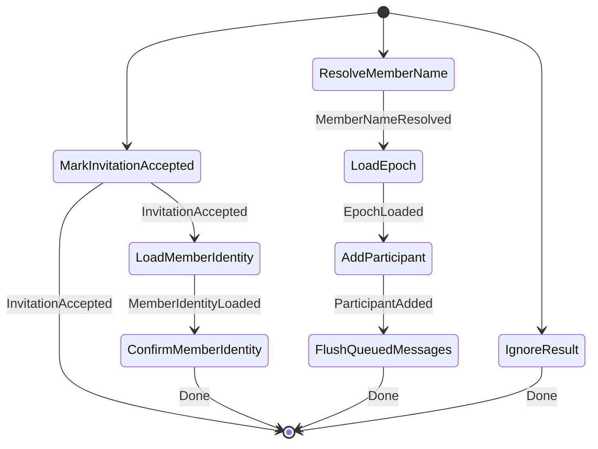

### RecoverAcceptedGroupInvitationWorkflow

- **Kind:** internal — started by an observer, dispatcher or another workflow `MembershipCommand.RecoverAcceptedGroupInvitation`
- **Source:** `feature/conversationorchestration/membership/src/commonMain/kotlin/com/cbgm/sparrow/feature/conversationorchestration/membership/domain/workflow/join/RecoverAcceptedGroupInvitationWorkflow.kt`
- **Lock:** none
- **Uses:** `WorkflowEngine`, `GetMembershipHandshakeUseCase`

```text
CheckHandshakeExists -> HandleResult.
```

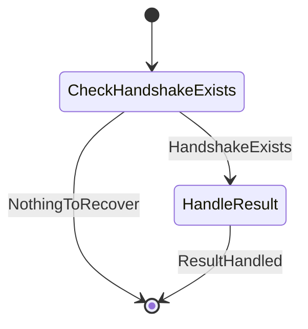

### ResumeApprovedGroupJoinWorkflow

- **Kind:** internal — started by an observer, dispatcher or another workflow `MembershipCommand.ResumeApprovedGroupJoin`
- **Source:** `feature/conversationorchestration/membership/src/commonMain/kotlin/com/cbgm/sparrow/feature/conversationorchestration/membership/domain/workflow/join/ResumeApprovedGroupJoinWorkflow.kt`
- **Lock:** none
- **Uses:** `GetMembershipHandshakeUseCase`, `GetRemoteIdentityUseCase`, `StageRemoteIdentityUseCase`, `EstablishMutualIdentityUseCase`, `ConfirmGroupMemberIdentityUseCase`

```text
FindHandshake -> LoadApprovedIdentity -> StageIdentity -> EstablishMutualIdentity -> ConfirmMemberIdentity

Approval changed the pinned keys in place but reset mutual authorization: the original signed JOIN's key
receipt is marked again and no earlier verification is inherited. A join that already got its welcome
needs nothing.
```

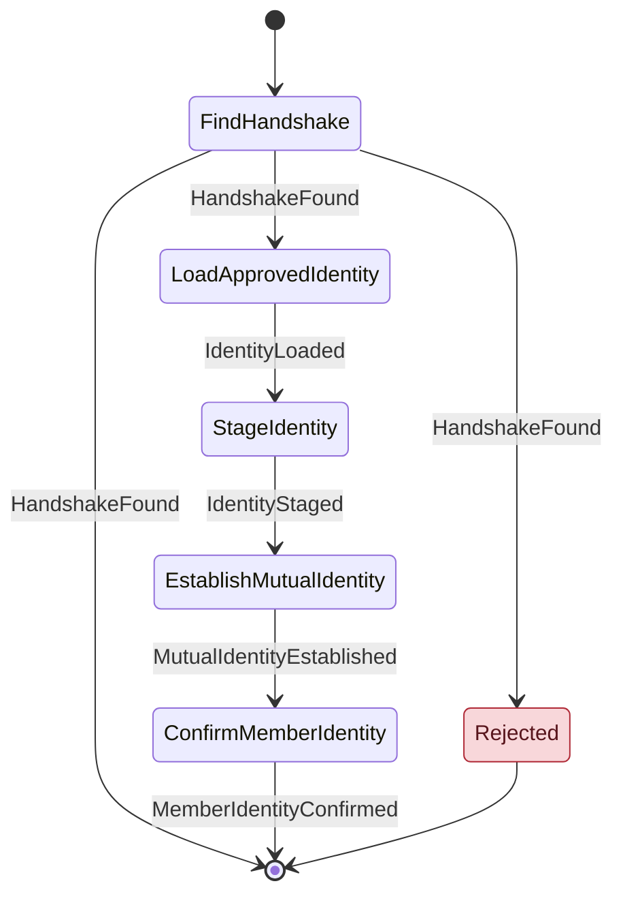

## `verification`

### RefreshOwnedGroupVerificationWorkflow

- **Kind:** internal — started by an observer, dispatcher or another workflow `MembershipCommand.RefreshOwnedGroupVerification`
- **Source:** `feature/conversationorchestration/membership/src/commonMain/kotlin/com/cbgm/sparrow/feature/conversationorchestration/membership/domain/workflow/verification/RefreshOwnedGroupVerificationWorkflow.kt`
- **Lock:** `groupVerificationLockKey(command.groupId)`
- **Uses:** `ResolveGroupVerificationRoleUseCase`, `CheckGroupOwnershipUseCase`, `RefreshOwnedGroupVerificationUseCase`, `BroadcastGroupVerificationSnapshotUseCase`

```text
LoadSecurity -> RefreshRows -> BroadcastSnapshot   (local admin)
LoadSecurity -> CheckOwnership -> RefreshRows      (owner without security state, e.g. before the first member joined)
```

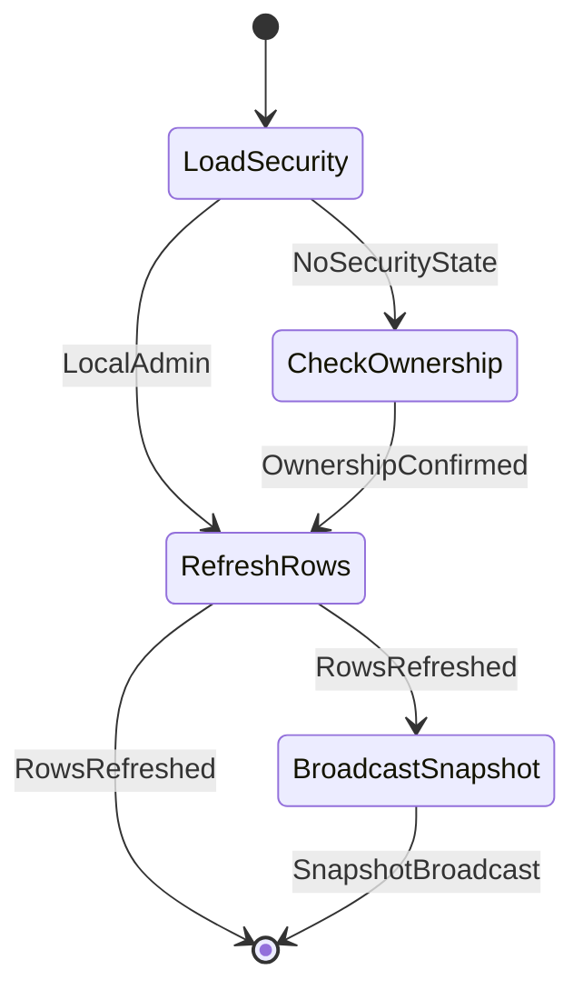

### SynchronizeGroupVerificationWorkflow

- **Kind:** public — Chats submits `GroupAdministrationCommand.SynchronizeVerification`
- **Source:** `feature/conversationorchestration/membership/src/commonMain/kotlin/com/cbgm/sparrow/feature/conversationorchestration/membership/domain/workflow/verification/SynchronizeGroupVerificationWorkflow.kt`
- **Lock:** `groupVerificationLockKey(command.groupId)`
- **Uses:** `ResolveGroupVerificationRoleUseCase`, `CheckGroupOwnershipUseCase`, `RefreshOwnedGroupVerificationUseCase`, `BroadcastGroupVerificationSnapshotUseCase`, `RequestGroupVerificationSnapshotUseCase`

```text
LoadSecurity -> RefreshRows -> BroadcastSnapshot   (local admin)
LoadSecurity -> RequestSnapshot                     (member)
LoadSecurity -> CheckOwnership -> RefreshRows       (no security state left)
```

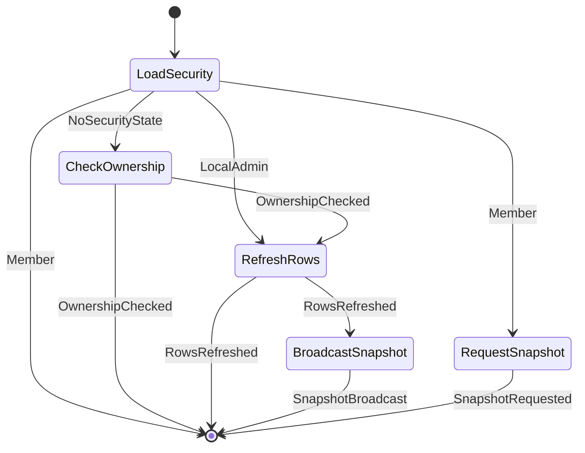

### VerifyGroupMemberWorkflow

- **Kind:** public — Chats submits `GroupAdministrationCommand.VerifyMember`
- **Source:** `feature/conversationorchestration/membership/src/commonMain/kotlin/com/cbgm/sparrow/feature/conversationorchestration/membership/domain/workflow/verification/VerifyGroupMemberWorkflow.kt`
- **Lock:** `groupVerificationLockKey(command.groupId)`
- **Uses:** `ResolveGroupVerificationRoleUseCase`, `ConfirmParticipantVerificationUseCase`, `BroadcastGroupVerificationSnapshotUseCase`, `SendAdminVerificationReceiptUseCase`

```text
LoadSecurity -> ConfirmParticipant -> BroadcastSnapshot   (the admin verified a member)
LoadSecurity -> SendReceipt                               (a member verified the admin)
```

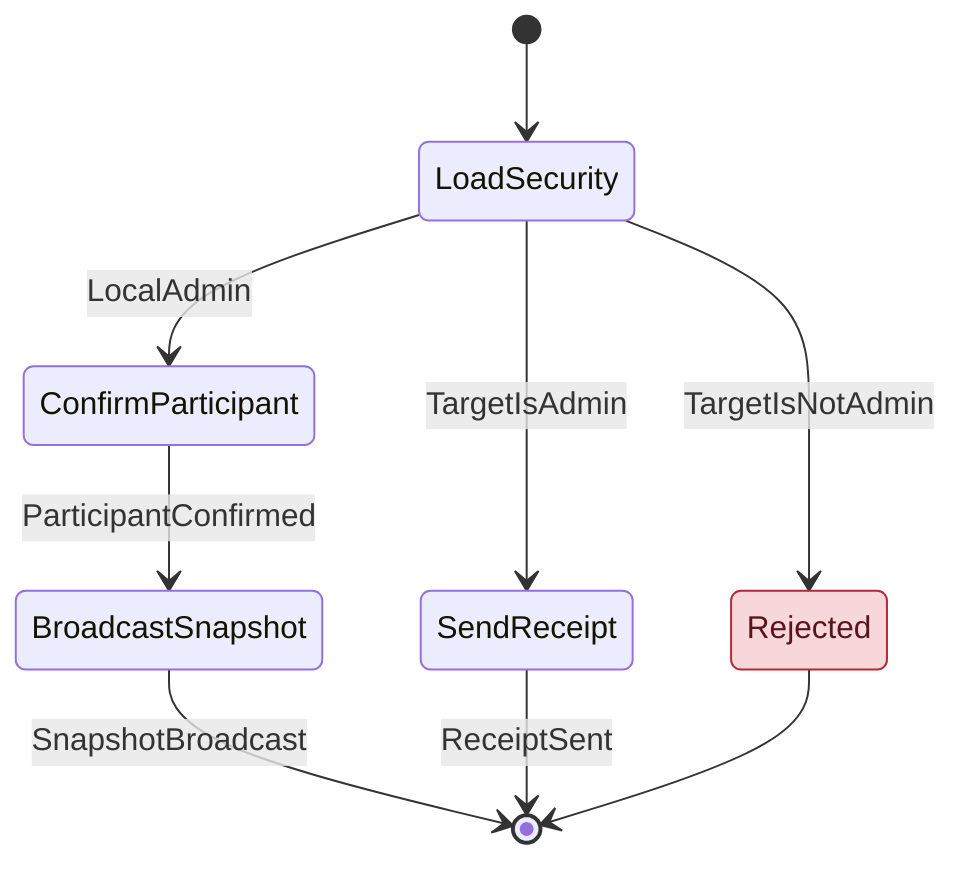
