# Message workflows

_Generated by `./gradlew workflowCatalog` from `:feature:conversationorchestration:message`. Do not edit by hand._

Writing, changing, reading and retrying Direct and Group messages, polls and forwarding.

Diagram legend: boxes are `Step`s, arrow labels are the `Outcome` a step reported, `[*]` is the start or a successful completion, `Rejected` ends the workflow with a `ConversationFailure`.

| Workflow | Started by | Command | Lock |
|---|---|---|---|
| [`DeleteDirectMessageWorkflow`](#deletedirectmessageworkflow) | Chats (`ConversationOrchestrator`) | `DirectConversationCommand.DeleteMessage` | — |
| [`DeliverDirectMessageWorkflow`](#deliverdirectmessageworkflow) | orchestration (`engine.run`) | `MessageCommand.DeliverDirectMessage` | — |
| [`EditDirectMessageWorkflow`](#editdirectmessageworkflow) | Chats (`ConversationOrchestrator`) | `DirectConversationCommand.EditMessage` | — |
| [`MarkDirectConversationReadWorkflow`](#markdirectconversationreadworkflow) | Chats (`ConversationOrchestrator`) | `DirectConversationCommand.MarkConversationRead` | — |
| [`RetryDirectMessageWorkflow`](#retrydirectmessageworkflow) | Chats (`ConversationOrchestrator`) | `DirectConversationCommand.RetryMessage` | — |
| [`SendDirectIndicatorWorkflow`](#senddirectindicatorworkflow) | Chats (`ConversationOrchestrator`) | `DirectConversationCommand.SendIndicator` | — |
| [`SendDirectMessageWorkflow`](#senddirectmessageworkflow) | Chats (`ConversationOrchestrator`) | `DirectConversationCommand.SendMessage` | — |
| [`ToggleDirectReactionWorkflow`](#toggledirectreactionworkflow) | Chats (`ConversationOrchestrator`) | `DirectConversationCommand.ToggleReaction` | — |
| [`ActivateAuthorizedConversationWorkflow`](#activateauthorizedconversationworkflow) | orchestration (`engine.run`) | `MessageCommand.ActivateAuthorizedConversation` | — |
| [`DiscardWaitingDirectMessagesWorkflow`](#discardwaitingdirectmessagesworkflow) | orchestration (`engine.run`) | `MessageCommand.DiscardWaitingDirectMessages` | `"direct-release:${command.contactId}"` |
| [`ReleaseWaitingDirectMessagesWorkflow`](#releasewaitingdirectmessagesworkflow) | orchestration (`engine.run`) | `MessageCommand.ReleaseWaitingDirectMessages` | `"direct-release:${command.contactId}"` |
| [`ForwardMessageWorkflow`](#forwardmessageworkflow) | Chats (`ConversationOrchestrator`) | `ForwardMessage` | — |
| [`CloseGroupPollWorkflow`](#closegrouppollworkflow) | Chats (`ConversationOrchestrator`) | `GroupMessageCommand.ClosePoll` | — |
| [`DeleteGroupMessageWorkflow`](#deletegroupmessageworkflow) | Chats (`ConversationOrchestrator`) | `GroupMessageCommand.DeleteMessage` | — |
| [`EditGroupMessageWorkflow`](#editgroupmessageworkflow) | Chats (`ConversationOrchestrator`) | `GroupMessageCommand.EditMessage` | — |
| [`FlushQueuedGroupMessagesWorkflow`](#flushqueuedgroupmessagesworkflow) | orchestration (`engine.run`) | `MessageCommand.FlushQueuedGroupMessages` | `groupSendLockKey(command.groupId)` |
| [`MarkGroupConversationReadWorkflow`](#markgroupconversationreadworkflow) | Chats (`ConversationOrchestrator`) | `GroupMessageCommand.MarkConversationRead` | — |
| [`RetryGroupMessageWorkflow`](#retrygroupmessageworkflow) | Chats (`ConversationOrchestrator`) | `GroupMessageCommand.RetryMessage` | — |
| [`SendGroupIndicatorWorkflow`](#sendgroupindicatorworkflow) | Chats (`ConversationOrchestrator`) | `GroupMessageCommand.SendIndicator` | — |
| [`SendGroupMessageWorkflow`](#sendgroupmessageworkflow) | Chats (`ConversationOrchestrator`) | `GroupMessageCommand.SendMessage` | `groupSendLockKey(command.groupId)` |
| [`ToggleGroupReactionWorkflow`](#togglegroupreactionworkflow) | Chats (`ConversationOrchestrator`) | `GroupMessageCommand.ToggleReaction` | — |
| [`VoteGroupPollWorkflow`](#votegrouppollworkflow) | Chats (`ConversationOrchestrator`) | `GroupMessageCommand.VotePoll` | — |

## `direct`

### DeleteDirectMessageWorkflow

- **Kind:** public — Chats submits `DirectConversationCommand.DeleteMessage`
- **Source:** `feature/conversationorchestration/message/src/commonMain/kotlin/com/cbgm/sparrow/feature/conversationorchestration/message/domain/workflow/direct/DeleteDirectMessageWorkflow.kt`
- **Lock:** none
- **Uses:** `DirectConversationRepository`, `DirectMessageRepository`, `RequireDirectChatAuthorizationUseCase`, `SendDirectOperationUseCase`, `DiscardDirectMessagesUseCase`

```text
FindConversation -> FindOwnMessage -> (DiscardMessage) | (CheckAuthorization -> SendDelete -> DiscardMessage).
```

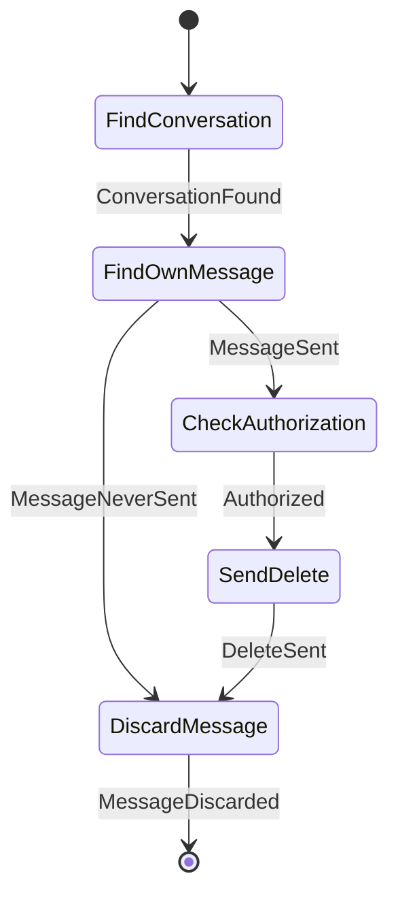

### DeliverDirectMessageWorkflow

- **Kind:** internal — started by an observer, dispatcher or another workflow `MessageCommand.DeliverDirectMessage`
- **Source:** `feature/conversationorchestration/message/src/commonMain/kotlin/com/cbgm/sparrow/feature/conversationorchestration/message/domain/workflow/direct/DeliverDirectMessageWorkflow.kt`
- **Lock:** none
- **Uses:** `DirectConversationRepository`, `DirectMessageRepository`, `FindDirectAuthorizationBlockUseCase`, `LoadDirectRecipientUseCase`, `StoreOutgoingDirectMessageUseCase`, `DiscardDirectMessagesUseCase`, `DirectMessagePacketFactory`, `ProtocolOutbox`, `RecordPacketSendFailureUseCase`

```text
FindConversation -> CheckAuthorization -> LoadRecipient -> StoreMessage -> CreatePacket
-> LinkPacket -> EnqueuePacket.

A packet that cannot be created or linked discards the stored message again; a packet the
outbox rejects keeps the message and marks it failed so the user can retry.
```

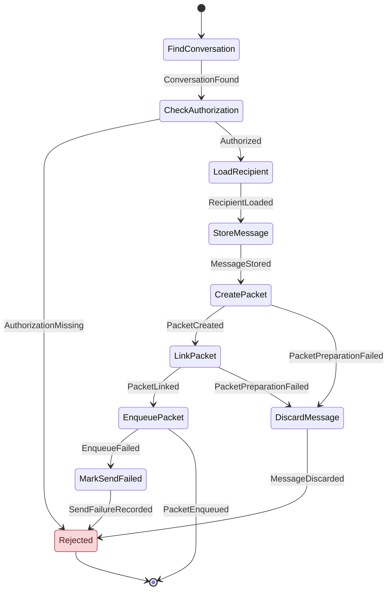

### EditDirectMessageWorkflow

- **Kind:** public — Chats submits `DirectConversationCommand.EditMessage`
- **Source:** `feature/conversationorchestration/message/src/commonMain/kotlin/com/cbgm/sparrow/feature/conversationorchestration/message/domain/workflow/direct/EditDirectMessageWorkflow.kt`
- **Lock:** none
- **Uses:** `DirectConversationRepository`, `DirectMessageRepository`, `MessageAttachmentOperationsRepository`, `RequireDirectChatAuthorizationUseCase`, `SendDirectOperationUseCase`

```text
FindConversation -> FindEditableMessage -> (ReplaceText) | (CheckAuthorization -> SendEdit -> ReplaceText).

A message still waiting for authorization was never sent, so it is edited locally only.
```

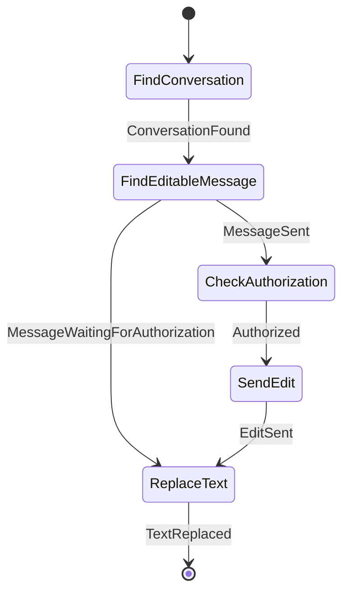

### MarkDirectConversationReadWorkflow

- **Kind:** public — Chats submits `DirectConversationCommand.MarkConversationRead`
- **Source:** `feature/conversationorchestration/message/src/commonMain/kotlin/com/cbgm/sparrow/feature/conversationorchestration/message/domain/workflow/direct/MarkDirectConversationReadWorkflow.kt`
- **Lock:** none
- **Uses:** `ConversationUnseenCountRepository`, `DirectConversationRepository`, `DirectMessageRepository`, `FindDirectAuthorizationBlockUseCase`, `SendReadReceiptUseCase`

```text
ClearUnseenCount -> FindConversation -> FindUnreadMessages -> CheckAuthorization
-> (SendReadReceipt -> MarkReceiptSent)* .

Read receipts are opportunistic: while authorization is missing (e.g. during onboarding) the
receipts stay pending in the database and are sent the next time the chat is read.
```

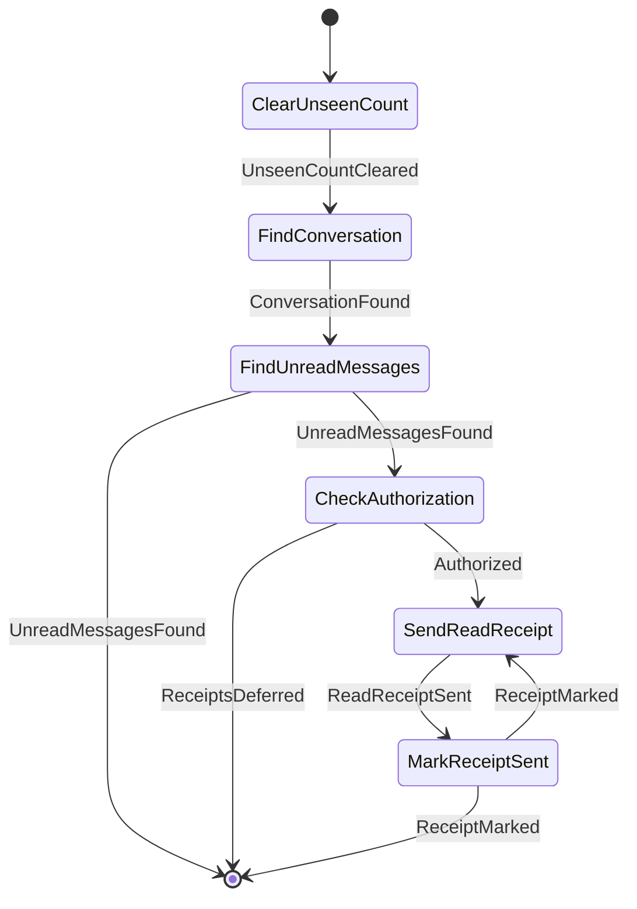

### RetryDirectMessageWorkflow

- **Kind:** public — Chats submits `DirectConversationCommand.RetryMessage`
- **Source:** `feature/conversationorchestration/message/src/commonMain/kotlin/com/cbgm/sparrow/feature/conversationorchestration/message/domain/workflow/direct/RetryDirectMessageWorkflow.kt`
- **Lock:** none
- **Uses:** `DirectConversationRepository`, `DirectMessageRepository`, `ProtocolOutbox`, `RequireDirectChatAuthorizationUseCase`, `RecordRetryRequestedUseCase`

```text
FindRetryableMessage -> FindConversation -> CheckPacketIdentity -> CheckAuthorization
-> ResendPacket -> RecordRetry.
```

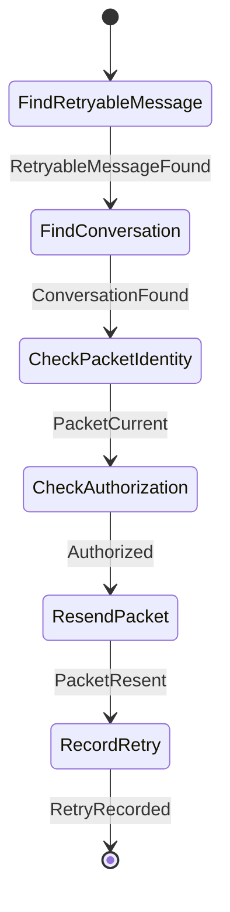

### SendDirectIndicatorWorkflow

- **Kind:** public — Chats submits `DirectConversationCommand.SendIndicator`
- **Source:** `feature/conversationorchestration/message/src/commonMain/kotlin/com/cbgm/sparrow/feature/conversationorchestration/message/domain/workflow/direct/SendDirectIndicatorWorkflow.kt`
- **Lock:** none
- **Uses:** `SendConversationIndicatorUseCase`

```text
SendIndicator. Indicators are transient transport events and never persisted.
```

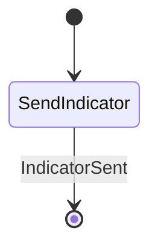

### SendDirectMessageWorkflow

- **Kind:** public — Chats submits `DirectConversationCommand.SendMessage`
- **Source:** `feature/conversationorchestration/message/src/commonMain/kotlin/com/cbgm/sparrow/feature/conversationorchestration/message/domain/workflow/direct/SendDirectMessageWorkflow.kt`
- **Lock:** none
- **Uses:** `WorkflowEngine`, `ContactBlocklistRepository`, `ObservePendingRemoteIdentityChangesUseCase`, `RequireDirectChatAuthorizationUseCase`, `InspectDirectInvitationUseCase`, `DirectReauthorizationPort`, `DirectConversationRepository`, `LoadDirectRecipientUseCase`, `StoreOutgoingDirectMessageUseCase`

```text
ValidateContent -> CheckBlockedContact -> CheckPendingIdentityChange -> CheckAuthorization
-> [InspectInvitation -> RequestReauthorization] -> ResolveConversation
-> DeliverMessage | (FindQueueConversation -> LoadQueueRecipient -> StoreWaitingMessage).

An authorized contact gets the message immediately. Without authorization the message waits in
WAITING_FOR_AUTHORIZATION, and the workflow starts a fresh invitation when none is pending.
```

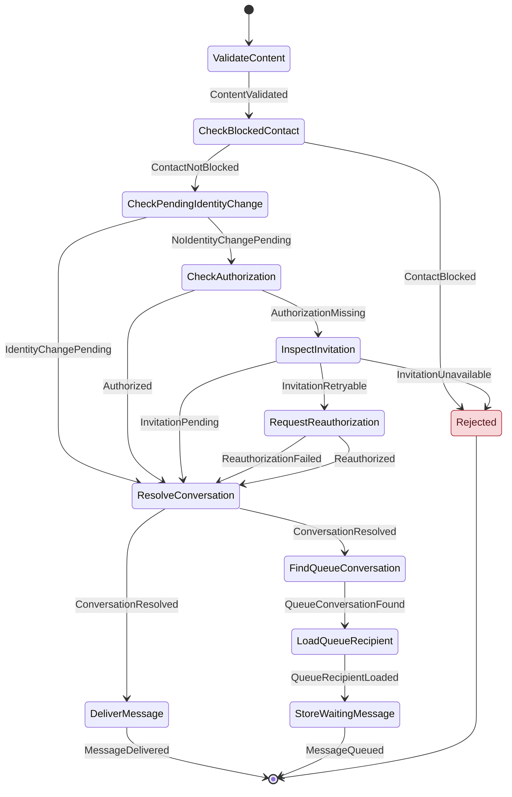

### ToggleDirectReactionWorkflow

- **Kind:** public — Chats submits `DirectConversationCommand.ToggleReaction`
- **Source:** `feature/conversationorchestration/message/src/commonMain/kotlin/com/cbgm/sparrow/feature/conversationorchestration/message/domain/workflow/direct/ToggleDirectReactionWorkflow.kt`
- **Lock:** none
- **Uses:** `DirectConversationRepository`, `DirectMessageRepository`, `MessageReactionRepository`, `RequireDirectChatAuthorizationUseCase`, `SendDirectOperationUseCase`

```text
FindConversation -> CheckAuthorization -> FindMessage -> (AddReaction | RemoveReaction) -> SendReaction.
```

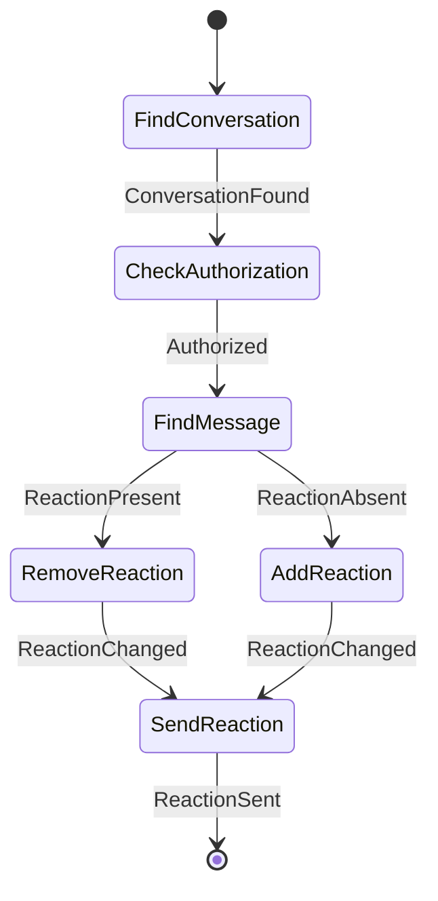

## `direct.authorization`

### ActivateAuthorizedConversationWorkflow

- **Kind:** internal — started by an observer, dispatcher or another workflow `MessageCommand.ActivateAuthorizedConversation`
- **Source:** `feature/conversationorchestration/message/src/commonMain/kotlin/com/cbgm/sparrow/feature/conversationorchestration/message/domain/workflow/direct/authorization/ActivateAuthorizedConversationWorkflow.kt`
- **Lock:** none
- **Uses:** `WorkflowEngine`, `DirectConversationRepository`

```text
EnsureConversation -> ReleaseWaitingMessages.
```

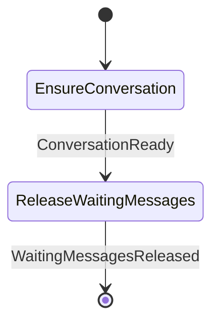

### DiscardWaitingDirectMessagesWorkflow

- **Kind:** internal — started by an observer, dispatcher or another workflow `MessageCommand.DiscardWaitingDirectMessages`
- **Source:** `feature/conversationorchestration/message/src/commonMain/kotlin/com/cbgm/sparrow/feature/conversationorchestration/message/domain/workflow/direct/authorization/DiscardWaitingDirectMessagesWorkflow.kt`
- **Lock:** `"direct-release:${command.contactId}"`
- **Uses:** `DirectMessageRepository`, `DiscardDirectMessagesUseCase`

```text
FindWaitingMessages -> DiscardMessages.
```

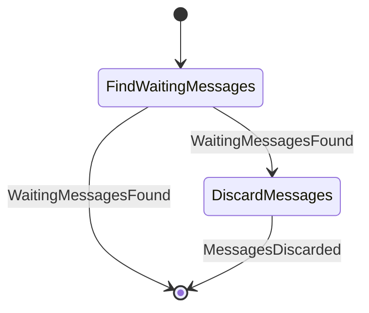

### ReleaseWaitingDirectMessagesWorkflow

- **Kind:** internal — started by an observer, dispatcher or another workflow `MessageCommand.ReleaseWaitingDirectMessages`
- **Source:** `feature/conversationorchestration/message/src/commonMain/kotlin/com/cbgm/sparrow/feature/conversationorchestration/message/domain/workflow/direct/authorization/ReleaseWaitingDirectMessagesWorkflow.kt`
- **Lock:** `"direct-release:${command.contactId}"`
- **Uses:** `DirectMessageRepository`, `MessageAttachmentOperationsRepository`, `FindDirectAuthorizationBlockUseCase`, `DiscardDirectMessagesUseCase`, `DirectMessagePacketFactory`, `ProtocolOutbox`, `RecordPacketSendFailureUseCase`

```text
FindWaitingMessages -> CheckAuthorization -> DiscardExpiredMessages
-> (PrepareRelease -> EnqueuePacket [-> MarkSendFailed -> RestoreWaitingMessage])* .

Release is opportunistic: onboarding, invitation acceptance and restart reconciliation may
all try before keys exist. Missing authorization defers the work instead of failing. A message
whose packet could not reach the outbox goes back to waiting so a later release retries it.
```

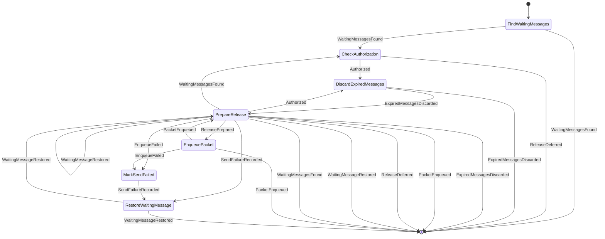

## `forward`

### ForwardMessageWorkflow

- **Kind:** public — Chats submits `ForwardMessage`
- **Source:** `feature/conversationorchestration/message/src/commonMain/kotlin/com/cbgm/sparrow/feature/conversationorchestration/message/domain/workflow/forward/ForwardMessageWorkflow.kt`
- **Lock:** none
- **Uses:** `WorkflowEngine`, `DirectConversationRepository`, `ConversationUnseenCountRepository`

```text
ValidateParts -> (FindContact ->) SendDirectMessage -> (FindDirectConversation ->) IncrementUnseen
ValidateParts -> SendGroupMessage -> IncrementUnseen
```

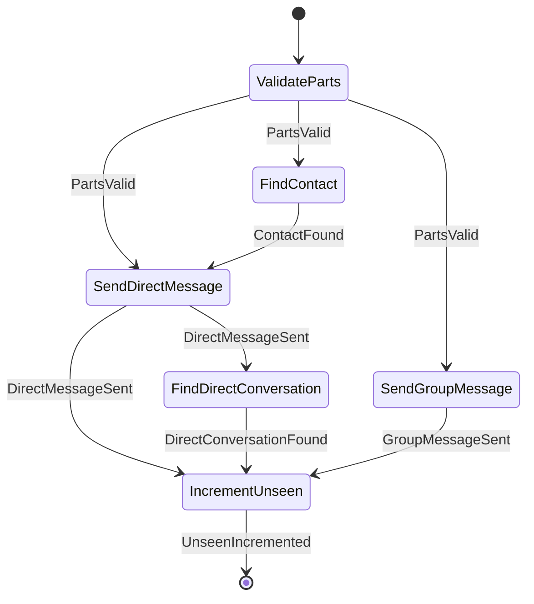

## `group`

### CloseGroupPollWorkflow

- **Kind:** public — Chats submits `GroupMessageCommand.ClosePoll`
- **Source:** `feature/conversationorchestration/message/src/commonMain/kotlin/com/cbgm/sparrow/feature/conversationorchestration/message/domain/workflow/group/CloseGroupPollWorkflow.kt`
- **Lock:** none
- **Uses:** `MessageAttachmentOperationsRepository`, `ObserveGroupAdministrationUseCase`, `CheckGroupMessageAccessUseCase`, `FindGroupMessageUseCase`, `FindGroupRecipientsUseCase`, `FindGroupPollUseCase`, `EncryptGroupOperationUseCase`, `EnqueueGroupPacketsUseCase`

```text
CheckMembership -> CheckClosePermission -> FindRecipients -> FindPoll -> SaveClosedPoll
-> EncryptClose -> EnqueueClose.

Only the poll creator or a group admin may close a poll.
```

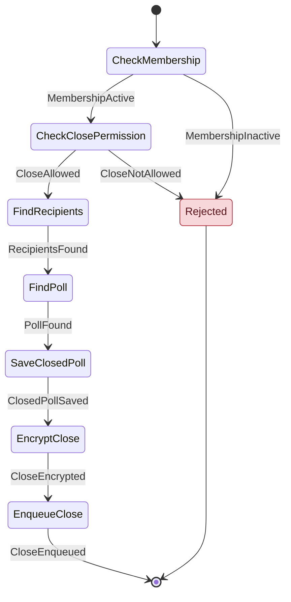

### DeleteGroupMessageWorkflow

- **Kind:** public — Chats submits `GroupMessageCommand.DeleteMessage`
- **Source:** `feature/conversationorchestration/message/src/commonMain/kotlin/com/cbgm/sparrow/feature/conversationorchestration/message/domain/workflow/group/DeleteGroupMessageWorkflow.kt`
- **Lock:** none
- **Uses:** `CheckGroupMessageAccessUseCase`, `FindGroupMessageUseCase`, `FindGroupRecipientsUseCase`, `EncryptGroupOperationUseCase`, `EnqueueGroupPacketsUseCase`, `DiscardGroupMessagesUseCase`, `RequireMessageWithoutPaymentUseCase`

```text
CheckMembership -> FindOwnMessage -> FindRecipients -> EncryptDelete -> EnqueueDelete -> DiscardMessage.
```

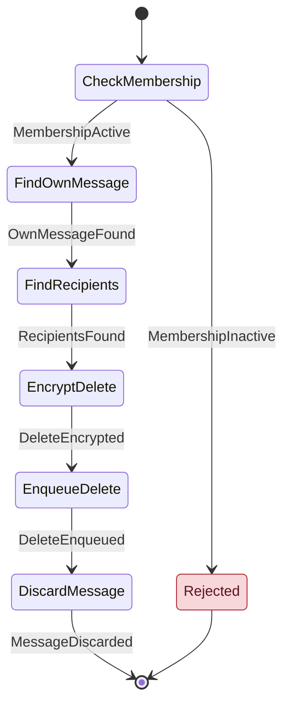

### EditGroupMessageWorkflow

- **Kind:** public — Chats submits `GroupMessageCommand.EditMessage`
- **Source:** `feature/conversationorchestration/message/src/commonMain/kotlin/com/cbgm/sparrow/feature/conversationorchestration/message/domain/workflow/group/EditGroupMessageWorkflow.kt`
- **Lock:** none
- **Uses:** `GroupMessageRepository`, `MessageAttachmentOperationsRepository`, `CheckGroupMessageAccessUseCase`, `FindGroupMessageUseCase`, `FindGroupRecipientsUseCase`, `EncryptGroupOperationUseCase`, `EnqueueGroupPacketsUseCase`

```text
CheckMembership -> FindEditableMessage -> FindRecipients -> EncryptEdit -> EnqueueEdit -> ReplaceText.
```

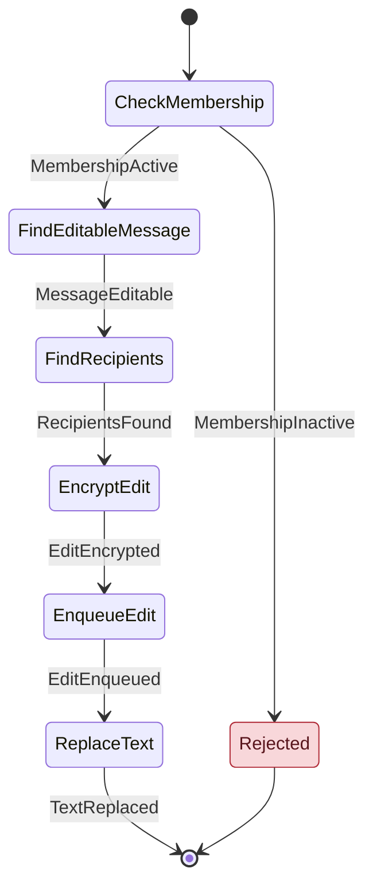

### FlushQueuedGroupMessagesWorkflow

- **Kind:** internal — started by an observer, dispatcher or another workflow `MessageCommand.FlushQueuedGroupMessages`
- **Source:** `feature/conversationorchestration/message/src/commonMain/kotlin/com/cbgm/sparrow/feature/conversationorchestration/message/domain/workflow/group/FlushQueuedGroupMessagesWorkflow.kt`
- **Lock:** `groupSendLockKey(command.groupId)`
- **Uses:** `GroupMessageRepository`, `MessageAttachmentOperationsRepository`, `ProtocolOutbox`, `EncryptGroupMessageUseCase`, `EnqueueGroupPacketsUseCase`

```text
FindRecipients -> FindQueuedMessages
-> (FindMissingRecipients -> EncryptMessage -> [SaveRecipientStates] -> EnqueuePackets)* .

The persisted queue survives process death and is replayed whenever membership activates a
recipient. A damaged or temporarily undeliverable message stays queued and never blocks the
following ones.
```

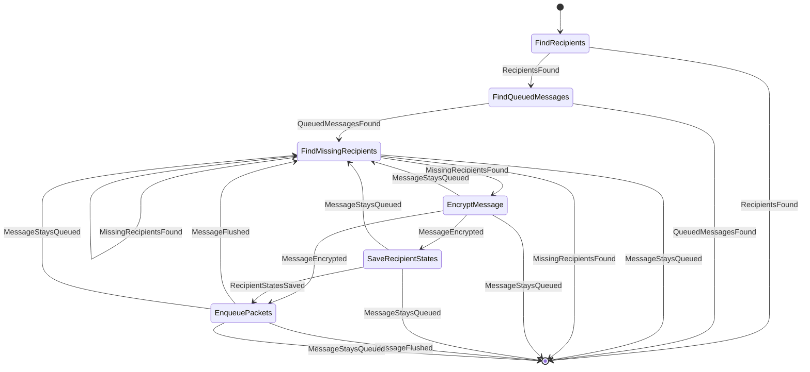

### MarkGroupConversationReadWorkflow

- **Kind:** public — Chats submits `GroupMessageCommand.MarkConversationRead`
- **Source:** `feature/conversationorchestration/message/src/commonMain/kotlin/com/cbgm/sparrow/feature/conversationorchestration/message/domain/workflow/group/MarkGroupConversationReadWorkflow.kt`
- **Lock:** none
- **Uses:** `ConversationUnseenCountRepository`, `GroupMessageRepository`, `SendReadReceiptUseCase`

```text
ClearUnseenCount -> FindUnreadMessages -> (AcknowledgeMessage)* .

Each sender gets its own receipt; one failing receipt does not hold back the others.
```

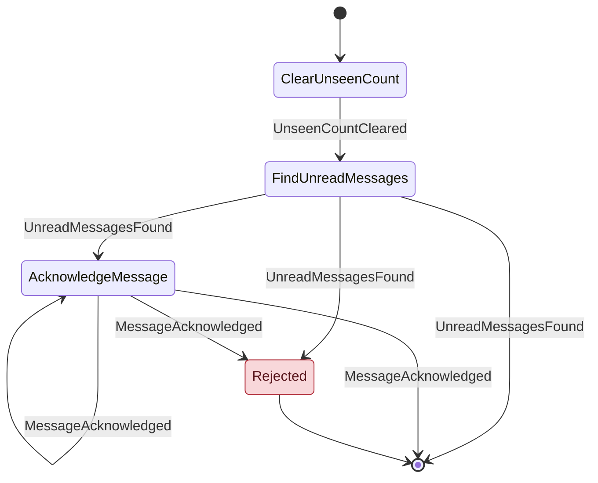

### RetryGroupMessageWorkflow

- **Kind:** public — Chats submits `GroupMessageCommand.RetryMessage`
- **Source:** `feature/conversationorchestration/message/src/commonMain/kotlin/com/cbgm/sparrow/feature/conversationorchestration/message/domain/workflow/group/RetryGroupMessageWorkflow.kt`
- **Lock:** none
- **Uses:** `GroupMessageRepository`, `ProtocolOutbox`, `RecordRetryRequestedUseCase`

```text
FindFailedRecipients -> (ResendToRecipient)* .

Retrying a group message resends only to the recipients whose delivery failed; it never
creates a new logical message. One failing recipient does not prevent the others' retry.
```

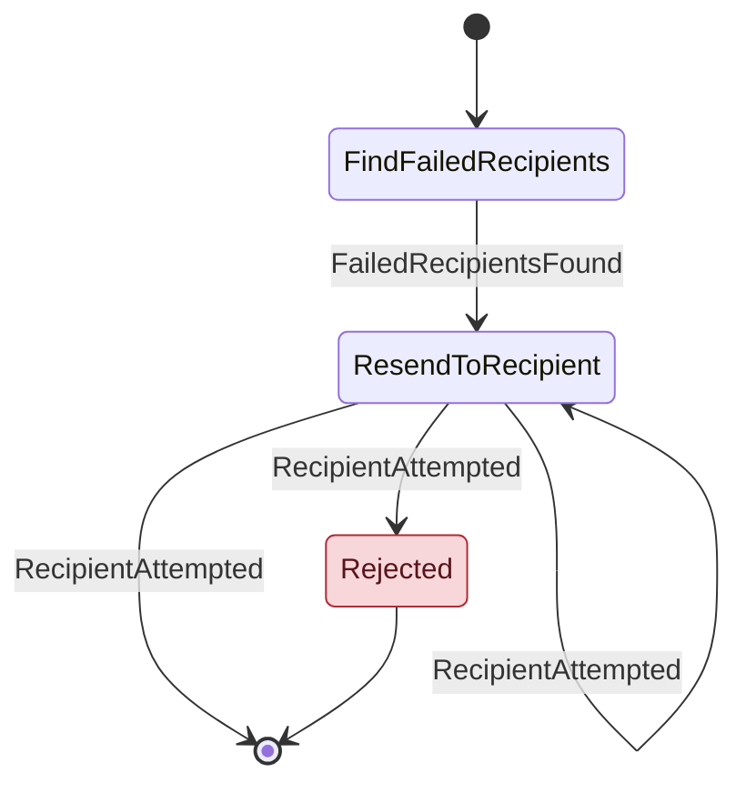

### SendGroupIndicatorWorkflow

- **Kind:** public — Chats submits `GroupMessageCommand.SendIndicator`
- **Source:** `feature/conversationorchestration/message/src/commonMain/kotlin/com/cbgm/sparrow/feature/conversationorchestration/message/domain/workflow/group/SendGroupIndicatorWorkflow.kt`
- **Lock:** none
- **Uses:** `SendConversationIndicatorUseCase`

```text
SendIndicator to every current group member. Indicators are transient and never persisted.
```


### SendGroupMessageWorkflow

- **Kind:** public — Chats submits `GroupMessageCommand.SendMessage`
- **Source:** `feature/conversationorchestration/message/src/commonMain/kotlin/com/cbgm/sparrow/feature/conversationorchestration/message/domain/workflow/group/SendGroupMessageWorkflow.kt`
- **Lock:** `groupSendLockKey(command.groupId)`
- **Uses:** `WorkflowEngine`, `GroupMessageRepository`, `CheckGroupMessageAccessUseCase`, `StoreOutgoingGroupMessageUseCase`, `DiscardGroupMessagesUseCase`, `EncryptGroupMessageUseCase`, `EnqueueGroupPacketsUseCase`

```text
ValidateContent -> CheckMembership -> FindRecipients -> [FlushQueuedMessages] -> StoreMessage
-> [EncryptMessage -> SaveRecipientStates -> EnqueuePackets].

Without an active recipient the message stays queued and is flushed once a member activates.
Older queued messages are flushed first so recipients receive them in order.
```

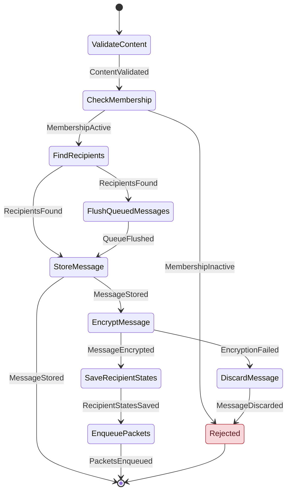

### ToggleGroupReactionWorkflow

- **Kind:** public — Chats submits `GroupMessageCommand.ToggleReaction`
- **Source:** `feature/conversationorchestration/message/src/commonMain/kotlin/com/cbgm/sparrow/feature/conversationorchestration/message/domain/workflow/group/ToggleGroupReactionWorkflow.kt`
- **Lock:** none
- **Uses:** `MessageReactionRepository`, `CheckGroupMessageAccessUseCase`, `FindGroupMessageUseCase`, `FindGroupRecipientsUseCase`, `EncryptGroupOperationUseCase`, `EnqueueGroupPacketsUseCase`

```text
CheckMembership -> FindMessage -> FindRecipients -> FindLocalReaction -> (AddReaction | RemoveReaction)
-> EncryptReaction -> EnqueueReaction.
```

```mermaid
stateDiagram-v2
    [*] --> CheckMembership
    CheckMembership --> FindMessage : MembershipActive
    CheckMembership --> Rejected : MembershipInactive
    FindMessage --> FindRecipients : MessageFound
    FindRecipients --> FindLocalReaction : RecipientsFound
    FindLocalReaction --> AddReaction : ReactionAbsent
    FindLocalReaction --> RemoveReaction : ReactionPresent
    RemoveReaction --> EncryptReaction : ReactionChanged
    AddReaction --> EncryptReaction : ReactionChanged
    EncryptReaction --> EnqueueReaction : ReactionEncrypted
    EnqueueReaction --> [*] : ReactionEnqueued
    Rejected --> [*]
    classDef reject fill:#f8d7da,stroke:#b02a37,color:#58151c
    class Rejected reject
```

### VoteGroupPollWorkflow

- **Kind:** public — Chats submits `GroupMessageCommand.VotePoll`
- **Source:** `feature/conversationorchestration/message/src/commonMain/kotlin/com/cbgm/sparrow/feature/conversationorchestration/message/domain/workflow/group/VoteGroupPollWorkflow.kt`
- **Lock:** none
- **Uses:** `MessageAttachmentOperationsRepository`, `CheckGroupMessageAccessUseCase`, `FindGroupMessageUseCase`, `FindGroupRecipientsUseCase`, `FindGroupPollUseCase`, `EncryptGroupOperationUseCase`, `EnqueueGroupPacketsUseCase`

```text
CheckMembership -> FindPollMessage -> FindRecipients -> FindPoll -> SaveVote -> EncryptVote -> EnqueueVote.
```

```mermaid
stateDiagram-v2
    [*] --> CheckMembership
    CheckMembership --> FindPollMessage : MembershipActive
    CheckMembership --> Rejected : MembershipInactive
    FindPollMessage --> FindRecipients : PollMessageFound
    FindRecipients --> FindPoll : RecipientsFound
    FindPoll --> SaveVote : PollFound
    SaveVote --> EncryptVote : VoteSaved
    EncryptVote --> EnqueueVote : VoteEncrypted
    EnqueueVote --> [*] : VoteEnqueued
    Rejected --> [*]
    classDef reject fill:#f8d7da,stroke:#b02a37,color:#58151c
    class Rejected reject
```
