# Message workflows

_Generated by `./gradlew workflowCatalog` from `:feature:conversationorchestration:message`. Do not edit by hand._

Writing, changing, reading and retrying Direct and Group messages, polls and forwarding.

Diagram legend: boxes are `Step`s, arrow labels are the `Outcome` a step reported, `[*]` is the start or a successful completion, `Rejected` ends the workflow with a `ConversationFailure`.

| Workflow | Started by | Command | Lock |
|---|---|---|---|
| [`DeleteDirectMessageWorkflow`](#deletedirectmessageworkflow) | Chats (`ConversationOrchestrator`) | `DirectConversationCommand.DeleteMessage` | — |
| [`DeleteOwnDirectMessageWorkflow`](#deleteowndirectmessageworkflow) | orchestration (`engine.run`) | `MessageCommand.DeleteOwnDirectMessage` | `directReleaseLockKey(command.target.contactId)` |
| [`DeliverDirectMessageWorkflow`](#deliverdirectmessageworkflow) | orchestration (`engine.run`) | `MessageCommand.DeliverDirectMessage` | — |
| [`EditDirectMessageWorkflow`](#editdirectmessageworkflow) | Chats (`ConversationOrchestrator`) | `DirectConversationCommand.EditMessage` | — |
| [`EditOwnDirectMessageWorkflow`](#editowndirectmessageworkflow) | orchestration (`engine.run`) | `MessageCommand.EditOwnDirectMessage` | `directReleaseLockKey(command.target.contactId)` |
| [`MarkDirectConversationReadWorkflow`](#markdirectconversationreadworkflow) | Chats (`ConversationOrchestrator`) | `DirectConversationCommand.MarkConversationRead` | — |
| [`RetryDirectMessageWorkflow`](#retrydirectmessageworkflow) | Chats (`ConversationOrchestrator`) | `DirectConversationCommand.RetryMessage` | — |
| [`SendDirectIndicatorWorkflow`](#senddirectindicatorworkflow) | Chats (`ConversationOrchestrator`) | `DirectConversationCommand.SendIndicator` | — |
| [`SendDirectMessageWorkflow`](#senddirectmessageworkflow) | Chats (`ConversationOrchestrator`) | `DirectConversationCommand.SendMessage` | — |
| [`ToggleDirectReactionWorkflow`](#toggledirectreactionworkflow) | Chats (`ConversationOrchestrator`) | `DirectConversationCommand.ToggleReaction` | — |
| [`ActivateAuthorizedConversationWorkflow`](#activateauthorizedconversationworkflow) | orchestration (`engine.run`) | `MessageCommand.ActivateAuthorizedConversation` | — |
| [`DiscardWaitingDirectMessagesWorkflow`](#discardwaitingdirectmessagesworkflow) | orchestration (`engine.run`) | `MessageCommand.DiscardWaitingDirectMessages` | `directReleaseLockKey(command.contactId)` |
| [`ReleaseWaitingDirectMessagesWorkflow`](#releasewaitingdirectmessagesworkflow) | orchestration (`engine.run`) | `MessageCommand.ReleaseWaitingDirectMessages` | `directReleaseLockKey(command.contactId)` |
| [`StoreWaitingDirectMessageWorkflow`](#storewaitingdirectmessageworkflow) | orchestration (`engine.run`) | `MessageCommand.StoreWaitingDirectMessage` | `directReleaseLockKey(command.contactId)` |
| [`ForwardMessageWorkflow`](#forwardmessageworkflow) | Chats (`ConversationOrchestrator`) | `ForwardMessage` | — |
| [`CloseGroupPollWorkflow`](#closegrouppollworkflow) | Chats (`ConversationOrchestrator`) | `GroupMessageCommand.ClosePoll` | — |
| [`DeleteGroupMessageWorkflow`](#deletegroupmessageworkflow) | Chats (`ConversationOrchestrator`) | `GroupMessageCommand.DeleteMessage` | — |
| [`DeleteUnsentGroupMessageWorkflow`](#deleteunsentgroupmessageworkflow) | orchestration (`engine.run`) | `MessageCommand.DeleteUnsentGroupMessage` | `groupSendLockKey(command.groupId)` |
| [`EditGroupMessageWorkflow`](#editgroupmessageworkflow) | Chats (`ConversationOrchestrator`) | `GroupMessageCommand.EditMessage` | — |
| [`EditUnsentGroupMessageWorkflow`](#editunsentgroupmessageworkflow) | orchestration (`engine.run`) | `MessageCommand.EditUnsentGroupMessage` | `groupSendLockKey(command.groupId)` |
| [`FlushQueuedGroupMessagesWorkflow`](#flushqueuedgroupmessagesworkflow) | orchestration (`engine.run`) | `MessageCommand.FlushQueuedGroupMessages` | `groupSendLockKey(command.groupId)` |
| [`MarkGroupConversationReadWorkflow`](#markgroupconversationreadworkflow) | Chats (`ConversationOrchestrator`) | `GroupMessageCommand.MarkConversationRead` | — |
| [`RetryGroupMessageWorkflow`](#retrygroupmessageworkflow) | Chats (`ConversationOrchestrator`) | `GroupMessageCommand.RetryMessage` | — |
| [`SendGroupIndicatorWorkflow`](#sendgroupindicatorworkflow) | Chats (`ConversationOrchestrator`) | `GroupMessageCommand.SendIndicator` | — |
| [`SendGroupMessageWorkflow`](#sendgroupmessageworkflow) | Chats (`ConversationOrchestrator`) | `GroupMessageCommand.SendMessage` | `groupSendLockKey(command.groupId)` |
| [`ToggleGroupReactionWorkflow`](#togglegroupreactionworkflow) | Chats (`ConversationOrchestrator`) | `GroupMessageCommand.ToggleReaction` | — |
| [`VoteGroupPollWorkflow`](#votegrouppollworkflow) | Chats (`ConversationOrchestrator`) | `GroupMessageCommand.VotePoll` | — |

## `direct`

### DeleteDirectMessageWorkflow

- **Kind:** public — Chats submits `DirectConversationCommand.DeleteMessage`
- **Source:** `feature/conversationorchestration/message/src/commonMain/kotlin/com/cbgm/sparrow/feature/conversationorchestration/message/domain/workflow/direct/DeleteDirectMessageWorkflow.kt`
- **Lock:** none
- **Uses:** `WorkflowEngine`, `DirectConversationRepository`, `FindDeletableDirectMessageUseCase`, `RequireDirectChatAuthorizationUseCase`, `SendDirectOperationUseCase`, `DiscardDirectMessagesUseCase`

```text
FindConversation -> FindOwnMessage -> (DeleteWaitingMessage) | (CheckAuthorization -> SendDelete -> DiscardMessage).

A message still waiting for authorization was never sent, so it is deleted locally only; that delete runs as
[MessageCommand.DeleteOwnDirectMessage] under the contact's release lock, which checks the message again, so a
release never revives it. A sent message cannot become waiting again, so its delete takes no lock.
```

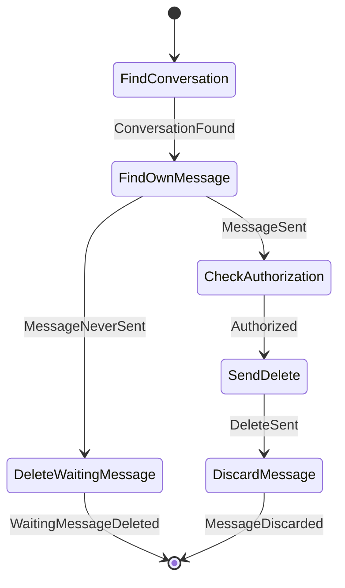

### DeleteOwnDirectMessageWorkflow

- **Kind:** internal — started by an observer, dispatcher or another workflow `MessageCommand.DeleteOwnDirectMessage`
- **Source:** `feature/conversationorchestration/message/src/commonMain/kotlin/com/cbgm/sparrow/feature/conversationorchestration/message/domain/workflow/direct/DeleteOwnDirectMessageWorkflow.kt`
- **Lock:** `directReleaseLockKey(command.target.contactId)`
- **Uses:** `FindDeletableDirectMessageUseCase`, `RequireDirectChatAuthorizationUseCase`, `SendDirectOperationUseCase`, `DiscardDirectMessagesUseCase`

```text
FindOwnMessage -> (DiscardMessage) | (CheckAuthorization -> SendDelete -> DiscardMessage).

Runs only for a message that was still waiting when the public delete looked at it. The workflow holds the
contact's release lock, so a waiting message cannot be released (and written back) between the check and the
local delete; one that was released just before gets a normal delete.
```

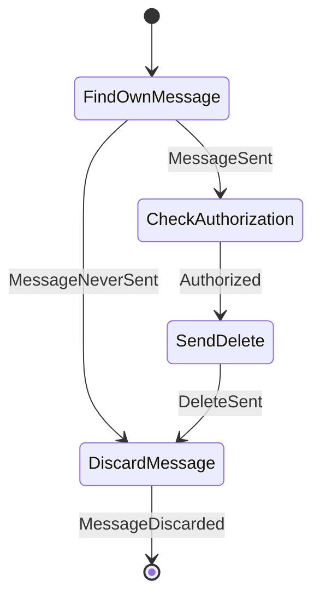

### DeliverDirectMessageWorkflow

- **Kind:** internal — started by an observer, dispatcher or another workflow `MessageCommand.DeliverDirectMessage`
- **Source:** `feature/conversationorchestration/message/src/commonMain/kotlin/com/cbgm/sparrow/feature/conversationorchestration/message/domain/workflow/direct/DeliverDirectMessageWorkflow.kt`
- **Lock:** none
- **Uses:** `DirectConversationRepository`, `FindDirectAuthorizationBlockUseCase`, `LoadDirectRecipientUseCase`, `StoreOutgoingDirectMessageUseCase`, `DiscardDirectMessagesUseCase`, `CreateDirectMessagePacketUseCase`, `ProtocolOutbox`, `RecordPacketSendFailureUseCase`

```text
FindConversation -> CheckAuthorization -> LoadRecipient -> StoreMessage -> CreatePacket -> EnqueuePacket.

A packet that cannot be created or linked to the message discards the stored message again; a packet the
outbox rejects keeps the message and marks it failed so the user can retry.
```

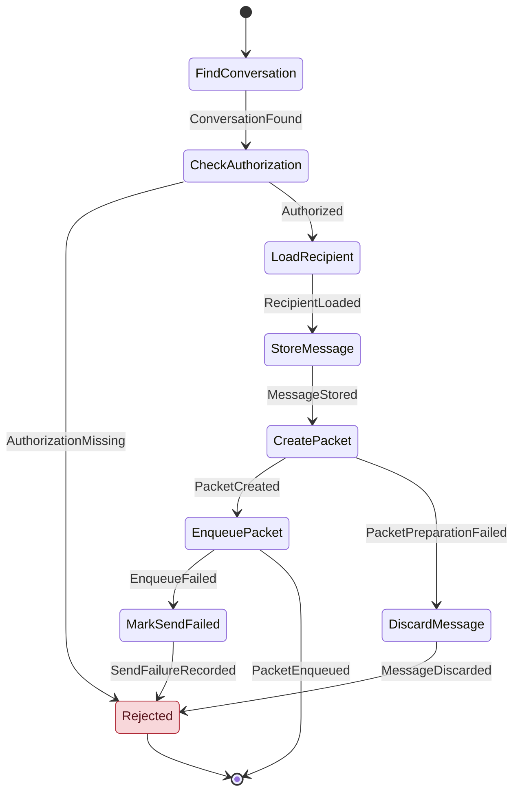

### EditDirectMessageWorkflow

- **Kind:** public — Chats submits `DirectConversationCommand.EditMessage`
- **Source:** `feature/conversationorchestration/message/src/commonMain/kotlin/com/cbgm/sparrow/feature/conversationorchestration/message/domain/workflow/direct/EditDirectMessageWorkflow.kt`
- **Lock:** none
- **Uses:** `WorkflowEngine`, `DirectConversationRepository`, `DirectMessageRepository`, `FindEditableDirectMessageUseCase`, `RequireDirectChatAuthorizationUseCase`, `SendDirectOperationUseCase`

```text
FindConversation -> FindEditableMessage -> (EditWaitingMessage) | (CheckAuthorization -> SendEdit -> ReplaceText).

A message still waiting for authorization was never sent, so it is edited locally only; that edit runs as
[MessageCommand.EditOwnDirectMessage] under the contact's release lock, which checks the message again, so a
release never sends the old text. A sent message cannot become waiting again, so its edit takes no lock and never
waits for a release or a send to the same contact.
```

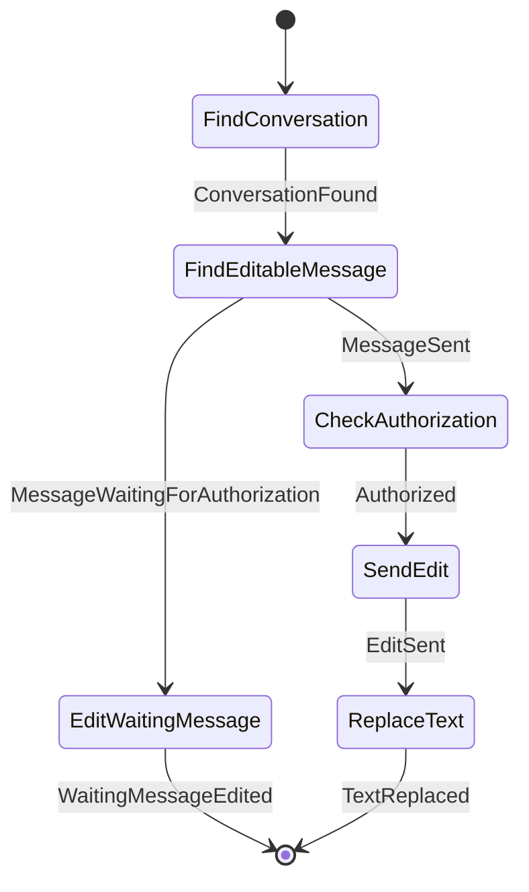

### EditOwnDirectMessageWorkflow

- **Kind:** internal — started by an observer, dispatcher or another workflow `MessageCommand.EditOwnDirectMessage`
- **Source:** `feature/conversationorchestration/message/src/commonMain/kotlin/com/cbgm/sparrow/feature/conversationorchestration/message/domain/workflow/direct/EditOwnDirectMessageWorkflow.kt`
- **Lock:** `directReleaseLockKey(command.target.contactId)`
- **Uses:** `DirectMessageRepository`, `FindEditableDirectMessageUseCase`, `RequireDirectChatAuthorizationUseCase`, `SendDirectOperationUseCase`

```text
FindEditableMessage -> (ReplaceText) | (CheckAuthorization -> SendEdit -> ReplaceText).

Runs only for a message that was still waiting when the public edit looked at it. A message still waiting for
authorization was never sent, so it is edited locally only. The workflow holds the contact's release lock, so a
waiting message cannot be released with its old text between the check and the edit; one that was released
just before gets a normal edit.
```

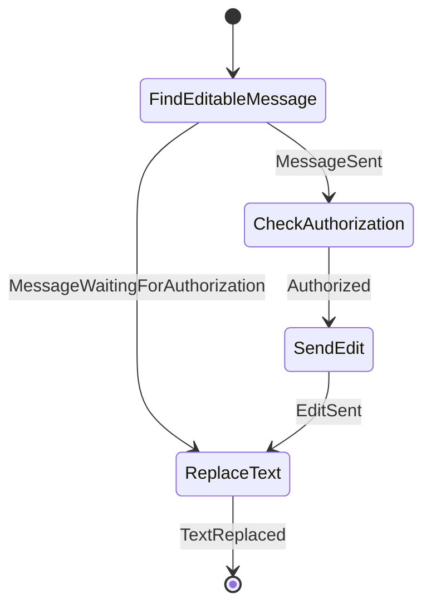

### MarkDirectConversationReadWorkflow

- **Kind:** public — Chats submits `DirectConversationCommand.MarkConversationRead`
- **Source:** `feature/conversationorchestration/message/src/commonMain/kotlin/com/cbgm/sparrow/feature/conversationorchestration/message/domain/workflow/direct/MarkDirectConversationReadWorkflow.kt`
- **Lock:** none
- **Uses:** `ConversationUnseenCountRepository`, `DirectConversationRepository`, `DirectMessageRepository`, `FindDirectAuthorizationBlockUseCase`, `AcknowledgeIncomingMessageUseCase`

```text
ClearUnseenCount -> FindConversation -> FindUnreadMessages -> CheckAuthorization -> (AcknowledgeMessage)* .

Read receipts are opportunistic: while authorization is missing (e.g. during onboarding) the
receipts stay pending in the database and are sent the next time the chat is read.
```

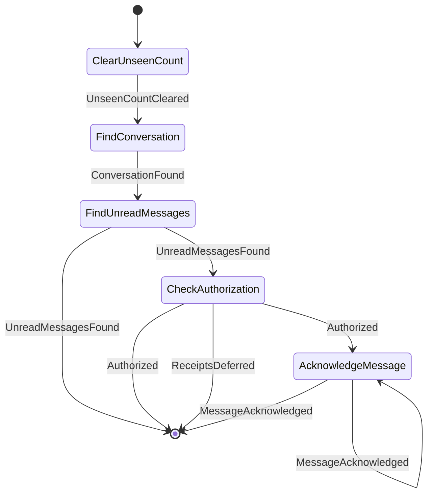

### RetryDirectMessageWorkflow

- **Kind:** public — Chats submits `DirectConversationCommand.RetryMessage`
- **Source:** `feature/conversationorchestration/message/src/commonMain/kotlin/com/cbgm/sparrow/feature/conversationorchestration/message/domain/workflow/direct/RetryDirectMessageWorkflow.kt`
- **Lock:** none
- **Uses:** `DirectConversationRepository`, `FindRetryableDirectMessageUseCase`, `CreateDirectMessagePacketUseCase`, `ProtocolOutbox`, `RequireDirectChatAuthorizationUseCase`, `RecordRetryRequestedUseCase`

```text
FindRetryableMessage -> FindConversation -> CheckAuthorization -> FindPacket
-> (ResendPacket | CreatePacket -> EnqueuePacket) -> RecordRetry.

A message whose packet never reached the outbox, or is no longer in it, gets a new packet; resending a packet
the outbox does not know would do nothing and leave the message queued forever.
```

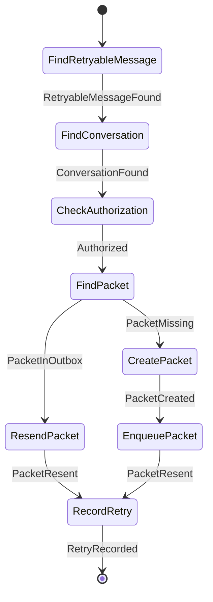

### SendDirectIndicatorWorkflow

- **Kind:** public — Chats submits `DirectConversationCommand.SendIndicator`
- **Source:** `feature/conversationorchestration/message/src/commonMain/kotlin/com/cbgm/sparrow/feature/conversationorchestration/message/domain/workflow/direct/SendDirectIndicatorWorkflow.kt`
- **Lock:** none
- **Uses:** `SendConversationIndicatorUseCase`

```text
SendIndicator. Indicators are transient transport events and never persisted.
```

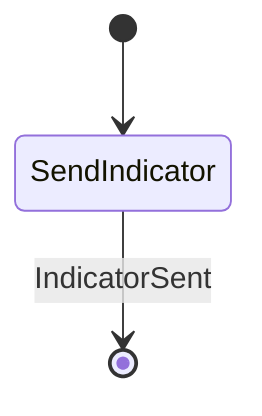

### SendDirectMessageWorkflow

- **Kind:** public — Chats submits `DirectConversationCommand.SendMessage`
- **Source:** `feature/conversationorchestration/message/src/commonMain/kotlin/com/cbgm/sparrow/feature/conversationorchestration/message/domain/workflow/direct/SendDirectMessageWorkflow.kt`
- **Lock:** none
- **Uses:** `WorkflowEngine`, `RequireDirectChatAuthorizationUseCase`, `InspectDirectInvitationUseCase`, `DirectReauthorizationPort`, `DirectConversationRepository`

```text
ValidateContent -> CheckAuthorization -> [InspectInvitation -> RequestReauthorization] -> ResolveConversation
-> DeliverMessage | (QueueMessage [-> DeliverMessage]).

An authorized contact gets the message immediately. Without authorization the message waits in
WAITING_FOR_AUTHORIZATION, and the workflow starts a fresh invitation when none is pending.

The workflow takes no lock, so a message is stored and shown at once even while an earlier message to the same
contact still uploads its attachments. Only QueueMessage ([MessageCommand.StoreWaitingDirectMessage]) holds the
contact's release lock: otherwise a release could run between "authorization missing" and storing the waiting
message, find nothing, and leave it waiting until the next identity event. When it finds the contact authorized
meanwhile, the message is delivered normally instead.
```

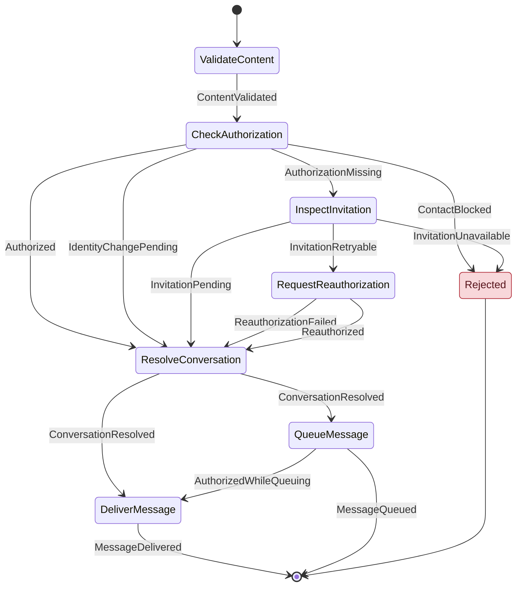

### ToggleDirectReactionWorkflow

- **Kind:** public — Chats submits `DirectConversationCommand.ToggleReaction`
- **Source:** `feature/conversationorchestration/message/src/commonMain/kotlin/com/cbgm/sparrow/feature/conversationorchestration/message/domain/workflow/direct/ToggleDirectReactionWorkflow.kt`
- **Lock:** none
- **Uses:** `DirectConversationRepository`, `FindDirectMessageUseCase`, `ToggleLocalReactionUseCase`, `RequireDirectChatAuthorizationUseCase`, `SendDirectOperationUseCase`

```text
FindConversation -> CheckAuthorization -> FindMessage -> ToggleReaction -> SendReaction.
```

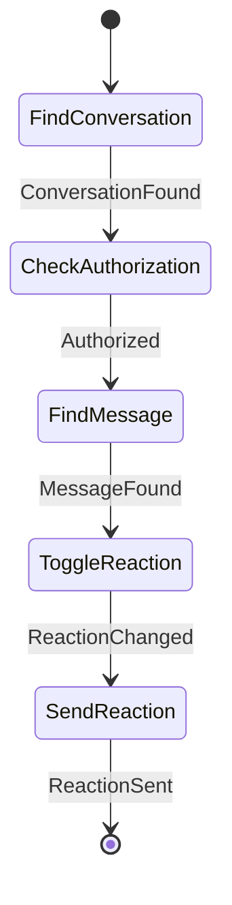

## `direct.authorization`

### ActivateAuthorizedConversationWorkflow

- **Kind:** internal — started by an observer, dispatcher or another workflow `MessageCommand.ActivateAuthorizedConversation`
- **Source:** `feature/conversationorchestration/message/src/commonMain/kotlin/com/cbgm/sparrow/feature/conversationorchestration/message/domain/workflow/direct/authorization/ActivateAuthorizedConversationWorkflow.kt`
- **Lock:** none
- **Uses:** `WorkflowEngine`, `DirectConversationRepository`

```text
EnsureConversation -> ReleaseWaitingMessages.
```

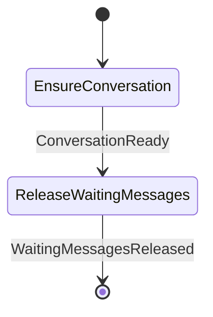

### DiscardWaitingDirectMessagesWorkflow

- **Kind:** internal — started by an observer, dispatcher or another workflow `MessageCommand.DiscardWaitingDirectMessages`
- **Source:** `feature/conversationorchestration/message/src/commonMain/kotlin/com/cbgm/sparrow/feature/conversationorchestration/message/domain/workflow/direct/authorization/DiscardWaitingDirectMessagesWorkflow.kt`
- **Lock:** `directReleaseLockKey(command.contactId)`
- **Uses:** `DirectMessageRepository`, `DiscardDirectMessagesUseCase`

```text
FindWaitingMessages -> DiscardMessages.
```

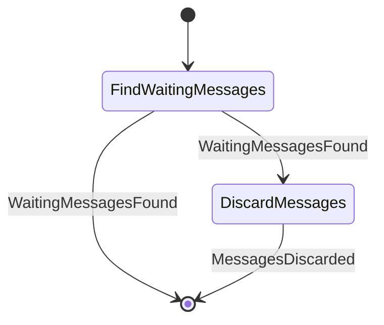

### ReleaseWaitingDirectMessagesWorkflow

- **Kind:** internal — started by an observer, dispatcher or another workflow `MessageCommand.ReleaseWaitingDirectMessages`
- **Source:** `feature/conversationorchestration/message/src/commonMain/kotlin/com/cbgm/sparrow/feature/conversationorchestration/message/domain/workflow/direct/authorization/ReleaseWaitingDirectMessagesWorkflow.kt`
- **Lock:** `directReleaseLockKey(command.contactId)`
- **Uses:** `DirectMessageRepository`, `FindDirectAuthorizationBlockUseCase`, `DiscardExpiredWaitingDirectMessagesUseCase`, `ReleaseWaitingDirectMessageUseCase`, `RestoreWaitingDirectMessageUseCase`, `ProtocolOutbox`, `RecordPacketSendFailureUseCase`

```text
FindWaitingMessages -> CheckAuthorization -> DiscardExpiredMessages
-> (PrepareRelease [-> EnqueuePacket [-> MarkSendFailed -> RestoreWaitingMessage]])* .

Release is opportunistic: onboarding, invitation acceptance and restart reconciliation may
all try before keys exist. Missing authorization defers the work instead of failing. A message
whose packet could not reach the outbox goes back to waiting so a later release retries it.

Storing a new waiting message and editing or deleting one share the lock, so none of them works on a contact's
waiting messages while they are released. PrepareRelease still reads each message again and skips one that is
gone or no longer waiting.
```

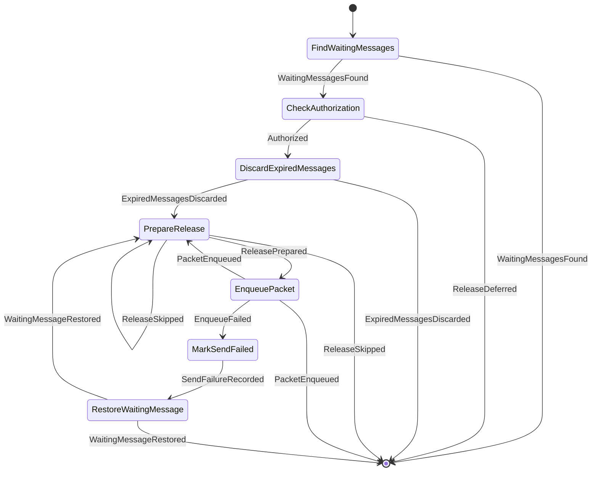

### StoreWaitingDirectMessageWorkflow

- **Kind:** internal — started by an observer, dispatcher or another workflow `MessageCommand.StoreWaitingDirectMessage`
- **Source:** `feature/conversationorchestration/message/src/commonMain/kotlin/com/cbgm/sparrow/feature/conversationorchestration/message/domain/workflow/direct/authorization/StoreWaitingDirectMessageWorkflow.kt`
- **Lock:** `directReleaseLockKey(command.contactId)`
- **Uses:** `FindDirectAuthorizationBlockUseCase`, `DirectConversationRepository`, `LoadDirectRecipientUseCase`, `StoreOutgoingDirectMessageUseCase`

```text
CheckAuthorization -> (FindConversation -> LoadRecipient -> StoreWaitingMessage).

Holds the contact's release lock and checks authorization again under it with the same rule the release uses:
either the contact became authorized meanwhile and nothing is stored (the caller sends the message normally), or
the message is stored as waiting before any later release can look for it. Only messages for contacts without
authorization take the lock, so authorized sends never wait for each other.
```

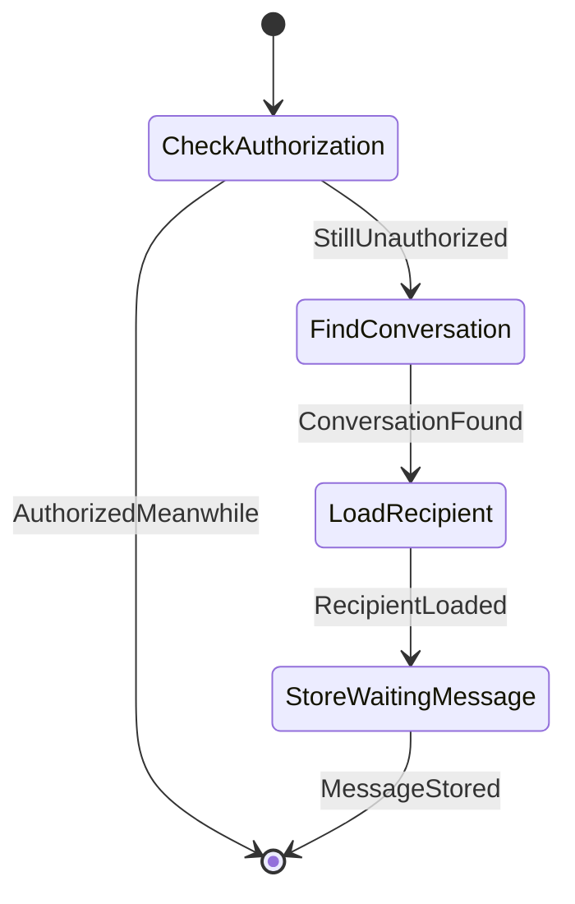

## `forward`

### ForwardMessageWorkflow

- **Kind:** public — Chats submits `ForwardMessage`
- **Source:** `feature/conversationorchestration/message/src/commonMain/kotlin/com/cbgm/sparrow/feature/conversationorchestration/message/domain/workflow/forward/ForwardMessageWorkflow.kt`
- **Lock:** none
- **Uses:** `WorkflowEngine`, `DirectConversationRepository`, `ConversationUnseenCountRepository`

```text
ValidateParts -> (FindContact ->) SendDirectMessage -> (FindDirectConversation ->) IncrementUnseen
ValidateParts -> SendGroupMessage -> IncrementUnseen
```

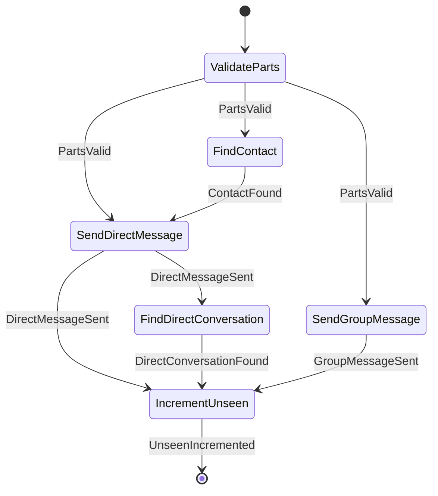

## `group`

### CloseGroupPollWorkflow

- **Kind:** public — Chats submits `GroupMessageCommand.ClosePoll`
- **Source:** `feature/conversationorchestration/message/src/commonMain/kotlin/com/cbgm/sparrow/feature/conversationorchestration/message/domain/workflow/group/CloseGroupPollWorkflow.kt`
- **Lock:** none
- **Uses:** `MessageAttachmentOperationsRepository`, `CheckGroupMessageAccessUseCase`, `FindGroupPollMessageUseCase`, `CheckPollClosePermissionUseCase`, `FindGroupRecipientsUseCase`, `FindGroupPollUseCase`, `EncryptGroupOperationUseCase`, `EnqueueGroupPacketsUseCase`

```text
CheckMembership -> FindPollMessage -> CheckClosePermission -> FindRecipients -> FindPoll -> EncryptClose
-> EnqueueClose -> SaveClosedPoll.

Only the poll creator or a group admin may close a poll. The poll is closed locally only after the close is
queued: a failed send leaves it open, so a retry closes and sends again.
```

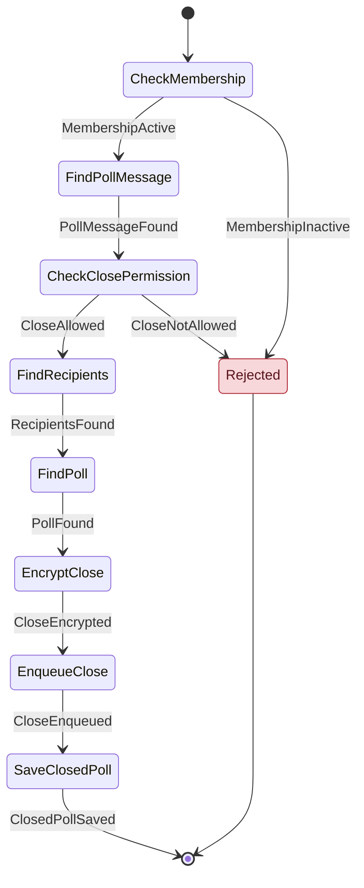

### DeleteGroupMessageWorkflow

- **Kind:** public — Chats submits `GroupMessageCommand.DeleteMessage`
- **Source:** `feature/conversationorchestration/message/src/commonMain/kotlin/com/cbgm/sparrow/feature/conversationorchestration/message/domain/workflow/group/DeleteGroupMessageWorkflow.kt`
- **Lock:** none
- **Uses:** `WorkflowEngine`, `CheckGroupMessageAccessUseCase`, `FindDeletableGroupMessageUseCase`, `FindGroupRecipientsUseCase`, `EncryptGroupOperationUseCase`, `EnqueueGroupPacketsUseCase`, `DiscardGroupMessagesUseCase`

```text
CheckMembership -> FindOwnMessage -> FindRecipients -> (EncryptDelete -> EnqueueDelete -> DiscardMessage)
| DeleteUnsentMessage.

A message nobody can receive or that is still queued unsent is deleted locally only, so it is never flushed.
Only that local delete ([MessageCommand.DeleteUnsentGroupMessage]) takes the group send lock, so a running flush
cannot send it while it is deleted. The delete of a message members already have takes no lock.
```

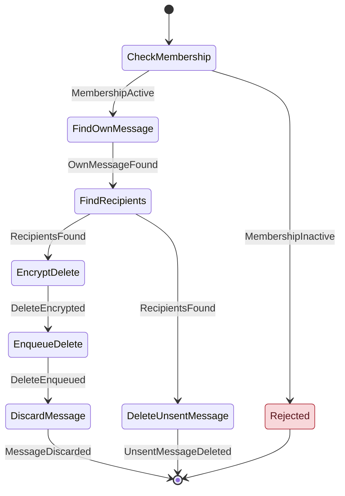

### DeleteUnsentGroupMessageWorkflow

- **Kind:** internal — started by an observer, dispatcher or another workflow `MessageCommand.DeleteUnsentGroupMessage`
- **Source:** `feature/conversationorchestration/message/src/commonMain/kotlin/com/cbgm/sparrow/feature/conversationorchestration/message/domain/workflow/group/DeleteUnsentGroupMessageWorkflow.kt`
- **Lock:** `groupSendLockKey(command.groupId)`
- **Uses:** `FindDeletableGroupMessageUseCase`, `FindGroupRecipientsUseCase`, `EncryptGroupOperationUseCase`, `EnqueueGroupPacketsUseCase`, `DiscardGroupMessagesUseCase`

```text
FindOwnMessage -> FindRecipients -> [EncryptDelete -> EnqueueDelete] -> DiscardMessage.

Runs only for a message nobody had received when the public delete looked at it. It holds the group send lock and
checks the recipients again, so a running flush either finished (and the delete is sent like any other) or never
sends the message.
```

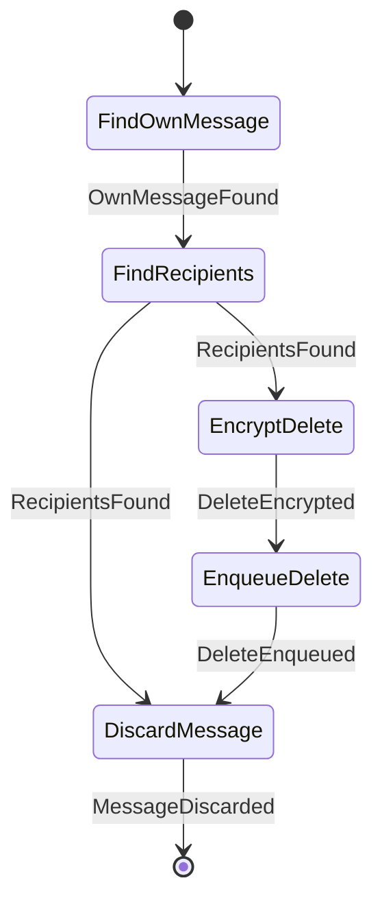

### EditGroupMessageWorkflow

- **Kind:** public — Chats submits `GroupMessageCommand.EditMessage`
- **Source:** `feature/conversationorchestration/message/src/commonMain/kotlin/com/cbgm/sparrow/feature/conversationorchestration/message/domain/workflow/group/EditGroupMessageWorkflow.kt`
- **Lock:** none
- **Uses:** `WorkflowEngine`, `GroupMessageRepository`, `CheckGroupMessageAccessUseCase`, `FindEditableGroupMessageUseCase`, `FindGroupRecipientsUseCase`, `EncryptGroupOperationUseCase`, `EnqueueGroupPacketsUseCase`

```text
CheckMembership -> FindEditableMessage -> FindRecipients -> (EncryptEdit -> EnqueueEdit -> ReplaceText)
| EditUnsentMessage.

A message nobody can receive or that is still queued unsent is edited locally only; the flush sends the new
text. Only that local edit ([MessageCommand.EditUnsentGroupMessage]) takes the group send lock, so a running
flush never sends the text from before the edit. The edit of a message members already have takes no lock and
never waits for a send or flush of the group.
```

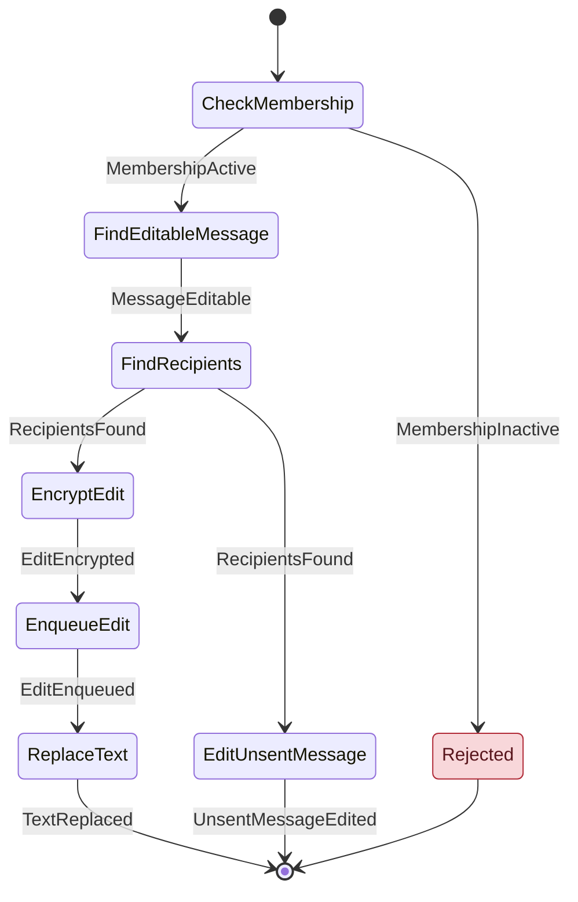

### EditUnsentGroupMessageWorkflow

- **Kind:** internal — started by an observer, dispatcher or another workflow `MessageCommand.EditUnsentGroupMessage`
- **Source:** `feature/conversationorchestration/message/src/commonMain/kotlin/com/cbgm/sparrow/feature/conversationorchestration/message/domain/workflow/group/EditUnsentGroupMessageWorkflow.kt`
- **Lock:** `groupSendLockKey(command.groupId)`
- **Uses:** `GroupMessageRepository`, `FindEditableGroupMessageUseCase`, `FindGroupRecipientsUseCase`, `EncryptGroupOperationUseCase`, `EnqueueGroupPacketsUseCase`

```text
FindEditableMessage -> FindRecipients -> [EncryptEdit -> EnqueueEdit] -> ReplaceText.

Runs only for a message nobody had received when the public edit looked at it. It holds the group send lock and
checks the recipients again, so a running flush either finished (and the edit is sent like any other) or sends the
new text later; it never sends the text from before the edit.
```

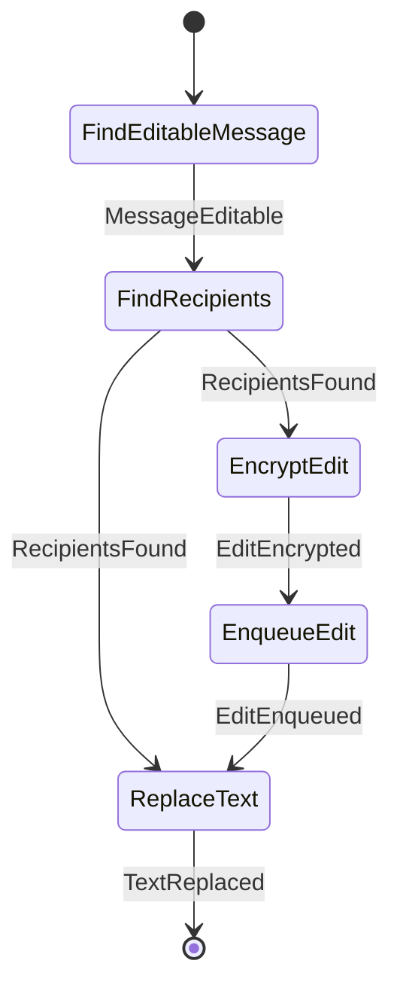

### FlushQueuedGroupMessagesWorkflow

- **Kind:** internal — started by an observer, dispatcher or another workflow `MessageCommand.FlushQueuedGroupMessages`
- **Source:** `feature/conversationorchestration/message/src/commonMain/kotlin/com/cbgm/sparrow/feature/conversationorchestration/message/domain/workflow/group/FlushQueuedGroupMessagesWorkflow.kt`
- **Lock:** `groupSendLockKey(command.groupId)`
- **Uses:** `GroupMessageRepository`, `FindGroupMessagesToFlushUseCase`, `FindUndeliveredGroupRecipientsUseCase`, `EncryptGroupMessageUseCase`, `SaveQueuedGroupRecipientsUseCase`, `EnqueueGroupPacketsUseCase`

```text
FindRecipients -> FindQueuedMessages
-> (FindMissingRecipients -> EncryptMessage -> [SaveRecipientStates] -> EnqueuePackets)* .

The persisted queue survives process death and is replayed whenever membership activates a
recipient. A damaged or temporarily undeliverable message stays queued and never blocks the
following ones.
```

```mermaid
stateDiagram-v2
    [*] --> FindRecipients
    FindRecipients --> FindQueuedMessages : RecipientsFound
    FindRecipients --> [*] : RecipientsFound
    FindQueuedMessages --> FindMissingRecipients : QueuedMessagesFound
    FindQueuedMessages --> [*] : QueuedMessagesFound
    FindMissingRecipients --> FindMissingRecipients : MessageStaysQueued
    FindMissingRecipients --> [*] : MessageStaysQueued
    FindMissingRecipients --> EncryptMessage : MissingRecipientsFound
    FindMissingRecipients --> FindMissingRecipients : MissingRecipientsFound
    FindMissingRecipients --> [*] : MissingRecipientsFound
    EncryptMessage --> EnqueuePackets : MessageEncrypted
    EncryptMessage --> SaveRecipientStates : MessageEncrypted
    EncryptMessage --> FindMissingRecipients : MessageStaysQueued
    EncryptMessage --> [*] : MessageStaysQueued
    SaveRecipientStates --> FindMissingRecipients : MessageStaysQueued
    SaveRecipientStates --> [*] : MessageStaysQueued
    SaveRecipientStates --> EnqueuePackets : RecipientStatesSaved
    EnqueuePackets --> FindMissingRecipients : MessageFlushed
    EnqueuePackets --> [*] : MessageFlushed
    EnqueuePackets --> FindMissingRecipients : MessageStaysQueued
    EnqueuePackets --> [*] : MessageStaysQueued
```

### MarkGroupConversationReadWorkflow

- **Kind:** public — Chats submits `GroupMessageCommand.MarkConversationRead`
- **Source:** `feature/conversationorchestration/message/src/commonMain/kotlin/com/cbgm/sparrow/feature/conversationorchestration/message/domain/workflow/group/MarkGroupConversationReadWorkflow.kt`
- **Lock:** none
- **Uses:** `ConversationUnseenCountRepository`, `GroupMessageRepository`, `RequireGroupConversationUseCase`, `AcknowledgeIncomingMessageUseCase`

```text
ClearUnseenCount -> FindUnreadMessages -> (AcknowledgeMessage)* .

Each sender gets its own receipt; one failing receipt does not hold back the others.
```

```mermaid
stateDiagram-v2
    [*] --> ClearUnseenCount
    ClearUnseenCount --> FindUnreadMessages : UnseenCountCleared
    FindUnreadMessages --> AcknowledgeMessage : UnreadMessagesFound
    FindUnreadMessages --> Rejected : UnreadMessagesFound
    FindUnreadMessages --> [*] : UnreadMessagesFound
    AcknowledgeMessage --> AcknowledgeMessage : MessageAcknowledged
    AcknowledgeMessage --> Rejected : MessageAcknowledged
    AcknowledgeMessage --> [*] : MessageAcknowledged
    Rejected --> [*]
    classDef reject fill:#f8d7da,stroke:#b02a37,color:#58151c
    class Rejected reject
```

### RetryGroupMessageWorkflow

- **Kind:** public — Chats submits `GroupMessageCommand.RetryMessage`
- **Source:** `feature/conversationorchestration/message/src/commonMain/kotlin/com/cbgm/sparrow/feature/conversationorchestration/message/domain/workflow/group/RetryGroupMessageWorkflow.kt`
- **Lock:** none
- **Uses:** `FindRetryableGroupRecipientsUseCase`, `ProtocolOutbox`, `RecordRetryRequestedUseCase`

```text
FindFailedRecipients -> (ResendToRecipient)* .

Retrying a group message resends only to the recipients whose delivery failed; it never
creates a new logical message. One failing recipient does not prevent the others' retry.
```

```mermaid
stateDiagram-v2
    [*] --> FindFailedRecipients
    FindFailedRecipients --> ResendToRecipient : FailedRecipientsFound
    ResendToRecipient --> Rejected : RecipientAttempted
    ResendToRecipient --> ResendToRecipient : RecipientAttempted
    ResendToRecipient --> [*] : RecipientAttempted
    Rejected --> [*]
    classDef reject fill:#f8d7da,stroke:#b02a37,color:#58151c
    class Rejected reject
```

### SendGroupIndicatorWorkflow

- **Kind:** public — Chats submits `GroupMessageCommand.SendIndicator`
- **Source:** `feature/conversationorchestration/message/src/commonMain/kotlin/com/cbgm/sparrow/feature/conversationorchestration/message/domain/workflow/group/SendGroupIndicatorWorkflow.kt`
- **Lock:** none
- **Uses:** `SendConversationIndicatorUseCase`

```text
SendIndicator to every current group member. Indicators are transient and never persisted.
```

```mermaid
stateDiagram-v2
    [*] --> SendIndicator
    SendIndicator --> [*] : IndicatorSent
```

### SendGroupMessageWorkflow

- **Kind:** public — Chats submits `GroupMessageCommand.SendMessage`
- **Source:** `feature/conversationorchestration/message/src/commonMain/kotlin/com/cbgm/sparrow/feature/conversationorchestration/message/domain/workflow/group/SendGroupMessageWorkflow.kt`
- **Lock:** `groupSendLockKey(command.groupId)`
- **Uses:** `WorkflowEngine`, `GroupMessageRepository`, `CheckGroupMessageAccessUseCase`, `StoreOutgoingGroupMessageUseCase`, `DiscardGroupMessagesUseCase`, `EncryptGroupMessageUseCase`, `SaveQueuedGroupRecipientsUseCase`, `EnqueueGroupPacketsUseCase`

```text
ValidateContent -> CheckMembership -> FindRecipients -> [FlushQueuedMessages] -> StoreMessage
-> [EncryptMessage -> SaveRecipientStates -> EnqueuePackets].

Without an active recipient the message stays queued and is flushed once a member activates.
Older queued messages are flushed first so recipients receive them in order.
```

```mermaid
stateDiagram-v2
    [*] --> ValidateContent
    ValidateContent --> CheckMembership : ContentValidated
    CheckMembership --> FindRecipients : MembershipActive
    CheckMembership --> Rejected : MembershipInactive
    FindRecipients --> FlushQueuedMessages : RecipientsFound
    FindRecipients --> StoreMessage : RecipientsFound
    FlushQueuedMessages --> StoreMessage : QueueFlushed
    StoreMessage --> EncryptMessage : MessageStored
    StoreMessage --> [*] : MessageStored
    EncryptMessage --> DiscardMessage : EncryptionFailed
    EncryptMessage --> SaveRecipientStates : MessageEncrypted
    DiscardMessage --> Rejected : MessageDiscarded
    SaveRecipientStates --> EnqueuePackets : RecipientStatesSaved
    EnqueuePackets --> [*] : PacketsEnqueued
    Rejected --> [*]
    classDef reject fill:#f8d7da,stroke:#b02a37,color:#58151c
    class Rejected reject
```

### ToggleGroupReactionWorkflow

- **Kind:** public — Chats submits `GroupMessageCommand.ToggleReaction`
- **Source:** `feature/conversationorchestration/message/src/commonMain/kotlin/com/cbgm/sparrow/feature/conversationorchestration/message/domain/workflow/group/ToggleGroupReactionWorkflow.kt`
- **Lock:** none
- **Uses:** `ToggleLocalReactionUseCase`, `CheckGroupMessageAccessUseCase`, `FindGroupMessageUseCase`, `FindGroupRecipientsUseCase`, `EncryptGroupOperationUseCase`, `EnqueueGroupPacketsUseCase`

```text
CheckMembership -> FindMessage -> FindRecipients -> ToggleReaction -> EncryptReaction -> EnqueueReaction.
```

```mermaid
stateDiagram-v2
    [*] --> CheckMembership
    CheckMembership --> FindMessage : MembershipActive
    CheckMembership --> Rejected : MembershipInactive
    FindMessage --> FindRecipients : MessageFound
    FindRecipients --> ToggleReaction : RecipientsFound
    ToggleReaction --> EncryptReaction : ReactionChanged
    EncryptReaction --> EnqueueReaction : ReactionEncrypted
    EnqueueReaction --> [*] : ReactionEnqueued
    Rejected --> [*]
    classDef reject fill:#f8d7da,stroke:#b02a37,color:#58151c
    class Rejected reject
```

### VoteGroupPollWorkflow

- **Kind:** public — Chats submits `GroupMessageCommand.VotePoll`
- **Source:** `feature/conversationorchestration/message/src/commonMain/kotlin/com/cbgm/sparrow/feature/conversationorchestration/message/domain/workflow/group/VoteGroupPollWorkflow.kt`
- **Lock:** none
- **Uses:** `MessageAttachmentOperationsRepository`, `CheckGroupMessageAccessUseCase`, `FindGroupPollMessageUseCase`, `FindGroupRecipientsUseCase`, `FindGroupPollUseCase`, `EncryptGroupOperationUseCase`, `EnqueueGroupPacketsUseCase`

```text
CheckMembership -> FindPollMessage -> FindRecipients -> FindPoll -> SaveVote -> EncryptVote -> EnqueueVote.
```

```mermaid
stateDiagram-v2
    [*] --> CheckMembership
    CheckMembership --> FindPollMessage : MembershipActive
    CheckMembership --> Rejected : MembershipInactive
    FindPollMessage --> FindRecipients : PollMessageFound
    FindRecipients --> FindPoll : RecipientsFound
    FindPoll --> SaveVote : PollFound
    SaveVote --> EncryptVote : VoteSaved
    EncryptVote --> EnqueueVote : VoteEncrypted
    EnqueueVote --> [*] : VoteEnqueued
    Rejected --> [*]
    classDef reject fill:#f8d7da,stroke:#b02a37,color:#58151c
    class Rejected reject
```
