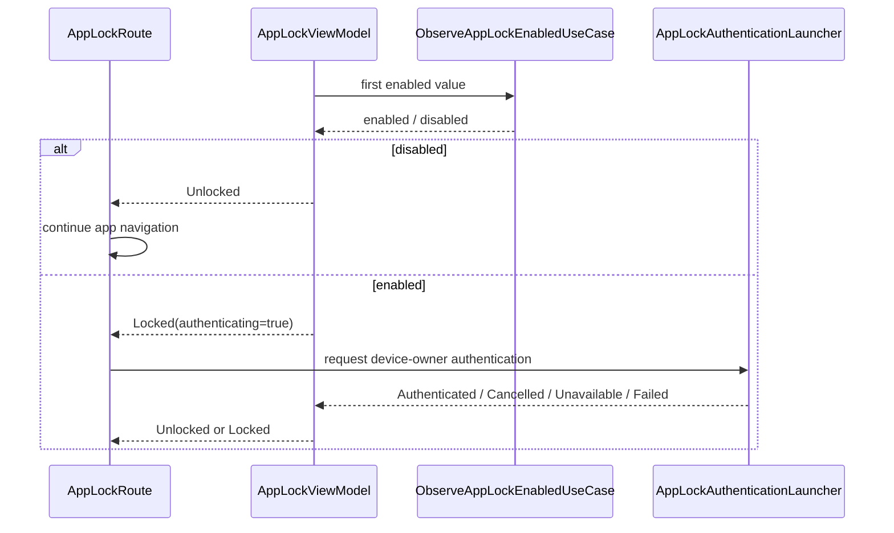

# App lock

`:feature:applock` provides the local application-lock boundary. The setting is exposed from Settings, while authentication is delegated to a platform `AppLockAuthenticationLauncher`.

## Main classes

- `AppLockRepository` / `AppLockRepositoryImpl` — persisted enabled/disabled setting and the timeout (`AppLockSettings`).
- `ObserveAppLockEnabledUseCase`, `ObserveAppLockSettingsUseCase` — observe the preferences.
- `SetAppLockEnabledUseCase`, `SetAppLockTimeoutUseCase` — update them.
- `AppLockSession` — in-memory "this process is unlocked" state; every new process starts locked.
- `ObserveAppLockRequiredUseCase` — lock on and process not unlocked.
- `UnlockAppUseCase`, `RecordAppHiddenUseCase`, `RecordAppVisibleUseCase` — unlock, start the background timer, lock again when it ran out.
- `AppLockTimeout` — immediately (a 2-second grace for screen rotation), 1, 5 (default) or 30 minutes in the background, or only on restart. A clock set backwards counts as expired.
- `AppLockViewModel` — resolves `Loading`, `Locked` or `Unlocked` presentation state.
- `AppLockRoute` — launches device-owner authentication and renders `AppLockScreen` while locked. Back sends the app to the background (`AppLockBackHandler`), so it never reveals the screen below.
- `AppLockAuthenticationLauncher` — expect/actual platform authentication boundary.

Android uses the platform authentication implementation under `feature/applock/src/androidMain`; the common presentation layer does not depend on Android APIs.

## Runtime flow

If the user cancels, `AppLockViewModel` leaves the app locked and stops the active prompt. The lock screen can request authentication again. Authentication failures are logged through a class-local `SparrowLog` tag; they do not silently unlock the app.

## Locking again

- **New process.** `App` keys the saved navigation state by a value that changes with every process, so a process Android restarted in the background starts at Startup (startup tasks and lock) instead of restoring the old screens.
- **Background timeout.** `AppViewModel` records ON_STOP and ON_START. When the app comes back after the chosen timeout, `RecordAppVisibleUseCase` locks the session synchronously and `AppNavigation` puts `AppRoute.AppLock` on top of the current screen; unlocking pops it and returns to that screen. A notification opens its chat only once the app is unlocked.
- **Recent apps.** While the lock is on, Android 13+ leaves the app out of the recent-apps preview (`setRecentsScreenshotEnabled(false)`); screenshots stay allowed. Older Android versions still show the preview.

## Settings integration

`SettingsViewModel` observes the app-lock preference. `SettingsScreen` requires device-owner authentication before applying a toggle change, using the same `AppLockAuthenticationLauncher` result model. This prevents enabling/disabling the lock without authenticating on supported devices. While the lock is on, **Lock after** chooses the timeout.
