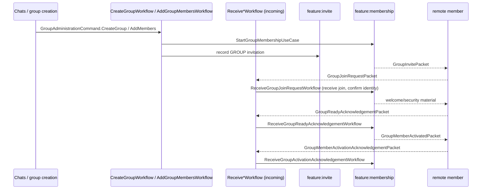

# Group membership and group security

`:feature:membership` owns Group membership lifecycle, member roles, epoch/security state, welcome/activation protocol and the membership result stream. It is intentionally separate from both `:feature:invite` and `:feature:chats`.

## Boundary

- Invite owns generic pending/declined/expired/failed invitation records.
- Membership owns whether a peer is an active/pending/removed Group member and the cryptographic epoch/member-key state.
- Chats owns conversation/message presentation and submits group commands.
- The workflows in `:feature:conversationorchestration:*` coordinate the three: group administration in `membership` (`CreateGroupWorkflow`, `AddGroupMembersWorkflow`, `RemoveGroupMemberWorkflow`, `PromoteGroupMemberWorkflow`, `TransferGroupAdminAndLeaveWorkflow`, `LeaveGroupWorkflow`, `DeleteGroupWorkflow`), invitation results in `invite`, incoming membership packets in `incoming`.

## Main implementation classes

State/protocol/security:

- `GroupMembershipStateMachine`
- `GroupMembershipLock`
- `GroupMembershipPacketProtocol`
- `GroupMembershipPayloadEncoder`
- `GroupSecurityManager`
- `GroupWelcomeSecurity`
- `GroupActivationPolicy`
- `resolveInvitationUpdatedAt()` (in `GroupInvitationTimestampPolicy.kt`)

Repositories/datasources:

- `MembershipRepository` / `MembershipRepositoryImpl`
- `GroupMembershipRepository` / `GroupMembershipRepositoryImpl`
- `GroupSecurityRepository`
- `GroupMembershipStoreDataSource`
- `GroupSecurityStoreDataSource`
- `GroupEpochDataSource`
- `GroupEpochSecurityDataSource`
- `GroupMembershipLifecycleDataSource`
- `GroupOwnerWelcomeDataSource`
- `GroupIncomingWelcomeDataSource`
- `GroupMembershipActivationDataSource`
- `GroupIncomingActivationDataSource`
- `GroupReadyAcknowledgementDataSource`
- `GroupMembershipAdministrationDataSource`
- `GroupMemberPromotionDataSource`
- `GroupMemberRemovalDataSource`
- `GroupLeaveDataSource`
- `GroupMembershipDeletionDataSource`
- `GroupIncomingRemovalDataSource`
- `GroupIncomingDeletionDataSource`

## Group creation/invitation to activation

The detailed steps depend on which side is owner/member and whether identity review is required, but Group cryptographic activation always remains a Membership concern.

## Key use cases

Invitation/handshake:

- `StartGroupMembershipUseCase`
- `ReceiveIncomingGroupMembershipUseCase`
- `InspectIncomingGroupMembershipUseCase`
- `GetMembershipHandshakeUseCase`
- `AcceptGroupMembershipUseCase`
- `DeclineGroupMembershipUseCase`
- `ClearMembershipHandshakeUseCase`
- `DiscardSupersededMembershipsUseCase`

Welcome/activation:

- `AuthorizeIncomingGroupWelcomeUseCase`
- `OpenIncomingGroupWelcomeUseCase`
- `PersistIncomingGroupWelcomeUseCase`
- `CompleteIncomingGroupWelcomeUseCase`
- `SendGroupReadyAcknowledgementUseCase`
- `ReceiveGroupReadyAcknowledgementUseCase`
- `AuthorizeIncomingGroupActivationUseCase`
- `ApplyIncomingGroupActivationUseCase`
- `ReceiveGroupActivationAcknowledgementUseCase`
- `ConfirmGroupMembershipIdentityUseCase`

Administration:

- `ObserveGroupAdministrationUseCase`
- `PromoteGroupMemberUseCase`
- `RemoveGroupMemberUseCase`
- `TransferGroupAdminAndLeaveUseCase`
- `LeaveGroupUseCase`
- `GetGroupLeaveRequirementUseCase`
- `DeleteGroupMembershipUseCase`
- `MarkMembershipRemovedUseCase`

Message/metadata authorization:

- `GetGroupMessageMembershipAccessUseCase`
- `GetGroupTransportRoutingMembersUseCase`
- `ResolveGroupTransportEncryptionPublicKeyUseCase`
- `AuthorizeGroupMetadataUseCase`
- `GetGroupPinSenderSigningKeyUseCase`
- `GetGroupCurrentEpochUseCase`

## Membership result stream

`ObserveMembershipResultsUseCase` exposes durable domain results. `MembershipResultObserver` in `:feature:conversationorchestration:membership` consumes them and runs `HandleMembershipResultWorkflow` (for `ACTIVE`: `ResolveMemberName -> LoadEpoch -> AddParticipant -> FlushQueuedMessages`). This replaces cross-feature repository calls/coordinators.

## Incoming invitations

`ReceiveGroupInviteWorkflow` stages the group conversation before the invitation is accepted, and the offer's signature proves only the inviter's keys, not that the group ID is theirs. `CheckGroupInvitationTargetUseCase` (`GroupInvitationTargetPolicy`, with `InspectGroupInvitationTargetUseCase`) therefore rejects the offer, so its envelope is dropped, when the group ID names a non-group conversation, a group the local user is a live member, admin or owner of, or a group with a pending invitation from another inviter. A new invitation from the same inviter still re-stages the pending one, and an invitation after leaving or removal (no live security state) still starts a new membership.

## Removing and promoting members

Membership commits the epoch rotation, the removal packet and the REMOVED status in one step; `RemoveGroupMemberWorkflow` projects the participant change and refreshes the verification afterwards. Its `FindRemovalProgress` step (`FindGroupMemberRemovalProgressUseCase`, `FindCommittedGroupMemberRemovalUseCase`, `GroupMemberRemovalProgress`) lets a retry after a crash or a failed later step continue: a committed removal still shown as participant is projected, an already projected one only refreshes the verification. A promotion is already safe to repeat: Membership returns the promotion of a member who is an admin already without rotating again.

## Group state and the epoch

Publishing title, description, avatar, pin and unpin, closing expenses and the replay of the current metadata to a new member run under the same `group-administration` lock as the membership changes, so they are signed for the epoch and recipients current when they are queued.

A title, description, avatar, pin or unpin is saved locally first, marked as not yet published, so the admin sees it at once even while a membership change holds the lock. Only the publish step (`PublishGroupTitle`, `PublishGroupDescription`, `PublishGroupAvatar`, `PublishGroupPin`) waits for the lock; it queues the packets with the current epoch and then marks the state published, but only while it is still the stored version. If the publish fails or the app stops before it, the state stays unpublished: the same change again is not skipped as "unchanged", and `UnpublishedGroupStateRunner` (startup task "publish unpublished group state") publishes it after the next start. A newer state from another admin replaces an unpublished local one and counts as published, so it is never overwritten or published again (last-writer-wins, `GroupStateVersionPolicy`). Closing expenses still queues its packets before saving. See [Locking](../architecture/conversation-orchestration.md#locking).

## Admin leave

`GetGroupLeaveRequirementUseCase` decides whether a normal leave is possible or whether the last/required admin must transfer responsibility first. `TransferGroupAdminAndLeaveUseCase` performs the explicit transfer+leave path; Chats triggers it with `GroupAdministrationCommand.TransferAdminAndLeave` (`TransferGroupAdminAndLeaveWorkflow`).

## Security epoch

`GroupSecurityManager` and the epoch datasources own current Group encryption state. Group message sending (`SendGroupMessageWorkflow`) asks Membership for the currently authorized recipients/encryption keys instead of embedding membership ownership inside Chats.
