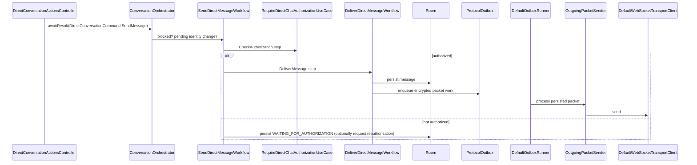
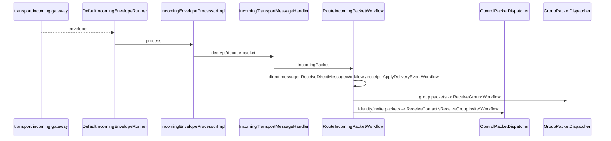
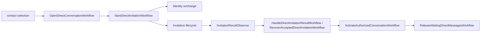

# Message, invitation and transport flow

This page connects the current client layers from UI to encrypted network delivery.

## Direct send

A queued Direct message is released by `ReleaseWaitingDirectMessagesWorkflow` (via `ActivateAuthorizedConversationWorkflow`) only after orchestration establishes fresh authorization. There is no plaintext fallback.

## Incoming delivery

## Direct invitation/authorization

The generic invitation row is owned by `:feature:invite`, the cryptographic exchange by `:feature:identity`, and the cross-feature sequence by the lifecycle workflows (`StartDirectInvitationWorkflow`, `HandleDirectInvitationResultWorkflow`, …) run by `OpenDirectConversationWorkflow` and `InvitationResultObserver`.

Explicit recovery/reconnection is documented separately in [Identity recovery](identity-recovery.md).

## Group send

`SendGroupMessageWorkflow` validates active membership, obtains current recipients from Membership, encrypts for the current Group epoch and queues one packet per active recipient (`CheckMembership -> FindRecipients -> [FlushQueuedMessages] -> StoreMessage -> EncryptMessage -> SaveRecipientStates -> EnqueuePackets`). Group security state is not inferred from the invitation table.

## Offline mailbox

When direct online routing is unavailable or policy selects mailbox delivery, `OutgoingPacketSender` uses the recipient mailbox route/capability resolved by orchestration/transport. Client mailbox lifecycle is implemented around `DefaultMailboxCoordinator`, `DefaultMailboxCapabilityLifecycle`, `MailboxRouteProvisioner`, `MailboxPendingSynchronizer` and `HttpMailboxGateway`.

The server `mailbox` service stores opaque encrypted envelopes behind recipient-selected capabilities. Push is a wake-up path, not decryption/interpretation by the server.

## Delivery/read receipts

Protocol receipts are routed by `RouteIncomingPacketWorkflow` to `ApplyDeliveryEventWorkflow`; outbox progress reaches the same workflow through `OutboxDeliveryStateRouter`. Direct and Group maintain distinct recipient/delivery state logic (`DirectMessageDeliveryStateMachine`, `GroupMessageDeliveryStateMachine`, `DirectMessageDeliveryRepository` and `GroupRecipientDeliveryRepository` in `:feature:conversationorchestration:delivery`), while generic outbox execution remains in `:feature:messaging`.
