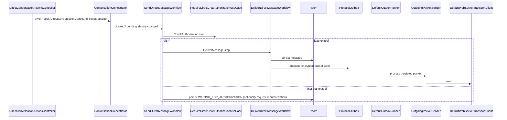
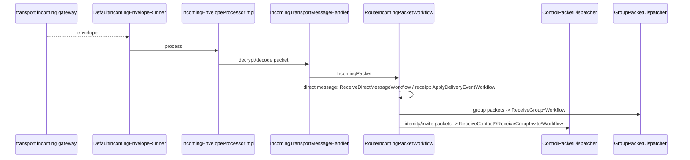
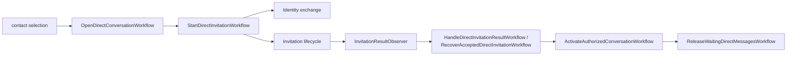

# Message, invitation and transport flow

This page connects the current client layers from UI to encrypted network delivery.

## Direct send

A queued Direct message is released by `ReleaseWaitingDirectMessagesWorkflow` (via `ActivateAuthorizedConversationWorkflow`) only after orchestration establishes fresh authorization. There is no plaintext fallback.

Retrying a failed Direct message (`RetryDirectMessageWorkflow`) resends its packet when the outbox still has it and otherwise creates a new packet, for example when the outbox insert failed. A send interrupted between storing the message and queuing its packet (the app was closed or crashed) is found at the next app start (`RecoverInterruptedDirectSendsUseCase`) and marked failed, so the user can retry it.

## Incoming delivery

A packet that is not allowed or invalid (an edit by someone other than the sender, a vote on a closed poll, an expense change by a non-creator, an expired group JOIN, a message ID that belongs to another message) is rejected with `IncomingMessageRejectedException`: its envelope is acknowledged and dropped instead of being redelivered until it expires. Failures that can succeed later (database, network, an expense revision whose original has not arrived) keep the envelope for redelivery. A redelivered direct or group message keeps its stored row, so edits, deletions and the read state applied since are not undone.

Delivery paths do not guarantee order: after a reconnect, an edit, delete, reaction or poll operation can
arrive before the message it refers to. Such an operation is parked locally and applied right after the
message is stored; it is deleted after 7 days if the message never arrives
([Conversation orchestration](../architecture/conversation-orchestration.md#operations-that-overtake-their-message)).

## Direct invitation/authorization

The generic invitation row is owned by `:feature:invite`, the cryptographic exchange by `:feature:identity`, and the cross-feature sequence by the lifecycle workflows (`StartDirectInvitationWorkflow`, `HandleDirectInvitationResultWorkflow`, …) run by `OpenDirectConversationWorkflow` and `InvitationResultObserver`.

Explicit recovery/reconnection is documented separately in [Identity recovery](identity-recovery.md).

## Group send

`SendGroupMessageWorkflow` validates active membership, obtains current recipients from Membership, encrypts for the current Group epoch and queues one packet per active recipient (`CheckMembership -> FindRecipients -> [FlushQueuedMessages] -> StoreMessage -> EncryptMessage -> SaveRecipientStates -> EnqueuePackets`). Group security state is not inferred from the invitation table.

## Offline mailbox

When direct online routing is unavailable or policy selects mailbox delivery, `OutgoingPacketSender` uses the recipient mailbox route/capability resolved by orchestration/transport. Client mailbox lifecycle is implemented around `DefaultMailboxCoordinator`, `DefaultMailboxCapabilityLifecycle`, `MailboxRouteProvisioner`, `MailboxPendingSynchronizer` and `HttpMailboxGateway`.

`MailboxRouteProvisioner` decides from the freshly verified, signed node directory, never from a socket failure:

- **Moved node:** a node keeps its node ID when its address changes (for example a new public IP). Saved mailbox credentials whose node ID is in the directory under a new address switch to the node's new mailbox access endpoint. A mailbox whose delivery route still points to the old address is renewed and the new route is shared with the contact (`MailboxRoutePacket`), because contacts keep delivering to the old address until then.
- **Retired node:** a node ID that is missing from the verified directory means the old mailbox is gone; a replacement is saved without revoking the old one.
- **Unreachable or refusing node:** `DefaultMailboxCapabilityLifecycle.revokeForContact` deletes the remote route and marks the local mailbox revocation pending. If the revocation fails for any reason, it stays pending instead of failing the caller (for example deleting a chat or approving an identity change); provisioning retries every pending revocation, and one that keeps failing does not hold up the others. A node that answers 404, 410 or 401 no longer has the mailbox, so the revocation counts as done.
- **Renewal:** a mailbox that is renewed gets its replacement saved and shared even when the old one cannot be revoked; the old mailbox then expires on its node.

`MailboxPendingSynchronizer` processes every local mailbox. An envelope that fails stays in its mailbox for the next sync and does not stop the envelopes behind it or the other mailboxes; a mailbox that cannot be read is skipped. Rejected envelopes are acknowledged and dropped, on the mailbox path and on the push-store path.

The server `mailbox` service stores opaque encrypted envelopes behind recipient-selected capabilities. Push is a wake-up path, not decryption/interpretation by the server.

## Delivery/read receipts

Protocol receipts are routed by `RouteIncomingPacketWorkflow` to `ApplyDeliveryEventWorkflow`; outbox progress reaches the same workflow through `OutboxDeliveryStateRouter`. Direct and Group maintain distinct recipient/delivery state logic (`DirectMessageDeliveryStateMachine`, `GroupMessageDeliveryStateMachine`, `DirectMessageDeliveryRepository` and `GroupRecipientDeliveryRepository` in `:feature:conversationorchestration:delivery`), while generic outbox execution remains in `:feature:messaging`.
