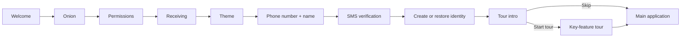

# Onboarding

`:feature:onboarding` owns the first-run UI: six swipeable pages, identity creation on the last one, and an
optional key-feature tour afterwards. `OnboardingViewModel` keeps the page order (`OnboardingPage`) and asks for
permissions, the phone number, the connection mode and the theme through platform ports and use cases instead of
putting persistence or Android APIs into the composables. Identity creation and restore are owned by
`:feature:identity` (`IdentityCreateViewModel`, `IdentityRestoreViewModel`); `OnboardingRoute` hosts them and places
`IdentitySetupDialogs` (restore and phone verification dialogs) on top of the onboarding screen.

## Pages

| Page | Composable | Title | What it does |
|---|---|---|---|
| `WELCOME` | `WelcomePage` | Sparrow | The Sparrow mark (`SparrowAnimation`, animated): the sparrow flies in and its wings close into the shield, which then keeps pulsing. |
| `ONION` | `OnionPage` | Nobody sees *who* you talk to. | Explains the relays (`OnionGraphic`). |
| `PERMISSIONS` | `PermissionsPage` | A few permissions. | Lists notifications, contacts, camera, audio, storage and phone number with their reasons and requests them. |
| `RECEIVING` | `ReceivingPage` | While Sparrow is closed… | Chooses the `ConnectionMode`: *Always connected* (preselected) or *Only while the app is open*. On iOS a note replaces the choice. |
| `THEME` | `ThemePage` | Light or dark? | Like my phone, light or dark; saved at once (`SetAppThemeModeUseCase`). |
| `PHONE` | `PhonePage` | Last thing. | Name and phone number, then *Create* or *Restore* (see below). |

`RECEIVING` comes after `PERMISSIONS` because the connection service needs the notification permission asked
for there. Swiping on past a page does what its action would: past `PERMISSIONS` the permissions are requested
once, past `RECEIVING` the preselected connection mode is saved. Choosing *Always connected* also opens Android's
battery optimization list (see [Receiving messages and offline delivery](../push-notifications.md)).

`LocalNetworkAccess` (`LocalNetworkAccessViewModel`) asks for the local network permission only while a configured
server is on the local network (`ObserveLocalNetworkNeededUseCase`).

The exact navigation condition is driven by startup/identity/onboarding state, so this diagram is
conceptual rather than a persisted protocol state machine.

## Phone page

The phone page asks for the phone number and name. With the phone-number permission the SIM
number is filled in automatically (`AutomaticPhoneNumberReader`); otherwise the user can pick a
number (`PhoneNumberHintLauncher`) or type it. The page offers two actions:

- **Approve and create identity** — the number is normalized, the phone verification dialog
  opens, and the identity keys are created only after the number was verified.
- **Restore** — select an identity backup file, enter its password; the backup is decrypted and
  checked in memory, then the same phone verification runs, and only after it succeeds is the
  restored identity saved.

## Phone verification

Verification happens once, at sign-up (create and restore). `PhoneVerificationDialog` /
`PhoneVerificationViewModel` (in `:feature:identity`):

1. opens with "We will send a code by SMS to …"; tapping *Verify* sends the SMS;
2. shows six code fields (`SparrowCodeField` in `:core:ui`); entering the sixth digit, or an SMS
   read automatically by the platform, confirms the code;
3. *Send again* becomes available after a 60-second countdown;
4. if the SMS cannot be sent, the dialog returns to the first step with an error; a wrong code
   clears the fields.

Cancelling the dialog creates or restores nothing. Debug builds show an additional
*Skip (debug)* button. Details, including how the result reaches the server, are in
[Identity](identity.md#phone-verification-at-sign-up).

## Key-feature tour

Once the identity exists (`OnboardingUiEvent.IdentityCreated`), `TourIntro` offers "A quick look around?": six
short steps on a sample chat, about a minute. *Skip* finishes onboarding, *Start tour* opens `KeyFeatureTour`.
The tour explains only what no screen explains by itself (`TourStep`):

| Step | Title | Try it |
|---|---|---|
| `RING` | The ring around a contact | Dashed: not both verified yet; solid: both compared the safety number. |
| `TOP_BAR` | The top bar | Tap the shield (route protection), search and mailbox icons. |
| `DOTS` | Dots next to the time | Send a sample message and watch its delivery dots; an open lock means sent without encryption. |
| `HOLD` | Hold a message | Hold a message to reply, react, forward, copy, edit or delete. |
| `DAYS` | Dates between messages | Hold a date and slide to jump to another day (`SparrowDayRail`). |
| `SWIPE` | Swipe to the left | Swipe a chat to delete it; the same works for group members, invitations, auto replies and expenses. |

`SampleChats` and `SampleChat` draw the sample screens; `TourTryState` records what was tried, and finishing a
step's try moves the tour on by itself. *Next* and swiping back move between steps (`TourNextClicked`,
`TourBackSwiped`); after the last step, onboarding ends. Nothing in the tour sends real messages.

## Platform notes

Android has the usable onboarding permission/phone/contact integrations and the Firebase-based SMS
verification. Location permission for sharing the current location is requested at runtime by
the attachment action rather than being a required onboarding permission. The KMP project
contains iOS source sets, but iOS has no phone verification implementation yet and is not
currently a usable client; it should not be documented as having completed onboarding parity.
