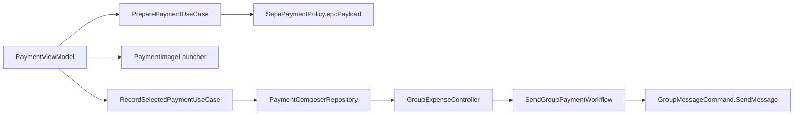

# Settle up and payment

`:feature:payment` helps members settle the balances of a [group expense board](expenses.md). It
prepares a SEPA credit transfer for the user's own banking app and records the settlement status
in the group. **Sparrow does not move money and cannot verify bank transfers**: the transfer
itself happens in the user's banking app.

## How the user uses it

1. In the expense overview, *Settle up* lists the suggested transfers ("You pay …",
   "… pays you"). The payer taps their transfer to open the payment screen (*Settle expense*).
   The recipient can open a transfer once the payer has marked it as sent.
2. The payer enters the **recipient's** account-holder name and IBAN. Sparrow never sends bank
   details through the group, so the payer gets them from the recipient outside the app. With
   *Remember bank details securely on this device* they are stored locally for this recipient;
   *Delete saved bank details* removes them.
3. *Review payment* shows recipient, IBAN, amount and the reference `SPARROW-…`. The payer can
   share a payment image (*Share payment information*) with a compatible banking app or copy the
   fields one by one, and must check recipient, amount and reference before authorising.
4. After paying in the banking app the payer taps *I have sent the transfer*. The group sees
   "… marked … as sent".
5. The recipient checks their bank account and taps *Confirm money received*. Only then does the
   transfer count in the balances.

The *Payments* section of the overview lists recorded transfers (*Marked as sent*,
*Receipt confirmed*); payer and recipient can open their entries again.

## Limitations

- SEPA preparation is only available when the board currency is **EUR**. For other currencies
  the suggestions are still shown, but they do not open the payment screen and the payment has
  to be arranged without it.
- Only IBANs of the supported EEA countries are accepted (`SepaPaymentPolicy`: country-specific
  length and ISO 7064 mod-97 checksum). The account-holder name is at most 70 characters.
- Payment status events cannot be edited or deleted individually
  (`RequireMessageWithoutPaymentUseCase`, `MessageEditPolicy`).
- If the balance changed in the meantime (for example a new expense), the selected transfer is no
  longer offered and the screen asks the user to go back and select the current settlement.

## Model

`PaymentTransfer` in `:core:base` is the only payment data sent to the group. It contains the
board, `transferId`, payer and recipient member IDs, amount in minor units, currency, reference,
`status` (`SENT` or `RECEIVED`) and time. **It never contains bank details.**

`PaymentTransferPolicy` enforces:

- the event ID is `<transferId>-sent` or `<transferId>-received`;
- payer and recipient differ; amount between 1 and 99 999 999 999 minor units;
- currency is `EUR` and the reference matches `SPARROW-[A-Za-z0-9-]{1,60}`;
- `requireActor(...)`: only the payer may send `SENT`, only the recipient may send `RECEIVED`;
- `matches(...)`: a `RECEIVED` event must repeat the `SENT` event's transfer, board, members,
  amount, currency and reference.

Incoming payment events are checked by `AuthorizeIncomingExpensesUseCase` (sender must be a
member and the actor allowed by `requireActor`, no conflicting event with the same ID, board not
closed). `ExpensePayments.confirmed(...)` in `:feature:expenses` counts a transfer only when a
matching `SENT`/`RECEIVED` pair exists.

Local-only models:

- `BankDetails` (account holder, IBAN) — never a navigation argument or message payload; its
  `toString()` is redacted;
- `PaymentContext` — published by the Group chat (`GroupExpenseController`), contains members,
  settlement suggestions and transfers, no bank details;
- `PaymentSelection` / `PaymentSession` — the selected transfer and the derived state (`canPay`,
  `canConfirmReceipt`, status);
- `SepaPayment` / `PreparedPayment` — the transfer prepared for the banking app.

## Flow

- `ObservePaymentSessionUseCase` resolves the selection against the current `PaymentContext`.
  `canPay` is true only for the payer, an EUR board, no `SENT` event yet, and a selection that
  still matches a current settlement suggestion.
- `PreparePaymentUseCase` normalizes and validates the bank details, builds the EPC QR payload
  and saves or deletes the remembered details.
- `SepaPaymentPolicy.epcPayload(...)` creates an EPC069-12 payload (version `002`, UTF-8, `SCT`,
  BIC omitted, at most 331 bytes).
- `PaymentImageLauncher` renders the payload as a QR image with the labelled fields and opens the
  platform share sheet.
- `RecordSelectedPaymentUseCase` creates the `SENT` or `RECEIVED` `PaymentTransfer` and hands it
  to `PaymentComposerRepository`. `GroupExpenseController` observes these requests, runs
  `GroupMessageCommand.SendPaymentTransfer` and reports the result back
  (`CompletePaymentRequestUseCase`).
- `SendGroupPaymentWorkflow` (ValidatePayment → SendPayment) validates the event with
  `RequireGroupPaymentTransferUseCase` and sends it as an ordinary encrypted group message. Bank
  details never enter messaging or the outbox.

## Local storage of bank details

Remembered bank details are keyed by local member and recipient (`BankDetailsRepository`,
`BankDetailsStorage`):

- **Android** (`AndroidBankDetailsStorage`): AES-256-GCM ciphertext in `noBackupFilesDir`; the key
  stays in the Android Keystore.
- **iOS** (`IosBankDetailsStorage`): Keychain items accessible only when unlocked and only on this
  device.

On Android the shared payment PNG is written to `cacheDir/payment-share`, shared through
`PaymentFileProvider`, and deleted (and the read permission revoked) after five minutes; left-over
files are removed at the next start.

## Platform notes

The payment screen is used on Android. iOS implementations of the storage and share launcher
exist, but the iOS app as a whole is not runnable yet.
