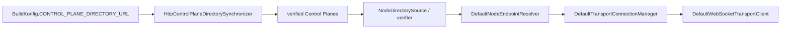

# Transport and failover

`:feature:transport` is responsible for getting opaque application payloads to/from the server edge. It does not own Direct/Group conversation rules.

## Discovery chain



Control Plane directory startup is task based. `LoadControlPlaneConfigurationStartupTask` applies the build-time `BuildKonfig.CONTROL_PLANE_DIRECTORY_URL` once if no directory is configured, and `RestoreControlPlaneDirectoryStartupTask` restores the verified cached snapshot; `MaintainControlPlaneDirectoryStartupTask` (refresh every 5 minutes, retry after 5 s), `MaintainControlPlaneHealthStartupTask` and `ObserveControlPlaneRegistrationTargetsStartupTask` maintain it after navigation.

The directory is an HTTPS origin without a path. `ControlPlaneDirectoryRemoteSource` reads `/.well-known/sparrow-directory` (protocol `sparrow-directory-bootstrap-v1`, `keyId`, Ed25519 `publicKey`, `controlPlanesEndpoint`) and then the signed envelope from `/v1/control-planes`:

```json
{
  "payload": {
    "protocol": "sparrow-control-plane-directory-v1",
    "version": 7,
    "generatedAtEpochMilliseconds": 1760000000000,
    "validUntilEpochMilliseconds": 1760086400000,
    "controlPlanes": [
      { "controlPlaneId": "<sha256 of publicKey>", "baseUrl": "https://plane-a.example.com", "publicKey": "<base64url DER>" }
    ],
    "revokedControlPlaneIds": []
  },
  "keyId": "<sha256 of the directory key>",
  "signature": "<base64url Ed25519 signature>"
}
```

`SignedControlPlaneDirectoryVerifier` checks the signature over the canonical payload, the timestamps (at most 24 h validity), canonical HTTPS origins and that each `controlPlaneId` is the SHA-256 of its key. `VerifiedControlPlaneDirectoryState` pins the directory key on the first verified snapshot and refuses a different key afterwards, rejects version rollbacks and reinstated revoked IDs, and keeps the last verified snapshot for offline starts. Removing the directory in Settings forgets the pin.

An unsigned `{"controlPlanes": ["https://…"]}` list is accepted only as a one-time manual import in Settings (**JSON list**); it is not the signed directory and is not refreshed.

The Settings Add dialog accepts a single Control Plane URL, a signed directory or a JSON list.

## Important transport classes

### Control Plane

- `HttpControlPlaneDirectorySynchronizer`
- `HttpControlPlaneHealthMonitor`
- `ControlPlaneCandidateVerifier`
- `ControlPlaneRequestRouter`
- `NodeControlPlaneDirectorySource`
- `NodeControlPlaneDiscoverySynchronizer`

### Node discovery/failover

- `NodeDirectorySource`
- `NodeDirectoryVerifier`
- `NodeDirectoryCache`
- `DefaultNodeEndpointResolver`
- `FailedNodeTracker`
- `TransportDiagnosticsState`

### WebSocket/routing

- `DefaultTransportConnectionManager`
- `DefaultWebSocketTransportClient`
- `WebSocketOutgoingWireSender`
- `ClientPresenceRouteCoordinator`
- `ClientRouteRegistrationFactory`
- `Sha256RoutingIdGenerator`

### Offline

- `HttpMailboxGateway`

There is no push service; see [Receiving messages](../push-notifications.md).

Mailbox provisioning, renewal and revocation are driven from `:feature:conversationorchestration:delivery` (`MailboxRouteProvisioner`, `DefaultMailboxCapabilityLifecycle`); see [Offline mailbox](message-transport-flow.md#offline-mailbox).

## WebSocket connection

The selected node exposes `/v1/gateway`. `DefaultWebSocketTransportClient` first obtains gateway information, opens the WebSocket, waits for the gateway's session challenge, checks that it names the node chosen from the signed directory and signs in with the identity signing key (`CreateGatewaySessionProofUseCase`). Only then does it publish/refresh the signed presence route and send/receive envelopes and acknowledgements. Typing indicators travel as encrypted packets through the mailboxes, not through the gateway. A missing challenge (10 s), a challenge from another node or an `INVALID_SESSION` rejection fails the connection attempt like any other connect failure, so the connection manager retries. See [Session sign-in](../api/websocket.md#session-sign-in-challenge-response). After sign-in, a frame the app cannot read (or a message type from a newer server) is skipped and the session goes on; an unreadable envelope whose ID is still readable is acknowledged so the gateway stops delivering it. The mailbox fetch reads each envelope on its own the same way. Unknown JSON fields are ignored. The gateway refuses envelopes the app could not read (blank fields, negative timestamps), so they are never stored.

The server-side counterpart is `GatewayWebSocketHandler`/`GatewaySessionHandler`.

## Phone verification token at sign-up

The phone number is verified once in the app, at sign-up (create or restore identity). The resulting one-time Firebase ID token is kept in memory only (`LocalIdentityProfileDataSource`, dropped after 50 minutes) and goes into the first alias claim. Once the route is ready, `ClientPresenceRouteSession` has `AliasClaimRegistrar` claim the phone alias (the bootstrap routing ID) at every Control Plane the user has, and again every 6 hours. For each one the registrar fetches that Control Plane's signed node directory, checks it against the Control Plane's pinned root and takes the Presence Directory's key from it (`NodeDirectory.aliasClaimKey`). It signs an `AliasClaim` (routing ID, signing key, alias, token, time) with the device key, seals it for that key (`SodiumSealedMessageCipher`: X25519, SHA-256, ChaCha20-Poly1305) and posts it to `POST /v1/alias-claims`, all through the relays. A Control Plane whose root is not pinned yet is skipped. The token is cleared once a Control Plane has answered it, so a rejected token is not sent again.

At the Presence Directory a blank or invalid token fails the claim with `403 PHONE_VERIFICATION_FAILED`; a valid one proves the alias derived from the verified phone number. Each alias belongs to one device: the device keeps an alias it already holds without a token, a free alias needs a proof when the server verifies phones (otherwise the first claim wins), and an alias held by another device moves only with a proof. The answer lists the positions of the bound aliases; first invites wait until an alias is bound (`awaitRoutingAlias`). The token is never stored. A claim sealed for an older key (the Presence Directory makes a new one on every restart) fails and is repeated with the next claim.

## Onion relays to Control Planes

The app's requests to Control Planes (node discovery, health checks, push registration and inbox, alias claims) use a separate HTTP client whose engine (`OnionRelayEngine`) sends them through two relays, so no Control Plane sees the app's address. `RelaySelector` takes the relays from the last verified node directory: nodes publish an X25519 relay key in their signed descriptor (`SparrowNodeDescriptor.relayKey`). The first relay is the node the app is connected through, which knows its address anyway (before a connection: the node the user chose, otherwise any node); the second is another node. `OnionRelayClient` seals one `RelayLayer` per relay: the first names only the second relay, the second only the destination. Each relay seals its reply with a one-time key from its layer. So the first relay learns the address but not the destination, the second the destination but not the address, and neither reads the request or the reply. A relay that fails is left out for 20 seconds (in memory only) and the request is sent once more through the remaining relays. The relay's answer tells which hop failed: 400 the first relay could not open its layer, 502 the next relay failed, 504 the Control Plane could not be reached (no relay is left out then). With only one reachable relay the route has one hop: the Control Plane still does not see the address, but that relay sees the destination; the app logs a warning when this starts.

With a single relaying node the route has that one hop; without any (first start, older servers) requests go out directly, except alias claims, which then wait. A node directory from a Control Plane whose root is not pinned yet is fetched directly, because through a relay the last relay could hand over a forged one. Relays only reach other relays' `/v1/relay` and the Control Plane paths above, never private addresses (except in LAN installations, `RELAY_PRIVATE_DESTINATIONS`). Two relays run by the same operator could link address and destination.

## Onion circuits

While the app is in the foreground, `CircuitRunner` keeps one circuit open through 1 to 5 relays (Settings > Network > Onion routing, default 2), built hop by hop over the gateways' `/v1/circuit` WebSocket. The first hop is chosen as for the relays above; the last hop is the session node. Each hop is added with one round trip: the app sends an ephemeral X25519 key, the relay answers with its own and a confirmation that only the holder of its published relay key can compute (`CircuitHandshake` on the server, `SodiumCircuitCipher` in the app). Cells are always 1024 bytes; every hop before the last adds or removes a ChaCha20 layer, the last hop seals and opens with ChaCha20-Poly1305; each direction of each hop counts its cells, and the count is the nonce. The runner pings the last hop every 30 seconds (the latency shown in settings) and rebuilds the circuit when it fails.

The app keeps 1 to 3 circuits open (Settings > Network > Onion routing, default 1 until there are enough relaying nodes for the spreading to help, `CircuitCountStore`, `transport.circuit_count`). Each ends at a different session node when there are enough relaying nodes (`RelaySelector.circuitRoute(avoidLastHops)`); the first hop is the connected node for all of them. Mailbox requests carry a key (the mailbox ID, or the contact ID when creating one, `CircuitKey`) that picks the circuit, and a mailbox wait is split per circuit, so one session node sees only its share of the device's mailboxes. When a request's circuit is down, another open one is used. With only two nodes, every circuit ends at the same node.

The session node makes HTTP requests for the app, but only the node mailbox operations (create, store, fetch, acknowledge, revoke, wait; `RelayDestinationPolicy.mailbox`). A request and its answer are split into stream parts (`STREAM_DATA`, `STREAM_END`); several streams can be open at once, so a wait does not hold back sending or the ping (`Circuit.readAnswers` hands each answer to its stream). `HttpMailboxGateway` uses a client whose engine (`CircuitMailboxEngine`) sends every mailbox request this way, so the mailbox node does not see the device's address. Without a circuit (still being built, failed, app in the background) the request goes out directly by default and the app logs a warning; with "Send directly without a route" switched off it waits up to 30 seconds for a circuit through at least two hops and fails otherwise: a circuit through one hop does not count then, because its single node sees both the device's address and the mailbox. A circuit with fewer hops than chosen (relaying nodes were missing) is replaced once they are back: after each ping `CircuitRunner` builds a fuller one next to it and switches over when it is up, keeping the old one when that fails. Each mailbox request logs whether it went through the circuit (debug) or directly (warning).

Sealed packets are padded before they are sealed (transport version 2, `TransportPadding`): to 1, 4, 16, 64 or 256 KiB, beyond that to the next 64 KiB, so nodes that store or pass on an envelope learn only its size class. Version 1 envelopes are still read. A mailbox answers a fetch with about 1 MiB of envelopes at most (always at least one); the app acknowledges them and the next wait reports the rest. Through a circuit a request may carry 1.5 MiB and an answer 3 MiB.

Typing and voice indicators are encrypted `IndicatorPacket`s put into the contact's mailbox like messages (`MailboxMessagingIndicatorGateway`), padded and without routing IDs, with a 30-second lifetime; the mailbox sends no wake for envelopes that short, and the recipient ignores one older than 10 seconds. They are never queued: without a route to the contact, or while sending directly is off and no circuit protects, they are dropped. The sender repeats them every 4 seconds, the recipient shows them for 7. The gateway WebSocket no longer carries them from the app.

A new mailbox costs a small proof of work (`MailboxCreationWorkSolver`: `SHA-256("sparrow-mailbox-work-v1|stamp|createdAt|nonce")` with 18 leading zero bits, about 2^18 hashes, well under a second to a few seconds on a phone). The mailbox service checks it (`MailboxCreationWorkCheck`, `MAILBOX_CREATION_WORK_BITS`), accepts each stamp once within 10 minutes and keeps nothing about the creator; there is no per-address quota any more, which behind a circuit would have been shared by every user of the same session node.

Messages to a contact whose mailbox route the app knows are put into that mailbox by the app itself (`WebSocketOutgoingWireSender` → `MailboxGateway.deliver`, through the circuit), so the connected node no longer learns whom the device writes to. The envelope names neither sender nor recipient (`FederatedEnvelope.withoutRoutingIds`, both set to `mailbox`), so the session node and the mailbox node do not learn it either; the recipient takes the sender from the mailbox, which belongs to one contact, and ignores any routing ID an envelope names. When the mailbox cannot be reached and sending directly is allowed, the envelope goes to the connected node as before (live delivery first, then the mailbox); otherwise the send fails and the outbox retries it. A direct contact gets a mailbox as soon as the handshake has established its keys, before the identity is verified (`GetMailboxContactStatesUseCase`); its route is encrypted and signed with those handshake keys and accepted with them (`GetMailboxRouteSigningPublicKeyUseCase`), since they already protect every message of the contact. Group members still need a mutual identity. A new contact gets its mailbox within about 15 seconds after the handshake (`MailboxRouteProvisioner.provisionMissing`, checked while the app is open), not only at the next connect, so messages after the handshake already use mailboxes. Contacts without a mailbox route yet (a first invite, the route exchange itself) are still reached through the connected node, which then learns the recipient.

With "Send directly without a route" switched off, nothing leaves the device without a circuit through at least two hops (`DirectSendingPolicy`, `ProtectedRouteMissingException`): not mailbox requests, not messages through the connected node, not invites. Such messages stay in the outbox as transient failures, the chat shows that they wait (`ObserveWaitingForRouteUseCase`), and they go out as soon as a protecting circuit is up (`ForegroundRuntimeCoordinator` restarts the outbox then). Two new contacts with the switch off therefore exchange their mailbox routes only once such a circuit exists.

Receiving: while the app is open, `MailboxArrivalListener` keeps a wait open at every node that holds this device's mailboxes (`POST /v1/mailboxes/wait` with the mailbox IDs and retrieval capabilities, answered after at most 8 seconds, at once when a mailbox holds envelopes). The mailboxes that got envelopes are fetched and processed right away (`MailboxPendingSynchronizer`, one sync at a time), so messages arrive live. The mailbox service only wakes waiters for envelopes stored by its own process (`MailboxArrivals`); with several processes the others are seen at the next wait. The outbox starts before the mailbox setup and the fetch at connect, so waiting for a circuit never holds back sending.

## Failover and cooldown

When a node fails, `FailedNodeTracker` temporarily excludes it from endpoint selection. A new verified node is selected and the connection manager reconnects.

### Preferred node

**Settings → Network → Preferred node** (also linked from the developer **Nodes** screen) offers **Automatic** (default: the least busy gateway first) or one favourite gateway from the verified node directory, found with a search over address, node ID and, for automatic `sslip.io` names, the dotted IP. `NodeEndpointSelector` puts the favourite (`PreferredNodeStore`, `transport.preferred_node_id`) first and keeps the other gateways behind it by load, so a favourite that fails over moves on to them as usual. While connected through a fallback node, every directory refresh checks the favourite (`PreferredNodeReturnPolicy`): once it is listed again and its failure cooldown is over, the session is closed and the reconnect goes back to it. Choosing a favourite reconnects right away when the app is connected through another node (`TransportConnectionManager.moveTo`). Whoever runs the gateway sees the client's IP address; messages stay end-to-end encrypted.

Developer diagnostics preserve a recently disappeared node as `COOLDOWN` so the operator can see what happened. A cooldown node always reports **0 connections** in the client diagnostics even if the most recent directory snapshot contained an older non-zero count.

Dead nodes are excluded from actual routing immediately; retaining a diagnostics row does not make them eligible again.

## Route refresh

Presence routes are signed and expire. Refresh timestamps/expiry must advance with time. `DefaultWebSocketTransportClient` maintains a server-clock baseline plus monotonic elapsed time so a later refresh does not reuse the original absolute server timestamp. Reusing the original timestamp would eventually make the gateway reject a refresh as `INVALID_ROUTE_REFRESH`.

## Control Plane/node health freshness

The Settings network screen probes Control Plane health frequently for human-visible status. Community Nodes heartbeat healthy state frequently as well; unavailable planes are retried on a slower interval to avoid unnecessary request spam.

## What transport does not do

Transport must not:

- load a conversation and decide Direct vs Group semantics;
- implement membership rules;
- decide whether a member is allowed to see Group history;
- turn a delivery receipt into a UI state by itself;
- decrypt application packet meaning for the server.
