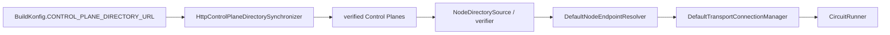

# Transport and failover

`:feature:transport` is responsible for getting opaque application payloads to/from the server edge. It does not own Direct/Group conversation rules.

## Discovery chain



Control Plane directory startup is task based. `LoadControlPlaneConfigurationStartupTask` applies the build-time `BuildKonfig.CONTROL_PLANE_DIRECTORY_URL` once if no directory is configured, and `RestoreControlPlaneDirectoryStartupTask` restores the verified cached snapshot; `MaintainControlPlaneDirectoryStartupTask` (refresh every 5 minutes, retry after 5 s), `MaintainControlPlaneHealthStartupTask` and `ObserveControlPlaneRegistrationTargetsStartupTask` maintain it after navigation.

The directory is an HTTPS origin without a path. `ControlPlaneDirectoryRemoteSource` reads `/.well-known/sparrow-directory` (protocol `sparrow-directory-bootstrap-v1`, `keyId`, Ed25519 `publicKey`, `controlPlanesEndpoint`) and then the signed envelope from `/v1/control-planes`:

```json
{
  "payload": {
    "protocol": "sparrow-control-plane-directory-v1",
    "version": 7,
    "generatedAtEpochMilliseconds": 1760000000000,
    "validUntilEpochMilliseconds": 1760086400000,
    "controlPlanes": [
      { "controlPlaneId": "<sha256 of publicKey>", "baseUrl": "https://plane-a.example.com", "publicKey": "<base64url DER>" }
    ],
    "revokedControlPlaneIds": []
  },
  "keyId": "<sha256 of the directory key>",
  "signature": "<base64url Ed25519 signature>"
}
```

`SignedControlPlaneDirectoryVerifier` checks the signature over the canonical payload, the timestamps (at most 24 h validity), canonical HTTPS origins and that each `controlPlaneId` is the SHA-256 of its key. `VerifiedControlPlaneDirectoryState` pins the directory key on the first verified snapshot and refuses a different key afterwards, rejects version rollbacks and reinstated revoked IDs, and keeps the last verified snapshot for offline starts. Removing the directory in Settings forgets the pin.

An unsigned `{"controlPlanes": ["https://…"]}` list is accepted only as a one-time manual import in Settings (**JSON list**); it is not the signed directory and is not refreshed.

The Settings Add dialog accepts a single Control Plane URL, a signed directory or a JSON list.

## Important transport classes

### Control Plane

- `HttpControlPlaneDirectorySynchronizer`
- `HttpControlPlaneHealthMonitor`
- `ControlPlaneCandidateVerifier`
- `ControlPlaneRequestRouter`
- `NodeControlPlaneDirectorySource`
- `NodeControlPlaneDiscoverySynchronizer`

### Node discovery/failover

- `NodeDirectorySource`
- `NodeDirectoryVerifier`
- `NodeDirectoryCache`
- `DefaultNodeEndpointResolver`
- `FailedNodeTracker`
- `TransportDiagnosticsState`

### Home node, sending and aliases

- `DefaultTransportConnectionManager`
- `CircuitRunner`
- `MailboxOutgoingWireSender`
- `AliasClaimRegistrar`
- `Sha256RoutingIdGenerator`

### Mailboxes

- `HttpMailboxGateway`
- `InvitationMailboxRenewal`, `SignedInvitationLetters`, `InvitationRouteRemoteSource`

There is no push service; see [Receiving messages](../push-notifications.md).

Mailbox provisioning, renewal and revocation are driven from `:feature:conversationorchestration:delivery` (`MailboxRouteProvisioner`, `DefaultMailboxCapabilityLifecycle`); see [Offline mailbox](message-transport-flow.md#offline-mailbox).

## Home node and connection state

Apps hold no session at a node. `DefaultTransportConnectionManager` picks a home node from the verified node directory (the preferred node when it is listed, otherwise the first available; `NodeEndpointSelector`). The home node is the first hop of every circuit (`RelaySelector`) and answers link previews and exchange rates (`TransportDiagnostics.currentNodeBaseUrl`). The app counts as connected (`TransportConnectionState.Connected`) while a circuit is up, and as failed when none came up within 15 seconds or the circuits closed; then the home node cools down (`FailedNodeTracker`) and the next one is picked. On connect the foreground runtime starts the outbox, provisions mailboxes and fetches what waits in them (`ForegroundConnectionHandler`). The manager also keeps the node directory and the Control Plane discovery from the home node (`/v1/control-planes`) fresh.

Nothing arrives at a node for the app: every packet goes into a mailbox (see [Offline mailbox](message-transport-flow.md#offline-mailbox)), and the app fetches them through its circuit.

## Phone verification token at sign-up

The phone number is verified once in the app, at sign-up (create or restore identity). The resulting one-time Firebase ID token is kept in memory only (`LocalIdentityProfileDataSource`, dropped after 50 minutes) and goes into the first alias claim. When the app starts, `DefaultTransportConnectionManager` has `AliasClaimRegistrar` claim the phone alias (the bootstrap routing ID) at every Control Plane the user has, and again every 6 hours (after a minute when no Control Plane bound it). For each one the registrar fetches that Control Plane's signed node directory, checks it against the Control Plane's pinned root and takes the Presence Directory's key from it (`NodeDirectory.aliasClaimKey`). It signs an `AliasClaim` (routing ID, signing key, alias, attestation, invitation route, time) with the device key, seals it for that key (`SodiumSealedMessageCipher`: X25519, SHA-256, ChaCha20-Poly1305) and posts it to `POST /v1/alias-claims`, all through the relays. A Control Plane whose root is not pinned yet is skipped. The token is cleared once a Control Plane has answered it, so a rejected token is not sent again.

At the Presence Directory a blank or invalid token fails the claim with `403 PHONE_VERIFICATION_FAILED`; a valid one proves the alias derived from the verified phone number. Each alias belongs to one device: the device keeps an alias it already holds without a token, a free alias needs a proof when the server verifies phones (otherwise the first claim wins), and an alias held by another device moves only with a proof. The answer lists the positions of the bound aliases; the registrar keeps the bound ones in memory, and a first invite waits until its own alias is bound (`PhoneAliasBinding.awaitBound`). The token is never stored. A claim sealed for an older key (the Presence Directory makes a new one on every restart) fails and is repeated with the next claim.

## Onion relays to Control Planes

The app's requests to Control Planes (node discovery, health checks, alias claims, invitation route lookups) use a separate HTTP client whose engine (`OnionRelayEngine`) sends them through two relays, so no Control Plane sees the app's address. `RelaySelector` takes the relays from the last verified node directory: nodes publish an X25519 relay key in their signed descriptor (`SparrowNodeDescriptor.relayKey`). The first relay is the home node, which knows the app's address anyway (before one is picked: the node the user chose, otherwise any node); the second is another node. `OnionRelayClient` seals one `RelayLayer` per relay: the first names only the second relay, the second only the destination. Each relay seals its reply with a one-time key from its layer. So the first relay learns the address but not the destination, the second the destination but not the address, and neither reads the request or the reply. A relay that fails is left out for 20 seconds (in memory only) and the request is sent once more through the remaining relays. The relay's answer tells which hop failed: 400 the first relay could not open its layer, 502 the next relay failed, 504 the Control Plane could not be reached (no relay is left out then). With only one reachable relay the route has one hop: the Control Plane still does not see the address, but that relay sees the destination; the app logs a warning when this starts.

With a single relaying node the route has that one hop; without any (first start, older servers) requests go out directly, except alias claims, which then wait. A node directory from a Control Plane whose root is not pinned yet is fetched directly, because through a relay the last relay could hand over a forged one. Relays only reach other relays' `/v1/relay` and the Control Plane paths above, never private addresses (except in LAN installations, `RELAY_PRIVATE_DESTINATIONS`). Two relays run by the same operator could link address and destination.

## Onion circuits

While the app is in the foreground, `CircuitRunner` keeps its circuits open through 1 to 5 relays each (Settings > Network > Onion routing, default 2), built hop by hop over the gateways' `/v1/circuit` WebSocket. The first hop is chosen as for the relays above; the last hop is the session node. Each hop is added with one round trip: the app sends an ephemeral X25519 key, the relay answers with its own and a confirmation that only the holder of its published relay key can compute (`CircuitHandshake` on the server, `SodiumCircuitCipher` in the app). Cells are always 1024 bytes; every hop before the last adds or removes a ChaCha20 layer, the last hop seals and opens with ChaCha20-Poly1305; each direction of each hop counts its cells, and the count is the nonce. The runner pings the last hop every 30 seconds (the latency shown in settings) and rebuilds the circuit when it fails.

Nodes declare who runs them: `NODE_OPERATOR` (the installer's **Operator name**) goes into the signed node descriptor (`SparrowNodeDescriptor.operator`); a node without one counts as its own operator. Names are compared trimmed and in lower case. A circuit never has two hops of one operator, so it gets fewer hops than chosen when fewer operators run relaying nodes, and settings say so. The name is self-declared: one person can register nodes under different names, and the app can only avoid what nodes declare.

The app keeps 1 to 3 circuits open (Settings > Network > Onion routing, default 2, `CircuitCountStore`, `transport.circuit_count`). Each ends at a session node of a different operator when there are enough operators (`RelaySelector.circuitRoute(avoidLastOperators)`); the first hop is the home node for all of them. Mailbox requests carry a key (`CircuitKey`) that picks the circuit: the contact ID for the device's own mailboxes, from their creation through every read, acknowledgement and revocation, and the mailbox ID when delivering to a contact's mailbox. A mailbox wait is split per circuit, so one operator sees only its share of the device's mailboxes. While a request's circuit is rebuilt, it may use another open circuit only when that one ends at the same operator; otherwise it waits up to 10 seconds for its own (`CircuitMailboxEngine`) and then goes out directly when sending directly is allowed, or fails and is retried. Settings warn when the open circuits end at fewer operators than there are circuits. Changing the number of circuits spreads the mailboxes anew.

The session node makes HTTP requests for the app, but only the node mailbox operations (create, store, fetch, acknowledge, revoke, wait; `RelayDestinationPolicy.mailbox`). A request and its answer are split into stream parts (`STREAM_DATA`, `STREAM_END`); several streams can be open at once, so a wait does not hold back sending or the ping (`Circuit.readAnswers` hands each answer to its stream). `HttpMailboxGateway` uses a client whose engine (`CircuitMailboxEngine`) sends every mailbox request this way, so the mailbox node does not see the device's address. Without a circuit (still being built, failed, app in the background) the request goes out directly by default and the app logs a warning; with "Send directly without a route" switched off it waits up to 30 seconds for a circuit through at least two hops and fails otherwise: a circuit through one hop does not count then, because its single node sees both the device's address and the mailbox. A circuit with fewer hops than chosen (relaying nodes were missing) is replaced once they are back: after each ping `CircuitRunner` builds a fuller one next to it and switches over when it is up, keeping the old one when that fails. Each mailbox request logs whether it went through the circuit (debug) or directly (warning).

Sealed packets are padded before they are sealed (transport version 2, `TransportPadding`): to 1, 4, 16, 64 or 256 KiB, beyond that to the next 64 KiB, so nodes that store or pass on an envelope learn only its size class. A mailbox answers a fetch with about 1 MiB of envelopes at most (always at least one); the app acknowledges them and the next wait reports the rest. Through a circuit a request may carry 1.5 MiB and an answer 3 MiB.

Typing and voice indicators are encrypted `IndicatorPacket`s put into the contact's mailbox like messages (`MailboxMessagingIndicatorGateway`), padded and without routing IDs, with a 30-second lifetime; the mailbox sends no wake for envelopes that short, and the recipient ignores one older than 10 seconds. They are never queued: without a route to the contact, or while sending directly is off and no circuit protects, they are dropped. The sender repeats them every 4 seconds, the recipient shows them for 7.

A new mailbox costs a small proof of work (`MailboxCreationWorkSolver`: `SHA-256("sparrow-mailbox-work-v1|stamp|createdAt|nonce")` with 18 leading zero bits, about 2^18 hashes, well under a second to a few seconds on a phone). The mailbox service checks it (`MailboxCreationWorkCheck`, `MAILBOX_CREATION_WORK_BITS`), accepts each stamp once within 10 minutes and keeps nothing about the creator; there is no per-address quota any more, which behind a circuit would have been shared by every user of the same session node.

Messages to a contact whose mailbox route the app knows are put into that mailbox by the app itself (`MailboxOutgoingWireSender` → `MailboxGateway.deliver`, through the circuit), so no node learns whom the device writes to. The envelope names neither sender nor recipient (`FederatedEnvelope.withoutRoutingIds`, both set to `mailbox`), so the session node and the mailbox node do not learn it either; the recipient takes the sender from the mailbox, which belongs to one contact, and ignores any routing ID an envelope names. When the mailbox cannot be reached, the send fails and the outbox retries it. A direct contact gets a mailbox as soon as the handshake has established its keys, before the identity is verified (`GetMailboxContactStatesUseCase`); its route is encrypted and signed with those handshake keys and accepted with them (`GetMailboxRouteSigningPublicKeyUseCase`), since they already protect every message of the contact. Group members still need a mutual identity. A new contact gets its mailbox within about 15 seconds after the handshake (`MailboxRouteProvisioner.provisionMissing`, checked while the app is open), not only at the next connect, so messages after the handshake already use mailboxes. Contacts without a mailbox route yet (a first invite, the route exchange itself) are reached through their invitation mailbox, see below.

### Decoy envelopes

A mailbox node sees when envelopes are stored and fetched. Deposits into several mailboxes at the same moment (a group fan-out) or a deposit right after a fetch (a delivery receipt) let it guess which random mailboxes belong together. Settings > Network > Onion routing > **Decoy envelopes** (0 to 5, off by default, `DecoyCountStore`, `transport.decoy_count`) blurs that without delaying anything: with each send, `OutgoingPacketSender` has `DecoyEnvelopes` prepare that many decoys and start them together with the real envelope, so neither comes first. Each decoy is a `CoverPacket` for another contact picked at random from those the device has a mailbox for (never the recipient), encrypted, padded and given the lifetime of a message (`CoverEnvelopeSealer`), so no node can tell it apart; the recipient drops it (`CoverPacketHandler`) and acknowledges its envelope like any other. Decoys go out only through a protecting circuit and at most once a second, so a group fan-out gets one set; they are never queued or retried. They cost the sender and the contacts that get them a little data. They do not hide when the device is online: its mailbox waits show that.

### Invitation mailboxes

Every device keeps one invitation mailbox (`InvitationMailboxRenewal`): a mailbox opened with `invitation = true` on the first mailbox node, for 30 days. A week before it expires, or when its node left the signed directory or moved, a new one is opened; the old one stays readable until it expired, then the node deletes it. Every alias claim names the current one with the identity's encryption key (`InvitationRoute`), so the Presence Directory of every Control Plane knows it for the device and, through the alias binding, for its phone alias. Its send capability is public: the node takes only paid deposits there (`depositWork`, the mailbox proof of work), at most 50 envelopes of up to 64 KiB.

A packet to a phone alias, or to a contact whose mailbox route the app does not have yet, goes into that invitation mailbox (`MailboxOutgoingWireSender` → `SignedInvitationLetters.send`):

1. `InvitationRouteRemoteSource` asks the user's Control Planes one after the other with `POST /v1/invitation-routes` (`{routingId, work}`, a phone alias or a device routing ID, paid with the proof of work), through the relays, so the Presence Directory does not see who asks. The first one that knows it answers `{ownerRoutingId, invitationRoute}`.
2. The app writes a letter: sender routing ID (its phone alias for a first invite, otherwise its device routing ID), recipient routing ID, its signing key, the transport payload and the time, signed with the device key (domain `sparrow-invitation-letter-v1`).
3. The letter is sealed for the recipient's key with the transport cipher and put into the mailbox through the circuit, paid with a proof of work. The envelope names neither sender nor recipient, so neither the mailbox node nor the nodes on the way learn who writes to whom, or what.

`MailboxArrivalListener` and `MailboxPendingSynchronizer` also watch the invitation mailboxes. `SignedInvitationLetters.open` opens each letter and checks the signature, that the letter names this device (its device routing ID or phone alias), and that the key proves the sender: a device routing ID must derive from the key, and a phone alias must belong to that device at the user's Control Planes (the same lookup). The packet is then processed as coming from that routing ID. A letter that fails a check is acknowledged and dropped (`InvalidInvitationLetterException`), so nobody can claim another person's phone number; one whose sender cannot be checked now (no Control Plane reachable) stays for the next sync.

With "Send directly without a route" switched off, nothing leaves the device without a circuit through at least two hops (`DirectSendingPolicy`, `ProtectedRouteMissingException`): not mailbox requests, not invitation lookups through a single relay, not invites. Such messages stay in the outbox as transient failures, the chat shows that they wait (`ObserveWaitingForRouteUseCase`), and they go out as soon as a protecting circuit is up (`ForegroundRuntimeCoordinator` restarts the outbox then). Two new contacts with the switch off therefore exchange their mailbox routes only once such a circuit exists.

Receiving: while the app is open, `MailboxArrivalListener` keeps a wait open at every node that holds this device's mailboxes (`POST /v1/mailboxes/wait` with the mailbox IDs and retrieval capabilities, answered after at most 8 seconds, at once when a mailbox holds envelopes). The mailboxes that got envelopes are fetched and processed right away (`MailboxPendingSynchronizer`, one sync at a time), so messages arrive live. The mailbox service only wakes waiters for envelopes stored by its own process (`MailboxArrivals`); with several processes the others are seen at the next wait. The outbox starts before the mailbox setup and the fetch at connect, so waiting for a circuit never holds back sending.

## Failover and cooldown

When no circuit comes up through the home node, `FailedNodeTracker` temporarily excludes it from endpoint selection, and the next verified node becomes the home node.

### Preferred node

**Settings → Network → Preferred node** (also linked from the developer **Nodes** screen) offers **Automatic** (default: the gateways in an order of the device's own, derived from its routing ID, so devices spread over them) or one favourite gateway from the verified node directory, found with a search over address, node ID and, for automatic `sslip.io` names, the dotted IP. `NodeEndpointSelector` puts the favourite (`PreferredNodeStore`, `transport.preferred_node_id`) first and keeps the other gateways behind it in that order, so a favourite that fails over moves on to them as usual. While a fallback node is the home node, every directory refresh checks the favourite (`PreferredNodeReturnPolicy`): once it is listed again and its failure cooldown is over, it becomes the home node again. Choosing a favourite makes it the home node right away (`TransportConnectionManager.moveTo`); circuits built after that start there. The first hop of a circuit sees the client's IP address, but not where its requests go; messages stay end-to-end encrypted.

Developer diagnostics preserve a recently disappeared node as `COOLDOWN` so the operator can see what happened. A cooldown node always reports **0 connections** in the client diagnostics even if the most recent directory snapshot contained an older non-zero count.

Dead nodes are excluded from actual routing immediately; retaining a diagnostics row does not make them eligible again.

## Control Plane/node health freshness

The Settings network screen probes Control Plane health frequently for human-visible status. Community Nodes heartbeat healthy state frequently as well; unavailable planes are retried on a slower interval to avoid unnecessary request spam.

## What transport does not do

Transport must not:

- load a conversation and decide Direct vs Group semantics;
- implement membership rules;
- decide whether a member is allowed to see Group history;
- turn a delivery receipt into a UI state by itself;
- decrypt application packet meaning for the server.
