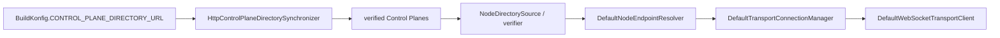

# Transport and failover

`:feature:transport` is responsible for getting opaque application payloads to/from the server edge. It does not own Direct/Group conversation rules.

## Discovery chain



Control Plane directory startup is task based. `LoadControlPlaneConfigurationStartupTask` applies the build-time `BuildKonfig.CONTROL_PLANE_DIRECTORY_URL` once if no directory is configured, and `RestoreControlPlaneDirectoryStartupTask` restores the verified cached snapshot; `MaintainControlPlaneDirectoryStartupTask` (refresh every 5 minutes, retry after 5 s), `MaintainControlPlaneHealthStartupTask` and `ObserveControlPlaneRegistrationTargetsStartupTask` maintain it after navigation.

The directory is an HTTPS origin without a path. `ControlPlaneDirectoryRemoteSource` reads `/.well-known/sparrow-directory` (protocol `sparrow-directory-bootstrap-v1`, `keyId`, Ed25519 `publicKey`, `controlPlanesEndpoint`) and then the signed envelope from `/v1/control-planes`:

```json
{
  "payload": {
    "protocol": "sparrow-control-plane-directory-v1",
    "version": 7,
    "generatedAtEpochMilliseconds": 1760000000000,
    "validUntilEpochMilliseconds": 1760086400000,
    "controlPlanes": [
      { "controlPlaneId": "<sha256 of publicKey>", "baseUrl": "https://plane-a.example.com", "publicKey": "<base64url DER>" }
    ],
    "revokedControlPlaneIds": []
  },
  "keyId": "<sha256 of the directory key>",
  "signature": "<base64url Ed25519 signature>"
}
```

`SignedControlPlaneDirectoryVerifier` checks the signature over the canonical payload, the timestamps (at most 24 h validity), canonical HTTPS origins and that each `controlPlaneId` is the SHA-256 of its key. `VerifiedControlPlaneDirectoryState` pins the directory key on the first verified snapshot and refuses a different key afterwards, rejects version rollbacks and reinstated revoked IDs, and keeps the last verified snapshot for offline starts. Removing the directory in Settings forgets the pin.

An unsigned `{"controlPlanes": ["https://…"]}` list is accepted only as a one-time manual import in Settings (**JSON list**); it is not the signed directory and is not refreshed.

The Settings Add dialog accepts a single Control Plane URL, a signed directory or a JSON list.

## Important transport classes

### Control Plane

- `HttpControlPlaneDirectorySynchronizer`
- `HttpControlPlaneHealthMonitor`
- `ControlPlaneCandidateVerifier`
- `ControlPlaneRequestRouter`
- `NodeControlPlaneDirectorySource`
- `NodeControlPlaneDiscoverySynchronizer`

### Node discovery/failover

- `NodeDirectorySource`
- `NodeDirectoryVerifier`
- `NodeDirectoryCache`
- `DefaultNodeEndpointResolver`
- `FailedNodeTracker`
- `TransportDiagnosticsState`

### WebSocket/routing

- `DefaultTransportConnectionManager`
- `DefaultWebSocketTransportClient`
- `WebSocketOutgoingWireSender`
- `ClientPresenceRouteCoordinator`
- `ClientRouteRegistrationFactory`
- `Sha256RoutingIdGenerator`

### Offline/push

- `HttpMailboxGateway`
- `HttpPushTokenRegistrationGateway`
- `HttpPendingEnvelopeGateway`

Mailbox provisioning, renewal and revocation are driven from `:feature:conversationorchestration:delivery` (`MailboxRouteProvisioner`, `DefaultMailboxCapabilityLifecycle`); see [Offline mailbox](message-transport-flow.md#offline-mailbox).

## WebSocket connection

The selected node exposes `/v1/gateway`. `DefaultWebSocketTransportClient` first obtains gateway information, opens the WebSocket, registers/refreshes the signed presence route, then sends/receives envelopes, acknowledgements and ephemeral typing data.

The server-side counterpart is `GatewayWebSocketHandler`/`GatewaySessionHandler`.

## Phone verification token at sign-up

The phone number is verified once in the app, at sign-up (create or restore identity). The resulting one-time Firebase ID token is kept in memory only (`LocalIdentityProfileDataSource`, dropped after 50 minutes) and is attached to the first route registration as the optional `ClientRouteRegistration.phoneVerificationToken`. `ClientPresenceRouteSession.prepareRegistration` (in `ClientPresenceRouteCoordinator.kt`) adds it only when the registration advertises a phone alias (the bootstrap routing ID). The session clears the token after the route is announced ready, and also after a failure, so a rejected token is not sent again; later registrations and refreshes carry no token.

The gateway forwards the registration to the Presence Directory (`PUT /v1/routes/{routingId}`). There a missing token, or a server without a configured verifier, is accepted; a blank token is rejected; otherwise every advertised alias must equal the routing ID derived from the verified phone number, or the registration fails with `PHONE_VERIFICATION_FAILED`. The token is not stored with the route.

## Failover and cooldown

When a node fails, `FailedNodeTracker` temporarily excludes it from endpoint selection. A new verified node is selected and the connection manager reconnects.

Developer diagnostics preserve a recently disappeared node as `COOLDOWN` so the operator can see what happened. A cooldown node always reports **0 connections** in the client diagnostics even if the most recent directory snapshot contained an older non-zero count.

Dead nodes are excluded from actual routing immediately; retaining a diagnostics row does not make them eligible again.

## Route refresh

Presence routes are signed and expire. Refresh timestamps/expiry must advance with time. `DefaultWebSocketTransportClient` maintains a server-clock baseline plus monotonic elapsed time so a later refresh does not reuse the original absolute server timestamp. Reusing the original timestamp would eventually make the gateway reject a refresh as `INVALID_ROUTE_REFRESH`.

## Control Plane/node health freshness

The Settings network screen probes Control Plane health frequently for human-visible status. Community Nodes heartbeat healthy state frequently as well; unavailable planes are retried on a slower interval to avoid unnecessary request spam.

## What transport does not do

Transport must not:

- load a conversation and decide Direct vs Group semantics;
- implement membership rules;
- decide whether a member is allowed to see Group history;
- turn a delivery receipt into a UI state by itself;
- decrypt application packet meaning for the server.
