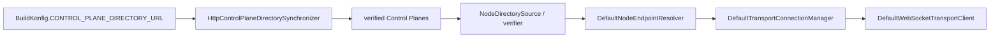

# Transport and failover

`:feature:transport` is responsible for getting opaque application payloads to/from the server edge. It does not own Direct/Group conversation rules.

## Discovery chain



Control Plane directory startup is task based. `LoadControlPlaneConfigurationStartupTask` applies the build-time `BuildKonfig.CONTROL_PLANE_DIRECTORY_URL` once if no directory is configured, and `RestoreControlPlaneDirectoryStartupTask` restores the verified cached snapshot; `MaintainControlPlaneDirectoryStartupTask` (refresh every 5 minutes, retry after 5 s), `MaintainControlPlaneHealthStartupTask` and `ObserveControlPlaneRegistrationTargetsStartupTask` maintain it after navigation.

The directory is an HTTPS origin without a path. `ControlPlaneDirectoryRemoteSource` reads `/.well-known/sparrow-directory` (protocol `sparrow-directory-bootstrap-v1`, `keyId`, Ed25519 `publicKey`, `controlPlanesEndpoint`) and then the signed envelope from `/v1/control-planes`:

```json
{
  "payload": {
    "protocol": "sparrow-control-plane-directory-v1",
    "version": 7,
    "generatedAtEpochMilliseconds": 1760000000000,
    "validUntilEpochMilliseconds": 1760086400000,
    "controlPlanes": [
      { "controlPlaneId": "<sha256 of publicKey>", "baseUrl": "https://plane-a.example.com", "publicKey": "<base64url DER>" }
    ],
    "revokedControlPlaneIds": []
  },
  "keyId": "<sha256 of the directory key>",
  "signature": "<base64url Ed25519 signature>"
}
```

`SignedControlPlaneDirectoryVerifier` checks the signature over the canonical payload, the timestamps (at most 24 h validity), canonical HTTPS origins and that each `controlPlaneId` is the SHA-256 of its key. `VerifiedControlPlaneDirectoryState` pins the directory key on the first verified snapshot and refuses a different key afterwards, rejects version rollbacks and reinstated revoked IDs, and keeps the last verified snapshot for offline starts. Removing the directory in Settings forgets the pin.

An unsigned `{"controlPlanes": ["https://…"]}` list is accepted only as a one-time manual import in Settings (**JSON list**); it is not the signed directory and is not refreshed.

The Settings Add dialog accepts a single Control Plane URL, a signed directory or a JSON list.

## Important transport classes

### Control Plane

- `HttpControlPlaneDirectorySynchronizer`
- `HttpControlPlaneHealthMonitor`
- `ControlPlaneCandidateVerifier`
- `ControlPlaneRequestRouter`
- `NodeControlPlaneDirectorySource`
- `NodeControlPlaneDiscoverySynchronizer`

### Node discovery/failover

- `NodeDirectorySource`
- `NodeDirectoryVerifier`
- `NodeDirectoryCache`
- `DefaultNodeEndpointResolver`
- `FailedNodeTracker`
- `TransportDiagnosticsState`

### WebSocket/routing

- `DefaultTransportConnectionManager`
- `DefaultWebSocketTransportClient`
- `WebSocketOutgoingWireSender`
- `ClientPresenceRouteCoordinator`
- `ClientRouteRegistrationFactory`
- `Sha256RoutingIdGenerator`

### Offline/push

- `HttpMailboxGateway`
- `HttpPushTokenRegistrationGateway`
- `HttpPendingEnvelopeGateway`

`HttpPushTokenRegistrationGateway` signs every registration with `CreatePushDeviceRegistrationUseCase` (identity signing key, payload `pushDeviceRegistrationPayload`, see [Push API](../api/push.md)). The shared HTTP client uses `expectSuccess`, so the gateway turns a 4xx (`ClientRequestException`) into `ControlPlaneRequestRejectedException` with the server's error code; the endpoint stays marked reachable.

Mailbox provisioning, renewal and revocation are driven from `:feature:conversationorchestration:delivery` (`MailboxRouteProvisioner`, `DefaultMailboxCapabilityLifecycle`); see [Offline mailbox](message-transport-flow.md#offline-mailbox).

## WebSocket connection

The selected node exposes `/v1/gateway`. `DefaultWebSocketTransportClient` first obtains gateway information, opens the WebSocket, waits for the gateway's session challenge, checks that it names the node chosen from the signed directory and signs in with the identity signing key (`CreateGatewaySessionProofUseCase`). Only then does it publish/refresh the signed presence route and send/receive envelopes, acknowledgements and ephemeral typing data. A missing challenge (10 s), a challenge from another node or an `INVALID_SESSION` rejection fails the connection attempt like any other connect failure, so the connection manager retries. See [Session sign-in](../api/websocket.md#session-sign-in-challenge-response). After sign-in, a frame the app cannot read (or a message type from a newer server) is skipped and the session goes on; an unreadable envelope whose ID is still readable is acknowledged so the gateway stops delivering it. The mailbox and push-inbox fetches read each envelope on its own the same way. Unknown JSON fields are ignored. The gateway refuses envelopes the app could not read (blank fields, negative timestamps), so they are never stored.

The server-side counterpart is `GatewayWebSocketHandler`/`GatewaySessionHandler`.

## Phone verification token at sign-up

The phone number is verified once in the app, at sign-up (create or restore identity). The resulting one-time Firebase ID token is kept in memory only (`LocalIdentityProfileDataSource`, dropped after 50 minutes) and goes into the first alias claim. `ClientPresenceRouteSession.prepareRegistration` (in `ClientPresenceRouteCoordinator.kt`) builds an `AliasClaim` with the phone alias (the bootstrap routing ID) and the token, and `ClientRouteRegistrationFactory` signs it for this route and seals it (`SodiumAliasClaimSealer`: X25519, SHA-256, ChaCha20-Poly1305) for the Presence Directory's key, which `AliasClaimKeyProvider` reads from the last verified node directory (`NodeDirectory.aliasClaimKey`). Without a key the route is registered without a phone alias. The signed route itself never names the alias, so the gateway cannot read it. The session clears the token after the route is announced ready, and also after a failure, so a rejected token is not sent again; later registrations and refreshes carry no token.

The gateway forwards the registration to the Presence Directory (`PUT /v1/routes/{routingId}`). There a blank or invalid token fails the registration with `PHONE_VERIFICATION_FAILED`; a valid one proves the alias derived from the verified phone number. Each alias belongs to one device: the device keeps an alias it already holds without a token, a free alias needs a proof when the server verifies phones (otherwise the first claim wins), and an alias held by another device moves only with a proof. Refused aliases are dropped, the route itself is stored, and `RouteRegistered` lists the positions of the accepted aliases in the claim. The token is not stored with the route. A claim sealed for an older key (the Presence Directory makes a new one on every restart) is ignored; the next refresh seals for the new key.

## Failover and cooldown

When a node fails, `FailedNodeTracker` temporarily excludes it from endpoint selection. A new verified node is selected and the connection manager reconnects.

### Preferred node

**Settings → Network → Preferred node** (also linked from the developer **Nodes** screen) offers **Automatic** (default: the least busy gateway first) or one favourite gateway from the verified node directory, found with a search over address, node ID and, for automatic `sslip.io` names, the dotted IP. `NodeEndpointSelector` puts the favourite (`PreferredNodeStore`, `transport.preferred_node_id`) first and keeps the other gateways behind it by load, so a favourite that fails over moves on to them as usual. While connected through a fallback node, every directory refresh checks the favourite (`PreferredNodeReturnPolicy`): once it is listed again and its failure cooldown is over, the session is closed and the reconnect goes back to it. Choosing a favourite reconnects right away when the app is connected through another node (`TransportConnectionManager.moveTo`). Whoever runs the gateway sees the client's IP address; messages stay end-to-end encrypted.

Developer diagnostics preserve a recently disappeared node as `COOLDOWN` so the operator can see what happened. A cooldown node always reports **0 connections** in the client diagnostics even if the most recent directory snapshot contained an older non-zero count.

Dead nodes are excluded from actual routing immediately; retaining a diagnostics row does not make them eligible again.

## Route refresh

Presence routes are signed and expire. Refresh timestamps/expiry must advance with time. `DefaultWebSocketTransportClient` maintains a server-clock baseline plus monotonic elapsed time so a later refresh does not reuse the original absolute server timestamp. Reusing the original timestamp would eventually make the gateway reject a refresh as `INVALID_ROUTE_REFRESH`.

## Control Plane/node health freshness

The Settings network screen probes Control Plane health frequently for human-visible status. Community Nodes heartbeat healthy state frequently as well; unavailable planes are retried on a slower interval to avoid unnecessary request spam.

## What transport does not do

Transport must not:

- load a conversation and decide Direct vs Group semantics;
- implement membership rules;
- decide whether a member is allowed to see Group history;
- turn a delivery receipt into a UI state by itself;
- decrypt application packet meaning for the server.
