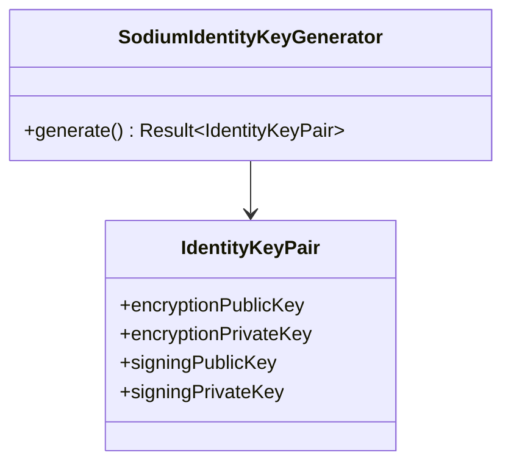
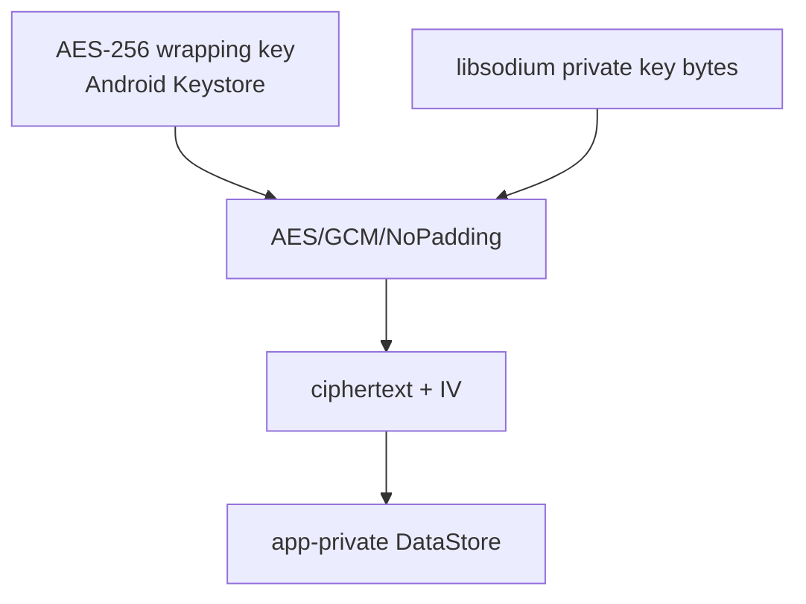

# Identity and key storage

## Key generation

`SodiumIdentityKeyGenerator` creates two separate key pairs:

- encryption pair: libsodium `Box.keypair()`;
- signing pair: libsodium `Signature.keypair()`.

The public keys form the public identity used for encryption/verification. Private keys stay on the device.

## Android private-key storage

`AndroidPrivateKeyStorage` does not store the X25519/box and signing private-key bytes directly as plaintext preferences.

A separate AES-GCM operation/IV is used for encryption and signing private-key values. The Android Keystore holds the wrapping key.

## Phone number verification at sign-up

The phone number is the user's contact/routing alias. It is verified by SMS once, when the
identity is created or restored; the keys are created, or the restored keys saved, only after the
verification succeeded. On Android this uses Firebase phone authentication: the app signs in only
to obtain a one-time Firebase ID token and signs out again immediately, so no Firebase session
remains.

The token is kept in memory only (at most 50 minutes) and sent once with the first presence-route
registration. When the presence directory has a verifier configured, it accepts a registration
with a token only if the verified number matches the advertised phone alias; a registration
without a token is accepted. Verification proves control of the number at sign-up time only; it
is not a continuing login. Debug builds can skip the verification. See [Identity](../features/identity.md#phone-verification-at-sign-up).

## Identity changes

Identity replacement is security-sensitive. Contact/group flows pin/compare identity material and surface verification/security state instead of silently treating a new identity as the old one. Mailbox capabilities and authorization state can be revoked/re-established when identity relationships change.
