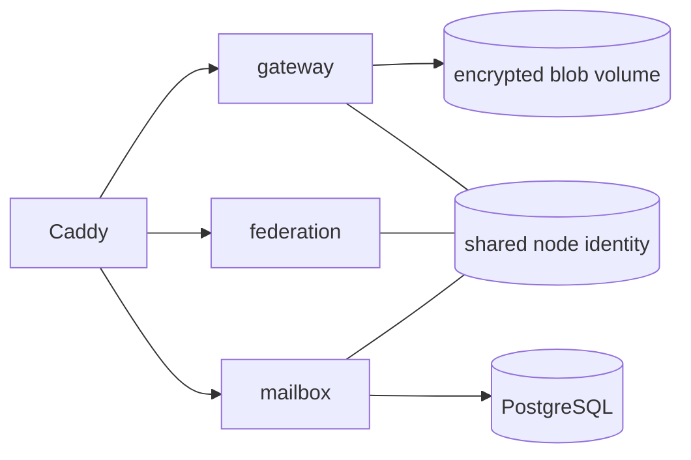

# Community Node

A Community Node is Sparrow's message-transport edge. It relays the apps' onion requests and circuit hops, keeps their mailboxes and stores opaque encrypted attachment blobs. Apps hold no session at a node.

## Runtime topology

`server/community-node/docker-compose.yml` defines:



Compose services are `caddy`, `mailbox-database`, `mailbox`, `federation`, `blob-storage-init`, and `gateway`.

## Gateway

`:server:gateway` serves the onion relay (`POST /v1/relay`), the circuit hops (`/v1/circuit`) and the blob HTTP API; see [Gateway API](../api/gateway.md). Important classes include:

- `OnionRelay`
- `CircuitRelay`
- `BlobStore`
- `BlobCleanupAgent`

A relay sees only the next hop, never both the app's address and the destination of a request. Attachment storage contains encrypted blob bytes rather than decoded media.

## Exchange rates

The gateway also serves `GET /v1/exchange-rates` for currency conversion in group expenses
(`:server:exchange-rates`, `installExchangeRateRoutes()`, `ExchangeRateCache`). It fetches the euro
reference rates from `EXCHANGE_RATES_URL` (default
`https://api.frankfurter.dev/v2/rates?base=EUR`), checks that the answer is a JSON list, keeps it
for 24 hours for all clients and passes it through unchanged. When the upstream fails, the last
rates stay in use; without any rates the route answers `502`. The upstream therefore sees only the
node, never the apps.

Another source must answer in the same Frankfurter format, for example a self-hosted Frankfurter
instance. Fill in the empty `EXCHANGE_RATES_URL=` line in the node's `.env.runtime` and recreate the
gateway: Start for `community-node/.env.runtime`, **Update** under **Nodes...** for a managed node in
`node-instances/<id>/`. The installer writes the empty line for new nodes and Start adds it to an
existing main node. An empty value uses the default.

## Federation

`:server:federation` registers the node at its Control Planes (`NodeRegistrationAgent`) and keeps its signed descriptor fresh with heartbeats, so apps find its relays, circuits, mailboxes and blobs in the signed node directory. Nodes pass no envelopes to each other: apps put them into mailboxes themselves, through their circuits.

## Offline mailbox

`:server:mailbox` provides durable recipient-selected offline delivery. `MailboxStore` / `PostgresMailboxStore` own mailbox persistence; nothing wakes the owner, whose app waits at its mailboxes through its circuit. Mailbox capability/create/revoke/fetch routes are defined by the mailbox HTTP routing layer. A mailbox created with `invitation = true` is an invitation mailbox: its send capability is handed out by the Presence Directories, so every deposit must carry a proof of work (`MailboxEnvelopeRequest.depositWork`, refused with `DEPOSIT_WORK_REQUIRED` otherwise), and it holds at most 50 envelopes of up to 64 KiB (`InvitationMailboxes`).

At the client, every envelope arrives through a mailbox and enters the incoming-envelope processing pipeline.

## Attachment blobs

Caddy routes `/v1/blobs/*` to the gateway. A blob is opened with a proof of work and uploaded in chunks through a circuit of its own; uploads, downloads and deletion are capability-based. The persistent gateway blob volume stores encrypted bytes plus server-side metadata required for size, expiration and capability enforcement. `BlobCleanupAgent` removes expired data.

## Multi-node management

The current public operator bundle is `dist/sparrow-server.zip`, generated from `server/installer`. In the installer window (Windows, macOS, Linux) **What to install** offers **Community Node only** for a machine whose nodes connect to an existing Control Plane, and **Nodes...** opens the manager for additional Community Node instances, listing the main node of a Combined installation first. Each node instance receives a distinct Compose project, node signing identity, secrets/cache and named volumes; multiple nodes are not simulated as unrelated identities inside one container.

Node-only installs use an existing Control Plane directly or, in the advanced flow, a signed independent Control Plane Directory with a separately trusted/pinned key. They do not install a hidden Control Plane.

On the command line, Linux/macOS use `Start-SparrowServer.sh nodes --help` (`app/Manage-SparrowNodes.py` on every system). With automatic sslip.io hostnames, managed nodes follow a changed public IP on the next **Start / apply settings** like the Combined installation.

## LAN/public endpoints

A default LAN deployment exposes the node Caddy edge on port `8490`; the node's address in the node directory is normally `ws://<host>:8490/v1/gateway`, from which apps derive the relay, circuit, mailbox and blob URLs. Public mode uses HTTPS/WSS through the configured public hostname.

`/index` provides links for gateway health, advertised Control Planes, federation capabilities/health and mailbox health.

## Failure/retry behavior

`NodeRegistrationAgent` retries a Control Plane that is temporarily unavailable. Sending is retried by the **client** durable outbox: a mailbox that cannot be reached fails the send, and the outbox tries again.

## Running directly from source

For development, supply reachable endpoints and run:

```bash
docker compose -f server/community-node/docker-compose.yml up -d --build
```

For multiple local nodes use separate Compose project names/ports/volumes or the repository's multi-node/smoke tooling; do not start two identical projects that share identities and ports.
