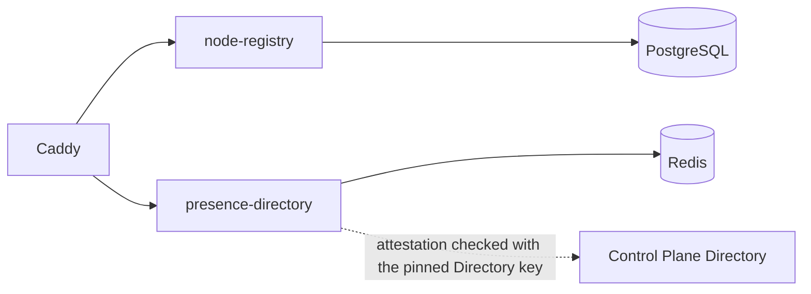

# Control Plane

A Sparrow Control Plane is the discovery and presence side of the network: the signed node directory, the phone alias bindings and the invitation mailboxes of devices. It carries no messages and decrypts nothing.

## Runtime topology

`server/control-plane/docker-compose.yml` defines the production-shaped stack:



Compose services are `caddy`, `node-registry-database`, `node-registry`, `presence-redis` and `presence-directory`.

## Kotlin server modules and important classes

### `:server:node-registry`

The registry accepts authorized node registration/heartbeats and publishes node descriptors used by clients and other nodes. Important implementation types include `NodeRegistryStore`, `RegistryDirectorySigner`, `DirectRegistryDirectorySigner`, `RotatingRegistryDirectorySigner` and `RegistryAuthorityCertificateStore`.

The registry signing path matters because Sparrow does not treat an arbitrary list of node URLs as trusted routing data. Directory/registry responses are signed and verified by clients before node selection.

### `:server:presence-directory`

The presence directory keeps which device holds a phone alias, and each device's invitation mailbox. Redis holds this state; apps claim it again every few hours, so it is rebuilt after a loss. Devices hold no routes here: they receive only through their mailboxes.

Apps claim their aliases with `POST /v1/alias-claims`, sent through two relays so the Control Plane does not see the app's address: an `AliasClaim` sealed for the Presence Directory's X25519 key (`AliasClaimKeys`, kept only in memory and replaced on every restart), signed with the device key its routing ID derives from and at most 5 minutes old. The node registry fetches the key from `GET /v1/alias-claim-key` (`PRESENCE_DIRECTORY_URL`, cached 30 seconds) and signs it into the node directory (`NodeDirectory.aliasClaimKey`), so a relay cannot hand the app its own key. Claims are rate-limited per device. A claim also names the device's invitation mailbox and encryption key (`InvitationRoute`); the Presence Directory keeps it for the device as long as an alias binding and replaces it with every claim (a claim without one removes it). `POST /v1/invitation-routes` (`{routingId, work}`, a phone alias or a device routing ID, paid with the mailbox proof of work, `PRESENCE_LOOKUP_WORK_BITS`, default 18) answers `{ownerRoutingId, invitationRoute}` for a live route, or 404. Apps send it through the relays; nothing about the lookup is kept. Senders use it for packets to a device whose mailbox route they do not have yet, and recipients use it to check that a phone alias a letter claims belongs to the device that signed it (see [Invitation mailboxes](../features/transport.md#invitation-mailboxes)).

Phone numbers are verified centrally, by the phone verifier next to the Control Plane Directory (`server/control-plane-directory/phone_verifier.py`), never here. The app verifies the user's phone number once at sign-up (Firebase SMS), sends the Firebase ID token sealed and through two relays to that verifier, and puts the signed attestation it gets back into its alias claims right after sign-up (`AliasClaim.phoneAttestation`). `PhoneAttestations` checks it with the pinned Directory key (`CONTROL_PLANE_DIRECTORY_PUBLIC_KEY`): the Directory key certifies the verifier's attestation key, the attestation names the alias (`ClientRoutingIds.fromPhoneNumber` of the verified number) and the claiming device's routing ID, and it is valid for one hour. An attestation that does not check out is answered with `403 PHONE_VERIFICATION_FAILED`. Nothing about it is stored.

Each phone alias belongs to one device (`AliasClaims`). The Presence Directory keeps only the alias and the device routing ID holding it (Redis key `…:owner`, no phone number, no token); every claim renews it and it is forgotten 30 days after the last one (`ALIAS_BINDING_LIFETIME_MILLISECONDS`). A device keeps an alias it holds without an attestation. A free alias needs one, and an alias held by another device moves only with one. The response `200 {"acceptedAliasIndexes": [...]}` lists the positions of the bound aliases in the claim, so the relay passing it on learns no alias. Without a pinned Directory key no attestation checks out, so only test numbers can be bound. The operator's test numbers (`PRESENCE_TEST_PHONE_ALIASES`, comma-separated phone aliases, set from the installer's **Test phone numbers** field) count as proven for every claim, so they move to the device that claims them last.

## Control Plane vs. independent directory

Do not confuse a Control Plane with `server/control-plane-directory`.

- A **Control Plane** publishes/serves the node registry and the presence directory.
- The **Independent Control Plane Directory** publishes a signed list of Control Plane origins and verifies ownership during Control Plane registration.
- The independent directory is operator infrastructure and is deliberately excluded from the public Sparrow server bundle.

See [Server runtime, build and deployment](runtime-build-deployment.md#independent-control-plane-directory-operator-only).

## Server installer

The current operator entry point is the installer under `server/installer`, not the older separate Control-Plane launcher flow. It always installs the Control Plane together with a Community Node (Combined).

`Start-SparrowServer.cmd` (Windows), `Start-SparrowServer.command` (macOS) or `./Start-SparrowServer.sh` (Linux) opens the same installer window on all three systems (Python 3.9+ with Tk; a text menu without a desktop). Started from a source checkout it first creates an installation folder (`build.py --install`) and opens there. In the installation folder use **Install**, later **Start / apply settings**.

```text
python3 server/installer/build.py
```

builds `dist/sparrow-server.zip` for distribution. A developer can also run the Compose file directly from source.

## LAN and public deployment

In LAN mode the Control Plane Caddy edge is normally exposed on port `8390`. `/index` is the operator-friendly entry page and links to registry/presence health and node information.

Public mode uses Caddy/TLS and a public hostname. In a Combined installation, Control Plane and Community Node remain separate Compose projects; an optional shared public-edge Caddy routes their distinct hostnames.

## State that must survive upgrades

A valuable deployment must preserve at least:

- registry signing/authority material;
- PostgreSQL registry state;
- Redis configuration/state as appropriate for the deployment;
- generated runtime secrets;
- Caddy/TLS state when used;
- `.env.runtime` and the runtime ownership information used by the installer.

**Start / apply settings** on an intact existing installation updates selected Sparrow backend images in place and is deliberately designed not to recreate stateful stores or identities as a normal update mechanism. Backups are still required before meaningful upgrades because database migrations can be incompatible.

## Running directly from source

For development:

```bash
docker compose -f server/control-plane/docker-compose.yml up -d --build
```

Use `docker compose ... ps` and `logs` to inspect startup. Phone aliases additionally need the pinned Directory key (`CONTROL_PLANE_DIRECTORY_PUBLIC_KEY`) of a Directory that runs phone verification; without it only test phone numbers (`PRESENCE_TEST_PHONE_ALIASES`) are bound.
