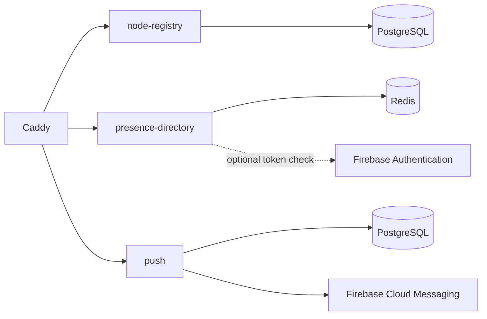

# Control Plane

A Sparrow Control Plane is the discovery, presence and push side of the network. It does **not** carry normal client WebSocket message traffic and it does not decrypt application messages.

## Runtime topology

`server/control-plane/docker-compose.yml` defines the production-shaped stack:



Compose services are `caddy`, `node-registry-database`, `node-registry`, `presence-redis`, `presence-directory`, `push-database`, and `push`.

## Kotlin server modules and important classes

### `:server:node-registry`

The registry accepts authorized node registration/heartbeats and publishes node descriptors used by clients and other nodes. Important implementation types include `NodeRegistryStore`, `RegistryDirectorySigner`, `DirectRegistryDirectorySigner`, `RotatingRegistryDirectorySigner` and `RegistryAuthorityCertificateStore`.

The registry signing path matters because Sparrow does not treat an arbitrary list of node URLs as trusted routing data. Directory/registry responses are signed and verified by clients before node selection.

### `:server:presence-directory`

Presence is intentionally short-lived routing state. Redis is used for state that can be reconstructed as nodes/clients reconnect; it is not the authoritative store for conversations or messages.

Phone verification is optional per registration. The app verifies the user's phone number once at sign-up (Firebase SMS) and sends the resulting Firebase ID token only with its first route registration (`ClientRouteRegistration.phoneVerificationToken`). A present token is checked by `FirebasePhoneTokenVerifier` (cached per token until it expires by `CachingPhoneTokenVerifier`) and must be a phone sign-in; it proves the alias `ClientRoutingIds.fromPhoneNumber` of that number. A blank or failing token is answered with `403 PHONE_VERIFICATION_FAILED`. The token is removed before the route is stored.

Each phone alias belongs to one device (`AliasClaims`). The Presence Directory keeps only the alias and the device routing ID holding it (Redis key `…:owner`, no phone number, no token); every registration renews it and it is forgotten 30 days after the last one (`ALIAS_BINDING_LIFETIME_MILLISECONDS`). A device keeps an alias it holds without a token. A free alias needs a proof when phone verification is configured; without it the first device that claims it gets it, unverified. An alias held by another device moves only with a proof, and a higher generation no longer evicts the holder. Refused aliases are dropped while the route itself is stored; the response `200 {"aliases": [...]}` lists the accepted aliases. There is no setting that requires verified phone numbers.

The verifier is enabled when `GOOGLE_APPLICATION_CREDENTIALS` points at a Firebase Admin service-account JSON; `docker-compose.firebase.yml` mounts the same `firebase-admin.json` secret as for `push`. `FIREBASE_TARGET_PROJECT_ID` selects the Firebase project (default `sparrow-a9048`). Without credentials, tokens are not checked and all registrations are accepted.

### `:server:push`

The push service stores the registration state required for wake-ups and coordinates Android FCM notification delivery. Important types include `PushCoordinator` and `FirebasePushSender`. Push wakes a client so it can fetch encrypted mailbox traffic; it is not a plaintext message-delivery channel. Device registrations must be signed with the routing ID's identity key and expire 30 days after the last registration; see [Push API](../api/push.md).

## Control Plane vs. independent directory

Do not confuse a Control Plane with `server/control-plane-directory`.

- A **Control Plane** publishes/serves node registry, presence and push services.
- The **Independent Control Plane Directory** publishes a signed list of Control Plane origins and verifies ownership during Control Plane registration.
- The independent directory is operator infrastructure and is deliberately excluded from the public Sparrow server bundle.

See [Server runtime, build and deployment](runtime-build-deployment.md#independent-control-plane-directory-operator-only).

## Server installer

The current operator entry point is the installer under `server/installer`, not the older separate Control-Plane launcher flow. It always installs the Control Plane together with a Community Node (Combined).

`Start-SparrowServer.cmd` (Windows), `Start-SparrowServer.command` (macOS) or `./Start-SparrowServer.sh` (Linux) opens the same installer window on all three systems (Python 3.9+ with Tk; a text menu without a desktop). Started from a source checkout it first creates an installation folder (`build.py --install`) and opens there. In the installation folder use **Install**, later **Start / apply settings**.

```text
python3 server/installer/build.py
```

builds `dist/sparrow-server.zip` for distribution. A developer can also run the Compose file directly from source.

## LAN and public deployment

In LAN mode the Control Plane Caddy edge is normally exposed on port `8390`. `/index` is the operator-friendly entry page and links to registry/presence/push health and node information.

Public mode uses Caddy/TLS and a public hostname. In a Combined installation, Control Plane and Community Node remain separate Compose projects; an optional shared public-edge Caddy routes their distinct hostnames.

## State that must survive upgrades

A valuable deployment must preserve at least:

- registry signing/authority material;
- PostgreSQL registry and push state;
- Redis configuration/state as appropriate for the deployment;
- generated runtime secrets;
- Caddy/TLS state when used;
- `.env.runtime` and the runtime ownership information used by the installer.

**Start / apply settings** on an intact existing installation updates selected Sparrow backend images in place and is deliberately designed not to recreate stateful stores or identities as a normal update mechanism. Backups are still required before meaningful upgrades because database migrations can be incompatible.

## Running directly from source

For development:

```bash
docker compose -f server/control-plane/docker-compose.yml up -d --build
```

Use `docker compose ... ps` and `logs` to inspect startup. Real Firebase push delivery and phone token verification additionally require correctly authorized service-account credentials (add `-f server/control-plane/docker-compose.firebase.yml` with `FIREBASE_ADMIN_CREDENTIALS` set to the JSON file); without them the rest of the stack can still be developed/tested, real FCM delivery is unavailable and phone tokens are not checked.
