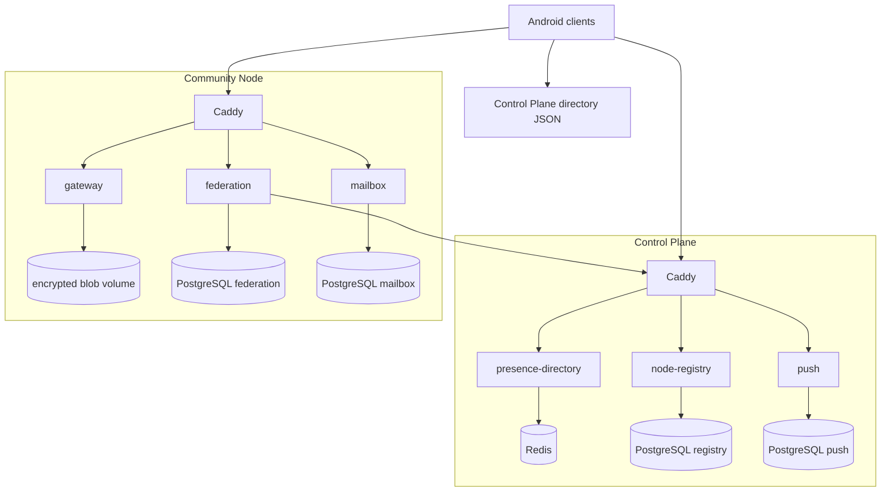
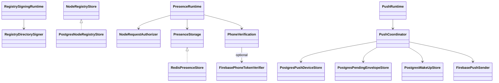
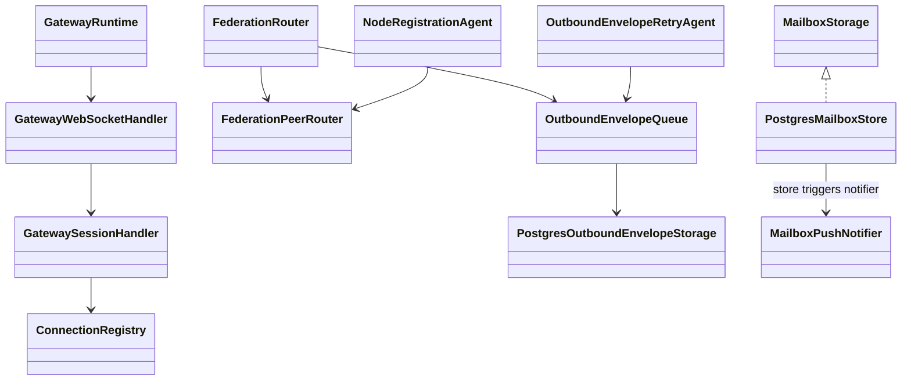

# Server overview

Sparrow's production-shaped server is split into two independently deployable packages.

## Control Plane services

### `node-registry`

Stores signed Community Node descriptors and heartbeats. Public `/v1/nodes` returns currently healthy compatible
nodes. The registry uses PostgreSQL and signing authority material.

Key classes:

- `com.cbgm.sparrow.server.registry.ApplicationKt`
- `NodeRegistryStore`
- `PostgresNodeRegistryStore`
- `RegistrySigningRuntime`
- `RegistryDirectorySigner`

### `presence-directory`

Stores short-lived routing information mapping a client routing ID to its current node/connection. Redis is used
because presence is ephemeral and should be rebuilt by reconnecting clients.

It also decides which phone aliases a route may hold. The app sends a one-time Firebase ID token only with its
first route registration at sign-up. When Firebase Admin credentials are configured
(`GOOGLE_APPLICATION_CREDENTIALS`), a present token must be a valid Firebase phone sign-in, otherwise the registration
is rejected with `PHONE_VERIFICATION_FAILED`; it proves the alias of that number. Each alias belongs to one device:
only the alias and the device routing ID are kept in Redis, renewed by every registration and forgotten 30 days after
the last one. The holder keeps its alias without a token; a free alias needs a proof when credentials are configured,
otherwise the first claim wins; an alias held by another device moves only with a proof. Refused aliases are dropped,
the route is still stored. The token itself is never stored.

Key classes:

- `PresenceRuntime`
- `installPresenceRoutes()`
- `RedisPresenceStore`
- `NodeRequestAuthorizer`
- `PhoneVerification`, `FirebasePhoneTokenVerifier`, `CachingPhoneTokenVerifier`

### `push`

Stores Android device registrations and wake-up/pending fallback information. It integrates with Firebase Admin
when credentials are configured (the same service account as phone verification). A device registration
needs a signature with the routing ID's identity key and expires 30 days after the last registration
(`PUSH_DEVICE_REGISTRATION_LIFETIME_MILLISECONDS`); see [Push API](../api/push.md).

Key classes:

- `PushRuntime`
- `PushCoordinator`
- `PostgresPushDeviceStore`
- `PostgresPendingEnvelopeStore`
- `PostgresWakeUpStore`
- `FirebasePushSender`
- `PushDeviceRegistrationValidator`

## Community Node services

### `gateway`

Owns client WebSockets, connection registry, route refresh handling, typing, envelope ingress/egress and the encrypted attachment-blob HTTP store. Each WebSocket starts with a signed challenge-response sign-in (`GatewaySessionValidator`); see [Session sign-in](../api/websocket.md#session-sign-in-challenge-response).

Key classes:

- `GatewayRuntime`
- `installGatewayRoutes()`
- `GatewayWebSocketHandler`
- `GatewaySessionHandler`
- `GatewaySessionValidator`
- `ConnectionRegistry`
- `BlobStore` / `BlobUploadPermitStore` / `GatewayBlobUploadTicketIssuer`

### `federation`

Routes envelopes locally or to another node, resolves recipient presence, queues failed routes durably and retries.
It also registers/heartbeats the node against configured Control Planes.

Key classes:

- `FederationRouter`
- `FederationPeerRouter`
- `OutboundEnvelopeQueue`
- `PostgresOutboundEnvelopeStorage`
- `OutboundEnvelopeRetryAgent`
- `NodeRegistrationAgent`
- `CachingNodeRegistryClient`

### `mailbox`

Provides recipient-selected offline stores. Mailboxes are capability protected; encrypted envelopes can be stored,
retrieved, acknowledged and the entire mailbox can be revoked.

Key classes:

- `configureMailboxRoutes()`
- `MailboxStorage`
- `PostgresMailboxStore`
- `MailboxPushNotifier`

## Shared server modules

- `server:protocol` — HTTP/federation wire models.
- `server:security` — Ed25519 node identity/signatures, replay protection, rate limits, routing IDs.
- `server:persistence` — shared environment/idempotency helpers.
- `server:observability` — health/readiness, metrics, request IDs.

## Operator pages

Every launcher deployment exposes a `/index` page:

- Control Plane `/index`: registry, presence, push, connected nodes.
- Community Node `/index`: gateway health/info/connections, advertised planes, federation, mailbox.

See [Control Plane](control-plane.md) and [Community Node](community-node.md).

## Runtime class relationships

### Control Plane

### Community Node

The diagrams show responsibility/usage relationships, not every constructor parameter.

## Link preview service

`:server:link-preview` is a separate module for metadata/image preview fetching, mounted in the gateway by `installLinkPreviewRoutes()`. Key classes are `LinkPreviewService`, `LinkPreviewFetcher`, `LinkPreviewHtmlParser` and `LinkPreviewUrlValidator`. It is intentionally separate from the encrypted message-routing code.

## Exchange rate service

`:server:exchange-rates` serves the exchange rates for group expenses from the gateway (`installExchangeRateRoutes()`, `ExchangeRateCache`): one cached upstream request per day for all clients, configurable with `EXCHANGE_RATES_URL`. See [Community Node](community-node.md#exchange-rates).

For exact Compose topology, installer scripts, update semantics and bundle building, see [Server runtime, build and deployment](runtime-build-deployment.md).
