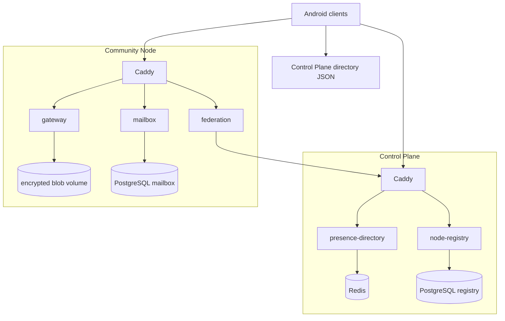
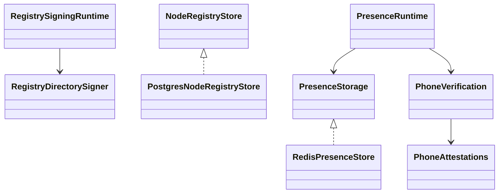
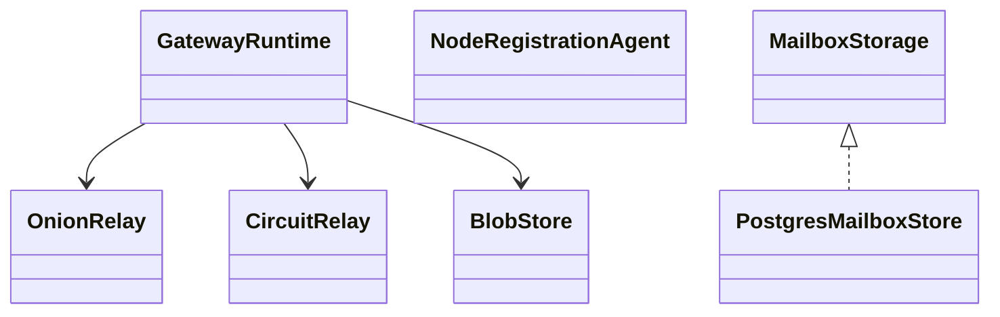

# Server overview

Sparrow's production-shaped server is split into two independently deployable packages.

## Control Plane services

### `node-registry`

Stores signed Community Node descriptors and heartbeats. Public `/v1/nodes` returns currently healthy compatible
nodes. The registry uses PostgreSQL and signing authority material.

Key classes:

- `com.cbgm.sparrow.server.registry.ApplicationKt`
- `NodeRegistryStore`
- `PostgresNodeRegistryStore`
- `RegistrySigningRuntime`
- `RegistryDirectorySigner`

### `presence-directory`

Decides which device holds a phone alias and keeps each device's invitation mailbox. Apps claim both directly
(`POST /v1/alias-claims`), sealed for the Presence Directory's key from the signed node directory and sent through two
relays, so neither a node nor a relay reads them and the Control Plane does not see the app's address. The first claim
after sign-up carries the attestation of the phone verifier next to the Control Plane Directory; it proves the alias of
the verified number. Each alias belongs to one device: only the alias and the device routing ID are kept in Redis,
renewed by every claim and forgotten 30 days after the last one. The holder keeps its alias without an attestation; a
free alias needs one; an alias held by another device moves only with one. Senders look up an invitation mailbox with
`POST /v1/invitation-routes`, paid with a proof of work. Redis is used because apps claim again every few hours, so the
state is rebuilt after a loss.

Key classes:

- `PresenceRuntime`
- `installPresenceRoutes()`
- `RedisPresenceStore`
- `AliasClaimKeys`
- `PhoneVerification`, `PhoneAttestations`

## Community Node services

### `gateway`

The node's edge for apps: onion relays (`POST /v1/relay`), circuit hops (`/v1/circuit`), the encrypted attachment-blob
HTTP store, link previews and exchange rates. Apps hold no session here; see [Gateway API](../api/gateway.md).

Key classes:

- `GatewayRuntime`
- `installGatewayRoutes()`
- `OnionRelay`, `CircuitRelay`
- `BlobStore`

### `federation`

Registers the node at its Control Planes and keeps its signed descriptor fresh with heartbeats. Nodes pass no
envelopes to each other: apps put them into mailboxes themselves, through their circuits.

Key classes:

- `NodeRegistrationAgent`

### `mailbox`

Provides recipient-selected stores. Mailboxes are capability protected; encrypted envelopes can be stored,
retrieved, acknowledged and the entire mailbox can be revoked. An invitation mailbox takes only paid deposits and holds
at most 50 small envelopes.

Key classes:

- `configureMailboxRoutes()`
- `MailboxStorage`
- `PostgresMailboxStore`

## Shared server modules

- `server:protocol` — HTTP wire models.
- `server:security` — Ed25519 node identity/signatures, replay protection, rate limits, routing IDs.
- `server:persistence` — shared environment/idempotency helpers.
- `server:observability` — health/readiness, metrics, request IDs.

## Operator pages

Every launcher deployment exposes a `/index` page:

- Control Plane `/index`: registry, presence, registered nodes.
- Community Node `/index`: gateway health, advertised planes, federation, mailbox.

See [Control Plane](control-plane.md) and [Community Node](community-node.md).

## Runtime class relationships

### Control Plane

### Community Node

The diagrams show responsibility/usage relationships, not every constructor parameter.

## Link preview service

`:server:link-preview` is a separate module for metadata/image preview fetching, mounted in the gateway by `installLinkPreviewRoutes()`. Key classes are `LinkPreviewService`, `LinkPreviewFetcher`, `LinkPreviewHtmlParser` and `LinkPreviewUrlValidator`. It is intentionally separate from the encrypted message-routing code.

## Exchange rate service

`:server:exchange-rates` serves the exchange rates for group expenses from the gateway (`installExchangeRateRoutes()`, `ExchangeRateCache`): one cached upstream request per day for all clients, configurable with `EXCHANGE_RATES_URL`. See [Community Node](community-node.md#exchange-rates).

For exact Compose topology, installer scripts, update semantics and bundle building, see [Server runtime, build and deployment](runtime-build-deployment.md).
