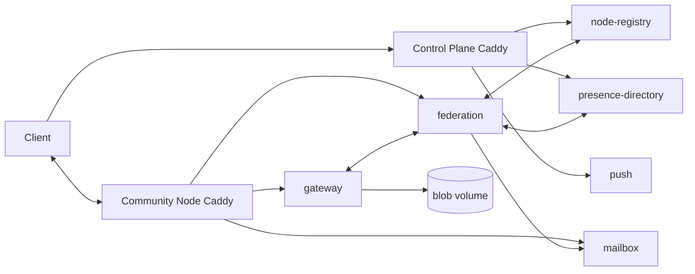
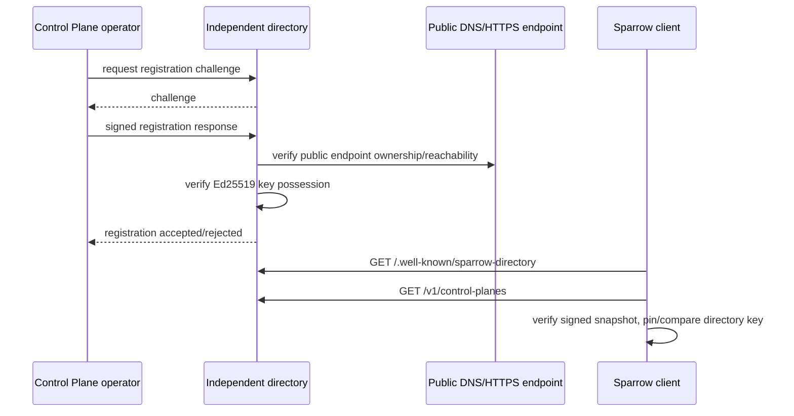

# Server runtime, build and deployment

This page describes the current server tree and the installer/runtime tooling.

## Deployable topology

### Control Plane

`server/control-plane/docker-compose.yml` runs:

- `caddy`
- `node-registry-database` (PostgreSQL)
- `node-registry` (`:server:node-registry`)
- `presence-redis`
- `presence-directory` (`:server:presence-directory`; optional phone-token check with Firebase Admin)
- `push-database` (PostgreSQL)
- `push` (`:server:push`)

### Community Node

`server/community-node/docker-compose.yml` runs:

- `caddy`
- `mailbox-database` + `mailbox` (`:server:mailbox`)
- `federation-database` + `federation` (`:server:federation`)
- `blob-storage-init`
- `gateway` (`:server:gateway`)

The Community Node shares a persistent `node-identity` volume between mailbox/federation/gateway and a persistent gateway blob volume for encrypted attachment blobs.

### Optional public shared proxy

`server/installer/public-proxy/docker-compose.yml` runs shared public-edge Caddy plus directory registration/synchronization helpers. Public Control Plane and Community Node hostnames can therefore share one public host while remaining independent Compose projects.

## Server request flow



## Important server classes

Gateway:

- `GatewayWebSocketHandler`
- `GatewaySessionHandler`
- `ConnectionRegistry`
- `BlobStore`
- `BlobCleanupAgent`
- `BlobUploadPermitStore`, `GatewayBlobUploadTicketIssuer`
- `HttpFederationClient`, `HttpPresenceClient`, `HttpNodePushClient`

Federation:

- `FederationRouter`
- `FederationPeerRouter`
- `OutboundEnvelopeQueue`
- `OutboundEnvelopeRetryAgent`
- `NodeRegistrationAgent`
- `CachingNodeRegistryClient`
- `HttpPresenceDirectoryClient`, `HttpLocalGatewayClient`, `HttpRemoteFederationClient`, `HttpMailboxClient`

Mailbox:

- `MailboxStore`
- `PostgresMailboxStore`
- `MailboxPushNotifier`
- mailbox capability/create/revoke/fetch HTTP routes in `MailboxRoutes`

Registry/presence/push:

- `NodeRegistryStore`
- `RegistryDirectorySigner`, `DirectRegistryDirectorySigner`, `RotatingRegistryDirectorySigner`
- `RegistryAuthorityCertificateStore`
- `PhoneVerification`, `FirebasePhoneTokenVerifier`, `CachingPhoneTokenVerifier`
- `PushCoordinator`
- `FirebasePushSender`
- PostgreSQL push stores

Link preview:

- `LinkPreviewService`
- `LinkPreviewFetcher`
- `LinkPreviewHtmlParser`
- `LinkPreviewUrlValidator`

## Installer/runtime

The installer bundle lives in `server/installer`.

Key entry points:

- `server/installer/build.py` — constructs the bundle (launchers + `app/` + component templates, file list in `app/layout.json`); `--local-images` embeds locally built server images, `--install <folder>` creates a ready installation folder instead of a ZIP.
- `Start-SparrowServer.cmd`, `Start-SparrowServer.command`, `Start-SparrowServer.sh` — launchers for Windows, macOS and Linux. They open the installer window; `.sh` with arguments runs the engine directly (`update ...`, `nodes ...`, `install ...`). Started from the source tree they first create an installation folder and open the installer there.
- `app/manager_window.py` — the installer window (Windows, macOS, Linux; Tk, shared look in `app/ui_window.py`); `app/manager_terminal.py` is the same menu for machines without a screen; `app/manager_core.py` holds their shared state and commands.
- `app/Invoke-SparrowServer.ps1` (Windows) / `app/Invoke-SparrowServer.py` (Linux/macOS) — runtime lifecycle operations.
- `app/public_ip.py` — runs before **Start** of an installation with automatic sslip.io hostnames and moves the generated names to a changed public IPv4 (backups in `backups/public-ip-*`); custom DNS names are never changed.
- `app/move_installation.py` — moves a running server into a new installation folder (same Compose projects and volumes).
- `app/Update-SparrowServer.ps1` (Windows) / `app/update_server.py` (Linux/macOS) — in-place update from the latest release, a ZIP, an extracted bundle or a local source build.
- `app/Update-SparrowServerBundle.ps1` — replaces manager code/templates and migrates older flat installations.
- `app/SparrowLocalImages.ps1` — Windows helper for the embedded local-image manifest of a local build.
- `app/Manage-SparrowNodes.py` — node-only multi-instance management.
- `app/Backup-SparrowDeployment.ps1` — deployment backup support.
- `app/Invoke-SparrowPublicCutover.ps1`, `app/Stage-SparrowPublicTls.ps1`, `app/Attached-SparrowDeployment.ps1` — advanced migration/public-edge tooling.
- `app/Get-SparrowVerifiedDirectory.ps1` plus `app/control_plane_directory_*.py` — signed directory consumption/registration/synchronization.

## Install / Start semantics

The installer treats Control Plane and Community Node as independent Compose projects. The window always manages both (Combined) from one runtime directory; **Nodes...** can manage multiple additional Community Node instances against this or an existing Control Plane.

On an existing installation with `.env.runtime`, **Start / apply settings** validates ownership, pulls only the selected Sparrow backend images and applies changed backend services without intentionally recreating PostgreSQL/Redis/Caddy volumes or identities.

A fresh test runtime with missing `.env.runtime` can discard abandoned test containers/volumes when ownership is unambiguous. Intact or ambiguous existing deployments are deliberately refused rather than silently taken over.

## Building the installer bundle

From the repository root (Windows, Linux or macOS):

```cmd
python3 server/installer/build.py
```

Add `--local-images` to embed locally built server images. The installed manager does the same with **Build from source...**. The expected development artifact is `dist/sparrow-server.zip`.

## Service image build

Each executable Ktor service has an `application` main class and is built through the common `server/Dockerfile` using a `SERVICE` build argument. Compose files select service names such as `gateway`, `federation`, `mailbox`, `node-registry`, `presence-directory` and `push`.

## Backups and upgrades

Normal updates are not a substitute for backups. Backend image updates may include incompatible database migrations. Persistent server identities, PostgreSQL/Redis state, queues, mailbox state and TLS data should be treated as deployment state, not as files that can be regenerated safely for a valuable installation.

Use the installer README files (`server/installer/README.md`, `README_RUNTIME.md`) as the operational source of truth for exact manager commands and safety guards.


## Independent Control Plane Directory (operator-only)

`server/control-plane-directory` is intentionally **not** part of the public Sparrow server ZIP or the release server ZIPs. It is separate operator infrastructure whose job is to publish and authenticate the set of Control Planes.

Its implementation is Python rather than a Gradle server module. Important source files are:

- `directory_service.py` — HTTP service and signed directory implementation;
- `directory_admin_cli.py` — private administrator operations;
- `Start-SparrowDirectory.cmd`, `.sh`, `.command` — open the Directory installer window (`directory_window.py`, engine `directory_installer.py`; `.sh` without a desktop runs the engine directly);
- `Build-SparrowDirectoryInstaller.py` — private installer builder (`sparrow-directory-windows.zip`, `sparrow-directory-linux.zip`); with `--install <folder>` it creates a ready Directory folder that takes over the `private/` settings of the running Directory;
- `docker-compose.yml` and `Dockerfile` — standalone deployment.

Started from the source tree, the window first creates such a Directory folder and opens there. The Directory either shares the HTTPS proxy (Caddy) of a Sparrow Server running on the same machine — it adds a marked Directory route to the server's Caddyfile, writes the Directory URL and key into the server's `sparrow.conf` files and registers its Control Plane — or, when no server runs, starts its own Caddy on ports 80/443. With an automatic `directory-<ip>.sslip.io` hostname, the server installer moves the route on its next Start after a public IP change, and the Directory's own Start updates its settings; the signing identity is kept.

Public routes are:

```text
GET  /health
GET  /.well-known/sparrow-directory
GET  /v1/control-planes
POST /v1/registrations/challenge
POST /v1/registrations
```

A new Control Plane registration must demonstrate both reachable DNS/public HTTPS endpoint possession and possession of its Ed25519 signing key. Revoked identities are not automatically restored, and endpoint/key changes require a separate authenticated process.



The directory signing key and SQLite state live in the persistent `sparrow-central-directory-state` Docker volume and must not be regenerated on an ordinary restart/update. Clients preserve previously verified candidates during an outage. A compromised directory signing key requires a dedicated secure recovery procedure; merely editing the URL is not a safe recovery mechanism and such key-recovery automation is not currently implemented.

`server/installer/build.py` deliberately excludes this directory service from `dist/sparrow-server.zip`. Never publish its private admin token, persistent state, installer, or operator credentials as public release assets.
